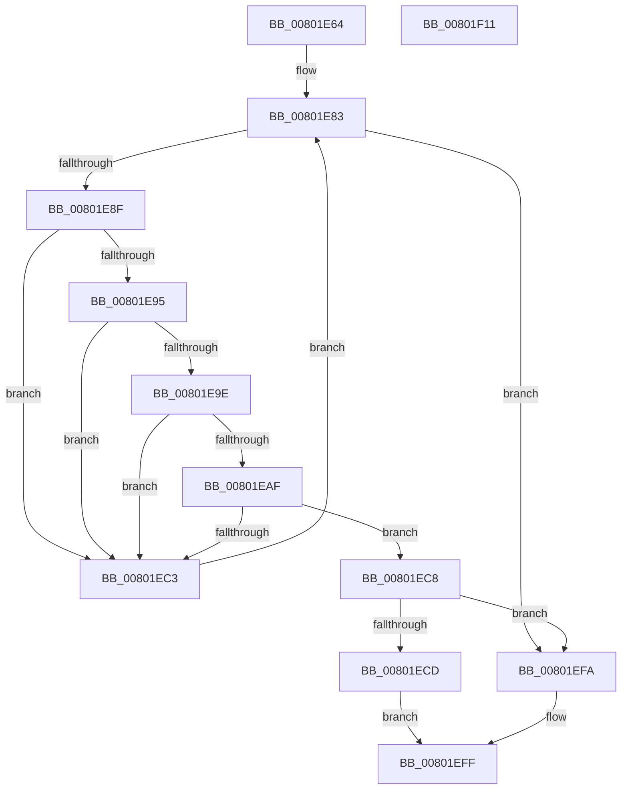

# MiApplyHotPatchToDriver

- RVA: `0x00801E64`–`0x00801F12` (길이 `174` bytes)
- VA: `0x0000000140801E64`
- 실행 섹션: `PAGE`
- PDB 이름 있음: `예`; PDB Function 태그: `아니요`
- unwind 정보 RVA: `0x000794E0`
- 디코드: `47`개 명령, `174/174` bytes 표시
- 미해석 바이트: `0` (있으면 어셈블리에 `.byte`로 보존)

> 이 문서는 커널 이미지의 기계어와 PDB 기호를 분석해 생성했습니다. 4번과 5번은 함수 원형과 자료형을 바이너리 사용 방식에서 추정한 C 해석이며 원본 소스 복구 결과는 아닙니다.

## 1. Dependencies

- 직접 호출 지점: **4**; 고유 호출 대상: **4**
- 직접 호출자로 확인된 함수: **1**
- RIP 상대 이미지 참조: **1**

### Outgoing calls
- `0x00801EA6` → [RtlIsPatchMachineApplicable](../84/RtlIsPatchMachineApplicable_function_00841194.md) (function, `0x00841194`)
- `0x00801EB2` → [MiGetBaseLoaderPortion](../../text/4D/MiGetBaseLoaderPortion_function_004D9D34.md) (function, `0x004D9D34`)
- `0x00801ED5` → [MiApplyHotPatchToLoadedDriver](MiApplyHotPatchToLoadedDriver_function_00802078.md) (function, `0x00802078`)
- `0x00801EF3` → [MiLogHotPatchOperationStatus](MiLogHotPatchOperationStatus_function_00804E84.md) (function, `0x00804E84`)

### Direct callers
- [MiLoadHotPatch](../AB/MiLoadHotPatch_function_00AB521C.md) at `0x00AB5556`

### Static image references
- `0x00801E73` → RVA `0x00EF54C0` (`.data`; read)

## 2. Other-region calls and transfers

- 다른 실행 섹션으로 향하는 call: **1**
  - `0x00801EB2` → [MiGetBaseLoaderPortion](../../text/4D/MiGetBaseLoaderPortion_function_004D9D34.md) (`PAGE` → `.text`)
- 별도 외부 분기/꼬리 이동을 확인하지 못했습니다.

## 3. Assembly (complete function range)

```asm
00801E64  48 89 5C 24 08                  mov qword ptr [rsp + 8], rbx
00801E69  48 89 74 24 10                  mov qword ptr [rsp + 0x10], rsi
00801E6E  57                              push rdi
00801E6F  48 83 EC 30                     sub rsp, 0x30
00801E73  48 8B 1D 46 36 6F 00            mov rbx, qword ptr [rip + 0x6f3646]
00801E7A  49 8B F0                        mov rsi, r8
00801E7D  44 8B D2                        mov r10d, edx
00801E80  44 8B D9                        mov r11d, ecx
00801E83  48 8D 05 36 36 6F 00            lea rax, [rip + 0x6f3636]
00801E8A  48 3B D8                        cmp rbx, rax
00801E8D  74 6B                           je 0x140801efa
00801E8F  44 39 5B 78                     cmp dword ptr [rbx + 0x78], r11d
00801E93  75 2E                           jne 0x140801ec3
00801E95  44 39 93 9C 00 00 00            cmp dword ptr [rbx + 0x9c], r10d
00801E9C  75 25                           jne 0x140801ec3
00801E9E  41 8B D1                        mov edx, r9d
00801EA1  B9 64 86 00 00                  mov ecx, 0x8664
00801EA6  E8 E9 F2 03 00                  call 0x140841194
00801EAB  84 C0                           test al, al
00801EAD  74 14                           je 0x140801ec3
00801EAF  48 8B CB                        mov rcx, rbx
00801EB2  E8 7D 7E CD FF                  call 0x1404d9d34
00801EB7  F7 80 B8 00 00 00 80 20 00 00   test dword ptr [rax + 0xb8], 0x2080
00801EC1  74 05                           je 0x140801ec8
00801EC3  48 8B 1B                        mov rbx, qword ptr [rbx]
00801EC6  EB BB                           jmp 0x140801e83
00801EC8  48 85 DB                        test rbx, rbx
00801ECB  74 2D                           je 0x140801efa
00801ECD  4C 8B 44 24 60                  mov r8, qword ptr [rsp + 0x60]
00801ED2  48 8B D6                        mov rdx, rsi
00801ED5  E8 9E 01 00 00                  call 0x140802078
00801EDA  8B 93 9C 00 00 00               mov edx, dword ptr [rbx + 0x9c]
00801EE0  44 8B C8                        mov r9d, eax
00801EE3  8B 4B 78                        mov ecx, dword ptr [rbx + 0x78]
00801EE6  4C 8B C6                        mov r8, rsi
00801EE9  8B F8                           mov edi, eax
00801EEB  C7 44 24 20 01 00 00 00         mov dword ptr [rsp + 0x20], 1
00801EF3  E8 8C 2F 00 00                  call 0x140804e84
00801EF8  EB 05                           jmp 0x140801eff
00801EFA  BF 35 01 00 C0                  mov edi, 0xc0000135
00801EFF  48 8B 5C 24 40                  mov rbx, qword ptr [rsp + 0x40]
00801F04  8B C7                           mov eax, edi
00801F06  48 8B 74 24 48                  mov rsi, qword ptr [rsp + 0x48]
00801F0B  48 83 C4 30                     add rsp, 0x30
00801F0F  5F                              pop rdi
00801F10  C3                              ret
00801F11  CC                              int3
```

## 4. C-style interpretation (structured pseudocode)

```c
__int64 __fastcall MiApplyHotPatchToDriver(int a1, int a2, __int64 a3, int a4, __int64 a5)
{
    __int64 result;
    __int64 v_rsp;
    unsigned int v_stack_m18;
    unsigned __int64 v_stack_p10;
    unsigned __int64 v_stack_p8;

    v_stack_p8 = v_rbx;
    v_stack_p10 = v_rsi;
    v_rsp = (v_rsp) - (48);
loc_00801E83:
    if ((*(unsigned __int64 *)(v_rip + 7288390)) == (v_rip + 7288374)) goto loc_00801EFA;
    if ((*(unsigned int *)(*(unsigned __int64 *)(v_rip + 7288390) + 120)) != ((unsigned int)((unsigned int)(a1)))) goto loc_00801EC3;
    if ((*(unsigned int *)(*(unsigned __int64 *)(v_rip + 7288390) + 156)) != ((unsigned int)((unsigned int)(a2)))) goto loc_00801EC3;
    result = RtlIsPatchMachineApplicable((unsigned int)(0x8664ULL), (unsigned int)(a4), a3, a4);
    if ((unsigned __int8)(result) == 0) goto loc_00801EC3;
    result = MiGetBaseLoaderPortion(*(unsigned __int64 *)(v_rip + 7288390), (unsigned int)(a4), a3, a4);
    if (((*(unsigned int *)(result + 184)) & (0x2080ULL)) == 0) goto loc_00801EC8;
loc_00801EC3:
    goto loc_00801E83;
loc_00801EC8:
    if (*(unsigned __int64 *)(*(unsigned __int64 *)(v_rip + 7288390)) == 0) goto loc_00801EFA;
    result = MiApplyHotPatchToLoadedDriver(*(unsigned __int64 *)(v_rip + 7288390), a3, a5, a4);
    v_stack_m18 = 1;
    result = MiLogHotPatchOperationStatus((unsigned int)(*(unsigned int *)(*(unsigned __int64 *)(*(unsigned __int64 *)(v_rip + 7288390)) + 120)), (unsigned int)(*(unsigned int *)(*(unsigned __int64 *)(*(unsigned __int64 *)(v_rip + 7288390)) + 156)), a3, (unsigned int)((unsigned int)(result)));
    goto loc_00801EFF;
loc_00801EFA:
loc_00801EFF:
    v_rsp = (v_rsp) + (48);
    return (unsigned int)((unsigned int)((unsigned int)(0xC0000135ULL)));
}
```

## 5. (Beta) C Style

```c
int64_t MiApplyHotPatchToDriver(int32_t Arg1, int32_t Arg2, int64_t Arg3, int32_t Arg4, int64_t Arg5)
{
    int64_t result;
    int64_t local_rsp;
    uint32_t v_stack_m18;
    uint64_t v_stack_p10;
    uint64_t v_stack_p8;

    v_stack_p8 = local_rbx;
    v_stack_p10 = local_rsi;
    local_rsp = (local_rsp) - (48);
loc_00801E83:
    if ((*(uint64_t *)(v_rip + 0x6F3646)) == (v_rip + 7288374)) goto loc_00801EFA;
    if ((*(uint32_t *)(*(uint64_t *)(v_rip + 0x6F3646) + 0x78)) != ((uint32_t)((uint32_t)(Arg1)))) goto loc_00801EC3;
    if ((*(uint32_t *)(*(uint64_t *)(v_rip + 0x6F3646) + 0x9C)) != ((uint32_t)((uint32_t)(Arg2)))) goto loc_00801EC3;
    result = RtlIsPatchMachineApplicable((uint32_t)(0x8664ULL), (uint32_t)(Arg4), Arg3, Arg4);
    if ((uint8_t)(result) == 0) goto loc_00801EC3;
    result = MiGetBaseLoaderPortion(*(uint64_t *)(v_rip + 0x6F3646), (uint32_t)(Arg4), Arg3, Arg4);
    if (((*(uint32_t *)(result + 0xB8)) & (0x2080ULL)) == 0) goto loc_00801EC8;
loc_00801EC3:
    goto loc_00801E83;
loc_00801EC8:
    if (*(uint64_t *)(*(uint64_t *)(v_rip + 0x6F3646)) == 0) goto loc_00801EFA;
    result = MiApplyHotPatchToLoadedDriver(*(uint64_t *)(v_rip + 0x6F3646), Arg3, Arg5, Arg4);
    v_stack_m18 = 1;
    result = MiLogHotPatchOperationStatus((uint32_t)(*(uint32_t *)(*(uint64_t *)(*(uint64_t *)(v_rip + 0x6F3646)) + 0x78)), (uint32_t)(*(uint32_t *)(*(uint64_t *)(*(uint64_t *)(v_rip + 0x6F3646)) + 0x9C)), Arg3, (uint32_t)((uint32_t)(result)));
    goto loc_00801EFF;
loc_00801EFA:
loc_00801EFF:
    local_rsp = (local_rsp) + (48);
    return (uint32_t)((uint32_t)((uint32_t)(0xC0000135ULL)));
}
```

## 6. Execution-region graph

[열기: 2D/3D 그래프와 함수 탐색 컨트롤 패널](../../../control-panel.html?section=page&rva=0x00801E64&view=graph)

- 2D 그래프는 위에서 아래로 흐르고, 3D 그래프는 빈 공간을 드래그해 회전합니다. Shift+드래그는 이동, 휠은 확대·축소, 함수 노드 선택은 대상 보고서 이동입니다.

### Static fallback


