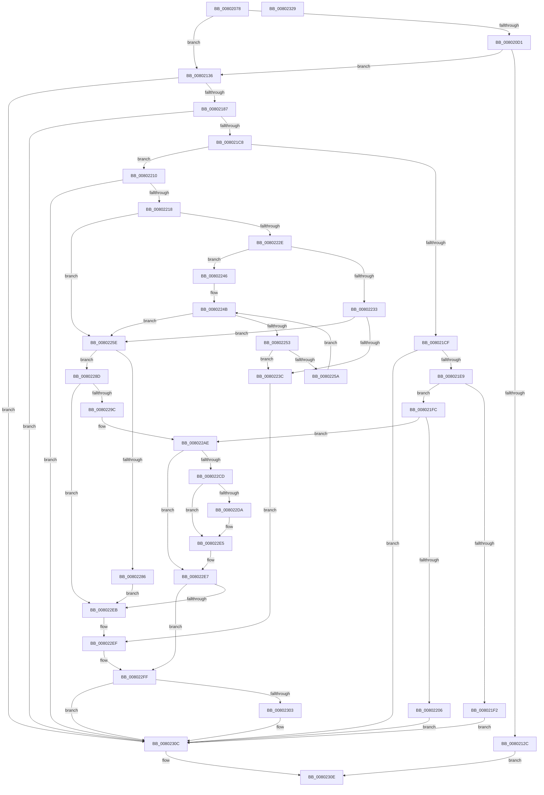

# MiApplyHotPatchToLoadedDriver

- RVA: `0x00802078`–`0x0080232A` (길이 `690` bytes)
- VA: `0x0000000140802078`
- 실행 섹션: `PAGE`
- PDB 이름 있음: `예`; PDB Function 태그: `아니요`
- unwind 정보 RVA: `0x000D8634`
- 디코드: `189`개 명령, `690/690` bytes 표시
- 미해석 바이트: `0` (있으면 어셈블리에 `.byte`로 보존)

> 이 문서는 커널 이미지의 기계어와 PDB 기호를 분석해 생성했습니다. 4번과 5번은 함수 원형과 자료형을 바이너리 사용 방식에서 추정한 C 해석이며 원본 소스 복구 결과는 아닙니다.

## 1. Dependencies

- 직접 호출 지점: **15**; 고유 호출 대상: **14**
- 직접 호출자로 확인된 함수: **1**
- RIP 상대 이미지 참조: **3**

### Outgoing calls
- `0x008020C8` → [MI_IS_PHYSICAL_ADDRESS](../../text/23/MI_IS_PHYSICAL_ADDRESS_function_0023B3A0.md) (function, `0x0023B3A0`)
- `0x008020D8` → [MiGetPteAddress](../../text/43/MiGetPteAddress_function_0043E130.md) (function, `0x0043E130`)
- `0x00802123` → [MiMakeZeroedPageTables](../../text/3B/MiMakeZeroedPageTables_function_003B4F6C.md) (function, `0x003B4F6C`)
- `0x00802139` → [MiGetBaseLoaderPortion](../../text/4D/MiGetBaseLoaderPortion_function_004D9D34.md) (function, `0x004D9D34`)
- `0x00802152` → [KeIsImageIATProtected](../../text/5B/KeIsImageIATProtected_function_005B1838.md) (function, `0x005B1838`)
- `0x00802178` → [MiGenerateSystemImageNames](../AD/MiGenerateSystemImageNames_function_00AD8CFC.md) (function, `0x00AD8CFC`)
- `0x008021B6` → [MmLoadSystemImageEx](../99/MmLoadSystemImageEx_function_00999B8C.md) (function, `0x00999B8C`)
- `0x008021D6` → [MiGetBaseLoaderPortion](../../text/4D/MiGetBaseLoaderPortion_function_004D9D34.md) (function, `0x004D9D34`)
- `0x0080227A` → [MiEnumerateBasePatches](../../pagelk/B7/MiEnumerateBasePatches_function_00B74B38.md) (function, `0x00B74B38`)
- `0x00802291` → [VslPrepareDriverForPatch](../../text/58/VslPrepareDriverForPatch_function_0058EC30.md) (function, `0x0058EC30`)
- `0x008022A5` → [MiHandleDriverNonPagedSections](../A4/MiHandleDriverNonPagedSections_function_00A4AEA8.md) (function, `0x00A4AEA8`)
- `0x008022B2` → [MiSectionControlArea](../../text/29/MiSectionControlArea_function_00294CB0.md) (function, `0x00294CB0`)
- `0x008022C0` → [MiApplyDriverHotPatch](MiApplyDriverHotPatch_function_008018EC.md) (function, `0x008018EC`)
- `0x008022FA` → [MiDriverLoadSucceeded](../70/MiDriverLoadSucceeded_function_00702F08.md) (function, `0x00702F08`)
- `0x00802307` → [MmUnloadSystemImage](../AA/MmUnloadSystemImage_function_00AA2F60.md) (function, `0x00AA2F60`)

### Direct callers
- [MiApplyHotPatchToDriver](MiApplyHotPatchToDriver_function_00801E64.md) at `0x00801ED5`

### Static image references
- `0x008020F4` → RVA `0x00E375AC` (`.data`; read)
- `0x0080226C` → RVA `0x008035D0` (`MiFindMatchingPatch`; read)
- `0x008022CD` → RVA `0x00FC6A88` (`ALMOSTRO`; read)

## 2. Other-region calls and transfers

- 다른 실행 섹션으로 향하는 call: **9**
  - `0x008020C8` → [MI_IS_PHYSICAL_ADDRESS](../../text/23/MI_IS_PHYSICAL_ADDRESS_function_0023B3A0.md) (`PAGE` → `.text`)
  - `0x008020D8` → [MiGetPteAddress](../../text/43/MiGetPteAddress_function_0043E130.md) (`PAGE` → `.text`)
  - `0x00802123` → [MiMakeZeroedPageTables](../../text/3B/MiMakeZeroedPageTables_function_003B4F6C.md) (`PAGE` → `.text`)
  - `0x00802139` → [MiGetBaseLoaderPortion](../../text/4D/MiGetBaseLoaderPortion_function_004D9D34.md) (`PAGE` → `.text`)
  - `0x00802152` → [KeIsImageIATProtected](../../text/5B/KeIsImageIATProtected_function_005B1838.md) (`PAGE` → `.text`)
  - `0x008021D6` → [MiGetBaseLoaderPortion](../../text/4D/MiGetBaseLoaderPortion_function_004D9D34.md) (`PAGE` → `.text`)
  - `0x0080227A` → [MiEnumerateBasePatches](../../pagelk/B7/MiEnumerateBasePatches_function_00B74B38.md) (`PAGE` → `PAGELK`)
  - `0x00802291` → [VslPrepareDriverForPatch](../../text/58/VslPrepareDriverForPatch_function_0058EC30.md) (`PAGE` → `.text`)
  - `0x008022B2` → [MiSectionControlArea](../../text/29/MiSectionControlArea_function_00294CB0.md) (`PAGE` → `.text`)
- 별도 외부 분기/꼬리 이동을 확인하지 못했습니다.

## 3. Assembly (complete function range)

```asm
00802078  48 89 5C 24 10                  mov qword ptr [rsp + 0x10], rbx
0080207D  55                              push rbp
0080207E  56                              push rsi
0080207F  57                              push rdi
00802080  41 54                           push r12
00802082  41 55                           push r13
00802084  41 56                           push r14
00802086  41 57                           push r15
00802088  48 8D 6C 24 D9                  lea rbp, [rsp - 0x27]
0080208D  48 81 EC 90 00 00 00            sub rsp, 0x90
00802094  48 83 65 7F 00                  and qword ptr [rbp + 0x7f], 0
00802099  33 C0                           xor eax, eax
0080209B  48 21 45 67                     and qword ptr [rbp + 0x67], rax
0080209F  48 8B F9                        mov rdi, rcx
008020A2  48 8B 49 30                     mov rcx, qword ptr [rcx + 0x30]
008020A6  0F 57 C0                        xorps xmm0, xmm0
008020A9  0F 57 C9                        xorps xmm1, xmm1
008020AC  48 89 45 17                     mov qword ptr [rbp + 0x17], rax
008020B0  0F 11 45 D7                     movups xmmword ptr [rbp - 0x29], xmm0
008020B4  4D 8B E0                        mov r12, r8
008020B7  4C 8B FA                        mov r15, rdx
008020BA  0F 11 4D F7                     movups xmmword ptr [rbp - 9], xmm1
008020BE  33 F6                           xor esi, esi
008020C0  0F 11 45 E7                     movups xmmword ptr [rbp - 0x19], xmm0
008020C4  0F 11 4D 07                     movups xmmword ptr [rbp + 7], xmm1
008020C8  E8 D3 92 A3 FF                  call 0x14023b3a0
008020CD  85 C0                           test eax, eax
008020CF  74 65                           je 0x140802136
008020D1  48 8B 4F 30                     mov rcx, qword ptr [rdi + 0x30]
008020D5  8B 57 40                        mov edx, dword ptr [rdi + 0x40]
008020D8  E8 53 C0 C3 FF                  call 0x14043e130
008020DD  41 B8 FF 0F 00 00               mov r8d, 0xfff
008020E3  44 8D 4E 0B                     lea r9d, [rsi + 0xb]
008020E7  41 85 D0                        test r8d, edx
008020EA  8B CE                           mov ecx, esi
008020EC  0F 95 C1                        setne cl
008020EF  C1 EA 0C                        shr edx, 0xc
008020F2  03 CA                           add ecx, edx
008020F4  8B 15 B2 54 63 00               mov edx, dword ptr [rip + 0x6354b2]
008020FA  48 81 C1 FF 01 00 00            add rcx, 0x1ff
00802101  48 81 E1 00 FE FF FF            and rcx, 0xfffffffffffffe00
00802108  41 85 D0                        test r8d, edx
0080210B  48 8D 0C C8                     lea rcx, [rax + rcx*8]
0080210F  8B C6                           mov eax, esi
00802111  0F 95 C0                        setne al
00802114  C1 EA 0C                        shr edx, 0xc
00802117  03 C2                           add eax, edx
00802119  45 33 C0                        xor r8d, r8d
0080211C  48 FF C8                        dec rax
0080211F  48 8D 14 C1                     lea rdx, [rcx + rax*8]
00802123  E8 44 2E BB FF                  call 0x1403b4f6c
00802128  85 C0                           test eax, eax
0080212A  75 0A                           jne 0x140802136
0080212C  B8 9A 00 00 C0                  mov eax, 0xc000009a
00802131  E9 D8 01 00 00                  jmp 0x14080230e
00802136  48 8B CF                        mov rcx, rdi
00802139  E8 F6 7B CD FF                  call 0x1404d9d34
0080213E  44 8B B0 B8 00 00 00            mov r14d, dword ptr [rax + 0xb8]
00802145  41 C1 EE 02                     shr r14d, 2
00802149  41 83 E6 02                     and r14d, 2
0080214D  41 0F BA EE 1E                  bts r14d, 0x1e
00802152  E8 E1 F6 DA FF                  call 0x1405b1838
00802157  44 8B E8                        mov r13d, eax
0080215A  4C 8D 4D D7                     lea r9, [rbp - 0x29]
0080215E  48 8D 45 E7                     lea rax, [rbp - 0x19]
00802162  45 33 C0                        xor r8d, r8d
00802165  48 89 44 24 28                  mov qword ptr [rsp + 0x28], rax
0080216A  33 D2                           xor edx, edx
0080216C  48 8D 45 F7                     lea rax, [rbp - 9]
00802170  49 8B CF                        mov rcx, r15
00802173  48 89 44 24 20                  mov qword ptr [rsp + 0x20], rax
00802178  E8 7F 6B 2D 00                  call 0x140ad8cfc
0080217D  8B D8                           mov ebx, eax
0080217F  85 C0                           test eax, eax
00802181  0F 88 85 01 00 00               js 0x14080230c
00802187  41 8B C6                        mov eax, r14d
0080218A  48 8D 4D 7F                     lea rcx, [rbp + 0x7f]
0080218E  48 89 4C 24 30                  mov qword ptr [rsp + 0x30], rcx
00802193  0F BA E8 1D                     bts eax, 0x1d
00802197  48 8D 4D 67                     lea rcx, [rbp + 0x67]
0080219B  45 85 ED                        test r13d, r13d
0080219E  48 89 4C 24 28                  mov qword ptr [rsp + 0x28], rcx
008021A3  4D 8B CC                        mov r9, r12
008021A6  41 0F 44 C6                     cmove eax, r14d
008021AA  49 8B CF                        mov rcx, r15
008021AD  45 33 C0                        xor r8d, r8d
008021B0  89 44 24 20                     mov dword ptr [rsp + 0x20], eax
008021B4  33 D2                           xor edx, edx
008021B6  E8 D1 79 19 00                  call 0x140999b8c
008021BB  8B D8                           mov ebx, eax
008021BD  3D 9D 01 00 C0                  cmp eax, 0xc000019d
008021C2  0F 84 44 01 00 00               je 0x14080230c
008021C8  3D 0E 01 00 C0                  cmp eax, 0xc000010e
008021CD  75 41                           jne 0x140802210
008021CF  4C 8B 4D 67                     mov r9, qword ptr [rbp + 0x67]
008021D3  49 8B C9                        mov rcx, r9
008021D6  E8 59 7B CD FF                  call 0x1404d9d34
008021DB  8B 88 B8 00 00 00               mov ecx, dword ptr [rax + 0xb8]
008021E1  84 C9                           test cl, cl
008021E3  0F 89 23 01 00 00               jns 0x14080230c
008021E9  48 39 B8 F8 00 00 00            cmp qword ptr [rax + 0xf8], rdi
008021F0  74 0A                           je 0x1408021fc
008021F2  BB 21 00 00 C0                  mov ebx, 0xc0000021
008021F7  E9 10 01 00 00                  jmp 0x14080230c
008021FC  49 39 71 70                     cmp qword ptr [r9 + 0x70], rsi
00802200  0F 85 A8 00 00 00               jne 0x1408022ae
00802206  BB 2A 04 00 C0                  mov ebx, 0xc000042a
0080220B  E9 FC 00 00 00                  jmp 0x14080230c
00802210  85 C0                           test eax, eax
00802212  0F 88 F4 00 00 00               js 0x14080230c
00802218  48 8B 4D 67                     mov rcx, qword ptr [rbp + 0x67]
0080221C  BE 01 00 00 00                  mov esi, 1
00802221  48 8B 81 88 00 00 00            mov rax, qword ptr [rcx + 0x88]
00802228  48 83 F8 FE                     cmp rax, -2
0080222C  74 30                           je 0x14080225e
0080222E  40 84 C6                        test sil, al
00802231  74 13                           je 0x140802246
00802233  48 83 E0 FE                     and rax, 0xfffffffffffffffe
00802237  48 3B C7                        cmp rax, rdi
0080223A  75 22                           jne 0x14080225e
0080223C  BB 6F 03 00 C0                  mov ebx, 0xc000036f
00802241  E9 A9 00 00 00                  jmp 0x1408022ef
00802246  4C 8B 08                        mov r9, qword ptr [rax]
00802249  33 D2                           xor edx, edx
0080224B  44 8B C2                        mov r8d, edx
0080224E  4D 3B C1                        cmp r8, r9
00802251  73 0B                           jae 0x14080225e
00802253  48 39 7C D0 08                  cmp qword ptr [rax + rdx*8 + 8], rdi
00802258  74 E2                           je 0x14080223c
0080225A  03 D6                           add edx, esi
0080225C  EB ED                           jmp 0x14080224b
0080225E  48 83 65 0F 00                  and qword ptr [rbp + 0xf], 0
00802263  4C 8D 45 07                     lea r8, [rbp + 7]
00802267  48 83 65 17 00                  and qword ptr [rbp + 0x17], 0
0080226C  48 8D 15 5D 13 00 00            lea rdx, [rip + 0x135d]
00802273  48 89 4D 07                     mov qword ptr [rbp + 7], rcx
00802277  48 8B CF                        mov rcx, rdi
0080227A  E8 B9 28 37 00                  call 0x140b74b38
0080227F  48 83 7D 0F 00                  cmp qword ptr [rbp + 0xf], 0
00802284  74 07                           je 0x14080228d
00802286  BB 2A 04 00 C0                  mov ebx, 0xc000042a
0080228B  EB 5E                           jmp 0x1408022eb
0080228D  48 8B 4F 30                     mov rcx, qword ptr [rdi + 0x30]
00802291  E8 9A C9 D8 FF                  call 0x14058ec30
00802296  8B D8                           mov ebx, eax
00802298  85 C0                           test eax, eax
0080229A  78 4F                           js 0x1408022eb
0080229C  48 8B 4D 67                     mov rcx, qword ptr [rbp + 0x67]
008022A0  BA 02 00 00 00                  mov edx, 2
008022A5  E8 FE 8B 24 00                  call 0x140a4aea8
008022AA  4C 8B 4D 67                     mov r9, qword ptr [rbp + 0x67]
008022AE  49 8B 49 70                     mov rcx, qword ptr [r9 + 0x70]
008022B2  E8 F9 29 A9 FF                  call 0x140294cb0
008022B7  4C 8B C0                        mov r8, rax
008022BA  48 8B D7                        mov rdx, rdi
008022BD  49 8B C9                        mov rcx, r9
008022C0  E8 27 F6 FF FF                  call 0x1408018ec
008022C5  8B D8                           mov ebx, eax
008022C7  8B CE                           mov ecx, esi
008022C9  85 C0                           test eax, eax
008022CB  78 1A                           js 0x1408022e7
008022CD  48 F7 05 B0 47 7C 00 00 00 04 00  test qword ptr [rip + 0x7c47b0], 0x40000
008022D8  74 0B                           je 0x1408022e5
008022DA  48 8B 45 67                     mov rax, qword ptr [rbp + 0x67]
008022DE  81 48 68 00 21 00 00            or dword ptr [rax + 0x68], 0x2100
008022E5  33 F6                           xor esi, esi
008022E7  85 C9                           test ecx, ecx
008022E9  74 14                           je 0x1408022ff
008022EB  48 8B 4D 67                     mov rcx, qword ptr [rbp + 0x67]
008022EF  4C 8D 4D D7                     lea r9, [rbp - 0x29]
008022F3  49 8B D7                        mov rdx, r15
008022F6  4C 8D 45 E7                     lea r8, [rbp - 0x19]
008022FA  E8 09 0C F0 FF                  call 0x140702f08
008022FF  85 F6                           test esi, esi
00802301  74 09                           je 0x14080230c
00802303  48 8B 4D 67                     mov rcx, qword ptr [rbp + 0x67]
00802307  E8 54 0C 2A 00                  call 0x140aa2f60
0080230C  8B C3                           mov eax, ebx
0080230E  48 8B 9C 24 D8 00 00 00         mov rbx, qword ptr [rsp + 0xd8]
00802316  48 81 C4 90 00 00 00            add rsp, 0x90
0080231D  41 5F                           pop r15
0080231F  41 5E                           pop r14
00802321  41 5D                           pop r13
00802323  41 5C                           pop r12
00802325  5F                              pop rdi
00802326  5E                              pop rsi
00802327  5D                              pop rbp
00802328  C3                              ret
00802329  CC                              int3
```

## 4. C-style interpretation (structured pseudocode)

```c
__int64 __fastcall MiApplyHotPatchToLoadedDriver(__int64 a1, __int64 a2, __int64 a3)
{
    __int64 result;
    __int64 v_r14;
    __int64 v_rsi;
    __int64 v_rsp;
    unsigned __int64 v_stack_m48;
    unsigned __int64 v_stack_m50;
    unsigned __int64 v_stack_m58;
    unsigned __int64 v_stack_m5F;
    unsigned __int64 v_stack_m68;
    unsigned __int64 v_stack_m78;
    unsigned __int64 v_stack_m88;
    unsigned __int64 v_stack_m98;
    unsigned __int64 v_stack_mA0;
    unsigned __int64 v_stack_mA8;
    unsigned __int64 v_stack_p10;
    unsigned __int64 v_stack_p20;
    unsigned __int64 v_stack_p8;

    v_stack_p10 = v_rbx;
    v_rsp = (v_rsp) - (144);
    result = 0;
    v_stack_m48 = 0;
    v_stack_m88 = v_xmm0;
    v_stack_m68 = v_xmm1;
    v_rsi = 0;
    v_stack_m78 = v_xmm0;
    v_stack_m58 = v_xmm1;
    result = MI_IS_PHYSICAL_ADDRESS(*(unsigned __int64 *)(a1 + 48), a2, a3, a4);
    if ((unsigned int)(result) == 0) goto loc_00802136;
    result = MiGetPteAddress(*(unsigned __int64 *)(a1 + 48), (unsigned int)(*(unsigned int *)(a1 + 64)), a3, a4);
    a1 = ((((unsigned int)((unsigned int)(0xFFFULL))) & ((unsigned int)((unsigned int)(*(unsigned int *)(a1 + 64))))) != 0) ? 1 : 0;
    a2 = (unsigned int)(((unsigned int)(*(unsigned int *)(a1 + 64))) >> (12));
    a1 = (unsigned int)((a1) + ((unsigned int)(a2)));
    a1 = (a1) + (511);
    a1 = (a1) & (-512);
    result = ((((unsigned int)((unsigned int)(0xFFFULL))) & ((unsigned int)((unsigned int)(*(unsigned int *)(v_rip + 6509746))))) != 0) ? 1 : 0;
    a2 = (unsigned int)(((unsigned int)(*(unsigned int *)(v_rip + 6509746))) >> (12));
    result = (unsigned int)((result) + ((unsigned int)(a2)));
    a3 = 0;
    result = (result) - 1;
    result = MiMakeZeroedPageTables(result + a1 * 8, result + a1 * 8 + result * 8, a3, v_rsi + 11);
    if ((unsigned int)(result) != 0) goto loc_00802136;
    goto loc_0080230E;
loc_00802136:
    result = MiGetBaseLoaderPortion(a1, result + a1 * 8 + result * 8, a3, v_rsi + 11);
    v_r14 = (unsigned int)(((unsigned int)(*(unsigned int *)(result + 184))) >> (2));
    v_r14 = (unsigned int)((v_r14) & (2));
    result = KeIsImageIATProtected(a1, result + a1 * 8 + result * 8, a3, v_rsi + 11);
    a3 = 0;
    v_stack_mA0 = v_stack_m78;
    a2 = 0;
    v_stack_mA8 = v_stack_m68;
    result = MiGenerateSystemImageNames(0, a2, a3, v_stack_m88);
    if (sign_flag) goto loc_0080230C;
    v_stack_m98 = v_stack_p20;
    v_stack_mA0 = v_stack_p8;
    result = (unsigned int)((unsigned int)(v_r14));
    if ((unsigned int)((unsigned int)((unsigned int)(result))) == 0) { result = (unsigned int)(v_r14); }
    a3 = 0;
    v_stack_mA8 = (unsigned int)(result);
    a2 = 0;
    result = MmLoadSystemImageEx(0, a2, a3, 0);
    if (((unsigned int)(result)) == 0xC000019DULL) goto loc_0080230C;
    if (((unsigned int)(result)) != 0xC000010EULL) goto loc_00802210;
    result = MiGetBaseLoaderPortion(v_stack_p8, a2, a3, v_stack_p8);
    if (!sign_flag) goto loc_0080230C;
    if ((*(unsigned __int64 *)(result + 248)) == a1) goto loc_008021FC;
    goto loc_0080230C;
loc_008021FC:
    if ((*(unsigned __int64 *)(v_stack_p8 + 112)) != 0) goto loc_008022AE;
    goto loc_0080230C;
loc_00802210:
    if (sign_flag) goto loc_0080230C;
    if ((*(unsigned __int64 *)(v_stack_p8 + 136)) == -2) goto loc_0080225E;
    if (((1) & ((unsigned __int8)(*(unsigned __int64 *)(v_stack_p8 + 136)))) == 0) goto loc_00802246;
    result = (*(unsigned __int64 *)(v_stack_p8 + 136)) & (-2);
    if (result != a1) goto loc_0080225E;
loc_0080223C:
    goto loc_008022EF;
loc_00802246:
    a2 = 0;
loc_0080224B:
    if (0 >= (*(unsigned __int64 *)(result))) goto loc_0080225E;
    if ((*(unsigned __int64 *)(result + a2 * 8 + 8)) == a1) goto loc_0080223C;
    a2 = (unsigned int)((a2) + (1));
    goto loc_0080224B;
loc_0080225E:
    v_stack_m58 = v_stack_p8;
    result = MiEnumerateBasePatches(a1, v_rip + 4957, v_stack_m58, *(unsigned __int64 *)(result));
    if (v_stack_m50 == 0) goto loc_0080228D;
    goto loc_008022EB;
loc_0080228D:
    result = VslPrepareDriverForPatch(*(unsigned __int64 *)(a1 + 48), v_rip + 4957, v_stack_m58, *(unsigned __int64 *)(result));
    if (sign_flag) goto loc_008022EB;
    result = MiHandleDriverNonPagedSections(v_stack_p8, 2, v_stack_m58, *(unsigned __int64 *)(result));
loc_008022AE:
    result = MiSectionControlArea(*(unsigned __int64 *)(v_stack_p8 + 112), 2, v_stack_m58, v_stack_p8);
    result = MiApplyDriverHotPatch(v_stack_p8, a1, result, v_stack_p8);
    if (sign_flag) goto loc_008022E7;
    if (((*(unsigned __int64 *)(v_rip + 8144816)) & (0x40000ULL)) != 0) {
        result = v_stack_p8;
    }
    v_rsi = 0;
loc_008022E7:
    if (1 == 0) goto loc_008022FF;
loc_008022EB:
loc_008022EF:
    result = MiDriverLoadSucceeded(v_stack_p8, a2, v_stack_m78, v_stack_m88);
loc_008022FF:
    if (0 != 0) {
        a1 = v_stack_p8;
        result = MmUnloadSystemImage(a1, a2, v_stack_m78, v_stack_m88);
    }
loc_0080230E:
    v_rsp = (v_rsp) + (144);
    return (unsigned int)((unsigned int)((unsigned int)((unsigned int)(result))));
}
```

## 5. (Beta) C Style

```c
int64_t MiApplyHotPatchToLoadedDriver(void *Arg1, int64_t Arg2, int64_t Arg3)
{
    uint8_t *arg1 = (uint8_t *)Arg1;

    int64_t result;
    int64_t local_r14;
    int64_t local_rsi;
    int64_t local_rsp;
    uint64_t v_stack_m48;
    uint64_t v_stack_m50;
    uint64_t v_stack_m58;
    uint64_t v_stack_m5F;
    uint64_t v_stack_m68;
    uint64_t v_stack_m78;
    uint64_t v_stack_m88;
    uint64_t v_stack_m98;
    uint64_t v_stack_mA0;
    uint64_t v_stack_mA8;
    uint64_t v_stack_p10;
    uint64_t v_stack_p20;
    uint64_t v_stack_p8;

    v_stack_p10 = local_rbx;
    local_rsp = (local_rsp) - (144);
    result = 0;
    v_stack_m48 = 0;
    v_stack_m88 = v_xmm0;
    v_stack_m68 = v_xmm1;
    local_rsi = 0;
    v_stack_m78 = v_xmm0;
    v_stack_m58 = v_xmm1;
    result = MI_IS_PHYSICAL_ADDRESS(*(uint64_t *)(arg1 + 0x30), Arg2, Arg3, a4);
    if ((uint32_t)(result) == 0) goto loc_00802136;
    result = MiGetPteAddress(*(uint64_t *)(arg1 + 0x30), (uint32_t)(*(uint32_t *)(arg1 + 0x40)), Arg3, a4);
    Arg1 = ((((uint32_t)((uint32_t)(0xFFFULL))) & ((uint32_t)((uint32_t)(*(uint32_t *)(arg1 + 0x40))))) != 0) ? 1 : 0;
    Arg2 = (uint32_t)(((uint32_t)(*(uint32_t *)(arg1 + 0x40))) >> (12));
    Arg1 = (uint32_t)((Arg1) + ((uint32_t)(Arg2)));
    Arg1 = (Arg1) + (511);
    Arg1 = (Arg1) & (-512);
    result = ((((uint32_t)((uint32_t)(0xFFFULL))) & ((uint32_t)((uint32_t)(*(uint32_t *)(v_rip + 0x6354B2))))) != 0) ? 1 : 0;
    Arg2 = (uint32_t)(((uint32_t)(*(uint32_t *)(v_rip + 0x6354B2))) >> (12));
    result = (uint32_t)((result) + ((uint32_t)(Arg2)));
    Arg3 = 0;
    result = (result) - 1;
    result = MiMakeZeroedPageTables(result + Arg1 * 8, result + Arg1 * 8 + result * 8, Arg3, local_rsi + 11);
    if ((uint32_t)(result) != 0) goto loc_00802136;
    goto loc_0080230E;
loc_00802136:
    result = MiGetBaseLoaderPortion(Arg1, result + Arg1 * 8 + result * 8, Arg3, local_rsi + 11);
    local_r14 = (uint32_t)(((uint32_t)(*(uint32_t *)(result + 0xB8))) >> (2));
    local_r14 = (uint32_t)((local_r14) & (2));
    result = KeIsImageIATProtected(Arg1, result + Arg1 * 8 + result * 8, Arg3, local_rsi + 11);
    Arg3 = 0;
    v_stack_mA0 = v_stack_m78;
    Arg2 = 0;
    v_stack_mA8 = v_stack_m68;
    result = MiGenerateSystemImageNames(0, Arg2, Arg3, v_stack_m88);
    if (sign_flag) goto loc_0080230C;
    v_stack_m98 = v_stack_p20;
    v_stack_mA0 = v_stack_p8;
    result = (uint32_t)((uint32_t)(local_r14));
    if ((uint32_t)((uint32_t)((uint32_t)(result))) == 0) { result = (uint32_t)(local_r14); }
    Arg3 = 0;
    v_stack_mA8 = (uint32_t)(result);
    Arg2 = 0;
    result = MmLoadSystemImageEx(0, Arg2, Arg3, 0);
    if (((uint32_t)(result)) == 0xC000019DULL) goto loc_0080230C;
    if (((uint32_t)(result)) != 0xC000010EULL) goto loc_00802210;
    result = MiGetBaseLoaderPortion(v_stack_p8, Arg2, Arg3, v_stack_p8);
    if (!sign_flag) goto loc_0080230C;
    if ((*(uint64_t *)(result + 0xF8)) == Arg1) goto loc_008021FC;
    goto loc_0080230C;
loc_008021FC:
    if ((*(uint64_t *)(v_stack_p8 + 0x70)) != 0) goto loc_008022AE;
    goto loc_0080230C;
loc_00802210:
    if (sign_flag) goto loc_0080230C;
    if ((*(uint64_t *)(v_stack_p8 + 0x88)) == -2) goto loc_0080225E;
    if (((1) & ((uint8_t)(*(uint64_t *)(v_stack_p8 + 0x88)))) == 0) goto loc_00802246;
    result = (*(uint64_t *)(v_stack_p8 + 0x88)) & (-2);
    if (result != Arg1) goto loc_0080225E;
loc_0080223C:
    goto loc_008022EF;
loc_00802246:
    Arg2 = 0;
loc_0080224B:
    if (0 >= (*(uint64_t *)(result))) goto loc_0080225E;
    if ((*(uint64_t *)(result + Arg2 * 8 + 0x8)) == Arg1) goto loc_0080223C;
    Arg2 = (uint32_t)((Arg2) + (1));
    goto loc_0080224B;
loc_0080225E:
    v_stack_m58 = v_stack_p8;
    result = MiEnumerateBasePatches(Arg1, v_rip + 4957, v_stack_m58, *(uint64_t *)(result));
    if (v_stack_m50 == 0) goto loc_0080228D;
    goto loc_008022EB;
loc_0080228D:
    result = VslPrepareDriverForPatch(*(uint64_t *)(arg1 + 0x30), v_rip + 4957, v_stack_m58, *(uint64_t *)(result));
    if (sign_flag) goto loc_008022EB;
    result = MiHandleDriverNonPagedSections(v_stack_p8, 2, v_stack_m58, *(uint64_t *)(result));
loc_008022AE:
    result = MiSectionControlArea(*(uint64_t *)(v_stack_p8 + 0x70), 2, v_stack_m58, v_stack_p8);
    result = MiApplyDriverHotPatch(v_stack_p8, Arg1, result, v_stack_p8);
    if (sign_flag) goto loc_008022E7;
    if (((*(uint64_t *)(v_rip + 0x7C47B0)) & (0x40000ULL)) != 0) {
        result = v_stack_p8;
    }
    local_rsi = 0;
loc_008022E7:
    if (1 == 0) goto loc_008022FF;
loc_008022EB:
loc_008022EF:
    result = MiDriverLoadSucceeded(v_stack_p8, Arg2, v_stack_m78, v_stack_m88);
loc_008022FF:
    if (0 != 0) {
        Arg1 = v_stack_p8;
        result = MmUnloadSystemImage(Arg1, Arg2, v_stack_m78, v_stack_m88);
    }
loc_0080230E:
    local_rsp = (local_rsp) + (144);
    return (uint32_t)((uint32_t)((uint32_t)((uint32_t)(result))));
}
```

### 관측된 메모리 오프셋

구조체 형식이 확인되지 않은 접근은 인자 기준의 오프셋으로만 기록했습니다.

| 기준 인자 | 오프셋 표현 | 폭 (bit) | 접근 |
|---|---:|---:|---|
| `Arg1` | `+ 0x30` | `64` | `R` |
| `Arg1` | `+ 0x40` | `32` | `R` |

## 6. Execution-region graph

[열기: 2D/3D 그래프와 함수 탐색 컨트롤 패널](../../../control-panel.html?section=page&rva=0x00802078&view=graph)

- 2D 그래프는 위에서 아래로 흐르고, 3D 그래프는 빈 공간을 드래그해 회전합니다. Shift+드래그는 이동, 휠은 확대·축소, 함수 노드 선택은 대상 보고서 이동입니다.

### Static fallback


