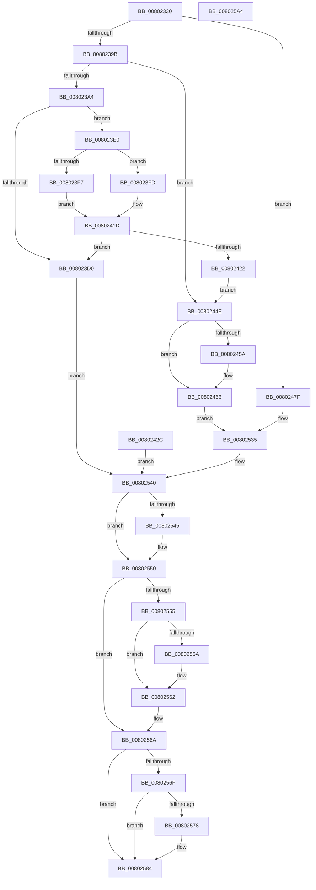

# MiApplyImageHotPatch

- RVA: `0x00802330`–`0x008025A5` (길이 `629` bytes)
- VA: `0x0000000140802330`
- 실행 섹션: `PAGE`
- PDB 이름 있음: `예`; PDB Function 태그: `아니요`
- unwind 정보 RVA: `0x000D8520`
- 디코드: `143`개 명령, `629/629` bytes 표시
- 미해석 바이트: `0` (있으면 어셈블리에 `.byte`로 보존)

> 이 문서는 커널 이미지의 기계어와 PDB 기호를 분석해 생성했습니다. 4번과 5번은 함수 원형과 자료형을 바이너리 사용 방식에서 추정한 C 해석이며 원본 소스 복구 결과는 아닙니다.

## 1. Dependencies

- 직접 호출 지점: **10**; 고유 호출 대상: **10**
- 직접 호출자로 확인된 함수: **1**
- RIP 상대 이미지 참조: **3**

### Outgoing calls
- `0x008023BB` → [IoAllocateMdl](../../text/29/IoAllocateMdl_function_0029EBF0.md) (function, `0x0029EBF0`)
- `0x008023E8` → [MmProbeAndLockPages](../../text/23/MmProbeAndLockPages_function_0023B990.md) (function, `0x0023B990`)
- `0x00802415` → [MmMapLockedPagesSpecifyCache](../../text/31/MmMapLockedPagesSpecifyCache_function_00318800.md) (function, `0x00318800`)
- `0x00802461` → [MmLockPagableSectionByHandle](../A4/MmLockPagableSectionByHandle_function_00A4D1E0.md) (function, `0x00A4D1E0`)
- `0x00802475` → [KeGenericCallDpc](../../text/49/KeGenericCallDpc_function_0049F980.md) (function, `0x0049F980`)
- `0x00802529` → [RtlApplyHotPatch](../../pagelk/B7/RtlApplyHotPatch_function_00B7528C.md) (function, `0x00B7528C`)
- `0x0080254B` → [MmUnmapLockedPages](../../text/24/MmUnmapLockedPages_function_00246E60.md) (function, `0x00246E60`)
- `0x0080255D` → [MmUnlockPages](../../text/29/MmUnlockPages_function_0029EEE0.md) (function, `0x0029EEE0`)
- `0x00802565` → [IoFreeMdl](../../text/29/IoFreeMdl_function_0029EA80.md) (function, `0x0029EA80`)
- `0x0080257F` → [MmUnlockPagableImageSection](../../text/2A/MmUnlockPagableImageSection_function_002A39F0.md) (function, `0x002A39F0`)

### Direct callers
- [MiApplyImageHotPatchRequest](MiApplyImageHotPatchRequest_function_008025AC.md) at `0x00802E52`

### Static image references
- `0x00802451` → RVA `0x00FC6A88` (`ALMOSTRO`; read)
- `0x0080245A` → RVA `0x00FC6C00` (`ALMOSTRO`; read)
- `0x0080246E` → RVA `0x00B74A20` (`MiApplyImageHotPatchDpc`; read)

## 2. Other-region calls and transfers

- 다른 실행 섹션으로 향하는 call: **9**
  - `0x008023BB` → [IoAllocateMdl](../../text/29/IoAllocateMdl_function_0029EBF0.md) (`PAGE` → `.text`)
  - `0x008023E8` → [MmProbeAndLockPages](../../text/23/MmProbeAndLockPages_function_0023B990.md) (`PAGE` → `.text`)
  - `0x00802415` → [MmMapLockedPagesSpecifyCache](../../text/31/MmMapLockedPagesSpecifyCache_function_00318800.md) (`PAGE` → `.text`)
  - `0x00802475` → [KeGenericCallDpc](../../text/49/KeGenericCallDpc_function_0049F980.md) (`PAGE` → `.text`)
  - `0x00802529` → [RtlApplyHotPatch](../../pagelk/B7/RtlApplyHotPatch_function_00B7528C.md) (`PAGE` → `PAGELK`)
  - `0x0080254B` → [MmUnmapLockedPages](../../text/24/MmUnmapLockedPages_function_00246E60.md) (`PAGE` → `.text`)
  - `0x0080255D` → [MmUnlockPages](../../text/29/MmUnlockPages_function_0029EEE0.md) (`PAGE` → `.text`)
  - `0x00802565` → [IoFreeMdl](../../text/29/IoFreeMdl_function_0029EA80.md) (`PAGE` → `.text`)
  - `0x0080257F` → [MmUnlockPagableImageSection](../../text/2A/MmUnlockPagableImageSection_function_002A39F0.md) (`PAGE` → `.text`)
- 별도 외부 분기/꼬리 이동을 확인하지 못했습니다.

## 3. Assembly (complete function range)

```asm
00802330  4C 8B DC                        mov r11, rsp
00802333  49 89 73 20                     mov qword ptr [r11 + 0x20], rsi
00802337  57                              push rdi
00802338  41 54                           push r12
0080233A  41 55                           push r13
0080233C  41 56                           push r14
0080233E  41 57                           push r15
00802340  48 81 EC 20 01 00 00            sub rsp, 0x120
00802347  4D 8B E8                        mov r13, r8
0080234A  33 FF                           xor edi, edi
0080234C  33 F6                           xor esi, esi
0080234E  48 89 B4 24 60 01 00 00         mov qword ptr [rsp + 0x160], rsi
00802356  45 33 FF                        xor r15d, r15d
00802359  45 33 F6                        xor r14d, r14d
0080235C  49 89 4B A8                     mov qword ptr [r11 - 0x58], rcx
00802360  49 89 53 B0                     mov qword ptr [r11 - 0x50], rdx
00802364  4D 89 4B B8                     mov qword ptr [r11 - 0x48], r9
00802368  4C 8B 84 24 70 01 00 00         mov r8, qword ptr [rsp + 0x170]
00802370  4D 89 43 C0                     mov qword ptr [r11 - 0x40], r8
00802374  41 8B 45 10                     mov eax, dword ptr [r13 + 0x10]
00802378  41 89 43 D0                     mov dword ptr [r11 - 0x30], eax
0080237C  4D 8B 55 18                     mov r10, qword ptr [r13 + 0x18]
00802380  4D 89 53 C8                     mov qword ptr [r11 - 0x38], r10
00802384  41 21 73 D4                     and dword ptr [r11 - 0x2c], esi
00802388  8B 81 9C 00 00 00               mov eax, dword ptr [rcx + 0x9c]
0080238E  44 8D 67 01                     lea r12d, [rdi + 1]
00802392  41 84 C4                        test r12b, al
00802395  0F 84 E4 00 00 00               je 0x14080247f
0080239B  4D 85 D2                        test r10, r10
0080239E  0F 84 AA 00 00 00               je 0x14080244e
008023A4  48 8B 41 28                     mov rax, qword ptr [rcx + 0x28]
008023A8  8B 10                           mov edx, dword ptr [rax]
008023AA  C1 E2 03                        shl edx, 3
008023AD  48 21 74 24 20                  and qword ptr [rsp + 0x20], rsi
008023B2  45 33 C9                        xor r9d, r9d
008023B5  45 33 C0                        xor r8d, r8d
008023B8  49 8B CA                        mov rcx, r10
008023BB  E8 30 C8 A9 FF                  call 0x14029ebf0
008023C0  48 8B F8                        mov rdi, rax
008023C3  48 89 84 24 70 01 00 00         mov qword ptr [rsp + 0x170], rax
008023CB  48 85 C0                        test rax, rax
008023CE  75 10                           jne 0x1408023e0
008023D0  C7 84 24 1C 01 00 00 9A 00 00 C0  mov dword ptr [rsp + 0x11c], 0xc000009a
008023DB  E9 60 01 00 00                  jmp 0x140802540
008023E0  45 8B C4                        mov r8d, r12d
008023E3  33 D2                           xor edx, edx
008023E5  48 8B CF                        mov rcx, rdi
008023E8  E8 A3 95 A3 FF                  call 0x14023b990
008023ED  90                              nop
008023EE  45 8B F4                        mov r14d, r12d
008023F1  F6 47 0A 05                     test byte ptr [rdi + 0xa], 5
008023F5  74 06                           je 0x1408023fd
008023F7  48 8B 77 18                     mov rsi, qword ptr [rdi + 0x18]
008023FB  EB 20                           jmp 0x14080241d
008023FD  C7 44 24 28 20 00 00 40         mov dword ptr [rsp + 0x28], 0x40000020
00802405  83 64 24 20 00                  and dword ptr [rsp + 0x20], 0
0080240A  45 33 C9                        xor r9d, r9d
0080240D  45 8B C4                        mov r8d, r12d
00802410  33 D2                           xor edx, edx
00802412  48 8B CF                        mov rcx, rdi
00802415  E8 E6 63 B1 FF                  call 0x140318800
0080241A  48 8B F0                        mov rsi, rax
0080241D  48 85 F6                        test rsi, rsi
00802420  74 AE                           je 0x1408023d0
00802422  48 89 B4 24 10 01 00 00         mov qword ptr [rsp + 0x110], rsi
0080242A  EB 22                           jmp 0x14080244e
0080242C  89 84 24 1C 01 00 00            mov dword ptr [rsp + 0x11c], eax
00802433  48 8B BC 24 70 01 00 00         mov rdi, qword ptr [rsp + 0x170]
0080243B  48 8B B4 24 60 01 00 00         mov rsi, qword ptr [rsp + 0x160]
00802443  44 8B FE                        mov r15d, esi
00802446  44 8B F6                        mov r14d, esi
00802449  E9 F2 00 00 00                  jmp 0x140802540
0080244E  45 8B FC                        mov r15d, r12d
00802451  F6 05 30 46 7C 00 04            test byte ptr [rip + 0x7c4630], 4
00802458  75 0C                           jne 0x140802466
0080245A  48 8B 0D 9F 47 7C 00            mov rcx, qword ptr [rip + 0x7c479f]
00802461  E8 7A AD 24 00                  call 0x140a4d1e0
00802466  48 8D 94 24 F0 00 00 00         lea rdx, [rsp + 0xf0]
0080246E  48 8D 0D AB 25 37 00            lea rcx, [rip + 0x3725ab]
00802475  E8 06 D5 C9 FF                  call 0x14049f980
0080247A  E9 B6 00 00 00                  jmp 0x140802535
0080247F  48 21 B4 24 C0 00 00 00         and qword ptr [rsp + 0xc0], rsi
00802487  4C 89 94 24 B8 00 00 00         mov qword ptr [rsp + 0xb8], r10
0080248F  48 8B 41 28                     mov rax, qword ptr [rcx + 0x28]
00802493  48 89 84 24 B0 00 00 00         mov qword ptr [rsp + 0xb0], rax
0080249B  0F B7 81 88 00 00 00            movzx eax, word ptr [rcx + 0x88]
008024A2  66 89 84 24 A8 00 00 00         mov word ptr [rsp + 0xa8], ax
008024AA  44 89 A4 24 A0 00 00 00         mov dword ptr [rsp + 0xa0], r12d
008024B2  4C 89 84 24 98 00 00 00         mov qword ptr [rsp + 0x98], r8
008024BA  4C 89 8C 24 90 00 00 00         mov qword ptr [rsp + 0x90], r9
008024C2  21 B4 24 88 00 00 00            and dword ptr [rsp + 0x88], esi
008024C9  48 21 B4 24 80 00 00 00         and qword ptr [rsp + 0x80], rsi
008024D1  48 21 74 24 70                  and qword ptr [rsp + 0x70], rsi
008024D6  21 74 24 68                     and dword ptr [rsp + 0x68], esi
008024DA  48 21 74 24 60                  and qword ptr [rsp + 0x60], rsi
008024DF  48 8B 42 08                     mov rax, qword ptr [rdx + 8]
008024E3  48 89 44 24 58                  mov qword ptr [rsp + 0x58], rax
008024E8  48 8B 42 48                     mov rax, qword ptr [rdx + 0x48]
008024EC  48 89 44 24 50                  mov qword ptr [rsp + 0x50], rax
008024F1  48 21 74 24 40                  and qword ptr [rsp + 0x40], rsi
008024F6  8B 81 98 00 00 00               mov eax, dword ptr [rcx + 0x98]
008024FC  89 44 24 38                     mov dword ptr [rsp + 0x38], eax
00802500  48 8B 81 90 00 00 00            mov rax, qword ptr [rcx + 0x90]
00802507  48 89 44 24 30                  mov qword ptr [rsp + 0x30], rax
0080250C  48 8D 84 24 18 01 00 00         lea rax, [rsp + 0x118]
00802514  48 89 44 24 20                  mov qword ptr [rsp + 0x20], rax
00802519  44 8B 49 24                     mov r9d, dword ptr [rcx + 0x24]
0080251D  4C 8B 41 50                     mov r8, qword ptr [rcx + 0x50]
00802521  48 8B 51 08                     mov rdx, qword ptr [rcx + 8]
00802525  48 8B 49 48                     mov rcx, qword ptr [rcx + 0x48]
00802529  E8 5E 2D 37 00                  call 0x140b7528c
0080252E  89 84 24 1C 01 00 00            mov dword ptr [rsp + 0x11c], eax
00802535  8B 84 24 18 01 00 00            mov eax, dword ptr [rsp + 0x118]
0080253C  41 89 45 10                     mov dword ptr [r13 + 0x10], eax
00802540  48 85 F6                        test rsi, rsi
00802543  74 0B                           je 0x140802550
00802545  48 8B D7                        mov rdx, rdi
00802548  48 8B CE                        mov rcx, rsi
0080254B  E8 10 49 A4 FF                  call 0x140246e60
00802550  48 85 FF                        test rdi, rdi
00802553  74 15                           je 0x14080256a
00802555  45 85 F6                        test r14d, r14d
00802558  74 08                           je 0x140802562
0080255A  48 8B CF                        mov rcx, rdi
0080255D  E8 7E C9 A9 FF                  call 0x14029eee0
00802562  48 8B CF                        mov rcx, rdi
00802565  E8 16 C5 A9 FF                  call 0x14029ea80
0080256A  45 85 FF                        test r15d, r15d
0080256D  74 15                           je 0x140802584
0080256F  F6 05 12 45 7C 00 04            test byte ptr [rip + 0x7c4512], 4
00802576  75 0C                           jne 0x140802584
00802578  48 8B 0D 81 46 7C 00            mov rcx, qword ptr [rip + 0x7c4681]
0080257F  E8 6C 14 AA FF                  call 0x1402a39f0
00802584  8B 84 24 1C 01 00 00            mov eax, dword ptr [rsp + 0x11c]
0080258B  48 8B B4 24 68 01 00 00         mov rsi, qword ptr [rsp + 0x168]
00802593  48 81 C4 20 01 00 00            add rsp, 0x120
0080259A  41 5F                           pop r15
0080259C  41 5E                           pop r14
0080259E  41 5D                           pop r13
008025A0  41 5C                           pop r12
008025A2  5F                              pop rdi
008025A3  C3                              ret
008025A4  CC                              int3
```

## 4. C-style interpretation (structured pseudocode)

```c
__int64 __fastcall MiApplyImageHotPatch(__int64 a1, __int64 a2, __int64 a3, __int64 a4, __int64 a5)
{
    __int64 result;
    __int64 v_r14;
    __int64 v_r15;
    __int64 v_rdi;
    __int64 v_rsi;
    __int64 v_rsp;
    unsigned __int64 v_stack_m108;
    unsigned int v_stack_m110;
    unsigned __int64 v_stack_m118;
    unsigned int v_stack_m120;
    unsigned __int64 v_stack_m128;
    unsigned int v_stack_m2C;
    unsigned __int64 v_stack_m30;
    unsigned __int64 v_stack_m38;
    unsigned __int64 v_stack_m58;
    unsigned __int64 v_stack_m88;
    unsigned __int64 v_stack_m90;
    unsigned __int64 v_stack_m98;
    unsigned __int16 v_stack_mA0;
    unsigned int v_stack_mA8;
    unsigned __int64 v_stack_mB0;
    unsigned __int64 v_stack_mB8;
    unsigned int v_stack_mC0;
    unsigned __int64 v_stack_mC8;
    unsigned __int64 v_stack_mD8;
    unsigned int v_stack_mE0;
    unsigned __int64 v_stack_mE8;
    unsigned __int64 v_stack_mF0;
    unsigned __int64 v_stack_mF8;
    unsigned __int64 v_stack_p18;
    unsigned __int64 v_stack_p20;
    unsigned __int64 v_stack_p28;

    *(unsigned __int64 *)(v_rsp + 32) = v_rsi;
    v_rsp = (v_rsp) - (288);
    v_rdi = 0;
    v_rsi = 0;
    v_stack_p18 = 0;
    v_r15 = 0;
    v_r14 = 0;
    *(unsigned __int64 *)(v_rsp - 88) = a1;
    *(unsigned __int64 *)(v_rsp - 80) = a2;
    *(unsigned __int64 *)(v_rsp - 72) = a4;
    *(unsigned __int64 *)(v_rsp - 64) = a5;
    *(unsigned int *)(v_rsp - 48) = (unsigned int)((unsigned int)(*(unsigned int *)(a3 + 16)));
    *(unsigned __int64 *)(v_rsp - 56) = *(unsigned __int64 *)(a3 + 24);
    if ((((unsigned __int8)(v_rdi + 1)) & ((unsigned __int8)((unsigned int)(*(unsigned int *)(a1 + 156))))) == 0) goto loc_0080247F;
    if (*(unsigned __int64 *)(a3 + 24) == 0) goto loc_0080244E;
    a2 = (unsigned int)(((unsigned int)(*(unsigned int *)(*(unsigned __int64 *)(a1 + 40)))) << (3));
    a4 = 0;
    a3 = 0;
    result = IoAllocateMdl(*(unsigned __int64 *)(a3 + 24), a2, a3, a4);
    v_stack_p28 = result;
    if (result != 0) goto loc_008023E0;
loc_008023D0:
    v_stack_m2C = 0xC000009AULL;
    goto loc_00802540;
loc_008023E0:
    a2 = 0;
    result = MmProbeAndLockPages(result, a2, (unsigned int)((unsigned int)(v_rdi + 1)), a4);
    if (((*(unsigned __int8 *)(result + 10)) & (5)) == 0) goto loc_008023FD;
    goto loc_0080241D;
loc_008023FD:
    v_stack_m120 = 0x40000020ULL;
    a4 = 0;
    a2 = 0;
    result = MmMapLockedPagesSpecifyCache(result, a2, (unsigned int)((unsigned int)(v_rdi + 1)), a4);
loc_0080241D:
    if (result == 0) goto loc_008023D0;
    v_stack_m38 = result;
    goto loc_0080244E;
loc_0080244E:
    if (((*(unsigned __int8 *)(v_rip + 8144432)) & (4)) == 0) {
        a1 = *(unsigned __int64 *)(v_rip + 8144799);
        result = MmLockPagableSectionByHandle(a1, a2, (unsigned int)((unsigned int)(v_rdi + 1)), a4);
    }
    result = KeGenericCallDpc(v_rip + 3614123, v_stack_m58, (unsigned int)((unsigned int)(v_rdi + 1)), a4);
    goto loc_00802535;
loc_0080247F:
    v_stack_m90 = *(unsigned __int64 *)(a3 + 24);
    v_stack_m98 = *(unsigned __int64 *)(v_rip + 3614123 + 40);
    v_stack_mA0 = (unsigned __int16)(*(unsigned __int16 *)(v_rip + 3614123 + 136));
    v_stack_mA8 = (unsigned int)(v_rdi + 1);
    v_stack_mB0 = (unsigned int)((unsigned int)(v_rdi + 1));
    v_stack_mB8 = 0;
    v_stack_mF0 = *(unsigned __int64 *)(v_stack_m58 + 8);
    v_stack_mF8 = *(unsigned __int64 *)(v_stack_m58 + 72);
    v_stack_m110 = (unsigned int)((unsigned int)(*(unsigned int *)(v_rip + 3614123 + 152)));
    v_stack_m118 = *(unsigned __int64 *)(v_rip + 3614123 + 144);
    v_stack_m128 = v_stack_m30;
    result = RtlApplyHotPatch(*(unsigned __int64 *)(v_rip + 3614123 + 72), *(unsigned __int64 *)(v_rip + 3614123 + 8), *(unsigned __int64 *)(v_rip + 3614123 + 80), (unsigned int)(*(unsigned int *)(v_rip + 3614123 + 36)));
    v_stack_m2C = (unsigned int)(result);
loc_00802535:
    *(unsigned int *)(a3 + 16) = (unsigned int)((unsigned int)(v_stack_m30));
loc_00802540:
    result = (unsigned int)(v_stack_m30);
    if (result != 0) {
        a2 = result;
        a1 = result;
        result = MmUnmapLockedPages(a1, a2, *(unsigned __int64 *)(v_rip + 3614123 + 80), (unsigned int)(*(unsigned int *)(v_rip + 3614123 + 36)));
    }
    if (result == 0) goto loc_0080256A;
    if ((unsigned int)((unsigned int)((unsigned int)(v_rdi + 1))) != 0) {
        a1 = result;
        result = MmUnlockPages(a1, a2, *(unsigned __int64 *)(v_rip + 3614123 + 80), (unsigned int)(*(unsigned int *)(v_rip + 3614123 + 36)));
    }
    result = IoFreeMdl(result, a2, *(unsigned __int64 *)(v_rip + 3614123 + 80), (unsigned int)(*(unsigned int *)(v_rip + 3614123 + 36)));
loc_0080256A:
    if ((unsigned int)((unsigned int)((unsigned int)(v_rdi + 1))) == 0) goto loc_00802584;
    if (((*(unsigned __int8 *)(v_rip + 8144146)) & (4)) == 0) {
        a1 = *(unsigned __int64 *)(v_rip + 8144513);
        result = MmUnlockPagableImageSection(a1, a2, *(unsigned __int64 *)(v_rip + 3614123 + 80), (unsigned int)(*(unsigned int *)(v_rip + 3614123 + 36)));
    }
    v_rsp = (v_rsp) + (288);
    return (unsigned int)(v_stack_m2C);
}
```

## 5. (Beta) C Style

```c
int64_t MiApplyImageHotPatch(void *Arg1, void *Arg2, void *Arg3, int64_t Arg4, int64_t Arg5)
{
    uint8_t *arg1 = (uint8_t *)Arg1;
    uint8_t *arg2 = (uint8_t *)Arg2;
    uint8_t *arg3 = (uint8_t *)Arg3;

    int64_t result;
    int64_t local_r14;
    int64_t local_r15;
    int64_t local_rdi;
    int64_t local_rsi;
    int64_t local_rsp;
    uint64_t v_stack_m108;
    uint32_t v_stack_m110;
    uint64_t v_stack_m118;
    uint32_t v_stack_m120;
    uint64_t v_stack_m128;
    uint32_t v_stack_m2C;
    uint64_t v_stack_m30;
    uint64_t v_stack_m38;
    uint64_t v_stack_m58;
    uint64_t v_stack_m88;
    uint64_t v_stack_m90;
    uint64_t v_stack_m98;
    uint16_t v_stack_mA0;
    uint32_t v_stack_mA8;
    uint64_t v_stack_mB0;
    uint64_t v_stack_mB8;
    uint32_t v_stack_mC0;
    uint64_t v_stack_mC8;
    uint64_t v_stack_mD8;
    uint32_t v_stack_mE0;
    uint64_t v_stack_mE8;
    uint64_t v_stack_mF0;
    uint64_t v_stack_mF8;
    uint64_t v_stack_p18;
    uint64_t v_stack_p20;
    uint64_t v_stack_p28;

    *(uint64_t *)(local_rsp + 0x20) = local_rsi;
    local_rsp = (local_rsp) - (288);
    local_rdi = 0;
    local_rsi = 0;
    v_stack_p18 = 0;
    local_r15 = 0;
    local_r14 = 0;
    *(void **)(local_rsp - 0x58) = Arg1;
    *(void **)(local_rsp - 0x50) = Arg2;
    *(uint64_t *)(local_rsp - 0x48) = Arg4;
    *(uint64_t *)(local_rsp - 0x40) = Arg5;
    *(uint32_t *)(local_rsp - 0x30) = (uint32_t)((uint32_t)(*(uint32_t *)(arg3 + 0x10)));
    *(uint64_t *)(local_rsp - 0x38) = *(uint64_t *)(arg3 + 0x18);
    if ((((uint8_t)(local_rdi + 1)) & ((uint8_t)((uint32_t)(*(uint32_t *)(arg1 + 0x9C))))) == 0) goto loc_0080247F;
    if (*(uint64_t *)(arg3 + 0x18) == 0) goto loc_0080244E;
    Arg2 = (uint32_t)(((uint32_t)(*(uint32_t *)(*(uint64_t *)(arg1 + 0x28)))) << (3));
    Arg4 = 0;
    Arg3 = 0;
    result = IoAllocateMdl(*(uint64_t *)(arg3 + 0x18), Arg2, Arg3, Arg4);
    v_stack_p28 = result;
    if (result != 0) goto loc_008023E0;
loc_008023D0:
    v_stack_m2C = 0xC000009AULL;
    goto loc_00802540;
loc_008023E0:
    Arg2 = 0;
    result = MmProbeAndLockPages(result, Arg2, (uint32_t)((uint32_t)(local_rdi + 1)), Arg4);
    if (((*(uint8_t *)(result + 0xA)) & (5)) == 0) goto loc_008023FD;
    goto loc_0080241D;
loc_008023FD:
    v_stack_m120 = 0x40000020ULL;
    Arg4 = 0;
    Arg2 = 0;
    result = MmMapLockedPagesSpecifyCache(result, Arg2, (uint32_t)((uint32_t)(local_rdi + 1)), Arg4);
loc_0080241D:
    if (result == 0) goto loc_008023D0;
    v_stack_m38 = result;
    goto loc_0080244E;
loc_0080244E:
    if (((*(uint8_t *)(v_rip + 0x7C4630)) & (4)) == 0) {
        Arg1 = *(uint64_t *)(v_rip + 0x7C479F);
        result = MmLockPagableSectionByHandle(Arg1, Arg2, (uint32_t)((uint32_t)(local_rdi + 1)), Arg4);
    }
    result = KeGenericCallDpc(v_rip + 3614123, v_stack_m58, (uint32_t)((uint32_t)(local_rdi + 1)), Arg4);
    goto loc_00802535;
loc_0080247F:
    v_stack_m90 = *(uint64_t *)(arg3 + 0x18);
    v_stack_m98 = *(uint64_t *)(v_rip + 0x3725AB + 0x28);
    v_stack_mA0 = (uint16_t)(*(uint16_t *)(v_rip + 0x3725AB + 0x88));
    v_stack_mA8 = (uint32_t)(local_rdi + 1);
    v_stack_mB0 = (uint32_t)((uint32_t)(local_rdi + 1));
    v_stack_mB8 = 0;
    v_stack_mF0 = *(uint64_t *)(v_stack_m58 + 0x8);
    v_stack_mF8 = *(uint64_t *)(v_stack_m58 + 0x48);
    v_stack_m110 = (uint32_t)((uint32_t)(*(uint32_t *)(v_rip + 0x3725AB + 0x98)));
    v_stack_m118 = *(uint64_t *)(v_rip + 0x3725AB + 0x90);
    v_stack_m128 = v_stack_m30;
    result = RtlApplyHotPatch(*(uint64_t *)(v_rip + 0x3725AB + 0x48), *(uint64_t *)(v_rip + 0x3725AB + 0x8), *(uint64_t *)(v_rip + 0x3725AB + 0x50), (uint32_t)(*(uint32_t *)(v_rip + 0x3725AB + 0x24)));
    v_stack_m2C = (uint32_t)(result);
loc_00802535:
    *(uint32_t *)(arg3 + 0x10) = (uint32_t)((uint32_t)(v_stack_m30));
loc_00802540:
    result = (uint32_t)(v_stack_m30);
    if (result != 0) {
        Arg2 = result;
        Arg1 = result;
        result = MmUnmapLockedPages(Arg1, Arg2, *(uint64_t *)(v_rip + 0x3725AB + 0x50), (uint32_t)(*(uint32_t *)(v_rip + 0x3725AB + 0x24)));
    }
    if (result == 0) goto loc_0080256A;
    if ((uint32_t)((uint32_t)((uint32_t)(local_rdi + 1))) != 0) {
        Arg1 = result;
        result = MmUnlockPages(Arg1, Arg2, *(uint64_t *)(v_rip + 0x3725AB + 0x50), (uint32_t)(*(uint32_t *)(v_rip + 0x3725AB + 0x24)));
    }
    result = IoFreeMdl(result, Arg2, *(uint64_t *)(v_rip + 0x3725AB + 0x50), (uint32_t)(*(uint32_t *)(v_rip + 0x3725AB + 0x24)));
loc_0080256A:
    if ((uint32_t)((uint32_t)((uint32_t)(local_rdi + 1))) == 0) goto loc_00802584;
    if (((*(uint8_t *)(v_rip + 0x7C4512)) & (4)) == 0) {
        Arg1 = *(uint64_t *)(v_rip + 0x7C4681);
        result = MmUnlockPagableImageSection(Arg1, Arg2, *(uint64_t *)(v_rip + 0x3725AB + 0x50), (uint32_t)(*(uint32_t *)(v_rip + 0x3725AB + 0x24)));
    }
    local_rsp = (local_rsp) + (288);
    return (uint32_t)(v_stack_m2C);
}
```

### 관측된 메모리 오프셋

구조체 형식이 확인되지 않은 접근은 인자 기준의 오프셋으로만 기록했습니다.

| 기준 인자 | 오프셋 표현 | 폭 (bit) | 접근 |
|---|---:|---:|---|
| `Arg1` | `+ 0x8` | `64` | `R` |
| `Arg1` | `+ 0x24` | `32` | `R` |
| `Arg1` | `+ 0x28` | `64` | `R` |
| `Arg1` | `+ 0x48` | `64` | `R` |
| `Arg1` | `+ 0x50` | `64` | `R` |
| `Arg1` | `+ 0x88` | `16` | `R` |
| `Arg1` | `+ 0x90` | `64` | `R` |
| `Arg1` | `+ 0x98` | `32` | `R` |
| `Arg1` | `+ 0x9C` | `32` | `R` |
| `Arg2` | `+ 0x8` | `64` | `R` |
| `Arg2` | `+ 0x48` | `64` | `R` |
| `Arg3` | `+ 0x10` | `32` | `R` |
| `Arg3` | `+ 0x10` | `32` | `W` |
| `Arg3` | `+ 0x18` | `64` | `R` |

## 6. Execution-region graph

[열기: 2D/3D 그래프와 함수 탐색 컨트롤 패널](../../../control-panel.html?section=page&rva=0x00802330&view=graph)

- 2D 그래프는 위에서 아래로 흐르고, 3D 그래프는 빈 공간을 드래그해 회전합니다. Shift+드래그는 이동, 휠은 확대·축소, 함수 노드 선택은 대상 보고서 이동입니다.

### Static fallback


