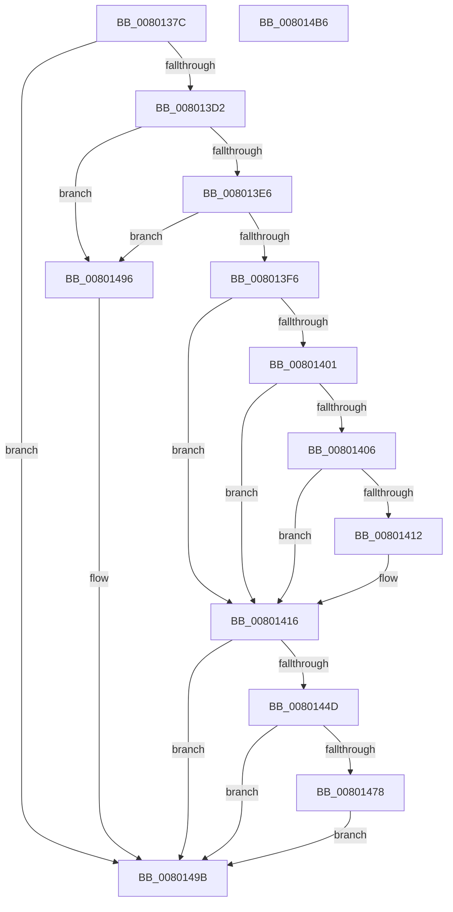

# MiCaptureBootDriverRetpolineInfo

- RVA: `0x0080137C`–`0x008014B7` (길이 `315` bytes)
- VA: `0x000000014080137C`
- 실행 섹션: `PAGE`
- PDB 이름 있음: `예`; PDB Function 태그: `아니요`
- unwind 정보 RVA: `0x000D55A4`
- 디코드: `94`개 명령, `315/315` bytes 표시
- 미해석 바이트: `0` (있으면 어셈블리에 `.byte`로 보존)

> 이 문서는 커널 이미지의 기계어와 PDB 기호를 분석해 생성했습니다. 4번과 5번은 함수 원형과 자료형을 바이너리 사용 방식에서 추정한 C 해석이며 원본 소스 복구 결과는 아닙니다.

## 1. Dependencies

- 직접 호출 지점: **6**; 고유 호출 대상: **6**
- 직접 호출자로 확인된 함수: **1**
- RIP 상대 이미지 참조: **0**

### Outgoing calls
- `0x008013C3` → [RtlImageNtHeaderEx](../../text/41/RtlImageNtHeaderEx_function_0041EAA0.md) (function, `0x0041EAA0`)
- `0x008013D5` → [LdrImageDirectoryEntryToLoadConfigEx](../../text/4F/LdrImageDirectoryEntryToLoadConfigEx_function_004F087C.md) (function, `0x004F087C`)
- `0x00801442` → [LdrCaptureDynamicRelocationTableHeader](../94/LdrCaptureDynamicRelocationTableHeader_function_009421E4.md) (function, `0x009421E4`)
- `0x0080146D` → [MiCaptureRetpolineRelocationTables](../94/MiCaptureRetpolineRelocationTables_function_00942E14.md) (function, `0x00942E14`)
- `0x00801484` → [MiCreateRetpolineRelocationInformation](../93/MiCreateRetpolineRelocationInformation_function_0093FE10.md) (function, `0x0093FE10`)
- `0x0080148F` → [MiFreeImageRetpolineContext](../94/MiFreeImageRetpolineContext_function_00941488.md) (function, `0x00941488`)

### Direct callers
- [MiInitializeLoadedModuleList](../../init/C6/MiInitializeLoadedModuleList_function_00C6BCDC.md) at `0x00C6BEC3`

### Static image references
- 디코드된 RIP-relative 메모리 참조가 없습니다.

## 2. Other-region calls and transfers

- 다른 실행 섹션으로 향하는 call: **2**
  - `0x008013C3` → [RtlImageNtHeaderEx](../../text/41/RtlImageNtHeaderEx_function_0041EAA0.md) (`PAGE` → `.text`)
  - `0x008013D5` → [LdrImageDirectoryEntryToLoadConfigEx](../../text/4F/LdrImageDirectoryEntryToLoadConfigEx_function_004F087C.md) (`PAGE` → `.text`)
- 별도 외부 분기/꼬리 이동을 확인하지 못했습니다.

## 3. Assembly (complete function range)

```asm
0080137C  48 89 5C 24 08                  mov qword ptr [rsp + 8], rbx
00801381  48 89 74 24 18                  mov qword ptr [rsp + 0x18], rsi
00801386  55                              push rbp
00801387  57                              push rdi
00801388  41 54                           push r12
0080138A  41 56                           push r14
0080138C  41 57                           push r15
0080138E  48 8B EC                        mov rbp, rsp
00801391  48 83 EC 70                     sub rsp, 0x70
00801395  83 65 38 00                     and dword ptr [rbp + 0x38], 0
00801399  4C 8D 4D 48                     lea r9, [rbp + 0x48]
0080139D  48 83 65 48 00                  and qword ptr [rbp + 0x48], 0
008013A2  0F 57 C0                        xorps xmm0, xmm0
008013A5  48 83 65 D0 00                  and qword ptr [rbp - 0x30], 0
008013AA  4D 8B E0                        mov r12, r8
008013AD  44 8B C2                        mov r8d, edx
008013B0  48 8B F9                        mov rdi, rcx
008013B3  44 8B F2                        mov r14d, edx
008013B6  48 8B D1                        mov rdx, rcx
008013B9  33 C9                           xor ecx, ecx
008013BB  0F 11 45 D8                     movups xmmword ptr [rbp - 0x28], xmm0
008013BF  0F 11 45 E8                     movups xmmword ptr [rbp - 0x18], xmm0
008013C3  E8 D8 D6 C1 FF                  call 0x14041eaa0
008013C8  8B D8                           mov ebx, eax
008013CA  85 C0                           test eax, eax
008013CC  0F 88 C9 00 00 00               js 0x14080149b
008013D2  48 8B CF                        mov rcx, rdi
008013D5  E8 A2 F4 CE FF                  call 0x1404f087c
008013DA  4C 8B C0                        mov r8, rax
008013DD  48 85 C0                        test rax, rax
008013E0  0F 84 B0 00 00 00               je 0x140801496
008013E6  44 8B 08                        mov r9d, dword ptr [rax]
008013E9  41 81 F9 E4 00 00 00            cmp r9d, 0xe4
008013F0  0F 8C A0 00 00 00               jl 0x140801496
008013F6  48 8B 48 78                     mov rcx, qword ptr [rax + 0x78]
008013FA  33 F6                           xor esi, esi
008013FC  48 85 C9                        test rcx, rcx
008013FF  74 15                           je 0x140801416
00801401  48 3B CF                        cmp rcx, rdi
00801404  72 10                           jb 0x140801416
00801406  48 8D 47 F8                     lea rax, [rdi - 8]
0080140A  49 03 C6                        add rax, r14
0080140D  48 3B C8                        cmp rcx, rax
00801410  73 04                           jae 0x140801416
00801412  8B F1                           mov esi, ecx
00801414  2B F7                           sub esi, edi
00801416  4C 8B 7D 48                     mov r15, qword ptr [rbp + 0x48]
0080141A  48 8D 45 D0                     lea rax, [rbp - 0x30]
0080141E  48 89 44 24 38                  mov qword ptr [rsp + 0x38], rax
00801423  41 8B D6                        mov edx, r14d
00801426  48 8D 45 38                     lea rax, [rbp + 0x38]
0080142A  48 8B CF                        mov rcx, rdi
0080142D  48 89 44 24 30                  mov qword ptr [rsp + 0x30], rax
00801432  41 0F B7 47 18                  movzx eax, word ptr [r15 + 0x18]
00801437  66 89 44 24 28                  mov word ptr [rsp + 0x28], ax
0080143C  48 83 64 24 20 00               and qword ptr [rsp + 0x20], 0
00801442  E8 9D 0D 14 00                  call 0x1409421e4
00801447  8B D8                           mov ebx, eax
00801449  85 C0                           test eax, eax
0080144B  78 4E                           js 0x14080149b
0080144D  44 8B 4D 38                     mov r9d, dword ptr [rbp + 0x38]
00801451  48 8D 45 D8                     lea rax, [rbp - 0x28]
00801455  45 8B 47 54                     mov r8d, dword ptr [r15 + 0x54]
00801459  41 8B D6                        mov edx, r14d
0080145C  48 89 44 24 30                  mov qword ptr [rsp + 0x30], rax
00801461  48 8B CF                        mov rcx, rdi
00801464  48 8D 45 D0                     lea rax, [rbp - 0x30]
00801468  48 89 44 24 20                  mov qword ptr [rsp + 0x20], rax
0080146D  E8 A2 19 14 00                  call 0x140942e14
00801472  8B D8                           mov ebx, eax
00801474  85 C0                           test eax, eax
00801476  78 23                           js 0x14080149b
00801478  4D 8B CC                        mov r9, r12
0080147B  48 8D 4D D8                     lea rcx, [rbp - 0x28]
0080147F  45 8B C6                        mov r8d, r14d
00801482  8B D6                           mov edx, esi
00801484  E8 87 E9 13 00                  call 0x14093fe10
00801489  48 8D 4D D8                     lea rcx, [rbp - 0x28]
0080148D  8B D8                           mov ebx, eax
0080148F  E8 F4 FF 13 00                  call 0x140941488
00801494  EB 05                           jmp 0x14080149b
00801496  BB BB 00 00 C0                  mov ebx, 0xc00000bb
0080149B  4C 8D 5C 24 70                  lea r11, [rsp + 0x70]
008014A0  8B C3                           mov eax, ebx
008014A2  49 8B 5B 30                     mov rbx, qword ptr [r11 + 0x30]
008014A6  49 8B 73 40                     mov rsi, qword ptr [r11 + 0x40]
008014AA  49 8B E3                        mov rsp, r11
008014AD  41 5F                           pop r15
008014AF  41 5E                           pop r14
008014B1  41 5C                           pop r12
008014B3  5F                              pop rdi
008014B4  5D                              pop rbp
008014B5  C3                              ret
008014B6  CC                              int3
```

## 4. C-style interpretation (structured pseudocode)

```c
__int64 __fastcall MiCaptureBootDriverRetpolineInfo(__int64 a1, int a2, __int64 a3)
{
    __int64 result;
    __int64 v_rsi;
    __int64 v_rsp;
    unsigned __int64 v_stack_m28;
    unsigned __int64 v_stack_m40;
    unsigned __int64 v_stack_m50;
    unsigned __int64 v_stack_m58;
    unsigned __int64 v_stack_m60;
    unsigned __int64 v_stack_m68;
    unsigned __int16 v_stack_m70;
    unsigned __int64 v_stack_m78;
    unsigned int v_stack_p10;
    unsigned __int64 v_stack_p18;
    unsigned __int64 v_stack_p20;
    unsigned __int64 v_stack_p8;

    v_stack_p8 = v_rbx;
    v_stack_p18 = v_rsi;
    v_rsp = (v_rsp) - (112);
    a1 = 0;
    v_stack_m50 = v_xmm0;
    v_stack_m40 = v_xmm0;
    result = RtlImageNtHeaderEx(a1, a1, (unsigned int)(a2), v_stack_p20);
    if (sign_flag) goto loc_0080149B;
    result = LdrImageDirectoryEntryToLoadConfigEx(0, a1, (unsigned int)(a2), v_stack_p20);
    if (result == 0) goto loc_00801496;
    if (((unsigned int)((unsigned int)(*(unsigned int *)(result)))) < 228) goto loc_00801496;
    v_rsi = 0;
    if (*(unsigned __int64 *)(result + 120) == 0) goto loc_00801416;
    if ((*(unsigned __int64 *)(result + 120)) < 0) goto loc_00801416;
    result = (a1 - 8) + ((unsigned int)(a2));
    if ((*(unsigned __int64 *)(result + 120)) < result) {
        v_rsi = (unsigned int)(*(unsigned __int64 *)(result + 120));
        v_rsi = (unsigned int)((v_rsi) - (0));
    }
    v_stack_m60 = v_stack_m58;
    v_stack_m68 = v_stack_p10;
    v_stack_m70 = (unsigned __int16)(*(unsigned __int16 *)(v_stack_p20 + 24));
    result = LdrCaptureDynamicRelocationTableHeader(0, (unsigned int)((unsigned int)((unsigned int)(a2))), result, (unsigned int)(*(unsigned int *)(result)));
    if (sign_flag) goto loc_0080149B;
    v_stack_m68 = v_stack_m50;
    v_stack_m78 = v_stack_m58;
    result = MiCaptureRetpolineRelocationTables(0, (unsigned int)((unsigned int)((unsigned int)(a2))), (unsigned int)(*(unsigned int *)(v_stack_p20 + 84)), (unsigned int)(v_stack_p10));
    if (sign_flag) goto loc_0080149B;
    result = MiCreateRetpolineRelocationInformation(v_stack_m50, (unsigned int)((unsigned int)(v_rsi)), (unsigned int)((unsigned int)((unsigned int)(a2))), a3);
    result = MiFreeImageRetpolineContext(v_stack_m50, (unsigned int)((unsigned int)(v_rsi)), (unsigned int)((unsigned int)((unsigned int)(a2))), a3);
    goto loc_0080149B;
loc_00801496:
loc_0080149B:
    return (unsigned int)((unsigned int)((unsigned int)(0xC00000BBULL)));
}
```

## 5. (Beta) C Style

```c
int64_t MiCaptureBootDriverRetpolineInfo(void *Arg1, int32_t Arg2, int64_t Arg3)
{
    uint8_t *arg1 = (uint8_t *)Arg1;

    int64_t result;
    int64_t local_rsi;
    int64_t local_rsp;
    uint64_t v_stack_m28;
    uint64_t v_stack_m40;
    uint64_t v_stack_m50;
    uint64_t v_stack_m58;
    uint64_t v_stack_m60;
    uint64_t v_stack_m68;
    uint16_t v_stack_m70;
    uint64_t v_stack_m78;
    uint32_t v_stack_p10;
    uint64_t v_stack_p18;
    uint64_t v_stack_p20;
    uint64_t v_stack_p8;

    v_stack_p8 = local_rbx;
    v_stack_p18 = local_rsi;
    local_rsp = (local_rsp) - (112);
    Arg1 = 0;
    v_stack_m50 = v_xmm0;
    v_stack_m40 = v_xmm0;
    result = RtlImageNtHeaderEx(Arg1, Arg1, (uint32_t)(Arg2), v_stack_p20);
    if (sign_flag) goto loc_0080149B;
    result = LdrImageDirectoryEntryToLoadConfigEx(0, Arg1, (uint32_t)(Arg2), v_stack_p20);
    if (result == 0) goto loc_00801496;
    if (((uint32_t)((uint32_t)(*(uint32_t *)(result)))) < 228) goto loc_00801496;
    local_rsi = 0;
    if (*(uint64_t *)(result + 0x78) == 0) goto loc_00801416;
    if ((*(uint64_t *)(result + 0x78)) < 0) goto loc_00801416;
    result = (Arg1 - 8) + ((uint32_t)(Arg2));
    if ((*(uint64_t *)(result + 0x78)) < result) {
        local_rsi = (uint32_t)(*(uint64_t *)(result + 0x78));
        local_rsi = (uint32_t)((local_rsi) - (0));
    }
    v_stack_m60 = v_stack_m58;
    v_stack_m68 = v_stack_p10;
    v_stack_m70 = (uint16_t)(*(uint16_t *)(v_stack_p20 + 0x18));
    result = LdrCaptureDynamicRelocationTableHeader(0, (uint32_t)((uint32_t)((uint32_t)(Arg2))), result, (uint32_t)(*(uint32_t *)(result)));
    if (sign_flag) goto loc_0080149B;
    v_stack_m68 = v_stack_m50;
    v_stack_m78 = v_stack_m58;
    result = MiCaptureRetpolineRelocationTables(0, (uint32_t)((uint32_t)((uint32_t)(Arg2))), (uint32_t)(*(uint32_t *)(v_stack_p20 + 0x54)), (uint32_t)(v_stack_p10));
    if (sign_flag) goto loc_0080149B;
    result = MiCreateRetpolineRelocationInformation(v_stack_m50, (uint32_t)((uint32_t)(local_rsi)), (uint32_t)((uint32_t)((uint32_t)(Arg2))), Arg3);
    result = MiFreeImageRetpolineContext(v_stack_m50, (uint32_t)((uint32_t)(local_rsi)), (uint32_t)((uint32_t)((uint32_t)(Arg2))), Arg3);
    goto loc_0080149B;
loc_00801496:
loc_0080149B:
    return (uint32_t)((uint32_t)((uint32_t)(0xC00000BBULL)));
}
```

### 관측된 메모리 오프셋

구조체 형식이 확인되지 않은 접근은 인자 기준의 오프셋으로만 기록했습니다.

| 기준 인자 | 오프셋 표현 | 폭 (bit) | 접근 |
|---|---:|---:|---|
| `Arg1` | `- 0x8` | `64` | `R` |

## 6. Execution-region graph

[열기: 2D/3D 그래프와 함수 탐색 컨트롤 패널](../../../control-panel.html?section=page&rva=0x0080137C&view=graph)

- 2D 그래프는 위에서 아래로 흐르고, 3D 그래프는 빈 공간을 드래그해 회전합니다. Shift+드래그는 이동, 휠은 확대·축소, 함수 노드 선택은 대상 보고서 이동입니다.

### Static fallback


