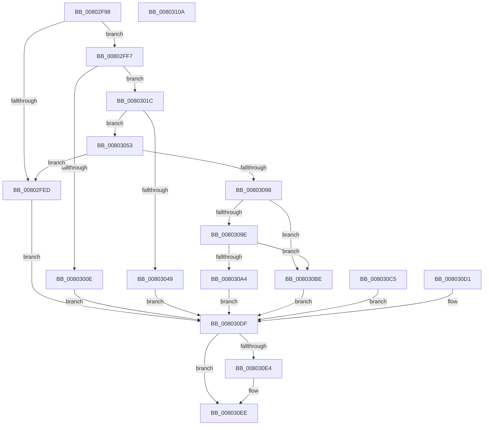

# MiCaptureHotPatchInfo

- RVA: `0x00802F98`–`0x0080310B` (길이 `371` bytes)
- VA: `0x0000000140802F98`
- 실행 섹션: `PAGE`
- PDB 이름 있음: `예`; PDB Function 태그: `아니요`
- unwind 정보 RVA: `0x000D8424`
- 디코드: `104`개 명령, `371/371` bytes 표시
- 미해석 바이트: `0` (있으면 어셈블리에 `.byte`로 보존)

> 이 문서는 커널 이미지의 기계어와 PDB 기호를 분석해 생성했습니다. 4번과 5번은 함수 원형과 자료형을 바이너리 사용 방식에서 추정한 C 해석이며 원본 소스 복구 결과는 아닙니다.

## 1. Dependencies

- 직접 호출 지점: **6**; 고유 호출 대상: **6**
- 직접 호출자로 확인된 함수: **1**
- RIP 상대 이미지 참조: **0**

### Outgoing calls
- `0x00802FFC` → [RtlFindHotPatchInformation](../84/RtlFindHotPatchInformation_function_00840F24.md) (function, `0x00840F24`)
- `0x00803034` → [MiAllocatePool](../../text/35/MiAllocatePool_function_0035B540.md) (function, `0x0035B540`)
- `0x0080305C` → [memcpy](../../text/6C/memcpy_function_006C6840.md) (function, `0x006C6840`)
- `0x00803070` → [RtlFindHotPatchBaseMachine](../84/RtlFindHotPatchBaseMachine_function_00840EBC.md) (function, `0x00840EBC`)
- `0x0080308B` → [RtlValidateHotPatchBase](../84/RtlValidateHotPatchBase_function_008411D0.md) (function, `0x008411D0`)
- `0x008030E9` → [ExFreePoolWithTag](../../poolcode/B8/ExFreePoolWithTag_function_00B82870.md) (function, `0x00B82870`)

### Direct callers
- [MiApplyImageHotPatchRequest](MiApplyImageHotPatchRequest_function_008025AC.md) at `0x00802BD8`

### Static image references
- 디코드된 RIP-relative 메모리 참조가 없습니다.

## 2. Other-region calls and transfers

- 다른 실행 섹션으로 향하는 call: **3**
  - `0x00803034` → [MiAllocatePool](../../text/35/MiAllocatePool_function_0035B540.md) (`PAGE` → `.text`)
  - `0x0080305C` → [memcpy](../../text/6C/memcpy_function_006C6840.md) (`PAGE` → `.text`)
  - `0x008030E9` → [ExFreePoolWithTag](../../poolcode/B8/ExFreePoolWithTag_function_00B82870.md) (`PAGE` → `POOLCODE`)
- 별도 외부 분기/꼬리 이동을 확인하지 못했습니다.

## 3. Assembly (complete function range)

```asm
00802F98  48 8B C4                        mov rax, rsp
00802F9B  48 89 58 08                     mov qword ptr [rax + 8], rbx
00802F9F  48 89 70 18                     mov qword ptr [rax + 0x18], rsi
00802FA3  89 50 10                        mov dword ptr [rax + 0x10], edx
00802FA6  57                              push rdi
00802FA7  41 54                           push r12
00802FA9  41 55                           push r13
00802FAB  41 56                           push r14
00802FAD  41 57                           push r15
00802FAF  48 83 EC 40                     sub rsp, 0x40
00802FB3  45 8B E1                        mov r12d, r9d
00802FB6  45 8B E8                        mov r13d, r8d
00802FB9  48 83 60 D0 00                  and qword ptr [rax - 0x30], 0
00802FBE  83 60 C8 00                     and dword ptr [rax - 0x38], 0
00802FC2  4C 8B BC 24 A0 00 00 00         mov r15, qword ptr [rsp + 0xa0]
00802FCA  49 83 27 00                     and qword ptr [r15], 0
00802FCE  33 FF                           xor edi, edi
00802FD0  48 89 BC 24 A0 00 00 00         mov qword ptr [rsp + 0xa0], rdi
00802FD8  48 8B 01                        mov rax, qword ptr [rcx]
00802FDB  44 8B 71 10                     mov r14d, dword ptr [rcx + 0x10]
00802FDF  49 C1 E6 0C                     shl r14, 0xc
00802FE3  B9 FF FF FF FF                  mov ecx, 0xffffffff
00802FE8  4C 3B F1                        cmp r14, rcx
00802FEB  76 0A                           jbe 0x140802ff7
00802FED  BB 7B 00 00 C0                  mov ebx, 0xc000007b
00802FF2  E9 E8 00 00 00                  jmp 0x1408030df
00802FF7  33 D2                           xor edx, edx
00802FF9  48 8B C8                        mov rcx, rax
00802FFC  E8 23 DF 03 00                  call 0x140840f24
00803001  48 8B D8                        mov rbx, rax
00803004  48 89 44 24 38                  mov qword ptr [rsp + 0x38], rax
00803009  48 85 C0                        test rax, rax
0080300C  75 0E                           jne 0x14080301c
0080300E  BB 7B 00 00 C0                  mov ebx, 0xc000007b
00803013  89 5C 24 34                     mov dword ptr [rsp + 0x34], ebx
00803017  E9 C3 00 00 00                  jmp 0x1408030df
0080301C  8B 40 04                        mov eax, dword ptr [rax + 4]
0080301F  89 44 24 30                     mov dword ptr [rsp + 0x30], eax
00803023  48 8B F0                        mov rsi, rax
00803026  41 B8 48 50 49 4E               mov r8d, 0x4e495048
0080302C  48 8B D0                        mov rdx, rax
0080302F  B9 40 00 00 00                  mov ecx, 0x40
00803034  E8 07 85 B5 FF                  call 0x14035b540
00803039  48 8B F8                        mov rdi, rax
0080303C  48 89 84 24 A0 00 00 00         mov qword ptr [rsp + 0xa0], rax
00803044  48 85 C0                        test rax, rax
00803047  75 0A                           jne 0x140803053
00803049  BB 9A 00 00 C0                  mov ebx, 0xc000009a
0080304E  E9 8C 00 00 00                  jmp 0x1408030df
00803053  4C 8B C6                        mov r8, rsi
00803056  48 8B D3                        mov rdx, rbx
00803059  48 8B CF                        mov rcx, rdi
0080305C  E8 DF 37 EC FF                  call 0x1406c6840
00803061  90                              nop
00803062  0F B7 9C 24 90 00 00 00         movzx ebx, word ptr [rsp + 0x90]
0080306A  0F B7 D3                        movzx edx, bx
0080306D  48 8B CF                        mov rcx, rdi
00803070  E8 47 DE 03 00                  call 0x140840ebc
00803075  48 8B F0                        mov rsi, rax
00803078  66 89 5C 24 28                  mov word ptr [rsp + 0x28], bx
0080307D  45 8B CE                        mov r9d, r14d
00803080  44 8B 44 24 78                  mov r8d, dword ptr [rsp + 0x78]
00803085  48 8B D0                        mov rdx, rax
00803088  48 8B CF                        mov rcx, rdi
0080308B  E8 40 E1 03 00                  call 0x1408411d0
00803090  84 C0                           test al, al
00803092  0F 84 55 FF FF FF               je 0x140802fed
00803098  44 39 6E 0C                     cmp dword ptr [rsi + 0xc], r13d
0080309C  75 20                           jne 0x1408030be
0080309E  44 39 66 08                     cmp dword ptr [rsi + 8], r12d
008030A2  75 1A                           jne 0x1408030be
008030A4  8B 46 18                        mov eax, dword ptr [rsi + 0x18]
008030A7  48 03 C7                        add rax, rdi
008030AA  49 89 07                        mov qword ptr [r15], rax
008030AD  48 8B 84 24 98 00 00 00         mov rax, qword ptr [rsp + 0x98]
008030B5  48 89 38                        mov qword ptr [rax], rdi
008030B8  33 FF                           xor edi, edi
008030BA  33 DB                           xor ebx, ebx
008030BC  EB 21                           jmp 0x1408030df
008030BE  BB 59 00 00 C0                  mov ebx, 0xc0000059
008030C3  EB 1A                           jmp 0x1408030df
008030C5  8B D8                           mov ebx, eax
008030C7  48 8B BC 24 A0 00 00 00         mov rdi, qword ptr [rsp + 0xa0]
008030CF  EB 0E                           jmp 0x1408030df
008030D1  8B D8                           mov ebx, eax
008030D3  89 44 24 34                     mov dword ptr [rsp + 0x34], eax
008030D7  48 8B BC 24 A0 00 00 00         mov rdi, qword ptr [rsp + 0xa0]
008030DF  48 85 FF                        test rdi, rdi
008030E2  74 0A                           je 0x1408030ee
008030E4  33 D2                           xor edx, edx
008030E6  48 8B CF                        mov rcx, rdi
008030E9  E8 82 F7 37 00                  call 0x140b82870
008030EE  8B C3                           mov eax, ebx
008030F0  4C 8D 5C 24 40                  lea r11, [rsp + 0x40]
008030F5  49 8B 5B 30                     mov rbx, qword ptr [r11 + 0x30]
008030F9  49 8B 73 40                     mov rsi, qword ptr [r11 + 0x40]
008030FD  49 8B E3                        mov rsp, r11
00803100  41 5F                           pop r15
00803102  41 5E                           pop r14
00803104  41 5D                           pop r13
00803106  41 5C                           pop r12
00803108  5F                              pop rdi
00803109  C3                              ret
0080310A  CC                              int3
```

## 4. C-style interpretation (structured pseudocode)

```c
__int64 __fastcall MiCaptureHotPatchInfo(__int64 a1, int a2, int a3, int a4, unsigned __int16 a5, __int64 a6, __int64 a7)
{
    __int64 result;
    __int64 v_r14;
    __int64 v_rbx;
    __int64 v_rdi;
    __int64 v_rsp;
    unsigned __int64 v_stack_m28;
    unsigned __int64 v_stack_m30;
    unsigned int v_stack_m34;
    unsigned int v_stack_m38;
    unsigned __int16 v_stack_m40;
    unsigned int v_stack_p10;
    unsigned __int64 v_stack_p38;

    *(unsigned __int64 *)(v_rsp + 8) = v_rbx;
    *(unsigned __int64 *)(v_rsp + 24) = v_rsi;
    *(unsigned int *)(v_rsp + 16) = a2;
    v_rsp = (v_rsp) - (64);
    v_rdi = 0;
    v_stack_p38 = 0;
    v_r14 = ((unsigned int)(*(unsigned int *)(a1 + 16))) << (12);
    if (v_r14 <= ((unsigned int)(0xFFFFFFFFULL))) goto loc_00802FF7;
loc_00802FED:
    goto loc_008030DF;
loc_00802FF7:
    a2 = 0;
    result = RtlFindHotPatchInformation(*(unsigned __int64 *)(a1), a2, a3, a4);
    v_stack_m30 = result;
    if (result != 0) goto loc_0080301C;
    v_stack_m34 = (unsigned int)((unsigned int)(0xC000007BULL));
    goto loc_008030DF;
loc_0080301C:
    v_stack_m38 = (unsigned int)((unsigned int)(*(unsigned int *)(result + 4)));
    result = MiAllocatePool(64, (unsigned int)(*(unsigned int *)(result + 4)), (unsigned int)(0x4E495048ULL), a4);
    v_stack_p38 = result;
    if (result != 0) goto loc_00803053;
    goto loc_008030DF;
loc_00803053:
    result = memcpy(result, (unsigned int)(0xC000009AULL), (unsigned int)(*(unsigned int *)(result + 4)), a4);
    result = RtlFindHotPatchBaseMachine(result, a5, (unsigned int)(*(unsigned int *)(result + 4)), a4);
    v_stack_m40 = a5;
    result = RtlValidateHotPatchBase(result, result, (unsigned int)(v_stack_p10), (unsigned int)((unsigned int)(v_r14)));
    if ((unsigned __int8)(result) == 0) goto loc_00802FED;
    if ((*(unsigned int *)(result + 12)) != ((unsigned int)((unsigned int)(a3)))) goto loc_008030BE;
    if ((*(unsigned int *)(result + 8)) != ((unsigned int)((unsigned int)(a4)))) goto loc_008030BE;
    result = ((unsigned int)(*(unsigned int *)(result + 24))) + (result);
    *(unsigned __int64 *)(a7) = result;
    *(unsigned __int64 *)(a6) = result;
    v_rdi = 0;
    v_rbx = 0;
    goto loc_008030DF;
loc_008030BE:
    goto loc_008030DF;
loc_008030DF:
    result = a6;
    if (0 != 0) {
        a2 = 0;
        a1 = 0;
        result = ExFreePoolWithTag(a1, a2, (unsigned int)(v_stack_p10), (unsigned int)((unsigned int)(v_r14)));
    }
    return (unsigned int)((unsigned int)((unsigned int)(0xC0000059ULL)));
}
```

## 5. (Beta) C Style

```c
int64_t MiCaptureHotPatchInfo(void *Arg1, int32_t Arg2, int32_t Arg3, int32_t Arg4, uint16_t Arg5, void *Arg6, void *Arg7)
{
    uint8_t *arg1 = (uint8_t *)Arg1;
    uint8_t *arg6 = (uint8_t *)Arg6;
    uint8_t *arg7 = (uint8_t *)Arg7;

    int64_t result;
    int64_t local_r14;
    int64_t local_rbx;
    int64_t local_rdi;
    int64_t local_rsp;
    uint64_t v_stack_m28;
    uint64_t v_stack_m30;
    uint32_t v_stack_m34;
    uint32_t v_stack_m38;
    uint16_t v_stack_m40;
    uint32_t v_stack_p10;
    uint64_t v_stack_p38;

    *(uint64_t *)(local_rsp + 0x8) = local_rbx;
    *(uint64_t *)(local_rsp + 0x18) = local_rsi;
    *(uint32_t *)(local_rsp + 0x10) = Arg2;
    local_rsp = (local_rsp) - (64);
    local_rdi = 0;
    v_stack_p38 = 0;
    local_r14 = ((uint32_t)(*(uint32_t *)(arg1 + 0x10))) << (12);
    if (local_r14 <= ((uint32_t)(0xFFFFFFFFULL))) goto loc_00802FF7;
loc_00802FED:
    goto loc_008030DF;
loc_00802FF7:
    Arg2 = 0;
    result = RtlFindHotPatchInformation(*(uint64_t *)(arg1), Arg2, Arg3, Arg4);
    v_stack_m30 = result;
    if (result != 0) goto loc_0080301C;
    v_stack_m34 = (uint32_t)((uint32_t)(0xC000007BULL));
    goto loc_008030DF;
loc_0080301C:
    v_stack_m38 = (uint32_t)((uint32_t)(*(uint32_t *)(result + 0x4)));
    result = MiAllocatePool(64, (uint32_t)(*(uint32_t *)(result + 0x4)), (uint32_t)(0x4E495048ULL), Arg4);
    v_stack_p38 = result;
    if (result != 0) goto loc_00803053;
    goto loc_008030DF;
loc_00803053:
    result = memcpy(result, (uint32_t)(0xC000009AULL), (uint32_t)(*(uint32_t *)(result + 0x4)), Arg4);
    result = RtlFindHotPatchBaseMachine(result, Arg5, (uint32_t)(*(uint32_t *)(result + 0x4)), Arg4);
    v_stack_m40 = Arg5;
    result = RtlValidateHotPatchBase(result, result, (uint32_t)(v_stack_p10), (uint32_t)((uint32_t)(local_r14)));
    if ((uint8_t)(result) == 0) goto loc_00802FED;
    if ((*(uint32_t *)(result + 0xC)) != ((uint32_t)((uint32_t)(Arg3)))) goto loc_008030BE;
    if ((*(uint32_t *)(result + 0x8)) != ((uint32_t)((uint32_t)(Arg4)))) goto loc_008030BE;
    result = ((uint32_t)(*(uint32_t *)(result + 0x18))) + (result);
    *(uint64_t *)(arg7) = result;
    *(uint64_t *)(arg6) = result;
    local_rdi = 0;
    local_rbx = 0;
    goto loc_008030DF;
loc_008030BE:
    goto loc_008030DF;
loc_008030DF:
    result = Arg6;
    if (0 != 0) {
        Arg2 = 0;
        Arg1 = 0;
        result = ExFreePoolWithTag(Arg1, Arg2, (uint32_t)(v_stack_p10), (uint32_t)((uint32_t)(local_r14)));
    }
    return (uint32_t)((uint32_t)((uint32_t)(0xC0000059ULL)));
}
```

### 관측된 메모리 오프셋

구조체 형식이 확인되지 않은 접근은 인자 기준의 오프셋으로만 기록했습니다.

| 기준 인자 | 오프셋 표현 | 폭 (bit) | 접근 |
|---|---:|---:|---|
| `Arg1` | `+ 0x0` | `64` | `R` |
| `Arg1` | `+ 0x10` | `32` | `R` |
| `Arg6` | `+ 0x0` | `64` | `W` |
| `Arg7` | `+ 0x0` | `64` | `R/W` |
| `Arg7` | `+ 0x0` | `64` | `W` |

## 6. Execution-region graph

[열기: 2D/3D 그래프와 함수 탐색 컨트롤 패널](../../../control-panel.html?section=page&rva=0x00802F98&view=graph)

- 2D 그래프는 위에서 아래로 흐르고, 3D 그래프는 빈 공간을 드래그해 회전합니다. Shift+드래그는 이동, 휠은 확대·축소, 함수 노드 선택은 대상 보고서 이동입니다.

### Static fallback


