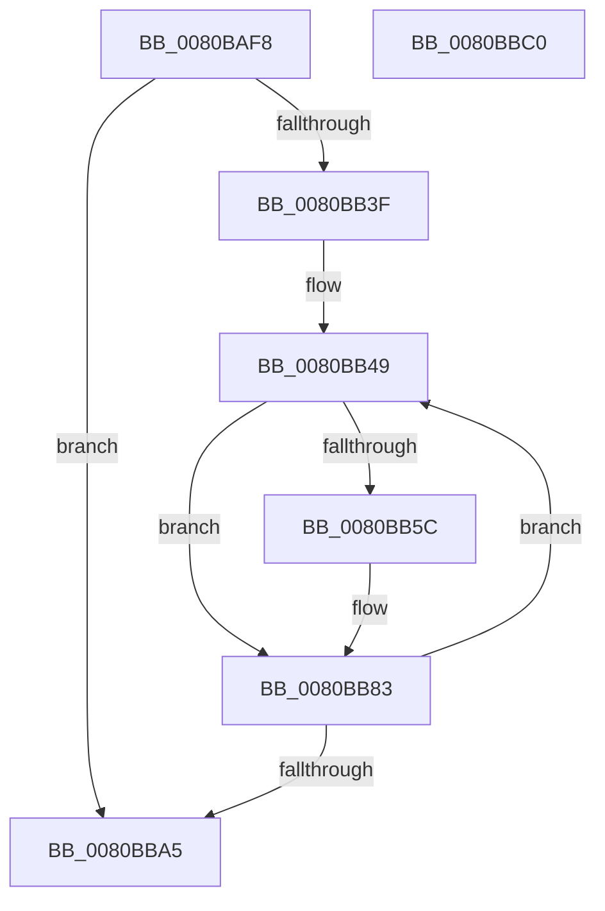

# MiCaptureSparsePages

- RVA: `0x0080BAF8`–`0x0080BBC1` (길이 `201` bytes)
- VA: `0x000000014080BAF8`
- 실행 섹션: `PAGE`
- PDB 이름 있음: `예`; PDB Function 태그: `아니요`
- unwind 정보 RVA: `0x0005E6B4`
- 디코드: `52`개 명령, `201/201` bytes 표시
- 미해석 바이트: `0` (있으면 어셈블리에 `.byte`로 보존)

> 이 문서는 커널 이미지의 기계어와 PDB 기호를 분석해 생성했습니다. 4번과 5번은 함수 원형과 자료형을 바이너리 사용 방식에서 추정한 C 해석이며 원본 소스 복구 결과는 아닙니다.

## 1. Dependencies

- 직접 호출 지점: **5**; 고유 호출 대상: **5**
- 직접 호출자로 확인된 함수: **1**
- RIP 상대 이미지 참조: **1**

### Outgoing calls
- `0x0080BB1D` → [MiInitializePageChainHead](../../text/41/MiInitializePageChainHead_function_0041D800.md) (function, `0x0041D800`)
- `0x0080BB32` → [MiMakeValidPte](../../text/2C/MiMakeValidPte_function_002C5590.md) (function, `0x002C5590`)
- `0x0080BB4F` → [MiGetContainingPageTable](../../text/34/MiGetContainingPageTable_function_003467F0.md) (function, `0x003467F0`)
- `0x0080BB7E` → [MiInsertPageChainHead](../../text/2A/MiInsertPageChainHead_function_002A24EC.md) (function, `0x002A24EC`)
- `0x0080BB96` → [MiLockAndDecrementShareCount](../../text/2A/MiLockAndDecrementShareCount_function_002A2854.md) (function, `0x002A2854`)

### Direct callers
- [MiDeleteSparseRange](MiDeleteSparseRange_function_0080C1D0.md) at `0x0080C201`

### Static image references
- `0x0080BB22` → RVA `0x00E37440` (`.data`; read)

## 2. Other-region calls and transfers

- 다른 실행 섹션으로 향하는 call: **5**
  - `0x0080BB1D` → [MiInitializePageChainHead](../../text/41/MiInitializePageChainHead_function_0041D800.md) (`PAGE` → `.text`)
  - `0x0080BB32` → [MiMakeValidPte](../../text/2C/MiMakeValidPte_function_002C5590.md) (`PAGE` → `.text`)
  - `0x0080BB4F` → [MiGetContainingPageTable](../../text/34/MiGetContainingPageTable_function_003467F0.md) (`PAGE` → `.text`)
  - `0x0080BB7E` → [MiInsertPageChainHead](../../text/2A/MiInsertPageChainHead_function_002A24EC.md) (`PAGE` → `.text`)
  - `0x0080BB96` → [MiLockAndDecrementShareCount](../../text/2A/MiLockAndDecrementShareCount_function_002A2854.md) (`PAGE` → `.text`)
- 별도 외부 분기/꼬리 이동을 확인하지 못했습니다.

## 3. Assembly (complete function range)

```asm
0080BAF8  48 8B C4                        mov rax, rsp
0080BAFB  48 89 58 08                     mov qword ptr [rax + 8], rbx
0080BAFF  48 89 68 10                     mov qword ptr [rax + 0x10], rbp
0080BB03  48 89 70 18                     mov qword ptr [rax + 0x18], rsi
0080BB07  48 89 78 20                     mov qword ptr [rax + 0x20], rdi
0080BB0B  41 56                           push r14
0080BB0D  48 83 EC 20                     sub rsp, 0x20
0080BB11  48 8B F9                        mov rdi, rcx
0080BB14  49 8B E8                        mov rbp, r8
0080BB17  49 8B C8                        mov rcx, r8
0080BB1A  48 8B F2                        mov rsi, rdx
0080BB1D  E8 DE 1C C1 FF                  call 0x14041d800
0080BB22  48 8B 15 17 B9 62 00            mov rdx, qword ptr [rip + 0x62b917]
0080BB29  41 B8 01 00 00 00               mov r8d, 1
0080BB2F  48 8B CF                        mov rcx, rdi
0080BB32  E8 59 9A AB FF                  call 0x1402c5590
0080BB37  48 8B D8                        mov rbx, rax
0080BB3A  48 85 F6                        test rsi, rsi
0080BB3D  74 66                           je 0x14080bba5
0080BB3F  49 BE 00 00 00 00 00 DE FF FF   movabs r14, 0xffffde0000000000
0080BB49  4C 8B 17                        mov r10, qword ptr [rdi]
0080BB4C  48 8B CF                        mov rcx, rdi
0080BB4F  E8 9C AC B3 FF                  call 0x1403467f0
0080BB54  4C 8B D8                        mov r11, rax
0080BB57  4C 3B D3                        cmp r10, rbx
0080BB5A  74 27                           je 0x14080bb83
0080BB5C  49 C1 EA 0C                     shr r10, 0xc
0080BB60  48 B8 FF FF FF FF FF 00 00 00   movabs rax, 0xffffffffff
0080BB6A  4C 23 D0                        and r10, rax
0080BB6D  4B 8D 14 52                     lea rdx, [r10 + r10*2]
0080BB71  48 C1 E2 04                     shl rdx, 4
0080BB75  49 8B CE                        mov rcx, r14
0080BB78  48 03 D1                        add rdx, rcx
0080BB7B  48 8B CD                        mov rcx, rbp
0080BB7E  E8 69 69 A9 FF                  call 0x1402a24ec
0080BB83  4B 8D 0C 5B                     lea rcx, [r11 + r11*2]
0080BB87  48 C1 E1 04                     shl rcx, 4
0080BB8B  49 8B C6                        mov rax, r14
0080BB8E  48 03 C8                        add rcx, rax
0080BB91  BA 04 00 00 00                  mov edx, 4
0080BB96  E8 B9 6C A9 FF                  call 0x1402a2854
0080BB9B  48 83 C7 08                     add rdi, 8
0080BB9F  48 83 EE 01                     sub rsi, 1
0080BBA3  75 A4                           jne 0x14080bb49
0080BBA5  48 8B 5C 24 30                  mov rbx, qword ptr [rsp + 0x30]
0080BBAA  48 8B 6C 24 38                  mov rbp, qword ptr [rsp + 0x38]
0080BBAF  48 8B 74 24 40                  mov rsi, qword ptr [rsp + 0x40]
0080BBB4  48 8B 7C 24 48                  mov rdi, qword ptr [rsp + 0x48]
0080BBB9  48 83 C4 20                     add rsp, 0x20
0080BBBD  41 5E                           pop r14
0080BBBF  C3                              ret
0080BBC0  CC                              int3
```

## 4. C-style interpretation (structured pseudocode)

```c
__int64 __fastcall MiCaptureSparsePages(__int64 a1, __int64 a2, __int64 a3)
{
    __int64 result;
    __int64 v_r10;
    __int64 v_rdi;
    __int64 v_rsi;
    __int64 v_rsp;
    unsigned __int64 v_stack_p10;
    unsigned __int64 v_stack_p18;
    unsigned __int64 v_stack_p20;
    unsigned __int64 v_stack_p8;

    *(unsigned __int64 *)(v_rsp + 8) = v_rbx;
    *(unsigned __int64 *)(v_rsp + 16) = v_rbp;
    *(unsigned __int64 *)(v_rsp + 24) = v_rsi;
    *(unsigned __int64 *)(v_rsp + 32) = v_rdi;
    v_rsp = (v_rsp) - (32);
    result = MiInitializePageChainHead(a3, a2, a3, a4);
    result = MiMakeValidPte(a1, *(unsigned __int64 *)(v_rip + 6469911), 1, a4);
    if (a2 == 0) goto loc_0080BBA5;
loc_0080BB49:
    result = MiGetContainingPageTable(a1, *(unsigned __int64 *)(v_rip + 6469911), 1, a4);
    v_r10 = *(unsigned __int64 *)(a1);
    if ((*(unsigned __int64 *)(a1)) != result) {
        v_r10 = (*(unsigned __int64 *)(a1)) >> (12);
        v_r10 = (v_r10) & (result);
        a2 = v_r10 + v_r10 * 2;
        a2 = (a2) << (4);
        a1 = v_r14;
        a2 = (a2) + (a1);
        a1 = a3;
        result = MiInsertPageChainHead(a1, a2, 1, a4);
    }
    a1 = (result + result * 2) << (4);
    a1 = (a1) + (v_r14);
    result = MiLockAndDecrementShareCount(a1, 4, 1, a4);
    v_rdi = (a1) + (8);
    v_rsi = (a2) - (1);
    if (condition_is_not_equal) goto loc_0080BB49;
loc_0080BBA5:
    v_rsp = (v_rsp) + (32);
    return result;
}
```

## 5. (Beta) C Style

```c
int64_t MiCaptureSparsePages(void *Arg1, int64_t Arg2, int64_t Arg3)
{
    uint8_t *arg1 = (uint8_t *)Arg1;

    int64_t result;
    int64_t local_r10;
    int64_t local_rdi;
    int64_t local_rsi;
    int64_t local_rsp;
    uint64_t v_stack_p10;
    uint64_t v_stack_p18;
    uint64_t v_stack_p20;
    uint64_t v_stack_p8;

    *(uint64_t *)(local_rsp + 0x8) = local_rbx;
    *(uint64_t *)(local_rsp + 0x10) = local_rbp;
    *(uint64_t *)(local_rsp + 0x18) = local_rsi;
    *(uint64_t *)(local_rsp + 0x20) = local_rdi;
    local_rsp = (local_rsp) - (32);
    result = MiInitializePageChainHead(Arg3, Arg2, Arg3, a4);
    result = MiMakeValidPte(Arg1, *(uint64_t *)(v_rip + 0x62B917), 1, a4);
    if (Arg2 == 0) goto loc_0080BBA5;
loc_0080BB49:
    result = MiGetContainingPageTable(Arg1, *(uint64_t *)(v_rip + 0x62B917), 1, a4);
    local_r10 = *(uint64_t *)(arg1);
    if ((*(uint64_t *)(arg1)) != result) {
        local_r10 = (*(uint64_t *)(arg1)) >> (12);
        local_r10 = (local_r10) & (result);
        Arg2 = local_r10 + local_r10 * 2;
        Arg2 = (Arg2) << (4);
        Arg1 = local_r14;
        Arg2 = (Arg2) + (Arg1);
        Arg1 = Arg3;
        result = MiInsertPageChainHead(Arg1, Arg2, 1, a4);
    }
    Arg1 = (result + result * 2) << (4);
    Arg1 = (Arg1) + (local_r14);
    result = MiLockAndDecrementShareCount(Arg1, 4, 1, a4);
    local_rdi = (Arg1) + (8);
    local_rsi = (Arg2) - (1);
    if (condition_is_not_equal) goto loc_0080BB49;
loc_0080BBA5:
    local_rsp = (local_rsp) + (32);
    return result;
}
```

### 관측된 메모리 오프셋

구조체 형식이 확인되지 않은 접근은 인자 기준의 오프셋으로만 기록했습니다.

| 기준 인자 | 오프셋 표현 | 폭 (bit) | 접근 |
|---|---:|---:|---|
| `Arg1` | `+ 0x0` | `64` | `R` |

## 6. Execution-region graph

[열기: 2D/3D 그래프와 함수 탐색 컨트롤 패널](../../../control-panel.html?section=page&rva=0x0080BAF8&view=graph)

- 2D 그래프는 위에서 아래로 흐르고, 3D 그래프는 빈 공간을 드래그해 회전합니다. Shift+드래그는 이동, 휠은 확대·축소, 함수 노드 선택은 대상 보고서 이동입니다.

### Static fallback


