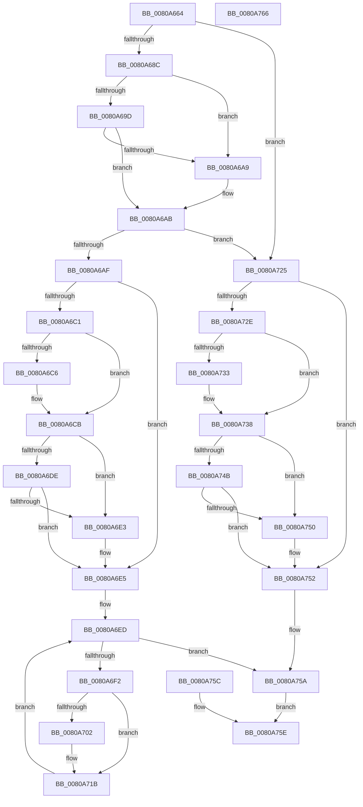

# MiCaptureUlongPtrArray

- RVA: `0x0080A664`–`0x0080A767` (길이 `259` bytes)
- VA: `0x000000014080A664`
- 실행 섹션: `PAGE`
- PDB 이름 있음: `예`; PDB Function 태그: `아니요`
- unwind 정보 RVA: `0x000D8B04`
- 디코드: `71`개 명령, `259/259` bytes 표시
- 미해석 바이트: `0` (있으면 어셈블리에 `.byte`로 보존)

> 이 문서는 커널 이미지의 기계어와 PDB 기호를 분석해 생성했습니다. 4번과 5번은 함수 원형과 자료형을 바이너리 사용 방식에서 추정한 C 해석이며 원본 소스 복구 결과는 아닙니다.

## 1. Dependencies

- 직접 호출 지점: **3**; 고유 호출 대상: **2**
- 직접 호출자로 확인된 함수: **3**
- RIP 상대 이미지 참조: **0**

### Outgoing calls
- `0x0080A6C6` → [ExRaiseDatatypeMisalignment](../89/ExRaiseDatatypeMisalignment_function_00899FD0.md) (function, `0x00899FD0`)
- `0x0080A733` → [ExRaiseDatatypeMisalignment](../89/ExRaiseDatatypeMisalignment_function_00899FD0.md) (function, `0x00899FD0`)
- `0x0080A755` → [memcpy](../../text/6C/memcpy_function_006C6840.md) (function, `0x006C6840`)

### Direct callers
- [NtFreeUserPhysicalPages](NtFreeUserPhysicalPages_function_0080AF30.md) at `0x0080B1A4`
- [NtMapUserPhysicalPages](NtMapUserPhysicalPages_function_0080B460.md) at `0x0080B50D`
- [NtMapUserPhysicalPagesScatter](NtMapUserPhysicalPagesScatter_function_0080B750.md) at `0x0080B84A`
- [NtMapUserPhysicalPagesScatter](NtMapUserPhysicalPagesScatter_function_0080B750.md) at `0x0080B895`

### Static image references
- 디코드된 RIP-relative 메모리 참조가 없습니다.

## 2. Other-region calls and transfers

- 다른 실행 섹션으로 향하는 call: **1**
  - `0x0080A755` → [memcpy](../../text/6C/memcpy_function_006C6840.md) (`PAGE` → `.text`)
- 별도 외부 분기/꼬리 이동을 확인하지 못했습니다.

## 3. Assembly (complete function range)

```asm
0080A664  40 53                           push rbx
0080A666  48 83 EC 30                     sub rsp, 0x30
0080A66A  4C 8B C9                        mov r9, rcx
0080A66D  33 DB                           xor ebx, ebx
0080A66F  65 48 8B 04 25 88 01 00 00      mov rax, qword ptr gs:[0x188]
0080A678  48 8B 80 B8 00 00 00            mov rax, qword ptr [rax + 0xb8]
0080A67F  48 39 98 10 03 00 00            cmp qword ptr [rax + 0x310], rbx
0080A686  0F 84 99 00 00 00               je 0x14080a725
0080A68C  0F B7 80 EC 06 00 00            movzx eax, word ptr [rax + 0x6ec]
0080A693  B9 4C 01 00 00                  mov ecx, 0x14c
0080A698  66 3B C1                        cmp ax, cx
0080A69B  74 0C                           je 0x14080a6a9
0080A69D  B9 C4 01 00 00                  mov ecx, 0x1c4
0080A6A2  66 3B C1                        cmp ax, cx
0080A6A5  8A C3                           mov al, bl
0080A6A7  75 02                           jne 0x14080a6ab
0080A6A9  B0 01                           mov al, 1
0080A6AB  84 C0                           test al, al
0080A6AD  74 76                           je 0x14080a725
0080A6AF  48 89 5C 24 20                  mov qword ptr [rsp + 0x20], rbx
0080A6B4  4A 8D 04 85 00 00 00 00         lea rax, [r8*4]
0080A6BC  48 85 C0                        test rax, rax
0080A6BF  74 24                           je 0x14080a6e5
0080A6C1  F6 C2 03                        test dl, 3
0080A6C4  74 05                           je 0x14080a6cb
0080A6C6  E8 05 F9 08 00                  call 0x140899fd0
0080A6CB  48 8D 0C 10                     lea rcx, [rax + rdx]
0080A6CF  48 B8 00 00 FF FF FF 7F 00 00   movabs rax, 0x7fffffff0000
0080A6D9  48 3B C8                        cmp rcx, rax
0080A6DC  77 05                           ja 0x14080a6e3
0080A6DE  48 3B CA                        cmp rcx, rdx
0080A6E1  73 02                           jae 0x14080a6e5
0080A6E3  8A 00                           mov al, byte ptr [rax]
0080A6E5  48 8B C3                        mov rax, rbx
0080A6E8  48 89 5C 24 20                  mov qword ptr [rsp + 0x20], rbx
0080A6ED  49 3B C0                        cmp rax, r8
0080A6F0  73 68                           jae 0x14080a75a
0080A6F2  8B 0C 82                        mov ecx, dword ptr [rdx + rax*4]
0080A6F5  49 89 0C C1                     mov qword ptr [r9 + rax*8], rcx
0080A6F9  48 F7 C1 00 00 00 80            test rcx, -0x80000000
0080A700  74 19                           je 0x14080a71b
0080A702  0F BA F1 1F                     btr ecx, 0x1f
0080A706  49 89 0C C1                     mov qword ptr [r9 + rax*8], rcx
0080A70A  49 BA 00 00 00 00 00 00 00 80   movabs r10, 0x8000000000000000
0080A714  49 0B CA                        or rcx, r10
0080A717  49 89 0C C1                     mov qword ptr [r9 + rax*8], rcx
0080A71B  48 FF C0                        inc rax
0080A71E  48 89 44 24 20                  mov qword ptr [rsp + 0x20], rax
0080A723  EB C8                           jmp 0x14080a6ed
0080A725  49 C1 E0 03                     shl r8, 3
0080A729  4D 85 C0                        test r8, r8
0080A72C  74 24                           je 0x14080a752
0080A72E  F6 C2 07                        test dl, 7
0080A731  74 05                           je 0x14080a738
0080A733  E8 98 F8 08 00                  call 0x140899fd0
0080A738  49 8D 0C 10                     lea rcx, [r8 + rdx]
0080A73C  48 B8 00 00 FF FF FF 7F 00 00   movabs rax, 0x7fffffff0000
0080A746  48 3B C8                        cmp rcx, rax
0080A749  77 05                           ja 0x14080a750
0080A74B  48 3B CA                        cmp rcx, rdx
0080A74E  73 02                           jae 0x14080a752
0080A750  8A 00                           mov al, byte ptr [rax]
0080A752  49 8B C9                        mov rcx, r9
0080A755  E8 E6 C0 EB FF                  call 0x1406c6840
0080A75A  EB 02                           jmp 0x14080a75e
0080A75C  8B D8                           mov ebx, eax
0080A75E  8B C3                           mov eax, ebx
0080A760  48 83 C4 30                     add rsp, 0x30
0080A764  5B                              pop rbx
0080A765  C3                              ret
0080A766  CC                              int3
```

## 4. C-style interpretation (structured pseudocode)

```c
__int64 __fastcall MiCaptureUlongPtrArray(__int64 a1, __int64 a2, __int64 a3)
{
    __int64 result;
    __int64 v_rbx;
    __int64 v_rsp;
    unsigned __int64 v_stack_m18;

    v_rsp = (v_rsp) - (48);
    v_rbx = 0;
    if ((*(unsigned __int64 *)(*(unsigned __int64 *)(*(unsigned __int64 *)(gs_base + (0 + 392)) + 184) + 784)) == 0) goto loc_0080A725;
    if (((unsigned __int16)(*(unsigned __int16 *)(*(unsigned __int64 *)(*(unsigned __int64 *)(gs_base + (0 + 392)) + 184) + 1772))) == 332) goto loc_0080A6A9;
    result = 0;
    if (((unsigned __int16)(*(unsigned __int16 *)(*(unsigned __int64 *)(*(unsigned __int64 *)(gs_base + (0 + 392)) + 184) + 1772))) == 452) {
        result = 1;
    }
    if ((unsigned __int8)(result) == 0) goto loc_0080A725;
    v_stack_m18 = 0;
    if (a3 * 4 == 0) goto loc_0080A6E5;
    result = a3 * 4;
    if ((((unsigned __int8)(a2)) & (3)) != 0) {
        result = ExRaiseDatatypeMisalignment(452, a2, a3, a1);
    }
    if ((result + a2 * 1) > result) goto loc_0080A6E3;
    if ((result + a2 * 1) < a2) {
        result = *(unsigned __int8 *)(result);
    }
    v_stack_m18 = 0;
loc_0080A6ED:
    if (0 >= a3) goto loc_0080A75A;
    *(unsigned __int64 *)(a1 + 0 * 8) = (unsigned int)(*(unsigned int *)(a2 + 0 * 4));
    if ((((unsigned int)(*(unsigned int *)(a2 + 0 * 4))) & (0xFFFFFFFF80000000ULL)) != 0) {
        *(unsigned __int64 *)(a1 + 0 * 8) = (unsigned int)(*(unsigned int *)(a2 + 0 * 4));
        a1 = ((unsigned int)(*(unsigned int *)(a2 + 0 * 4))) | (v_r10);
        *(unsigned __int64 *)(a1 + 0 * 8) = a1;
    }
    result = (0) + 1;
    v_stack_m18 = result;
    goto loc_0080A6ED;
loc_0080A725:
    a3 = (a3) << (3);
    if (a3 == 0) goto loc_0080A752;
    if ((((unsigned __int8)(a2)) & (7)) != 0) {
        result = ExRaiseDatatypeMisalignment(a1, a2, a3, a1);
    }
    if ((a3 + a2 * 1) > result) goto loc_0080A750;
    if ((a3 + a2 * 1) < a2) {
        result = *(unsigned __int8 *)(result);
    }
    result = memcpy(a1, a2, a3, a1);
loc_0080A75A:
    goto loc_0080A75E;
loc_0080A75E:
    v_rsp = (v_rsp) + (48);
    return 0;
}
```

## 5. (Beta) C Style

```c
int64_t MiCaptureUlongPtrArray(int64_t Arg1, int64_t Arg2, int64_t Arg3)
{
    int64_t result;
    int64_t local_rbx;
    int64_t local_rsp;
    uint64_t v_stack_m18;

    local_rsp = (local_rsp) - (48);
    local_rbx = 0;
    if ((*(uint64_t *)(*(uint64_t *)(*(uint64_t *)(gs_base + (0 + 0x188)) + 0xB8) + 0x310)) == 0) goto loc_0080A725;
    if (((uint16_t)(*(uint16_t *)(*(uint64_t *)(*(uint64_t *)(gs_base + (0 + 0x188)) + 0xB8) + 0x6EC))) == 332) goto loc_0080A6A9;
    result = 0;
    if (((uint16_t)(*(uint16_t *)(*(uint64_t *)(*(uint64_t *)(gs_base + (0 + 0x188)) + 0xB8) + 0x6EC))) == 452) {
        result = 1;
    }
    if ((uint8_t)(result) == 0) goto loc_0080A725;
    v_stack_m18 = 0;
    if (Arg3 * 4 == 0) goto loc_0080A6E5;
    result = Arg3 * 4;
    if ((((uint8_t)(Arg2)) & (3)) != 0) {
        result = ExRaiseDatatypeMisalignment(452, Arg2, Arg3, Arg1);
    }
    if ((result + Arg2 * 1) > result) goto loc_0080A6E3;
    if ((result + Arg2 * 1) < Arg2) {
        result = *(uint8_t *)(result);
    }
    v_stack_m18 = 0;
loc_0080A6ED:
    if (0 >= Arg3) goto loc_0080A75A;
    *(uint64_t *)(Arg1 + 0x0 * 8) = (uint32_t)(*(uint32_t *)(Arg2 + 0x0 * 4));
    if ((((uint32_t)(*(uint32_t *)(Arg2 + 0x0 * 4))) & (0xFFFFFFFF80000000ULL)) != 0) {
        *(uint64_t *)(Arg1 + 0x0 * 8) = (uint32_t)(*(uint32_t *)(Arg2 + 0x0 * 4));
        Arg1 = ((uint32_t)(*(uint32_t *)(Arg2 + 0x0 * 4))) | (local_r10);
        *(uint64_t *)(Arg1 + 0x0 * 8) = Arg1;
    }
    result = (0) + 1;
    v_stack_m18 = result;
    goto loc_0080A6ED;
loc_0080A725:
    Arg3 = (Arg3) << (3);
    if (Arg3 == 0) goto loc_0080A752;
    if ((((uint8_t)(Arg2)) & (7)) != 0) {
        result = ExRaiseDatatypeMisalignment(Arg1, Arg2, Arg3, Arg1);
    }
    if ((Arg3 + Arg2 * 1) > result) goto loc_0080A750;
    if ((Arg3 + Arg2 * 1) < Arg2) {
        result = *(uint8_t *)(result);
    }
    result = memcpy(Arg1, Arg2, Arg3, Arg1);
loc_0080A75A:
    goto loc_0080A75E;
loc_0080A75E:
    local_rsp = (local_rsp) + (48);
    return 0;
}
```

## 6. Execution-region graph

[열기: 2D/3D 그래프와 함수 탐색 컨트롤 패널](../../../control-panel.html?section=page&rva=0x0080A664&view=graph)

- 2D 그래프는 위에서 아래로 흐르고, 3D 그래프는 빈 공간을 드래그해 회전합니다. Shift+드래그는 이동, 휠은 확대·축소, 함수 노드 선택은 대상 보고서 이동입니다.

### Static fallback


