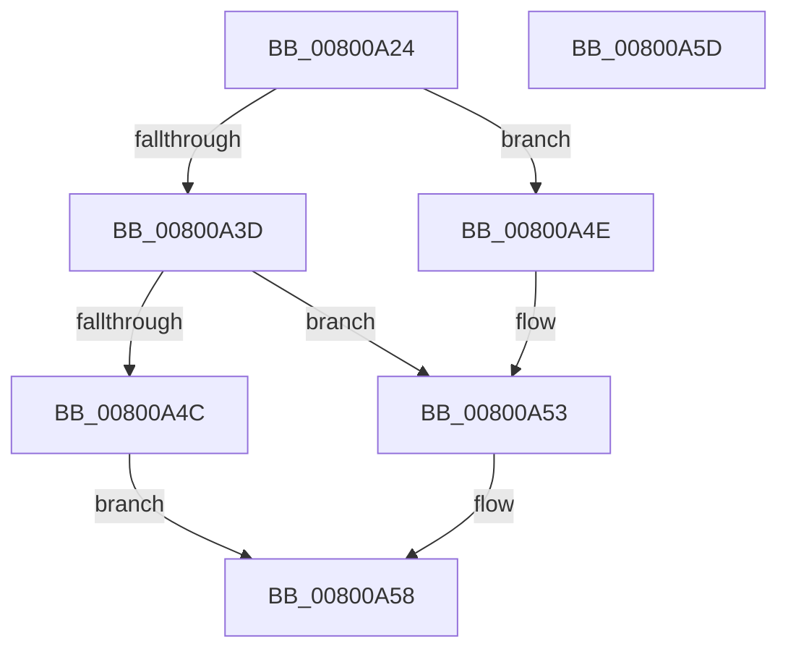

# MiChargeLargeProtoSubsection

- RVA: `0x00800A24`–`0x00800A5E` (길이 `58` bytes)
- VA: `0x0000000140800A24`
- 실행 섹션: `PAGE`
- PDB 이름 있음: `예`; PDB Function 태그: `아니요`
- unwind 정보 RVA: `0x0005C788`
- 디코드: `17`개 명령, `58/58` bytes 표시
- 미해석 바이트: `0` (있으면 어셈블리에 `.byte`로 보존)

> 이 문서는 커널 이미지의 기계어와 PDB 기호를 분석해 생성했습니다. 4번과 5번은 함수 원형과 자료형을 바이너리 사용 방식에서 추정한 C 해석이며 원본 소스 복구 결과는 아닙니다.

## 1. Dependencies

- 직접 호출 지점: **2**; 고유 호출 대상: **2**
- 직접 호출자로 확인된 함수: **3**
- RIP 상대 이미지 참조: **1**

### Outgoing calls
- `0x00800A43` → [MiChargeResident](../../text/28/MiChargeResident_function_0028A0F0.md) (function, `0x0028A0F0`)
- `0x00800A4E` → [MiReturnResident](../../text/28/MiReturnResident_function_00286890.md) (function, `0x00286890`)

### Direct callers
- [MiCreatePrototypePtes](../../text/29/MiCreatePrototypePtes_function_002950FC.md) at `0x002955B9`
- [MiCreatePrototypePtes](../../text/29/MiCreatePrototypePtes_function_002950FC.md) at `0x0029564E`
- [MiDecrementLargeSubsections](../../text/4D/MiDecrementLargeSubsections_function_004D2BE0.md) at `0x004D2CCF`
- [MiEnableLargeSubsection](../../text/68/MiEnableLargeSubsection_function_00680BC4.md) at `0x00680BED`

### Static image references
- `0x00800A2B` → RVA `0x00E38D00` (`.data`; read)

## 2. Other-region calls and transfers

- 다른 실행 섹션으로 향하는 call: **2**
  - `0x00800A43` → [MiChargeResident](../../text/28/MiChargeResident_function_0028A0F0.md) (`PAGE` → `.text`)
  - `0x00800A4E` → [MiReturnResident](../../text/28/MiReturnResident_function_00286890.md) (`PAGE` → `.text`)
- 별도 외부 분기/꼬리 이동을 확인하지 못했습니다.

## 3. Assembly (complete function range)

```asm
00800A24  48 83 EC 28                     sub rsp, 0x28
00800A28  8B 41 2C                        mov eax, dword ptr [rcx + 0x2c]
00800A2B  48 8D 0D CE 82 63 00            lea rcx, [rip + 0x6382ce]
00800A32  48 C1 E8 09                     shr rax, 9
00800A36  85 D2                           test edx, edx
00800A38  48 8B D0                        mov rdx, rax
00800A3B  74 11                           je 0x140800a4e
00800A3D  41 B8 00 04 00 00               mov r8d, 0x400
00800A43  E8 A8 96 A8 FF                  call 0x14028a0f0
00800A48  85 C0                           test eax, eax
00800A4A  75 07                           jne 0x140800a53
00800A4C  EB 0A                           jmp 0x140800a58
00800A4E  E8 3D 5E A8 FF                  call 0x140286890
00800A53  B8 01 00 00 00                  mov eax, 1
00800A58  48 83 C4 28                     add rsp, 0x28
00800A5C  C3                              ret
00800A5D  CC                              int3
```

## 4. C-style interpretation (structured pseudocode)

```c
__int64 __fastcall MiChargeLargeProtoSubsection(__int64 a1, int a2)
{
    __int64 result;
    __int64 v_rsp;

    v_rsp = (v_rsp) - (40);
    result = ((unsigned int)(*(unsigned int *)(a1 + 44))) >> (9);
    if (a2 == 0) goto loc_00800A4E;
    result = MiChargeResident(v_rip + 6521550, result, (unsigned int)(0x400ULL), a4);
    if ((unsigned int)(result) != 0) goto loc_00800A53;
    goto loc_00800A58;
loc_00800A4E:
    result = MiReturnResident(v_rip + 6521550, result, (unsigned int)(0x400ULL), a4);
loc_00800A53:
loc_00800A58:
    v_rsp = (v_rsp) + (40);
    return 1;
}
```

## 5. (Beta) C Style

```c
int64_t MiChargeLargeProtoSubsection(void *Arg1, int32_t Arg2)
{
    uint8_t *arg1 = (uint8_t *)Arg1;

    int64_t result;
    int64_t local_rsp;

    local_rsp = (local_rsp) - (40);
    result = ((uint32_t)(*(uint32_t *)(arg1 + 0x2C))) >> (9);
    if (Arg2 == 0) goto loc_00800A4E;
    result = MiChargeResident(v_rip + 6521550, result, (uint32_t)(0x400ULL), a4);
    if ((uint32_t)(result) != 0) goto loc_00800A53;
    goto loc_00800A58;
loc_00800A4E:
    result = MiReturnResident(v_rip + 6521550, result, (uint32_t)(0x400ULL), a4);
loc_00800A53:
loc_00800A58:
    local_rsp = (local_rsp) + (40);
    return 1;
}
```

### 관측된 메모리 오프셋

구조체 형식이 확인되지 않은 접근은 인자 기준의 오프셋으로만 기록했습니다.

| 기준 인자 | 오프셋 표현 | 폭 (bit) | 접근 |
|---|---:|---:|---|
| `Arg1` | `+ 0x2C` | `32` | `R` |

## 6. Execution-region graph

[열기: 2D/3D 그래프와 함수 탐색 컨트롤 패널](../../../control-panel.html?section=page&rva=0x00800A24&view=graph)

- 2D 그래프는 위에서 아래로 흐르고, 3D 그래프는 빈 공간을 드래그해 회전합니다. Shift+드래그는 이동, 휠은 확대·축소, 함수 노드 선택은 대상 보고서 이동입니다.

### Static fallback


