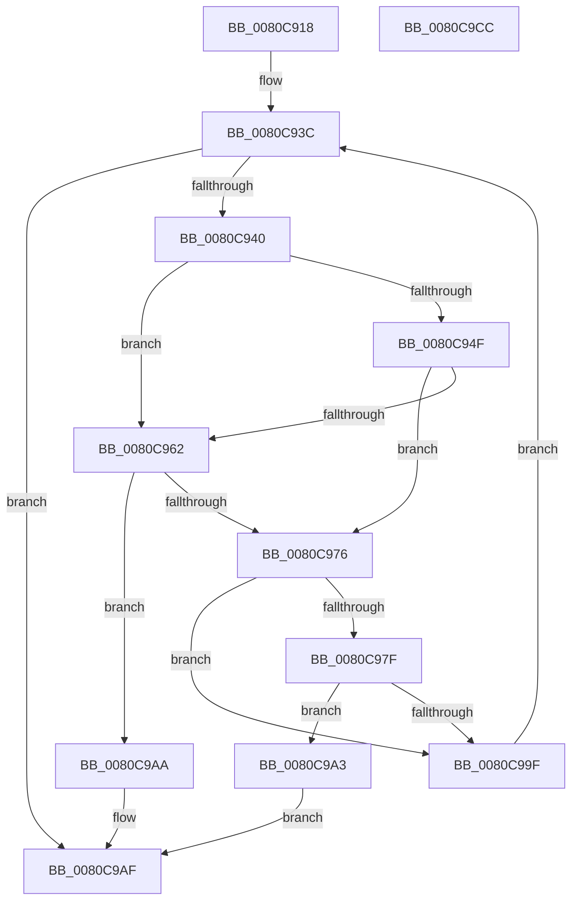

# MiCheckVerifierFunctionsCfgState

- RVA: `0x0080C918`–`0x0080C9CD` (길이 `181` bytes)
- VA: `0x000000014080C918`
- 실행 섹션: `PAGE`
- PDB 이름 있음: `예`; PDB Function 태그: `아니요`
- unwind 정보 RVA: `0x0005E6B4`
- 디코드: `53`개 명령, `181/181` bytes 표시
- 미해석 바이트: `0` (있으면 어셈블리에 `.byte`로 보존)

> 이 문서는 커널 이미지의 기계어와 PDB 기호를 분석해 생성했습니다. 4번과 5번은 함수 원형과 자료형을 바이너리 사용 방식에서 추정한 C 해석이며 원본 소스 복구 결과는 아닙니다.

## 1. Dependencies

- 직접 호출 지점: **3**; 고유 호출 대상: **3**
- 직접 호출자로 확인된 함수: **1**
- RIP 상대 이미지 참조: **1**

### Outgoing calls
- `0x0080C959` → [MiImageContainsVa](../../text/4B/MiImageContainsVa_function_004B1874.md) (function, `0x004B1874`)
- `0x0080C969` → [MmFindDataTableEntryByAddress](../../text/2A/MmFindDataTableEntryByAddress_function_002A3C0C.md) (function, `0x002A3C0C`)
- `0x0080C993` → [CfgAddressToBitState](../../text/4B/CfgAddressToBitState_function_004B9550.md) (function, `0x004B9550`)

### Direct callers
- [MiReapplyImportOptimizationForDriverVerifier](../../text/68/MiReapplyImportOptimizationForDriverVerifier_function_00682268.md) at `0x006823E9`

### Static image references
- `0x0080C97F` → RVA `0x00E2D818` (`.data`; read)

## 2. Other-region calls and transfers

- 다른 실행 섹션으로 향하는 call: **3**
  - `0x0080C959` → [MiImageContainsVa](../../text/4B/MiImageContainsVa_function_004B1874.md) (`PAGE` → `.text`)
  - `0x0080C969` → [MmFindDataTableEntryByAddress](../../text/2A/MmFindDataTableEntryByAddress_function_002A3C0C.md) (`PAGE` → `.text`)
  - `0x0080C993` → [CfgAddressToBitState](../../text/4B/CfgAddressToBitState_function_004B9550.md) (`PAGE` → `.text`)
- 별도 외부 분기/꼬리 이동을 확인하지 못했습니다.

## 3. Assembly (complete function range)

```asm
0080C918  48 8B C4                        mov rax, rsp
0080C91B  48 89 58 08                     mov qword ptr [rax + 8], rbx
0080C91F  48 89 68 10                     mov qword ptr [rax + 0x10], rbp
0080C923  48 89 70 18                     mov qword ptr [rax + 0x18], rsi
0080C927  48 89 78 20                     mov qword ptr [rax + 0x20], rdi
0080C92B  41 56                           push r14
0080C92D  48 83 EC 20                     sub rsp, 0x20
0080C931  33 DB                           xor ebx, ebx
0080C933  8B EA                           mov ebp, edx
0080C935  8B F3                           mov esi, ebx
0080C937  8B FB                           mov edi, ebx
0080C939  4C 8B F1                        mov r14, rcx
0080C93C  3B FD                           cmp edi, ebp
0080C93E  73 6F                           jae 0x14080c9af
0080C940  8B C7                           mov eax, edi
0080C942  4C 8D 04 40                     lea r8, [rax + rax*2]
0080C946  4F 8D 0C C6                     lea r9, [r14 + r8*8]
0080C94A  48 85 F6                        test rsi, rsi
0080C94D  74 13                           je 0x14080c962
0080C94F  4D 8B 59 08                     mov r11, qword ptr [r9 + 8]
0080C953  48 8B CE                        mov rcx, rsi
0080C956  49 8B D3                        mov rdx, r11
0080C959  E8 16 4F CA FF                  call 0x1404b1874
0080C95E  85 C0                           test eax, eax
0080C960  75 14                           jne 0x14080c976
0080C962  4D 8B 59 08                     mov r11, qword ptr [r9 + 8]
0080C966  49 8B CB                        mov rcx, r11
0080C969  E8 9E 72 A9 FF                  call 0x1402a3c0c
0080C96E  48 8B F0                        mov rsi, rax
0080C971  48 85 C0                        test rax, rax
0080C974  74 34                           je 0x14080c9aa
0080C976  F7 46 68 00 20 00 00            test dword ptr [rsi + 0x68], 0x2000
0080C97D  74 20                           je 0x14080c99f
0080C97F  48 8B 15 92 0E 62 00            mov rdx, qword ptr [rip + 0x620e92]
0080C986  48 B9 00 00 00 00 00 80 00 00   movabs rcx, 0x800000000000
0080C990  49 03 CB                        add rcx, r11
0080C993  E8 B8 CB CA FF                  call 0x1404b9550
0080C998  A9 FD FF FF FF                  test eax, 0xfffffffd
0080C99D  74 04                           je 0x14080c9a3
0080C99F  FF C7                           inc edi
0080C9A1  EB 99                           jmp 0x14080c93c
0080C9A3  BB 84 01 00 C0                  mov ebx, 0xc0000184
0080C9A8  EB 05                           jmp 0x14080c9af
0080C9AA  BB 0D 00 00 C0                  mov ebx, 0xc000000d
0080C9AF  48 8B 6C 24 38                  mov rbp, qword ptr [rsp + 0x38]
0080C9B4  8B C3                           mov eax, ebx
0080C9B6  48 8B 5C 24 30                  mov rbx, qword ptr [rsp + 0x30]
0080C9BB  48 8B 74 24 40                  mov rsi, qword ptr [rsp + 0x40]
0080C9C0  48 8B 7C 24 48                  mov rdi, qword ptr [rsp + 0x48]
0080C9C5  48 83 C4 20                     add rsp, 0x20
0080C9C9  41 5E                           pop r14
0080C9CB  C3                              ret
0080C9CC  CC                              int3
```

## 4. C-style interpretation (structured pseudocode)

```c
__int64 __fastcall MiCheckVerifierFunctionsCfgState(__int64 a1, int a2)
{
    __int64 result;
    __int64 v_rbx;
    __int64 v_rdi;
    __int64 v_rsp;
    unsigned __int64 v_stack_p10;
    unsigned __int64 v_stack_p18;
    unsigned __int64 v_stack_p20;
    unsigned __int64 v_stack_p8;

    *(unsigned __int64 *)(v_rsp + 8) = v_rbx;
    *(unsigned __int64 *)(v_rsp + 16) = v_rbp;
    *(unsigned __int64 *)(v_rsp + 24) = v_rsi;
    *(unsigned __int64 *)(v_rsp + 32) = v_rdi;
    v_rsp = (v_rsp) - (32);
    v_rbx = 0;
loc_0080C93C:
    if (0 >= ((unsigned int)((unsigned int)(a2)))) goto loc_0080C9AF;
    if (0 == 0) goto loc_0080C962;
    result = MiImageContainsVa(0, *(unsigned __int64 *)(a1 + 0 + 0 * 2 * 8 + 8), 0 + 0 * 2, a1 + 0 + 0 * 2 * 8);
    if ((unsigned int)(result) != 0) goto loc_0080C976;
loc_0080C962:
    result = MmFindDataTableEntryByAddress(*(unsigned __int64 *)(a1 + 0 + 0 * 2 * 8 + 8), *(unsigned __int64 *)(a1 + 0 + 0 * 2 * 8 + 8), 0 + 0 * 2, a1 + 0 + 0 * 2 * 8);
    if (result == 0) goto loc_0080C9AA;
loc_0080C976:
    if (((*(unsigned int *)(result + 104)) & (0x2000ULL)) == 0) goto loc_0080C99F;
    a1 = (*(unsigned __int64 *)(a1 + 0 + 0 * 2 * 8 + 8)) + (*(unsigned __int64 *)(a1 + 0 + 0 * 2 * 8 + 8));
    result = CfgAddressToBitState(a1, *(unsigned __int64 *)(v_rip + 6426258), 0 + 0 * 2, a1 + 0 + 0 * 2 * 8);
    if ((((unsigned int)(result)) & (0xFFFFFFFDULL)) == 0) goto loc_0080C9A3;
loc_0080C99F:
    v_rdi = (unsigned int)((0) + 1);
    goto loc_0080C93C;
loc_0080C9A3:
    goto loc_0080C9AF;
loc_0080C9AA:
loc_0080C9AF:
    v_rsp = (v_rsp) + (32);
    return (unsigned int)((unsigned int)((unsigned int)(0xC000000DULL)));
}
```

## 5. (Beta) C Style

```c
int64_t MiCheckVerifierFunctionsCfgState(void *Arg1, int32_t Arg2)
{
    uint8_t *arg1 = (uint8_t *)Arg1;

    int64_t result;
    int64_t local_rbx;
    int64_t local_rdi;
    int64_t local_rsp;
    uint64_t v_stack_p10;
    uint64_t v_stack_p18;
    uint64_t v_stack_p20;
    uint64_t v_stack_p8;

    *(uint64_t *)(local_rsp + 0x8) = local_rbx;
    *(uint64_t *)(local_rsp + 0x10) = local_rbp;
    *(uint64_t *)(local_rsp + 0x18) = local_rsi;
    *(uint64_t *)(local_rsp + 0x20) = local_rdi;
    local_rsp = (local_rsp) - (32);
    local_rbx = 0;
loc_0080C93C:
    if (0 >= ((uint32_t)((uint32_t)(Arg2)))) goto loc_0080C9AF;
    if (0 == 0) goto loc_0080C962;
    result = MiImageContainsVa(0, *(uint64_t *)(arg1 + 0x0 + 0x0 * 2 * 8 + 0x8), 0 + 0 * 2, Arg1 + 0 + 0 * 2 * 8);
    if ((uint32_t)(result) != 0) goto loc_0080C976;
loc_0080C962:
    result = MmFindDataTableEntryByAddress(*(uint64_t *)(arg1 + 0x0 + 0x0 * 2 * 8 + 0x8), *(uint64_t *)(arg1 + 0x0 + 0x0 * 2 * 8 + 0x8), 0 + 0 * 2, Arg1 + 0 + 0 * 2 * 8);
    if (result == 0) goto loc_0080C9AA;
loc_0080C976:
    if (((*(uint32_t *)(result + 0x68)) & (0x2000ULL)) == 0) goto loc_0080C99F;
    Arg1 = (*(uint64_t *)(arg1 + 0x0 + 0x0 * 2 * 8 + 0x8)) + (*(uint64_t *)(arg1 + 0x0 + 0x0 * 2 * 8 + 0x8));
    result = CfgAddressToBitState(Arg1, *(uint64_t *)(v_rip + 0x620E92), 0 + 0 * 2, Arg1 + 0 + 0 * 2 * 8);
    if ((((uint32_t)(result)) & (0xFFFFFFFDULL)) == 0) goto loc_0080C9A3;
loc_0080C99F:
    local_rdi = (uint32_t)((0) + 1);
    goto loc_0080C93C;
loc_0080C9A3:
    goto loc_0080C9AF;
loc_0080C9AA:
loc_0080C9AF:
    local_rsp = (local_rsp) + (32);
    return (uint32_t)((uint32_t)((uint32_t)(0xC000000DULL)));
}
```

### 관측된 메모리 오프셋

구조체 형식이 확인되지 않은 접근은 인자 기준의 오프셋으로만 기록했습니다.

| 기준 인자 | 오프셋 표현 | 폭 (bit) | 접근 |
|---|---:|---:|---|
| `Arg1` | `+ 0x0 + r8*8` | `64` | `R` |
| `Arg1` | `+ 0x8` | `64` | `R` |

## 6. Execution-region graph

[열기: 2D/3D 그래프와 함수 탐색 컨트롤 패널](../../../control-panel.html?section=page&rva=0x0080C918&view=graph)

- 2D 그래프는 위에서 아래로 흐르고, 3D 그래프는 빈 공간을 드래그해 회전합니다. Shift+드래그는 이동, 휠은 확대·축소, 함수 노드 선택은 대상 보고서 이동입니다.

### Static fallback


