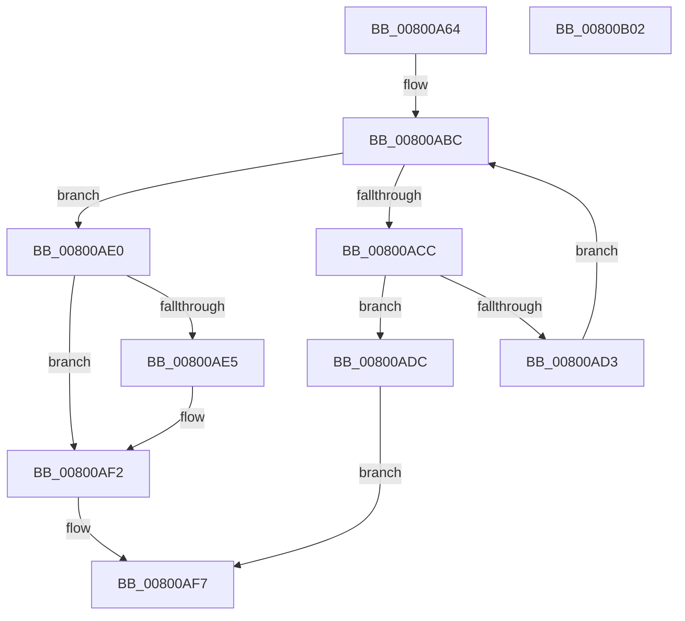

# MiCloneLargeFileOnlyVad

- RVA: `0x00800A64`–`0x00800B03` (길이 `159` bytes)
- VA: `0x0000000140800A64`
- 실행 섹션: `PAGE`
- PDB 이름 있음: `예`; PDB Function 태그: `아니요`
- unwind 정보 RVA: `0x000CBDD4`
- 디코드: `47`개 명령, `159/159` bytes 표시
- 미해석 바이트: `0` (있으면 어셈블리에 `.byte`로 보존)

> 이 문서는 커널 이미지의 기계어와 PDB 기호를 분석해 생성했습니다. 4번과 5번은 함수 원형과 자료형을 바이너리 사용 방식에서 추정한 C 해석이며 원본 소스 복구 결과는 아닙니다.

## 1. Dependencies

- 직접 호출 지점: **4**; 고유 호출 대상: **3**
- 직접 호출자로 확인된 함수: **1**
- RIP 상대 이미지 참조: **0**

### Outgoing calls
- `0x00800A92` → [MiGetProtoPteAddress](../../text/32/MiGetProtoPteAddress_function_0032E970.md) (function, `0x0032E970`)
- `0x00800AB0` → [MiGetProtoPteAddress](../../text/32/MiGetProtoPteAddress_function_0032E970.md) (function, `0x0032E970`)
- `0x00800AC2` → [MiIncrementLargeSubsections](../../text/4D/MiIncrementLargeSubsections_function_004D3410.md) (function, `0x004D3410`)
- `0x00800AED` → [MiDecrementLargeSubsections](../../text/4D/MiDecrementLargeSubsections_function_004D2BE0.md) (function, `0x004D2BE0`)

### Direct callers
- [MiAllocateChildVads](../97/MiAllocateChildVads_function_0097E380.md) at `0x0097E77C`

### Static image references
- 디코드된 RIP-relative 메모리 참조가 없습니다.

## 2. Other-region calls and transfers

- 다른 실행 섹션으로 향하는 call: **4**
  - `0x00800A92` → [MiGetProtoPteAddress](../../text/32/MiGetProtoPteAddress_function_0032E970.md) (`PAGE` → `.text`)
  - `0x00800AB0` → [MiGetProtoPteAddress](../../text/32/MiGetProtoPteAddress_function_0032E970.md) (`PAGE` → `.text`)
  - `0x00800AC2` → [MiIncrementLargeSubsections](../../text/4D/MiIncrementLargeSubsections_function_004D3410.md) (`PAGE` → `.text`)
  - `0x00800AED` → [MiDecrementLargeSubsections](../../text/4D/MiDecrementLargeSubsections_function_004D2BE0.md) (`PAGE` → `.text`)
- 별도 외부 분기/꼬리 이동을 확인하지 못했습니다.

## 3. Assembly (complete function range)

```asm
00800A64  4C 8B DC                        mov r11, rsp
00800A67  49 89 5B 18                     mov qword ptr [r11 + 0x18], rbx
00800A6B  57                              push rdi
00800A6C  48 83 EC 20                     sub rsp, 0x20
00800A70  0F B6 51 20                     movzx edx, byte ptr [rcx + 0x20]
00800A74  4D 8D 4B 08                     lea r9, [r11 + 8]
00800A78  8B 41 18                        mov eax, dword ptr [rcx + 0x18]
00800A7B  45 33 C0                        xor r8d, r8d
00800A7E  49 83 63 08 00                  and qword ptr [r11 + 8], 0
00800A83  48 8B D9                        mov rbx, rcx
00800A86  49 83 63 10 00                  and qword ptr [r11 + 0x10], 0
00800A8B  48 C1 E2 20                     shl rdx, 0x20
00800A8F  48 0B D0                        or rdx, rax
00800A92  E8 D9 DE B2 FF                  call 0x14032e970
00800A97  0F B6 53 21                     movzx edx, byte ptr [rbx + 0x21]
00800A9B  4C 8D 4C 24 38                  lea r9, [rsp + 0x38]
00800AA0  8B 43 1C                        mov eax, dword ptr [rbx + 0x1c]
00800AA3  45 33 C0                        xor r8d, r8d
00800AA6  48 C1 E2 20                     shl rdx, 0x20
00800AAA  48 8B CB                        mov rcx, rbx
00800AAD  48 0B D0                        or rdx, rax
00800AB0  E8 BB DE B2 FF                  call 0x14032e970
00800AB5  48 8B 5C 24 30                  mov rbx, qword ptr [rsp + 0x30]
00800ABA  33 FF                           xor edi, edi
00800ABC  8B 53 2C                        mov edx, dword ptr [rbx + 0x2c]
00800ABF  48 8B CB                        mov rcx, rbx
00800AC2  E8 49 29 CD FF                  call 0x1404d3410
00800AC7  83 F8 FF                        cmp eax, -1
00800ACA  74 14                           je 0x140800ae0
00800ACC  48 3B 5C 24 38                  cmp rbx, qword ptr [rsp + 0x38]
00800AD1  74 09                           je 0x140800adc
00800AD3  48 8B FB                        mov rdi, rbx
00800AD6  48 8B 5B 10                     mov rbx, qword ptr [rbx + 0x10]
00800ADA  EB E0                           jmp 0x140800abc
00800ADC  33 C0                           xor eax, eax
00800ADE  EB 17                           jmp 0x140800af7
00800AE0  48 85 FF                        test rdi, rdi
00800AE3  74 0D                           je 0x140800af2
00800AE5  48 8B 4C 24 30                  mov rcx, qword ptr [rsp + 0x30]
00800AEA  48 8B D7                        mov rdx, rdi
00800AED  E8 EE 20 CD FF                  call 0x1404d2be0
00800AF2  B8 9A 00 00 C0                  mov eax, 0xc000009a
00800AF7  48 8B 5C 24 40                  mov rbx, qword ptr [rsp + 0x40]
00800AFC  48 83 C4 20                     add rsp, 0x20
00800B00  5F                              pop rdi
00800B01  C3                              ret
00800B02  CC                              int3
```

## 4. C-style interpretation (structured pseudocode)

```c
__int64 __fastcall MiCloneLargeFileOnlyVad(__int64 a1, __int64 a2, int a3)
{
    __int64 result;
    __int64 v_rdi;
    __int64 v_rsp;
    unsigned __int64 v_stack_p10;
    unsigned __int64 v_stack_p18;
    unsigned __int64 v_stack_p8;

    *(unsigned __int64 *)(v_rsp + 24) = v_rbx;
    v_rsp = (v_rsp) - (32);
    a3 = 0;
    a2 = (*(unsigned __int8 *)(a1 + 32)) << (32);
    a2 = (a2) | ((unsigned int)(*(unsigned int *)(a1 + 24)));
    result = MiGetProtoPteAddress(a1, a2, a3, v_rsp + 8);
    a3 = 0;
    a2 = (*(unsigned __int8 *)(a1 + 33)) << (32);
    a2 = (a2) | ((unsigned int)(*(unsigned int *)(a1 + 28)));
    result = MiGetProtoPteAddress(a1, a2, a3, v_stack_p10);
    v_rdi = 0;
loc_00800ABC:
    result = MiIncrementLargeSubsections(v_stack_p8, (unsigned int)(*(unsigned int *)(v_stack_p8 + 44)), a3, v_stack_p10);
    if (((unsigned int)(result)) == -1) goto loc_00800AE0;
    if (v_stack_p8 == v_stack_p10) goto loc_00800ADC;
    goto loc_00800ABC;
loc_00800ADC:
    result = 0;
    goto loc_00800AF7;
loc_00800AE0:
    if (v_stack_p8 != 0) {
        a1 = v_stack_p8;
        a2 = v_stack_p8;
        result = MiDecrementLargeSubsections(a1, a2, a3, v_stack_p10);
    }
loc_00800AF7:
    v_rsp = (v_rsp) + (32);
    return (unsigned int)(0xC000009AULL);
}
```

## 5. (Beta) C Style

```c
int64_t MiCloneLargeFileOnlyVad(void *Arg1, int64_t Arg2, int32_t Arg3)
{
    uint8_t *arg1 = (uint8_t *)Arg1;

    int64_t result;
    int64_t local_rdi;
    int64_t local_rsp;
    uint64_t v_stack_p10;
    uint64_t v_stack_p18;
    uint64_t v_stack_p8;

    *(uint64_t *)(local_rsp + 0x18) = local_rbx;
    local_rsp = (local_rsp) - (32);
    Arg3 = 0;
    Arg2 = (*(uint8_t *)(arg1 + 0x20)) << (32);
    Arg2 = (Arg2) | ((uint32_t)(*(uint32_t *)(arg1 + 0x18)));
    result = MiGetProtoPteAddress(Arg1, Arg2, Arg3, local_rsp + 8);
    Arg3 = 0;
    Arg2 = (*(uint8_t *)(arg1 + 0x21)) << (32);
    Arg2 = (Arg2) | ((uint32_t)(*(uint32_t *)(arg1 + 0x1C)));
    result = MiGetProtoPteAddress(Arg1, Arg2, Arg3, v_stack_p10);
    local_rdi = 0;
loc_00800ABC:
    result = MiIncrementLargeSubsections(v_stack_p8, (uint32_t)(*(uint32_t *)(v_stack_p8 + 0x2C)), Arg3, v_stack_p10);
    if (((uint32_t)(result)) == -1) goto loc_00800AE0;
    if (v_stack_p8 == v_stack_p10) goto loc_00800ADC;
    goto loc_00800ABC;
loc_00800ADC:
    result = 0;
    goto loc_00800AF7;
loc_00800AE0:
    if (v_stack_p8 != 0) {
        Arg1 = v_stack_p8;
        Arg2 = v_stack_p8;
        result = MiDecrementLargeSubsections(Arg1, Arg2, Arg3, v_stack_p10);
    }
loc_00800AF7:
    local_rsp = (local_rsp) + (32);
    return (uint32_t)(0xC000009AULL);
}
```

### 관측된 메모리 오프셋

구조체 형식이 확인되지 않은 접근은 인자 기준의 오프셋으로만 기록했습니다.

| 기준 인자 | 오프셋 표현 | 폭 (bit) | 접근 |
|---|---:|---:|---|
| `Arg1` | `+ 0x18` | `32` | `R` |
| `Arg1` | `+ 0x1C` | `32` | `R` |
| `Arg1` | `+ 0x20` | `8` | `R` |
| `Arg1` | `+ 0x21` | `8` | `R` |

## 6. Execution-region graph

[열기: 2D/3D 그래프와 함수 탐색 컨트롤 패널](../../../control-panel.html?section=page&rva=0x00800A64&view=graph)

- 2D 그래프는 위에서 아래로 흐르고, 3D 그래프는 빈 공간을 드래그해 회전합니다. Shift+드래그는 이동, 휠은 확대·축소, 함수 노드 선택은 대상 보고서 이동입니다.

### Static fallback


