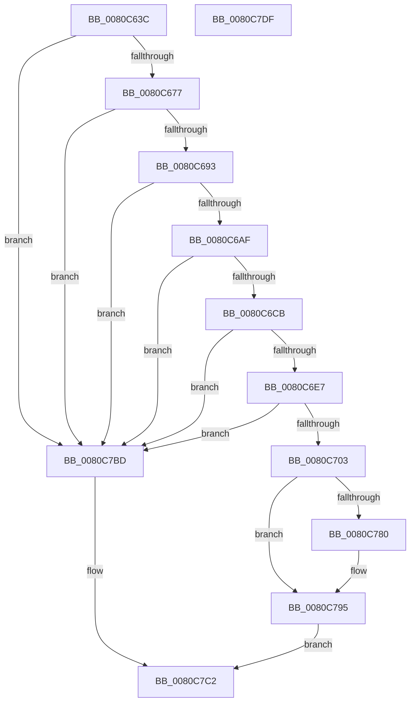

# MiCompactServiceTable

- RVA: `0x0080C63C`–`0x0080C7E0` (길이 `420` bytes)
- VA: `0x000000014080C63C`
- 실행 섹션: `PAGE`
- PDB 이름 있음: `예`; PDB Function 태그: `아니요`
- unwind 정보 RVA: `0x0008C2BC`
- 디코드: `107`개 명령, `420/420` bytes 표시
- 미해석 바이트: `0` (있으면 어셈블리에 `.byte`로 보존)

> 이 문서는 커널 이미지의 기계어와 PDB 기호를 분석해 생성했습니다. 4번과 5번은 함수 원형과 자료형을 바이너리 사용 방식에서 추정한 C 해석이며 원본 소스 복구 결과는 아닙니다.

## 1. Dependencies

- 직접 호출 지점: **13**; 고유 호출 대상: **4**
- 직접 호출자로 확인된 함수: **2**
- RIP 상대 이미지 참조: **6**

### Outgoing calls
- `0x0080C666` → [RtlFindExportedRoutineByName](../90/RtlFindExportedRoutineByName_function_0090F0A0.md) (function, `0x0090F0A0`)
- `0x0080C682` → [RtlFindExportedRoutineByName](../90/RtlFindExportedRoutineByName_function_0090F0A0.md) (function, `0x0090F0A0`)
- `0x0080C69E` → [RtlFindExportedRoutineByName](../90/RtlFindExportedRoutineByName_function_0090F0A0.md) (function, `0x0090F0A0`)
- `0x0080C6BA` → [RtlFindExportedRoutineByName](../90/RtlFindExportedRoutineByName_function_0090F0A0.md) (function, `0x0090F0A0`)
- `0x0080C6D6` → [RtlFindExportedRoutineByName](../90/RtlFindExportedRoutineByName_function_0090F0A0.md) (function, `0x0090F0A0`)
- `0x0080C6F2` → [RtlFindExportedRoutineByName](../90/RtlFindExportedRoutineByName_function_0090F0A0.md) (function, `0x0090F0A0`)
- `0x0080C719` → [MiSetImageProtection](../../text/38/MiSetImageProtection_function_003843D0.md) (function, `0x003843D0`)
- `0x0080C736` → [MiSetImageProtection](../../text/38/MiSetImageProtection_function_003843D0.md) (function, `0x003843D0`)
- `0x0080C753` → [KeCompactServiceTable](../../text/5B/KeCompactServiceTable_function_005B61AC.md) (function, `0x005B61AC`)
- `0x0080C772` → [KeCompactServiceTable](../../text/5B/KeCompactServiceTable_function_005B61AC.md) (function, `0x005B61AC`)
- `0x0080C780` → [MiSectionControlArea](../../text/29/MiSectionControlArea_function_00294CB0.md) (function, `0x00294CB0`)
- `0x0080C7A1` → [MiSetImageProtection](../../text/38/MiSetImageProtection_function_003843D0.md) (function, `0x003843D0`)
- `0x0080C7B4` → [MiSetImageProtection](../../text/38/MiSetImageProtection_function_003843D0.md) (function, `0x003843D0`)

### Direct callers
- [MmCompactServiceTable](MmCompactServiceTable_function_0080C7E8.md) at `0x0080C809`
- [MmLoadSystemImageEx](../99/MmLoadSystemImageEx_function_00999B8C.md) at `0x0099A0AE`

### Static image references
- `0x0080C65B` → RVA `0x00B0A080` (` ?? ::NNGAKEGL::`string'`; read)
- `0x0080C67B` → RVA `0x00B0A060` (` ?? ::NNGAKEGL::`string'`; read)
- `0x0080C697` → RVA `0x00B0A040` (` ?? ::NNGAKEGL::`string'`; read)
- `0x0080C6B3` → RVA `0x00B0A020` (` ?? ::NNGAKEGL::`string'`; read)
- `0x0080C6CF` → RVA `0x00B0A000` (` ?? ::NNGAKEGL::`string'`; read)
- `0x0080C6EB` → RVA `0x00B09FE0` (` ?? ::NNGAKEGL::`string'`; read)

## 2. Other-region calls and transfers

- 다른 실행 섹션으로 향하는 call: **7**
  - `0x0080C719` → [MiSetImageProtection](../../text/38/MiSetImageProtection_function_003843D0.md) (`PAGE` → `.text`)
  - `0x0080C736` → [MiSetImageProtection](../../text/38/MiSetImageProtection_function_003843D0.md) (`PAGE` → `.text`)
  - `0x0080C753` → [KeCompactServiceTable](../../text/5B/KeCompactServiceTable_function_005B61AC.md) (`PAGE` → `.text`)
  - `0x0080C772` → [KeCompactServiceTable](../../text/5B/KeCompactServiceTable_function_005B61AC.md) (`PAGE` → `.text`)
  - `0x0080C780` → [MiSectionControlArea](../../text/29/MiSectionControlArea_function_00294CB0.md) (`PAGE` → `.text`)
  - `0x0080C7A1` → [MiSetImageProtection](../../text/38/MiSetImageProtection_function_003843D0.md) (`PAGE` → `.text`)
  - `0x0080C7B4` → [MiSetImageProtection](../../text/38/MiSetImageProtection_function_003843D0.md) (`PAGE` → `.text`)
- 별도 외부 분기/꼬리 이동을 확인하지 못했습니다.

## 3. Assembly (complete function range)

```asm
0080C63C  48 89 5C 24 10                  mov qword ptr [rsp + 0x10], rbx
0080C641  48 89 6C 24 18                  mov qword ptr [rsp + 0x18], rbp
0080C646  48 89 74 24 20                  mov qword ptr [rsp + 0x20], rsi
0080C64B  57                              push rdi
0080C64C  41 54                           push r12
0080C64E  41 55                           push r13
0080C650  41 56                           push r14
0080C652  41 57                           push r15
0080C654  48 83 EC 30                     sub rsp, 0x30
0080C658  48 8B D9                        mov rbx, rcx
0080C65B  48 8D 15 1E DA 2F 00            lea rdx, [rip + 0x2fda1e]
0080C662  48 8B 49 30                     mov rcx, qword ptr [rcx + 0x30]
0080C666  E8 35 2A 10 00                  call 0x14090f0a0
0080C66B  48 8B E8                        mov rbp, rax
0080C66E  48 85 C0                        test rax, rax
0080C671  0F 84 46 01 00 00               je 0x14080c7bd
0080C677  48 8B 4B 30                     mov rcx, qword ptr [rbx + 0x30]
0080C67B  48 8D 15 DE D9 2F 00            lea rdx, [rip + 0x2fd9de]
0080C682  E8 19 2A 10 00                  call 0x14090f0a0
0080C687  4C 8B F0                        mov r14, rax
0080C68A  48 85 C0                        test rax, rax
0080C68D  0F 84 2A 01 00 00               je 0x14080c7bd
0080C693  48 8B 4B 30                     mov rcx, qword ptr [rbx + 0x30]
0080C697  48 8D 15 A2 D9 2F 00            lea rdx, [rip + 0x2fd9a2]
0080C69E  E8 FD 29 10 00                  call 0x14090f0a0
0080C6A3  4C 8B F8                        mov r15, rax
0080C6A6  48 85 C0                        test rax, rax
0080C6A9  0F 84 0E 01 00 00               je 0x14080c7bd
0080C6AF  48 8B 4B 30                     mov rcx, qword ptr [rbx + 0x30]
0080C6B3  48 8D 15 66 D9 2F 00            lea rdx, [rip + 0x2fd966]
0080C6BA  E8 E1 29 10 00                  call 0x14090f0a0
0080C6BF  48 8B F0                        mov rsi, rax
0080C6C2  48 85 C0                        test rax, rax
0080C6C5  0F 84 F2 00 00 00               je 0x14080c7bd
0080C6CB  48 8B 4B 30                     mov rcx, qword ptr [rbx + 0x30]
0080C6CF  48 8D 15 2A D9 2F 00            lea rdx, [rip + 0x2fd92a]
0080C6D6  E8 C5 29 10 00                  call 0x14090f0a0
0080C6DB  48 8B F8                        mov rdi, rax
0080C6DE  48 85 C0                        test rax, rax
0080C6E1  0F 84 D6 00 00 00               je 0x14080c7bd
0080C6E7  48 8B 4B 30                     mov rcx, qword ptr [rbx + 0x30]
0080C6EB  48 8D 15 EE D8 2F 00            lea rdx, [rip + 0x2fd8ee]
0080C6F2  E8 A9 29 10 00                  call 0x14090f0a0
0080C6F7  4C 8B E0                        mov r12, rax
0080C6FA  48 85 C0                        test rax, rax
0080C6FD  0F 84 BA 00 00 00               je 0x14080c7bd
0080C703  45 8B 2E                        mov r13d, dword ptr [r14]
0080C706  41 B9 04 00 00 00               mov r9d, 4
0080C70C  41 C1 E5 02                     shl r13d, 2
0080C710  48 8B D5                        mov rdx, rbp
0080C713  45 8B C5                        mov r8d, r13d
0080C716  48 8B CB                        mov rcx, rbx
0080C719  E8 B2 7C B7 FF                  call 0x1403843d0
0080C71E  8B 07                           mov eax, dword ptr [rdi]
0080C720  41 B9 04 00 00 00               mov r9d, 4
0080C726  C1 E0 02                        shl eax, 2
0080C729  48 8B D6                        mov rdx, rsi
0080C72C  44 8B C0                        mov r8d, eax
0080C72F  89 44 24 60                     mov dword ptr [rsp + 0x60], eax
0080C733  48 8B CB                        mov rcx, rbx
0080C736  E8 95 7C B7 FF                  call 0x1403843d0
0080C73B  48 8B 43 30                     mov rax, qword ptr [rbx + 0x30]
0080C73F  41 B9 03 00 00 00               mov r9d, 3
0080C745  44 8B 07                        mov r8d, dword ptr [rdi]
0080C748  49 8B D4                        mov rdx, r12
0080C74B  48 8B CE                        mov rcx, rsi
0080C74E  48 89 44 24 20                  mov qword ptr [rsp + 0x20], rax
0080C753  E8 54 9A DA FF                  call 0x1405b61ac
0080C758  48 8B 43 30                     mov rax, qword ptr [rbx + 0x30]
0080C75C  BF 01 00 00 00                  mov edi, 1
0080C761  45 8B 06                        mov r8d, dword ptr [r14]
0080C764  44 8B CF                        mov r9d, edi
0080C767  49 8B D7                        mov rdx, r15
0080C76A  48 89 44 24 20                  mov qword ptr [rsp + 0x20], rax
0080C76F  48 8B CD                        mov rcx, rbp
0080C772  E8 35 9A DA FF                  call 0x1405b61ac
0080C777  48 8B 4B 70                     mov rcx, qword ptr [rbx + 0x70]
0080C77B  48 85 C9                        test rcx, rcx
0080C77E  74 15                           je 0x14080c795
0080C780  E8 2B 85 A8 FF                  call 0x140294cb0
0080C785  B9 00 01 00 00                  mov ecx, 0x100
0080C78A  48 83 B8 90 00 00 00 00         cmp qword ptr [rax + 0x90], 0
0080C792  0F 45 F9                        cmovne edi, ecx
0080C795  44 8B CF                        mov r9d, edi
0080C798  45 8B C5                        mov r8d, r13d
0080C79B  48 8B D5                        mov rdx, rbp
0080C79E  48 8B CB                        mov rcx, rbx
0080C7A1  E8 2A 7C B7 FF                  call 0x1403843d0
0080C7A6  44 8B 44 24 60                  mov r8d, dword ptr [rsp + 0x60]
0080C7AB  44 8B CF                        mov r9d, edi
0080C7AE  48 8B D6                        mov rdx, rsi
0080C7B1  48 8B CB                        mov rcx, rbx
0080C7B4  E8 17 7C B7 FF                  call 0x1403843d0
0080C7B9  33 C0                           xor eax, eax
0080C7BB  EB 05                           jmp 0x14080c7c2
0080C7BD  B8 7A 00 00 C0                  mov eax, 0xc000007a
0080C7C2  48 8B 5C 24 68                  mov rbx, qword ptr [rsp + 0x68]
0080C7C7  48 8B 6C 24 70                  mov rbp, qword ptr [rsp + 0x70]
0080C7CC  48 8B 74 24 78                  mov rsi, qword ptr [rsp + 0x78]
0080C7D1  48 83 C4 30                     add rsp, 0x30
0080C7D5  41 5F                           pop r15
0080C7D7  41 5E                           pop r14
0080C7D9  41 5D                           pop r13
0080C7DB  41 5C                           pop r12
0080C7DD  5F                              pop rdi
0080C7DE  C3                              ret
0080C7DF  CC                              int3
```

## 4. C-style interpretation (structured pseudocode)

```c
__int64 __fastcall MiCompactServiceTable(__int64 a1)
{
    __int64 result;
    __int64 v_r13;
    __int64 v_rdi;
    __int64 v_rsp;
    unsigned __int64 v_stack_m38;
    unsigned __int64 v_stack_p10;
    unsigned __int64 v_stack_p18;
    unsigned __int64 v_stack_p20;
    unsigned int v_stack_p8;

    v_stack_p10 = v_rbx;
    v_stack_p18 = v_rbp;
    v_stack_p20 = v_rsi;
    v_rsp = (v_rsp) - (48);
    result = RtlFindExportedRoutineByName(*(unsigned __int64 *)(a1 + 48), v_rip + 3136030, a3, a4);
    if (result == 0) goto loc_0080C7BD;
    result = RtlFindExportedRoutineByName(*(unsigned __int64 *)(a1 + 48), v_rip + 3135966, a3, a4);
    if (result == 0) goto loc_0080C7BD;
    result = RtlFindExportedRoutineByName(*(unsigned __int64 *)(a1 + 48), v_rip + 3135906, a3, a4);
    if (result == 0) goto loc_0080C7BD;
    result = RtlFindExportedRoutineByName(*(unsigned __int64 *)(a1 + 48), v_rip + 3135846, a3, a4);
    if (result == 0) goto loc_0080C7BD;
    result = RtlFindExportedRoutineByName(*(unsigned __int64 *)(a1 + 48), v_rip + 3135786, a3, a4);
    if (result == 0) goto loc_0080C7BD;
    result = RtlFindExportedRoutineByName(*(unsigned __int64 *)(a1 + 48), v_rip + 3135726, a3, a4);
    if (result == 0) goto loc_0080C7BD;
    v_r13 = (unsigned int)(((unsigned int)(*(unsigned int *)(result))) << (2));
    result = MiSetImageProtection(a1, result, (unsigned int)((unsigned int)(v_r13)), 4);
    result = (unsigned int)(((unsigned int)(*(unsigned int *)(result))) << (2));
    v_stack_p8 = (unsigned int)(result);
    result = MiSetImageProtection(a1, result, (unsigned int)((unsigned int)(result)), 4);
    v_stack_m38 = *(unsigned __int64 *)(a1 + 48);
    result = KeCompactServiceTable(result, result, (unsigned int)(*(unsigned int *)(result)), 3);
    v_stack_m38 = *(unsigned __int64 *)(a1 + 48);
    result = KeCompactServiceTable(result, result, (unsigned int)(*(unsigned int *)(result)), 1);
    v_rdi = 1;
    if (*(unsigned __int64 *)(a1 + 112) != 0) {
        result = MiSectionControlArea(*(unsigned __int64 *)(a1 + 112), result, (unsigned int)(*(unsigned int *)(result)), 1);
        a1 = 256;
        v_rdi = 1;
        if ((*(unsigned __int64 *)(result + 144)) != 0) { v_rdi = (unsigned int)(a1); }
    }
    result = MiSetImageProtection(a1, result, (unsigned int)((unsigned int)(v_r13)), (unsigned int)((unsigned int)(v_rdi)));
    result = MiSetImageProtection(a1, result, (unsigned int)(v_stack_p8), (unsigned int)((unsigned int)(v_rdi)));
    result = 0;
    goto loc_0080C7C2;
loc_0080C7BD:
loc_0080C7C2:
    v_rsp = (v_rsp) + (48);
    return (unsigned int)(0xC000007AULL);
}
```

## 5. (Beta) C Style

```c
int64_t MiCompactServiceTable(void *Arg1)
{
    uint8_t *arg1 = (uint8_t *)Arg1;

    int64_t result;
    int64_t local_r13;
    int64_t local_rdi;
    int64_t local_rsp;
    uint64_t v_stack_m38;
    uint64_t v_stack_p10;
    uint64_t v_stack_p18;
    uint64_t v_stack_p20;
    uint32_t v_stack_p8;

    v_stack_p10 = local_rbx;
    v_stack_p18 = local_rbp;
    v_stack_p20 = local_rsi;
    local_rsp = (local_rsp) - (48);
    result = RtlFindExportedRoutineByName(*(uint64_t *)(arg1 + 0x30), v_rip + 3136030, a3, a4);
    if (result == 0) goto loc_0080C7BD;
    result = RtlFindExportedRoutineByName(*(uint64_t *)(arg1 + 0x30), v_rip + 3135966, a3, a4);
    if (result == 0) goto loc_0080C7BD;
    result = RtlFindExportedRoutineByName(*(uint64_t *)(arg1 + 0x30), v_rip + 3135906, a3, a4);
    if (result == 0) goto loc_0080C7BD;
    result = RtlFindExportedRoutineByName(*(uint64_t *)(arg1 + 0x30), v_rip + 3135846, a3, a4);
    if (result == 0) goto loc_0080C7BD;
    result = RtlFindExportedRoutineByName(*(uint64_t *)(arg1 + 0x30), v_rip + 3135786, a3, a4);
    if (result == 0) goto loc_0080C7BD;
    result = RtlFindExportedRoutineByName(*(uint64_t *)(arg1 + 0x30), v_rip + 3135726, a3, a4);
    if (result == 0) goto loc_0080C7BD;
    local_r13 = (uint32_t)(((uint32_t)(*(uint32_t *)(result))) << (2));
    result = MiSetImageProtection(Arg1, result, (uint32_t)((uint32_t)(local_r13)), 4);
    result = (uint32_t)(((uint32_t)(*(uint32_t *)(result))) << (2));
    v_stack_p8 = (uint32_t)(result);
    result = MiSetImageProtection(Arg1, result, (uint32_t)((uint32_t)(result)), 4);
    v_stack_m38 = *(uint64_t *)(arg1 + 0x30);
    result = KeCompactServiceTable(result, result, (uint32_t)(*(uint32_t *)(result)), 3);
    v_stack_m38 = *(uint64_t *)(arg1 + 0x30);
    result = KeCompactServiceTable(result, result, (uint32_t)(*(uint32_t *)(result)), 1);
    local_rdi = 1;
    if (*(uint64_t *)(arg1 + 0x70) != 0) {
        result = MiSectionControlArea(*(uint64_t *)(arg1 + 0x70), result, (uint32_t)(*(uint32_t *)(result)), 1);
        Arg1 = 256;
        local_rdi = 1;
        if ((*(uint64_t *)(result + 0x90)) != 0) { local_rdi = (uint32_t)(Arg1); }
    }
    result = MiSetImageProtection(Arg1, result, (uint32_t)((uint32_t)(local_r13)), (uint32_t)((uint32_t)(local_rdi)));
    result = MiSetImageProtection(Arg1, result, (uint32_t)(v_stack_p8), (uint32_t)((uint32_t)(local_rdi)));
    result = 0;
    goto loc_0080C7C2;
loc_0080C7BD:
loc_0080C7C2:
    local_rsp = (local_rsp) + (48);
    return (uint32_t)(0xC000007AULL);
}
```

### 관측된 메모리 오프셋

구조체 형식이 확인되지 않은 접근은 인자 기준의 오프셋으로만 기록했습니다.

| 기준 인자 | 오프셋 표현 | 폭 (bit) | 접근 |
|---|---:|---:|---|
| `Arg1` | `+ 0x30` | `64` | `R` |
| `Arg1` | `+ 0x70` | `64` | `R` |

## 6. Execution-region graph

[열기: 2D/3D 그래프와 함수 탐색 컨트롤 패널](../../../control-panel.html?section=page&rva=0x0080C63C&view=graph)

- 2D 그래프는 위에서 아래로 흐르고, 3D 그래프는 빈 공간을 드래그해 회전합니다. Shift+드래그는 이동, 휠은 확대·축소, 함수 노드 선택은 대상 보고서 이동입니다.

### Static fallback


