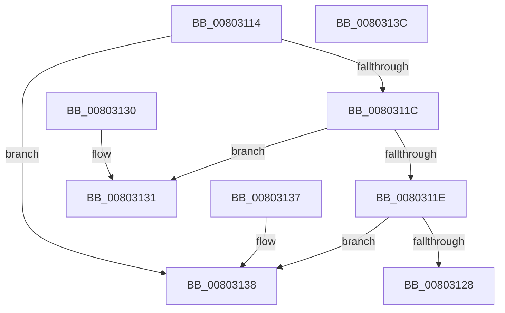

# MiCompareHotPatchNodes

- RVA: `0x00803114`–`0x0080313D` (길이 `41` bytes)
- VA: `0x0000000140803114`
- 실행 섹션: `PAGE`
- PDB 이름 있음: `예`; PDB Function 태그: `아니요`
- unwind 정보 RVA: `0x000DB714`
- 디코드: `19`개 명령, `41/41` bytes 표시
- 미해석 바이트: `0` (있으면 어셈블리에 `.byte`로 보존)

> 이 문서는 커널 이미지의 기계어와 PDB 기호를 분석해 생성했습니다. 4번과 5번은 함수 원형과 자료형을 바이너리 사용 방식에서 추정한 C 해석이며 원본 소스 복구 결과는 아닙니다.

## 1. Dependencies

- 직접 호출 지점: **0**; 고유 호출 대상: **0**
- 직접 호출자로 확인된 함수: **8**
- RIP 상대 이미지 참조: **0**

### Outgoing calls
- 직접 디코드된 call 명령이 없습니다.

### Direct callers
- [MiGetAllRegisteredPatches](MiGetAllRegisteredPatches_function_0080367C.md) at `0x00803742`
- [MiGetAllRegisteredPatches](MiGetAllRegisteredPatches_function_0080367C.md) at `0x0080376E`
- [MiInsertHotPatchRecord](MiInsertHotPatchRecord_function_008041D4.md) at `0x00804258`
- [MiInsertHotPatchRecord](MiInsertHotPatchRecord_function_008041D4.md) at `0x008042AE`
- [MiInsertPreviouslyRegisteredHotPatchRecord](MiInsertPreviouslyRegisteredHotPatchRecord_function_00804370.md) at `0x0080439A`
- [MiInsertPreviouslyRegisteredHotPatchRecord](MiInsertPreviouslyRegisteredHotPatchRecord_function_00804370.md) at `0x008043C1`
- [MiInsertPreviouslyRegisteredHotPatchRecord](MiInsertPreviouslyRegisteredHotPatchRecord_function_00804370.md) at `0x00804433`
- [MiInsertSecureImageActivePatch](MiInsertSecureImageActivePatch_function_0080448C.md) at `0x008044BA`
- [MmRemoveSecureImageActivePatch](MmRemoveSecureImageActivePatch_function_0080760C.md) at `0x00807652`
- [MiFindProcessImageHotPatchRecord](../A4/MiFindProcessImageHotPatchRecord_function_00A4206C.md) at `0x00A4216D`
- [MiFindHotPatchRecord](../A6/MiFindHotPatchRecord_function_00A6E618.md) at `0x00A6E682`
- [MmRegisterHotPatches](../../init/C6/MmRegisterHotPatches_function_00C678DC.md) at `0x00C67A96`

### Static image references
- 디코드된 RIP-relative 메모리 참조가 없습니다.

## 2. Other-region calls and transfers

- 다른 실행 섹션으로 향하는 call: **0**
- 별도 외부 분기/꼬리 이동을 확인하지 못했습니다.

## 3. Assembly (complete function range)

```asm
00803114  8B 41 18                        mov eax, dword ptr [rcx + 0x18]
00803117  3B 42 18                        cmp eax, dword ptr [rdx + 0x18]
0080311A  72 1C                           jb 0x140803138
0080311C  77 13                           ja 0x140803131
0080311E  8B 49 1C                        mov ecx, dword ptr [rcx + 0x1c]
00803121  8B 52 1C                        mov edx, dword ptr [rdx + 0x1c]
00803124  3B CA                           cmp ecx, edx
00803126  72 10                           jb 0x140803138
00803128  33 C0                           xor eax, eax
0080312A  3B CA                           cmp ecx, edx
0080312C  0F 97 C0                        seta al
0080312F  C3                              ret
00803130  CC                              int3
00803131  B8 01 00 00 00                  mov eax, 1
00803136  C3                              ret
00803137  CC                              int3
00803138  83 C8 FF                        or eax, 0xffffffff
0080313B  C3                              ret
0080313C  CC                              int3
```

## 4. C-style interpretation (structured pseudocode)

```c
__int64 __fastcall MiCompareHotPatchNodes(__int64 a1, __int64 a2)
{
    __int64 result;

    if (((unsigned int)((unsigned int)(*(unsigned int *)(a1 + 24)))) < (*(unsigned int *)(a2 + 24))) goto loc_00803138;
    if (((unsigned int)((unsigned int)(*(unsigned int *)(a1 + 24)))) > (*(unsigned int *)(a2 + 24))) goto loc_00803131;
    if (((unsigned int)((unsigned int)(*(unsigned int *)(a1 + 28)))) < ((unsigned int)((unsigned int)(*(unsigned int *)(a2 + 28))))) goto loc_00803138;
    result = 0;
    result = (((unsigned int)((unsigned int)(*(unsigned int *)(a1 + 28)))) > ((unsigned int)((unsigned int)(*(unsigned int *)(a2 + 28))))) ? 1 : 0;
    return result;
loc_00803131:
    return 1;
loc_00803138:
    result = (unsigned int)((1) | (0xFFFFFFFFULL));
    return result;
}
```

## 5. (Beta) C Style

```c
int64_t MiCompareHotPatchNodes(void *Arg1, void *Arg2)
{
    uint8_t *arg1 = (uint8_t *)Arg1;
    uint8_t *arg2 = (uint8_t *)Arg2;

    int64_t result;

    if (((uint32_t)((uint32_t)(*(uint32_t *)(arg1 + 0x18)))) < (*(uint32_t *)(arg2 + 0x18))) goto loc_00803138;
    if (((uint32_t)((uint32_t)(*(uint32_t *)(arg1 + 0x18)))) > (*(uint32_t *)(arg2 + 0x18))) goto loc_00803131;
    if (((uint32_t)((uint32_t)(*(uint32_t *)(arg1 + 0x1C)))) < ((uint32_t)((uint32_t)(*(uint32_t *)(arg2 + 0x1C))))) goto loc_00803138;
    result = 0;
    result = (((uint32_t)((uint32_t)(*(uint32_t *)(arg1 + 0x1C)))) > ((uint32_t)((uint32_t)(*(uint32_t *)(arg2 + 0x1C))))) ? 1 : 0;
    return result;
loc_00803131:
    return 1;
loc_00803138:
    result = (uint32_t)((1) | (0xFFFFFFFFULL));
    return result;
}
```

### 관측된 메모리 오프셋

구조체 형식이 확인되지 않은 접근은 인자 기준의 오프셋으로만 기록했습니다.

| 기준 인자 | 오프셋 표현 | 폭 (bit) | 접근 |
|---|---:|---:|---|
| `Arg1` | `+ 0x18` | `32` | `R` |
| `Arg1` | `+ 0x1C` | `32` | `R` |
| `Arg2` | `+ 0x18` | `32` | `R` |
| `Arg2` | `+ 0x1C` | `32` | `R` |

## 6. Execution-region graph

[열기: 2D/3D 그래프와 함수 탐색 컨트롤 패널](../../../control-panel.html?section=page&rva=0x00803114&view=graph)

- 2D 그래프는 위에서 아래로 흐르고, 3D 그래프는 빈 공간을 드래그해 회전합니다. Shift+드래그는 이동, 휠은 확대·축소, 함수 노드 선택은 대상 보고서 이동입니다.

### Static fallback


