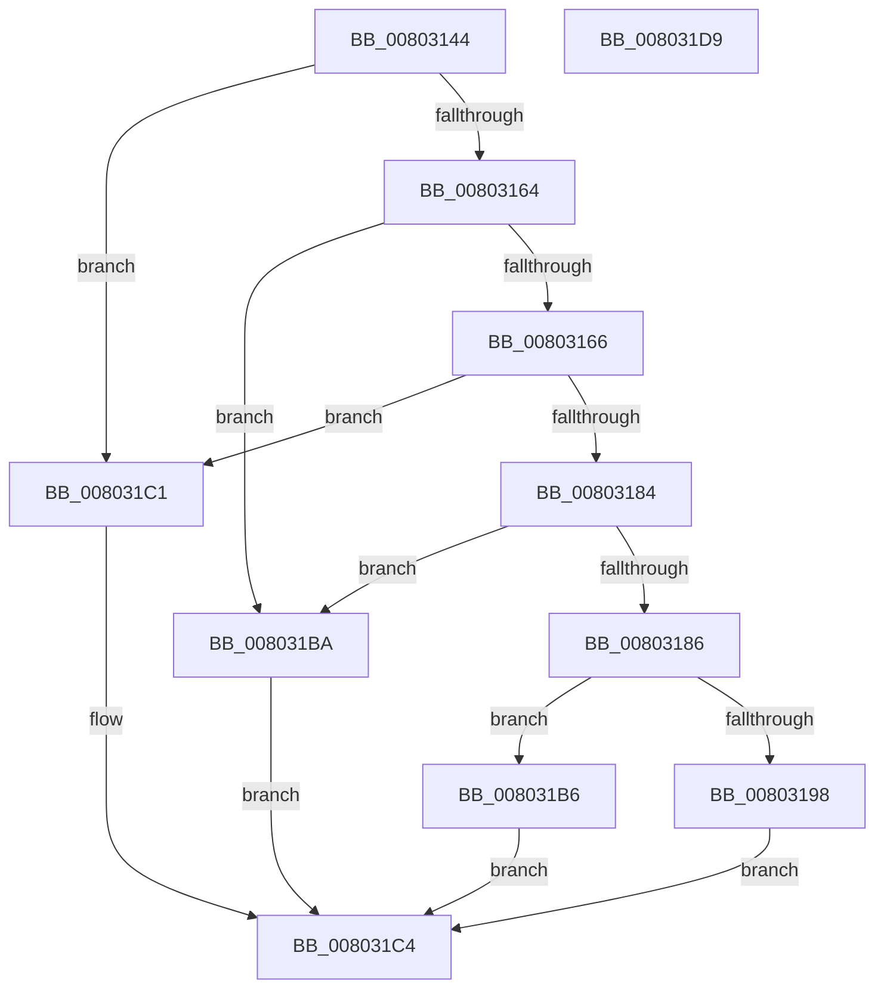

# MiCompareUserSidHotPatchNodes

- RVA: `0x00803144`–`0x008031DA` (길이 `150` bytes)
- VA: `0x0000000140803144`
- 실행 섹션: `PAGE`
- PDB 이름 있음: `예`; PDB Function 태그: `아니요`
- unwind 정보 RVA: `0x0005C954`
- 디코드: `46`개 명령, `150/150` bytes 표시
- 미해석 바이트: `0` (있으면 어셈블리에 `.byte`로 보존)

> 이 문서는 커널 이미지의 기계어와 PDB 기호를 분석해 생성했습니다. 4번과 5번은 함수 원형과 자료형을 바이너리 사용 방식에서 추정한 C 해석이며 원본 소스 복구 결과는 아닙니다.

## 1. Dependencies

- 직접 호출 지점: **3**; 고유 호출 대상: **2**
- 직접 호출자로 확인된 함수: **2**
- RIP 상대 이미지 참조: **0**

### Outgoing calls
- `0x00803171` → [RtlLengthSid](../../text/45/RtlLengthSid_function_0045D270.md) (function, `0x0045D270`)
- `0x0080317B` → [RtlLengthSid](../../text/45/RtlLengthSid_function_0045D270.md) (function, `0x0045D270`)
- `0x0080318F` → [RtlCompareMemory](../../text/6B/RtlCompareMemory_function_006BA670.md) (function, `0x006BA670`)

### Direct callers
- [MiFindUserSidHotPatchContext](MiFindUserSidHotPatchContext_function_0080360C.md) at `0x00803650`
- [MiLoadHotPatchForUserSid](../AB/MiLoadHotPatchForUserSid_function_00AB4F08.md) at `0x00AB505A`

### Static image references
- 디코드된 RIP-relative 메모리 참조가 없습니다.

## 2. Other-region calls and transfers

- 다른 실행 섹션으로 향하는 call: **3**
  - `0x00803171` → [RtlLengthSid](../../text/45/RtlLengthSid_function_0045D270.md) (`PAGE` → `.text`)
  - `0x0080317B` → [RtlLengthSid](../../text/45/RtlLengthSid_function_0045D270.md) (`PAGE` → `.text`)
  - `0x0080318F` → [RtlCompareMemory](../../text/6B/RtlCompareMemory_function_006BA670.md) (`PAGE` → `.text`)
- 별도 외부 분기/꼬리 이동을 확인하지 못했습니다.

## 3. Assembly (complete function range)

```asm
00803144  48 89 5C 24 08                  mov qword ptr [rsp + 8], rbx
00803149  48 89 6C 24 10                  mov qword ptr [rsp + 0x10], rbp
0080314E  48 89 74 24 18                  mov qword ptr [rsp + 0x18], rsi
00803153  57                              push rdi
00803154  48 83 EC 20                     sub rsp, 0x20
00803158  48 8B 01                        mov rax, qword ptr [rcx]
0080315B  48 8B F9                        mov rdi, rcx
0080315E  48 3B 42 20                     cmp rax, qword ptr [rdx + 0x20]
00803162  72 5D                           jb 0x1408031c1
00803164  77 54                           ja 0x1408031ba
00803166  48 8B 69 08                     mov rbp, qword ptr [rcx + 8]
0080316A  48 8D 72 28                     lea rsi, [rdx + 0x28]
0080316E  48 8B CD                        mov rcx, rbp
00803171  E8 FA A0 C5 FF                  call 0x14045d270
00803176  48 8B CE                        mov rcx, rsi
00803179  8B D8                           mov ebx, eax
0080317B  E8 F0 A0 C5 FF                  call 0x14045d270
00803180  3B D8                           cmp ebx, eax
00803182  72 3D                           jb 0x1408031c1
00803184  77 34                           ja 0x1408031ba
00803186  44 8B C3                        mov r8d, ebx
00803189  48 8B D6                        mov rdx, rsi
0080318C  48 8B CD                        mov rcx, rbp
0080318F  E8 DC 74 EB FF                  call 0x1406ba670
00803194  3B C3                           cmp eax, ebx
00803196  74 1E                           je 0x1408031b6
00803198  48 8B 57 08                     mov rdx, qword ptr [rdi + 8]
0080319C  41 83 C9 FF                     or r9d, 0xffffffff
008031A0  44 8B C0                        mov r8d, eax
008031A3  B8 01 00 00 00                  mov eax, 1
008031A8  41 8A 0C 30                     mov cl, byte ptr [r8 + rsi]
008031AC  41 38 0C 10                     cmp byte ptr [r8 + rdx], cl
008031B0  41 0F 4C C1                     cmovl eax, r9d
008031B4  EB 0E                           jmp 0x1408031c4
008031B6  33 C0                           xor eax, eax
008031B8  EB 0A                           jmp 0x1408031c4
008031BA  B8 01 00 00 00                  mov eax, 1
008031BF  EB 03                           jmp 0x1408031c4
008031C1  83 C8 FF                        or eax, 0xffffffff
008031C4  48 8B 5C 24 30                  mov rbx, qword ptr [rsp + 0x30]
008031C9  48 8B 6C 24 38                  mov rbp, qword ptr [rsp + 0x38]
008031CE  48 8B 74 24 40                  mov rsi, qword ptr [rsp + 0x40]
008031D3  48 83 C4 20                     add rsp, 0x20
008031D7  5F                              pop rdi
008031D8  C3                              ret
008031D9  CC                              int3
```

## 4. C-style interpretation (structured pseudocode)

```c
__int64 __fastcall MiCompareUserSidHotPatchNodes(__int64 a1, __int64 a2, __int64 a3, int a4)
{
    __int64 result;
    __int64 v_rsp;
    unsigned __int64 v_stack_p10;
    unsigned __int64 v_stack_p18;
    unsigned __int64 v_stack_p8;

    v_stack_p8 = v_rbx;
    v_stack_p10 = v_rbp;
    v_stack_p18 = v_rsi;
    v_rsp = (v_rsp) - (32);
    if ((*(unsigned __int64 *)(a1)) < (*(unsigned __int64 *)(a2 + 32))) goto loc_008031C1;
    if ((*(unsigned __int64 *)(a1)) > (*(unsigned __int64 *)(a2 + 32))) goto loc_008031BA;
    result = RtlLengthSid(*(unsigned __int64 *)(a1 + 8), a2, a3, a4);
    result = RtlLengthSid(a2 + 40, a2, a3, a4);
    if (((unsigned int)((unsigned int)((unsigned int)(result)))) < ((unsigned int)(result))) goto loc_008031C1;
    if (((unsigned int)((unsigned int)((unsigned int)(result)))) > ((unsigned int)(result))) goto loc_008031BA;
    result = RtlCompareMemory(*(unsigned __int64 *)(a1 + 8), a2 + 40, (unsigned int)((unsigned int)((unsigned int)((unsigned int)(result)))), a4);
    if (((unsigned int)(result)) == ((unsigned int)((unsigned int)((unsigned int)(result))))) goto loc_008031B6;
    a4 = (unsigned int)((a4) | (0xFFFFFFFFULL));
    result = 1;
    if ((*(unsigned __int8 *)((unsigned int)((unsigned int)(result)) + *(unsigned __int64 *)(a1 + 8) * 1)) < ((unsigned __int8)(*(unsigned __int8 *)((unsigned int)((unsigned int)(result)) + a2 + 40 * 1)))) { result = a4; }
    goto loc_008031C4;
loc_008031B6:
    result = 0;
    goto loc_008031C4;
loc_008031BA:
    goto loc_008031C4;
loc_008031C1:
    result = (unsigned int)((1) | (0xFFFFFFFFULL));
loc_008031C4:
    v_rsp = (v_rsp) + (32);
    return result;
}
```

## 5. (Beta) C Style

```c
int64_t MiCompareUserSidHotPatchNodes(void *Arg1, void *Arg2, int64_t Arg3, int32_t Arg4)
{
    uint8_t *arg1 = (uint8_t *)Arg1;
    uint8_t *arg2 = (uint8_t *)Arg2;

    int64_t result;
    int64_t local_rsp;
    uint64_t v_stack_p10;
    uint64_t v_stack_p18;
    uint64_t v_stack_p8;

    v_stack_p8 = local_rbx;
    v_stack_p10 = local_rbp;
    v_stack_p18 = local_rsi;
    local_rsp = (local_rsp) - (32);
    if ((*(uint64_t *)(arg1)) < (*(uint64_t *)(arg2 + 0x20))) goto loc_008031C1;
    if ((*(uint64_t *)(arg1)) > (*(uint64_t *)(arg2 + 0x20))) goto loc_008031BA;
    result = RtlLengthSid(*(uint64_t *)(arg1 + 0x8), Arg2, Arg3, Arg4);
    result = RtlLengthSid(Arg2 + 40, Arg2, Arg3, Arg4);
    if (((uint32_t)((uint32_t)((uint32_t)(result)))) < ((uint32_t)(result))) goto loc_008031C1;
    if (((uint32_t)((uint32_t)((uint32_t)(result)))) > ((uint32_t)(result))) goto loc_008031BA;
    result = RtlCompareMemory(*(uint64_t *)(arg1 + 0x8), Arg2 + 40, (uint32_t)((uint32_t)((uint32_t)((uint32_t)(result)))), Arg4);
    if (((uint32_t)(result)) == ((uint32_t)((uint32_t)((uint32_t)(result))))) goto loc_008031B6;
    Arg4 = (uint32_t)((Arg4) | (0xFFFFFFFFULL));
    result = 1;
    if ((*(uint8_t *)((uint32_t)((uint32_t)(result)) + *(uint64_t *)(arg1 + 0x8) * 1)) < ((uint8_t)(*(uint8_t *)((uint32_t)((uint32_t)(result)) + arg2 + 0x28 * 1)))) { result = Arg4; }
    goto loc_008031C4;
loc_008031B6:
    result = 0;
    goto loc_008031C4;
loc_008031BA:
    goto loc_008031C4;
loc_008031C1:
    result = (uint32_t)((1) | (0xFFFFFFFFULL));
loc_008031C4:
    local_rsp = (local_rsp) + (32);
    return result;
}
```

### 관측된 메모리 오프셋

구조체 형식이 확인되지 않은 접근은 인자 기준의 오프셋으로만 기록했습니다.

| 기준 인자 | 오프셋 표현 | 폭 (bit) | 접근 |
|---|---:|---:|---|
| `Arg1` | `+ 0x0` | `64` | `R` |
| `Arg1` | `+ 0x8` | `64` | `R` |
| `Arg2` | `+ 0x20` | `64` | `R` |
| `Arg2` | `+ 0x28` | `64` | `R` |

## 6. Execution-region graph

[열기: 2D/3D 그래프와 함수 탐색 컨트롤 패널](../../../control-panel.html?section=page&rva=0x00803144&view=graph)

- 2D 그래프는 위에서 아래로 흐르고, 3D 그래프는 빈 공간을 드래그해 회전합니다. Shift+드래그는 이동, 휠은 확대·축소, 함수 노드 선택은 대상 보고서 이동입니다.

### Static fallback


