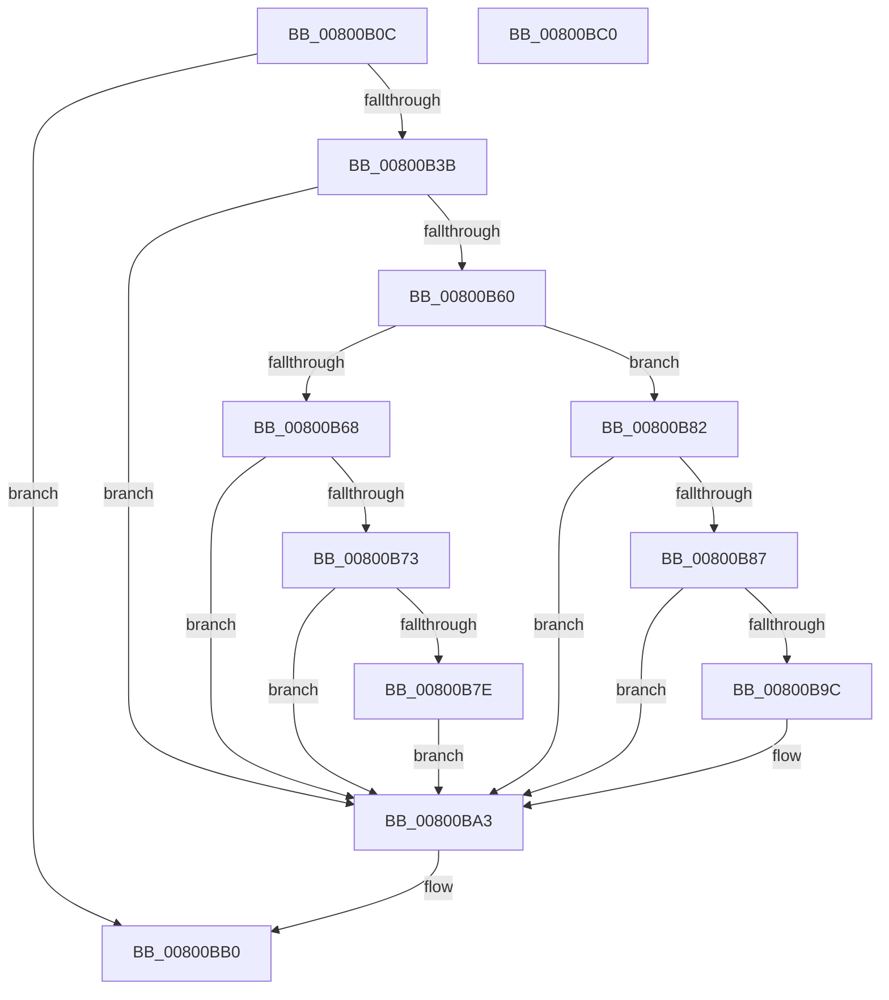

# MiComputeIdealFirstSubsection

- RVA: `0x00800B0C`–`0x00800BC1` (길이 `181` bytes)
- VA: `0x0000000140800B0C`
- 실행 섹션: `PAGE`
- PDB 이름 있음: `예`; PDB Function 태그: `아니요`
- unwind 정보 RVA: `0x000794E0`
- 디코드: `53`개 명령, `181/181` bytes 표시
- 미해석 바이트: `0` (있으면 어셈블리에 `.byte`로 보존)

> 이 문서는 커널 이미지의 기계어와 PDB 기호를 분석해 생성했습니다. 4번과 5번은 함수 원형과 자료형을 바이너리 사용 방식에서 추정한 C 해석이며 원본 소스 복구 결과는 아닙니다.

## 1. Dependencies

- 직접 호출 지점: **3**; 고유 호출 대상: **3**
- 직접 호출자로 확인된 함수: **1**
- RIP 상대 이미지 참조: **0**

### Outgoing calls
- `0x00800B2C` → [MiAllocatePool](../../text/35/MiAllocatePool_function_0035B540.md) (function, `0x0035B540`)
- `0x00800B57` → [FsRtlGetFileExtents](../../text/58/FsRtlGetFileExtents_function_00580F40.md) (function, `0x00580F40`)
- `0x00800BA8` → [ExFreePoolWithTag](../../poolcode/B8/ExFreePoolWithTag_function_00B82870.md) (function, `0x00B82870`)

### Direct callers
- [MiCreateDataFileMap](../98/MiCreateDataFileMap_function_00983494.md) at `0x00983859`

### Static image references
- 디코드된 RIP-relative 메모리 참조가 없습니다.

## 2. Other-region calls and transfers

- 다른 실행 섹션으로 향하는 call: **3**
  - `0x00800B2C` → [MiAllocatePool](../../text/35/MiAllocatePool_function_0035B540.md) (`PAGE` → `.text`)
  - `0x00800B57` → [FsRtlGetFileExtents](../../text/58/FsRtlGetFileExtents_function_00580F40.md) (`PAGE` → `.text`)
  - `0x00800BA8` → [ExFreePoolWithTag](../../poolcode/B8/ExFreePoolWithTag_function_00B82870.md) (`PAGE` → `POOLCODE`)
- 별도 외부 분기/꼬리 이동을 확인하지 못했습니다.

## 3. Assembly (complete function range)

```asm
00800B0C  48 89 5C 24 08                  mov qword ptr [rsp + 8], rbx
00800B11  48 89 74 24 10                  mov qword ptr [rsp + 0x10], rsi
00800B16  57                              push rdi
00800B17  48 83 EC 30                     sub rsp, 0x30
00800B1B  BA 28 00 00 00                  mov edx, 0x28
00800B20  48 8B F1                        mov rsi, rcx
00800B23  41 B8 4D 69 46 32               mov r8d, 0x3246694d
00800B29  8D 4A 18                        lea ecx, [rdx + 0x18]
00800B2C  E8 0F AA B5 FF                  call 0x14035b540
00800B31  33 FF                           xor edi, edi
00800B33  48 8B D8                        mov rbx, rax
00800B36  48 85 C0                        test rax, rax
00800B39  74 75                           je 0x140800bb0
00800B3B  45 33 C0                        xor r8d, r8d
00800B3E  48 C7 00 02 00 00 00            mov qword ptr [rax], 2
00800B45  41 B9 00 00 00 40               mov r9d, 0x40000000
00800B4B  48 89 5C 24 20                  mov qword ptr [rsp + 0x20], rbx
00800B50  48 8B CE                        mov rcx, rsi
00800B53  41 8D 50 02                     lea edx, [r8 + 2]
00800B57  E8 E4 03 D8 FF                  call 0x140580f40
00800B5C  85 C0                           test eax, eax
00800B5E  78 43                           js 0x140800ba3
00800B60  8B 43 04                        mov eax, dword ptr [rbx + 4]
00800B63  83 F8 01                        cmp eax, 1
00800B66  75 1A                           jne 0x140800b82
00800B68  8B 43 08                        mov eax, dword ptr [rbx + 8]
00800B6B  48 A9 FF FF 03 00               test rax, 0x3ffff
00800B71  75 30                           jne 0x140800ba3
00800B73  B8 00 00 04 00                  mov eax, 0x40000
00800B78  48 39 43 10                     cmp qword ptr [rbx + 0x10], rax
00800B7C  75 25                           jne 0x140800ba3
00800B7E  8B F8                           mov edi, eax
00800B80  EB 21                           jmp 0x140800ba3
00800B82  83 F8 02                        cmp eax, 2
00800B85  75 1C                           jne 0x140800ba3
00800B87  48 8B 53 10                     mov rdx, qword ptr [rbx + 0x10]
00800B8B  B8 00 00 04 00                  mov eax, 0x40000
00800B90  48 8B 4B 20                     mov rcx, qword ptr [rbx + 0x20]
00800B94  48 03 CA                        add rcx, rdx
00800B97  48 3B C8                        cmp rcx, rax
00800B9A  75 07                           jne 0x140800ba3
00800B9C  F6 C2 0F                        test dl, 0xf
00800B9F  48 0F 44 FA                     cmove rdi, rdx
00800BA3  33 D2                           xor edx, edx
00800BA5  48 8B CB                        mov rcx, rbx
00800BA8  E8 C3 1C 38 00                  call 0x140b82870
00800BAD  48 8B C7                        mov rax, rdi
00800BB0  48 8B 5C 24 40                  mov rbx, qword ptr [rsp + 0x40]
00800BB5  48 8B 74 24 48                  mov rsi, qword ptr [rsp + 0x48]
00800BBA  48 83 C4 30                     add rsp, 0x30
00800BBE  5F                              pop rdi
00800BBF  C3                              ret
00800BC0  CC                              int3
```

## 4. C-style interpretation (structured pseudocode)

```c
__int64 __fastcall MiComputeIdealFirstSubsection(__int64 a1)
{
    __int64 result;
    __int64 v_rdi;
    __int64 v_rsp;
    unsigned __int64 v_stack_m18;
    unsigned __int64 v_stack_p10;
    unsigned __int64 v_stack_p8;

    v_stack_p8 = v_rbx;
    v_stack_p10 = v_rsi;
    v_rsp = (v_rsp) - (48);
    result = MiAllocatePool(40 + 24, 40, (unsigned int)(0x3246694DULL), a4);
    v_rdi = 0;
    if (result == 0) goto loc_00800BB0;
    a3 = 0;
    *(unsigned __int64 *)(result) = 2;
    v_stack_m18 = result;
    result = FsRtlGetFileExtents(a1, a3 + 2, a3, (unsigned int)(0x40000000ULL));
    if (sign_flag) goto loc_00800BA3;
    if (((unsigned int)((unsigned int)(*(unsigned int *)(result + 4)))) != 1) goto loc_00800B82;
    if ((((unsigned int)(*(unsigned int *)(result + 8))) & (0x3FFFFULL)) != 0) goto loc_00800BA3;
    if ((*(unsigned __int64 *)(result + 16)) != ((unsigned int)(0x40000ULL))) goto loc_00800BA3;
    goto loc_00800BA3;
loc_00800B82:
    if (((unsigned int)((unsigned int)(0x40000ULL))) != 2) goto loc_00800BA3;
    a1 = (*(unsigned __int64 *)(result + 32)) + (*(unsigned __int64 *)(result + 16));
    v_rdi = (unsigned int)((unsigned int)((unsigned int)(0x40000ULL)));
    if (a1 == ((unsigned int)(0x40000ULL))) {
        v_rdi = (unsigned int)((unsigned int)((unsigned int)(0x40000ULL)));
        if ((((unsigned __int8)(*(unsigned __int64 *)(result + 16))) & (15)) == 0) { v_rdi = *(unsigned __int64 *)(result + 16); }
    }
    a2 = 0;
    result = ExFreePoolWithTag(result, a2, a3, (unsigned int)(0x40000000ULL));
loc_00800BB0:
    v_rsp = (v_rsp) + (48);
    return v_rdi;
}
```

## 5. (Beta) C Style

```c
int64_t MiComputeIdealFirstSubsection(int64_t Arg1)
{
    int64_t result;
    int64_t local_rdi;
    int64_t local_rsp;
    uint64_t v_stack_m18;
    uint64_t v_stack_p10;
    uint64_t v_stack_p8;

    v_stack_p8 = local_rbx;
    v_stack_p10 = local_rsi;
    local_rsp = (local_rsp) - (48);
    result = MiAllocatePool(40 + 24, 40, (uint32_t)(0x3246694DULL), a4);
    local_rdi = 0;
    if (result == 0) goto loc_00800BB0;
    a3 = 0;
    *(uint64_t *)(result) = 2;
    v_stack_m18 = result;
    result = FsRtlGetFileExtents(Arg1, a3 + 2, a3, (uint32_t)(0x40000000ULL));
    if (sign_flag) goto loc_00800BA3;
    if (((uint32_t)((uint32_t)(*(uint32_t *)(result + 0x4)))) != 1) goto loc_00800B82;
    if ((((uint32_t)(*(uint32_t *)(result + 0x8))) & (0x3FFFFULL)) != 0) goto loc_00800BA3;
    if ((*(uint64_t *)(result + 0x10)) != ((uint32_t)(0x40000ULL))) goto loc_00800BA3;
    goto loc_00800BA3;
loc_00800B82:
    if (((uint32_t)((uint32_t)(0x40000ULL))) != 2) goto loc_00800BA3;
    Arg1 = (*(uint64_t *)(result + 0x20)) + (*(uint64_t *)(result + 0x10));
    local_rdi = (uint32_t)((uint32_t)((uint32_t)(0x40000ULL)));
    if (Arg1 == ((uint32_t)(0x40000ULL))) {
        local_rdi = (uint32_t)((uint32_t)((uint32_t)(0x40000ULL)));
        if ((((uint8_t)(*(uint64_t *)(result + 0x10))) & (15)) == 0) { local_rdi = *(uint64_t *)(result + 0x10); }
    }
    a2 = 0;
    result = ExFreePoolWithTag(result, a2, a3, (uint32_t)(0x40000000ULL));
loc_00800BB0:
    local_rsp = (local_rsp) + (48);
    return local_rdi;
}
```

## 6. Execution-region graph

[열기: 2D/3D 그래프와 함수 탐색 컨트롤 패널](../../../control-panel.html?section=page&rva=0x00800B0C&view=graph)

- 2D 그래프는 위에서 아래로 흐르고, 3D 그래프는 빈 공간을 드래그해 회전합니다. Shift+드래그는 이동, 휠은 확대·축소, 함수 노드 선택은 대상 보고서 이동입니다.

### Static fallback


