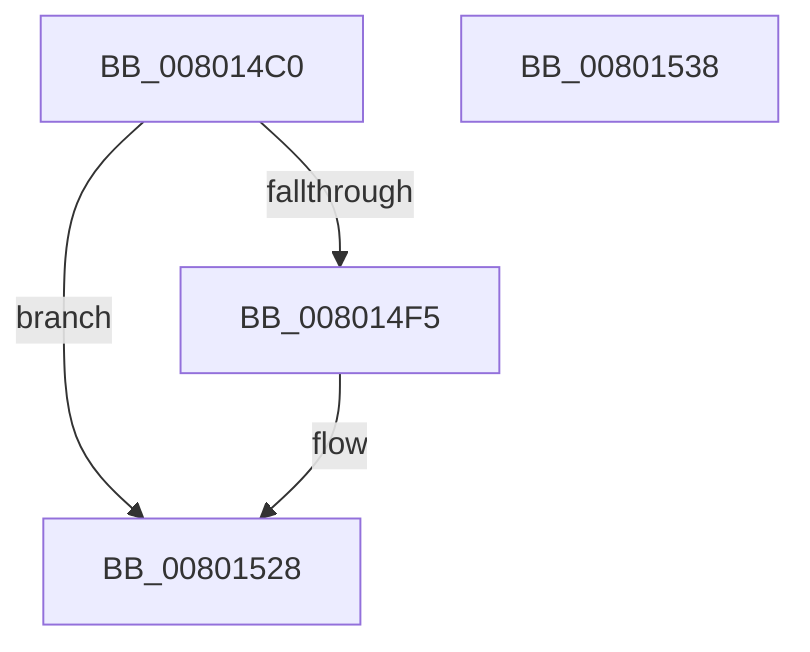

# MiConstructNonRetpolineImageLoadRecord

- RVA: `0x008014C0`–`0x00801539` (길이 `121` bytes)
- VA: `0x00000001408014C0`
- 실행 섹션: `PAGE`
- PDB 이름 있음: `예`; PDB Function 태그: `아니요`
- unwind 정보 RVA: `0x00060BC4`
- 디코드: `34`개 명령, `121/121` bytes 표시
- 미해석 바이트: `0` (있으면 어셈블리에 `.byte`로 보존)

> 이 문서는 커널 이미지의 기계어와 PDB 기호를 분석해 생성했습니다. 4번과 5번은 함수 원형과 자료형을 바이너리 사용 방식에서 추정한 C 해석이며 원본 소스 복구 결과는 아닙니다.

## 1. Dependencies

- 직접 호출 지점: **2**; 고유 호출 대상: **2**
- 직접 호출자로 확인된 함수: **1**
- RIP 상대 이미지 참조: **0**

### Outgoing calls
- `0x008014E8` → [MiAllocatePool](../../text/35/MiAllocatePool_function_0035B540.md) (function, `0x0035B540`)
- `0x00801511` → [RtlUnicodeStringCopy](../../text/3D/RtlUnicodeStringCopy_function_003D4130.md) (function, `0x003D4130`)

### Direct callers
- [MiLogRetpolineImageLoadEvents](../A9/MiLogRetpolineImageLoadEvents_function_00A996F0.md) at `0x00A9972D`

### Static image references
- 디코드된 RIP-relative 메모리 참조가 없습니다.

## 2. Other-region calls and transfers

- 다른 실행 섹션으로 향하는 call: **2**
  - `0x008014E8` → [MiAllocatePool](../../text/35/MiAllocatePool_function_0035B540.md) (`PAGE` → `.text`)
  - `0x00801511` → [RtlUnicodeStringCopy](../../text/3D/RtlUnicodeStringCopy_function_003D4130.md) (`PAGE` → `.text`)
- 별도 외부 분기/꼬리 이동을 확인하지 못했습니다.

## 3. Assembly (complete function range)

```asm
008014C0  48 89 5C 24 08                  mov qword ptr [rsp + 8], rbx
008014C5  48 89 74 24 10                  mov qword ptr [rsp + 0x10], rsi
008014CA  57                              push rdi
008014CB  48 83 EC 20                     sub rsp, 0x20
008014CF  48 8D 71 58                     lea rsi, [rcx + 0x58]
008014D3  48 8B F9                        mov rdi, rcx
008014D6  0F B7 16                        movzx edx, word ptr [rsi]
008014D9  B9 00 01 00 00                  mov ecx, 0x100
008014DE  48 83 C2 28                     add rdx, 0x28
008014E2  41 B8 4D 6D 4E 52               mov r8d, 0x524e6d4d
008014E8  E8 53 A0 B5 FF                  call 0x14035b540
008014ED  48 8B D8                        mov rbx, rax
008014F0  48 85 C0                        test rax, rax
008014F3  74 33                           je 0x140801528
008014F5  0F B7 06                        movzx eax, word ptr [rsi]
008014F8  48 8D 4B 10                     lea rcx, [rbx + 0x10]
008014FC  0F 57 C0                        xorps xmm0, xmm0
008014FF  48 8B D6                        mov rdx, rsi
00801502  0F 11 01                        movups xmmword ptr [rcx], xmm0
00801505  66 89 41 02                     mov word ptr [rcx + 2], ax
00801509  48 8D 43 28                     lea rax, [rbx + 0x28]
0080150D  48 89 41 08                     mov qword ptr [rcx + 8], rax
00801511  E8 1A 2C BD FF                  call 0x1403d4130
00801516  8B 47 78                        mov eax, dword ptr [rdi + 0x78]
00801519  89 43 20                        mov dword ptr [rbx + 0x20], eax
0080151C  8B 87 9C 00 00 00               mov eax, dword ptr [rdi + 0x9c]
00801522  89 43 24                        mov dword ptr [rbx + 0x24], eax
00801525  48 8B C3                        mov rax, rbx
00801528  48 8B 5C 24 30                  mov rbx, qword ptr [rsp + 0x30]
0080152D  48 8B 74 24 38                  mov rsi, qword ptr [rsp + 0x38]
00801532  48 83 C4 20                     add rsp, 0x20
00801536  5F                              pop rdi
00801537  C3                              ret
00801538  CC                              int3
```

## 4. C-style interpretation (structured pseudocode)

```c
__int64 __fastcall MiConstructNonRetpolineImageLoadRecord(__int64 a1)
{
    __int64 result;
    __int64 v_rsp;
    unsigned __int64 v_stack_p10;
    unsigned __int64 v_stack_p8;

    v_stack_p8 = v_rbx;
    v_stack_p10 = v_rsi;
    v_rsp = (v_rsp) - (32);
    a2 = (*(unsigned __int16 *)(a1 + 88)) + (40);
    result = MiAllocatePool(256, a2, (unsigned int)(0x524E6D4DULL), a4);
    if (result != 0) {
        result = *(unsigned __int16 *)(a1 + 88);
        a1 = result + 16;
        a2 = a1 + 88;
        *(unsigned __int64 *)(a1) = v_xmm0;
        *(unsigned __int16 *)(a1 + 2) = (unsigned __int16)(result);
        result = result + 40;
        *(unsigned __int64 *)(a1 + 8) = result;
        result = RtlUnicodeStringCopy(a1, a2, (unsigned int)(0x524E6D4DULL), a4);
        result = *(unsigned int *)(a1 + 120);
        *(unsigned int *)(result + 32) = (unsigned int)(result);
        result = *(unsigned int *)(a1 + 156);
        *(unsigned int *)(result + 36) = (unsigned int)(result);
        result = result;
    }
    v_rsp = (v_rsp) + (32);
    return result;
}
```

## 5. (Beta) C Style

```c
int64_t MiConstructNonRetpolineImageLoadRecord(void *Arg1)
{
    uint8_t *arg1 = (uint8_t *)Arg1;

    int64_t result;
    int64_t local_rsp;
    uint64_t v_stack_p10;
    uint64_t v_stack_p8;

    v_stack_p8 = local_rbx;
    v_stack_p10 = local_rsi;
    local_rsp = (local_rsp) - (32);
    a2 = (*(uint16_t *)(arg1 + 0x58)) + (40);
    result = MiAllocatePool(256, a2, (uint32_t)(0x524E6D4DULL), a4);
    if (result != 0) {
        result = *(uint16_t *)(arg1 + 0x58);
        Arg1 = result + 16;
        a2 = Arg1 + 88;
        *(uint64_t *)(arg1) = v_xmm0;
        *(uint16_t *)(arg1 + 0x2) = (uint16_t)(result);
        result = result + 40;
        *(uint64_t *)(arg1 + 0x8) = result;
        result = RtlUnicodeStringCopy(Arg1, a2, (uint32_t)(0x524E6D4DULL), a4);
        result = *(uint32_t *)(arg1 + 0x78);
        *(uint32_t *)(result + 0x20) = (uint32_t)(result);
        result = *(uint32_t *)(arg1 + 0x9C);
        *(uint32_t *)(result + 0x24) = (uint32_t)(result);
        result = result;
    }
    local_rsp = (local_rsp) + (32);
    return result;
}
```

### 관측된 메모리 오프셋

구조체 형식이 확인되지 않은 접근은 인자 기준의 오프셋으로만 기록했습니다.

| 기준 인자 | 오프셋 표현 | 폭 (bit) | 접근 |
|---|---:|---:|---|
| `Arg1` | `+ 0x0` | `16` | `R` |
| `Arg1` | `+ 0x58` | `64` | `R` |
| `Arg1` | `+ 0x78` | `32` | `R` |
| `Arg1` | `+ 0x9C` | `32` | `R` |

## 6. Execution-region graph

[열기: 2D/3D 그래프와 함수 탐색 컨트롤 패널](../../../control-panel.html?section=page&rva=0x008014C0&view=graph)

- 2D 그래프는 위에서 아래로 흐르고, 3D 그래프는 빈 공간을 드래그해 회전합니다. Shift+드래그는 이동, 휠은 확대·축소, 함수 노드 선택은 대상 보고서 이동입니다.

### Static fallback


