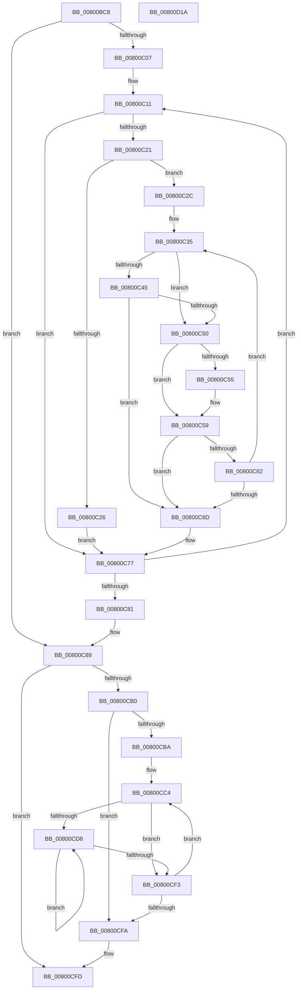

# MiConvertRunsToPages

- RVA: `0x00800BC8`–`0x00800D1B` (길이 `339` bytes)
- VA: `0x0000000140800BC8`
- 실행 섹션: `PAGE`
- PDB 이름 있음: `예`; PDB Function 태그: `아니요`
- unwind 정보 RVA: `0x00075C18`
- 디코드: `100`개 명령, `339/339` bytes 표시
- 미해석 바이트: `0` (있으면 어셈블리에 `.byte`로 보존)

> 이 문서는 커널 이미지의 기계어와 PDB 기호를 분석해 생성했습니다. 4번과 5번은 함수 원형과 자료형을 바이너리 사용 방식에서 추정한 C 해석이며 원본 소스 복구 결과는 아닙니다.

## 1. Dependencies

- 직접 호출 지점: **1**; 고유 호출 대상: **1**
- 직접 호출자로 확인된 함수: **1**
- RIP 상대 이미지 참조: **1**

### Outgoing calls
- `0x00800CA3` → [MiAllocatePool](../../text/35/MiAllocatePool_function_0035B540.md) (function, `0x0035B540`)

### Direct callers
- [MiAllocateFileExtents](../AB/MiAllocateFileExtents_function_00ABDF54.md) at `0x00ABE21B`

### Static image references
- `0x00800C2E` → RVA `0x00011C60` (`.rdata`; read)

## 2. Other-region calls and transfers

- 다른 실행 섹션으로 향하는 call: **1**
  - `0x00800CA3` → [MiAllocatePool](../../text/35/MiAllocatePool_function_0035B540.md) (`PAGE` → `.text`)
- 별도 외부 분기/꼬리 이동을 확인하지 못했습니다.

## 3. Assembly (complete function range)

```asm
00800BC8  48 89 5C 24 08                  mov qword ptr [rsp + 8], rbx
00800BCD  48 89 6C 24 10                  mov qword ptr [rsp + 0x10], rbp
00800BD2  48 89 74 24 18                  mov qword ptr [rsp + 0x18], rsi
00800BD7  57                              push rdi
00800BD8  41 54                           push r12
00800BDA  41 55                           push r13
00800BDC  41 56                           push r14
00800BDE  41 57                           push r15
00800BE0  48 83 EC 20                     sub rsp, 0x20
00800BE4  8B 41 04                        mov eax, dword ptr [rcx + 4]
00800BE7  33 FF                           xor edi, edi
00800BE9  45 33 D2                        xor r10d, r10d
00800BEC  48 8B D9                        mov rbx, rcx
00800BEF  4D 8B F9                        mov r15, r9
00800BF2  4D 8B E0                        mov r12, r8
00800BF5  48 B9 00 00 00 00 00 00 00 80   movabs rcx, 0x8000000000000000
00800BFF  85 C0                           test eax, eax
00800C01  0F 84 82 00 00 00               je 0x140800c89
00800C07  4C 8D 5B 10                     lea r11, [rbx + 0x10]
00800C0B  8B F0                           mov esi, eax
00800C0D  44 8D 6F 03                     lea r13d, [rdi + 3]
00800C11  4D 8B 33                        mov r14, qword ptr [r11]
00800C14  49 8B 6B F8                     mov rbp, qword ptr [r11 - 8]
00800C18  49 03 FE                        add rdi, r14
00800C1B  41 83 FA 01                     cmp r10d, 1
00800C1F  77 56                           ja 0x140800c77
00800C21  48 3B E9                        cmp rbp, rcx
00800C24  75 06                           jne 0x140800c2c
00800C26  41 83 CA FF                     or r10d, 0xffffffff
00800C2A  EB 4B                           jmp 0x140800c77
00800C2C  33 C9                           xor ecx, ecx
00800C2E  4C 8D 05 2B 10 81 FF            lea r8, [rip - 0x7eefd5]
00800C35  4D 8B 08                        mov r9, qword ptr [r8]
00800C38  33 D2                           xor edx, edx
00800C3A  48 8B C5                        mov rax, rbp
00800C3D  49 F7 F1                        div r9
00800C40  48 85 D2                        test rdx, rdx
00800C43  75 0B                           jne 0x140800c50
00800C45  49 8B C6                        mov rax, r14
00800C48  49 F7 F1                        div r9
00800C4B  48 85 D2                        test rdx, rdx
00800C4E  74 1D                           je 0x140800c6d
00800C50  44 3B D1                        cmp r10d, ecx
00800C53  77 04                           ja 0x140800c59
00800C55  44 8D 51 01                     lea r10d, [rcx + 1]
00800C59  49 81 F9 00 02 00 00            cmp r9, 0x200
00800C60  74 0B                           je 0x140800c6d
00800C62  FF C1                           inc ecx
00800C64  49 83 C0 08                     add r8, 8
00800C68  41 3B CD                        cmp ecx, r13d
00800C6B  72 C8                           jb 0x140800c35
00800C6D  48 B9 00 00 00 00 00 00 00 80   movabs rcx, 0x8000000000000000
00800C77  49 83 C3 10                     add r11, 0x10
00800C7B  48 83 EE 01                     sub rsi, 1
00800C7F  75 90                           jne 0x140800c11
00800C81  41 83 FA 01                     cmp r10d, 1
00800C85  45 0F 47 D5                     cmova r10d, r13d
00800C89  48 8D 14 FD 00 00 00 00         lea rdx, [rdi*8]
00800C91  45 89 17                        mov dword ptr [r15], r10d
00800C94  B9 40 00 00 00                  mov ecx, 0x40
00800C99  49 89 3C 24                     mov qword ptr [r12], rdi
00800C9D  41 B8 4D 69 46 31               mov r8d, 0x3146694d
00800CA3  E8 98 A8 B5 FF                  call 0x14035b540
00800CA8  4C 8B C8                        mov r9, rax
00800CAB  48 85 C0                        test rax, rax
00800CAE  74 4D                           je 0x140800cfd
00800CB0  45 33 D2                        xor r10d, r10d
00800CB3  33 C9                           xor ecx, ecx
00800CB5  39 4B 04                        cmp dword ptr [rbx + 4], ecx
00800CB8  76 40                           jbe 0x140800cfa
00800CBA  49 BB 00 00 00 00 00 00 00 80   movabs r11, 0x8000000000000000
00800CC4  8B C1                           mov eax, ecx
00800CC6  48 03 C0                        add rax, rax
00800CC9  4C 8B 44 C3 10                  mov r8, qword ptr [rbx + rax*8 + 0x10]
00800CCE  48 8B 54 C3 08                  mov rdx, qword ptr [rbx + rax*8 + 8]
00800CD3  4D 85 C0                        test r8, r8
00800CD6  74 1B                           je 0x140800cf3
00800CD8  4B 89 14 D1                     mov qword ptr [r9 + r10*8], rdx
00800CDC  48 8D 42 01                     lea rax, [rdx + 1]
00800CE0  49 FF C2                        inc r10
00800CE3  49 3B D3                        cmp rdx, r11
00800CE6  48 0F 44 C2                     cmove rax, rdx
00800CEA  48 8B D0                        mov rdx, rax
00800CED  49 83 E8 01                     sub r8, 1
00800CF1  75 E5                           jne 0x140800cd8
00800CF3  FF C1                           inc ecx
00800CF5  3B 4B 04                        cmp ecx, dword ptr [rbx + 4]
00800CF8  72 CA                           jb 0x140800cc4
00800CFA  49 8B C1                        mov rax, r9
00800CFD  48 8B 5C 24 50                  mov rbx, qword ptr [rsp + 0x50]
00800D02  48 8B 6C 24 58                  mov rbp, qword ptr [rsp + 0x58]
00800D07  48 8B 74 24 60                  mov rsi, qword ptr [rsp + 0x60]
00800D0C  48 83 C4 20                     add rsp, 0x20
00800D10  41 5F                           pop r15
00800D12  41 5E                           pop r14
00800D14  41 5D                           pop r13
00800D16  41 5C                           pop r12
00800D18  5F                              pop rdi
00800D19  C3                              ret
00800D1A  CC                              int3
```

## 4. C-style interpretation (structured pseudocode)

```c
__int64 __fastcall MiConvertRunsToPages(__int64 a1, int a2, __int64 a3, __int64 a4)
{
    __int64 result;
    __int64 v_r10;
    __int64 v_r11;
    __int64 v_rdi;
    __int64 v_rsi;
    __int64 v_rsp;
    unsigned __int64 v_stack_p10;
    unsigned __int64 v_stack_p18;
    unsigned __int64 v_stack_p8;

    v_stack_p8 = v_rbx;
    v_stack_p10 = v_rbp;
    v_stack_p18 = v_rsi;
    v_rsp = (v_rsp) - (32);
    v_rdi = 0;
    v_r10 = 0;
    if ((unsigned int)((unsigned int)(*(unsigned int *)(a1 + 4))) == 0) goto loc_00800C89;
loc_00800C11:
    v_rdi = (v_rdi) + (*(unsigned __int64 *)(a1 + 16));
    if (0 > 1) goto loc_00800C77;
    if ((*(unsigned __int64 *)(a1 + 16 - 8)) != a1) goto loc_00800C2C;
    v_r10 = (unsigned int)((v_r10) | (0xFFFFFFFFULL));
    goto loc_00800C77;
loc_00800C2C:
    a1 = 0;
loc_00800C35:
    a2 = 0;
    if (0 != 0) goto loc_00800C50;
    if (0 == 0) goto loc_00800C6D;
loc_00800C50:
    if (((unsigned int)(v_r10)) <= 0) {
        v_r10 = a1 + 1;
    }
    if ((*(unsigned __int64 *)(v_rip - 8318933)) == 512) goto loc_00800C6D;
    a1 = (unsigned int)((a1) + 1);
    a3 = (v_rip - 8318933) + (8);
    if (((unsigned int)(a1)) < ((unsigned int)(v_rdi + 3))) goto loc_00800C35;
loc_00800C6D:
loc_00800C77:
    v_r11 = (a1 + 16) + (16);
    v_rsi = ((unsigned int)((unsigned int)((unsigned int)(*(unsigned int *)(a1 + 4))))) - (1);
    if (condition_is_not_equal) goto loc_00800C11;
    if (((unsigned int)(v_r10)) > 1) { v_r10 = (unsigned int)(v_rdi + 3); }
loc_00800C89:
    *(unsigned int *)(a4) = (unsigned int)(v_r10);
    *(unsigned __int64 *)(a3) = v_rdi;
    result = MiAllocatePool(64, v_rdi * 8, (unsigned int)(0x3146694DULL), *(unsigned __int64 *)(v_rip - 8318933));
    if (result == 0) goto loc_00800CFD;
    v_r10 = 0;
    a1 = 0;
    if ((*(unsigned int *)(a1 + 4)) <= 0) goto loc_00800CFA;
loc_00800CC4:
    result = (0) + (0);
    if (*(unsigned __int64 *)(a1 + result * 8 + 16) == 0) goto loc_00800CF3;
loc_00800CD8:
    *(unsigned __int64 *)(result + v_r10 * 8) = *(unsigned __int64 *)(a1 + result * 8 + 8);
    v_r10 = (v_r10) + 1;
    result = *(unsigned __int64 *)(a1 + result * 8 + 8) + 1;
    if ((*(unsigned __int64 *)(a1 + result * 8 + 8)) == v_r11) { result = *(unsigned __int64 *)(a1 + result * 8 + 8); }
    a3 = (*(unsigned __int64 *)(a1 + result * 8 + 16)) - (1);
    if (condition_is_not_equal) goto loc_00800CD8;
loc_00800CF3:
    a1 = (unsigned int)((a1) + 1);
    if (((unsigned int)(a1)) < (*(unsigned int *)(a1 + 4))) goto loc_00800CC4;
loc_00800CFA:
loc_00800CFD:
    v_rsp = (v_rsp) + (32);
    return result;
}
```

## 5. (Beta) C Style

```c
int64_t MiConvertRunsToPages(void *Arg1, int32_t Arg2, void *Arg3, void *Arg4)
{
    uint8_t *arg1 = (uint8_t *)Arg1;
    uint8_t *arg3 = (uint8_t *)Arg3;
    uint8_t *arg4 = (uint8_t *)Arg4;

    int64_t result;
    int64_t local_r10;
    int64_t local_r11;
    int64_t local_rdi;
    int64_t local_rsi;
    int64_t local_rsp;
    uint64_t v_stack_p10;
    uint64_t v_stack_p18;
    uint64_t v_stack_p8;

    v_stack_p8 = local_rbx;
    v_stack_p10 = local_rbp;
    v_stack_p18 = local_rsi;
    local_rsp = (local_rsp) - (32);
    local_rdi = 0;
    local_r10 = 0;
    if ((uint32_t)((uint32_t)(*(uint32_t *)(arg1 + 0x4))) == 0) goto loc_00800C89;
loc_00800C11:
    local_rdi = (local_rdi) + (*(uint64_t *)(arg1 + 0x10));
    if (0 > 1) goto loc_00800C77;
    if ((*(uint64_t *)(arg1 + 0x10 - 0x8)) != Arg1) goto loc_00800C2C;
    local_r10 = (uint32_t)((local_r10) | (0xFFFFFFFFULL));
    goto loc_00800C77;
loc_00800C2C:
    Arg1 = 0;
loc_00800C35:
    Arg2 = 0;
    if (0 != 0) goto loc_00800C50;
    if (0 == 0) goto loc_00800C6D;
loc_00800C50:
    if (((uint32_t)(local_r10)) <= 0) {
        local_r10 = Arg1 + 1;
    }
    if ((*(uint64_t *)(v_rip - 0x7EEFD5)) == 512) goto loc_00800C6D;
    Arg1 = (uint32_t)((Arg1) + 1);
    Arg3 = (v_rip - 8318933) + (8);
    if (((uint32_t)(Arg1)) < ((uint32_t)(local_rdi + 3))) goto loc_00800C35;
loc_00800C6D:
loc_00800C77:
    local_r11 = (Arg1 + 16) + (16);
    local_rsi = ((uint32_t)((uint32_t)((uint32_t)(*(uint32_t *)(arg1 + 0x4))))) - (1);
    if (condition_is_not_equal) goto loc_00800C11;
    if (((uint32_t)(local_r10)) > 1) { local_r10 = (uint32_t)(local_rdi + 3); }
loc_00800C89:
    *(uint32_t *)(arg4) = (uint32_t)(local_r10);
    *(uint64_t *)(arg3) = local_rdi;
    result = MiAllocatePool(64, local_rdi * 8, (uint32_t)(0x3146694DULL), *(uint64_t *)(v_rip - 0x7EEFD5));
    if (result == 0) goto loc_00800CFD;
    local_r10 = 0;
    Arg1 = 0;
    if ((*(uint32_t *)(arg1 + 0x4)) <= 0) goto loc_00800CFA;
loc_00800CC4:
    result = (0) + (0);
    if (*(uint64_t *)(arg1 + result * 8 + 0x10) == 0) goto loc_00800CF3;
loc_00800CD8:
    *(uint64_t *)(result + local_r10 * 8) = *(uint64_t *)(arg1 + result * 8 + 0x8);
    local_r10 = (local_r10) + 1;
    result = *(uint64_t *)(arg1 + result * 8 + 0x8) + 1;
    if ((*(uint64_t *)(arg1 + result * 8 + 0x8)) == local_r11) { result = *(uint64_t *)(arg1 + result * 8 + 0x8); }
    Arg3 = (*(uint64_t *)(arg1 + result * 8 + 0x10)) - (1);
    if (condition_is_not_equal) goto loc_00800CD8;
loc_00800CF3:
    Arg1 = (uint32_t)((Arg1) + 1);
    if (((uint32_t)(Arg1)) < (*(uint32_t *)(arg1 + 0x4))) goto loc_00800CC4;
loc_00800CFA:
loc_00800CFD:
    local_rsp = (local_rsp) + (32);
    return result;
}
```

### 관측된 메모리 오프셋

구조체 형식이 확인되지 않은 접근은 인자 기준의 오프셋으로만 기록했습니다.

| 기준 인자 | 오프셋 표현 | 폭 (bit) | 접근 |
|---|---:|---:|---|
| `Arg1` | `- 0x8` | `64` | `R` |
| `Arg1` | `+ 0x0` | `64` | `R` |
| `Arg1` | `+ 0x4` | `32` | `R` |
| `Arg1` | `+ 0x8 + rax*8` | `64` | `R` |
| `Arg1` | `+ 0x10` | `64` | `R` |
| `Arg1` | `+ 0x10 + rax*8` | `64` | `R` |
| `Arg3` | `+ 0x0` | `64` | `W` |
| `Arg4` | `+ 0x0` | `32` | `W` |

## 6. Execution-region graph

[열기: 2D/3D 그래프와 함수 탐색 컨트롤 패널](../../../control-panel.html?section=page&rva=0x00800BC8&view=graph)

- 2D 그래프는 위에서 아래로 흐르고, 3D 그래프는 빈 공간을 드래그해 회전합니다. Shift+드래그는 이동, 휠은 확대·축소, 함수 노드 선택은 대상 보고서 이동입니다.

### Static fallback


