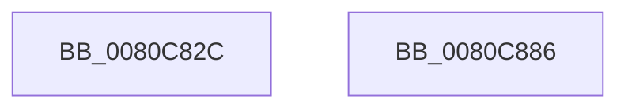

# MiCopyForkedFixupVad

- RVA: `0x0080C82C`–`0x0080C887` (길이 `91` bytes)
- VA: `0x000000014080C82C`
- 실행 섹션: `PAGE`
- PDB 이름 있음: `예`; PDB Function 태그: `아니요`
- unwind 정보 RVA: `0x0005CF00`
- 디코드: `25`개 명령, `91/91` bytes 표시
- 미해석 바이트: `0` (있으면 어셈블리에 `.byte`로 보존)

> 이 문서는 커널 이미지의 기계어와 PDB 기호를 분석해 생성했습니다. 4번과 5번은 함수 원형과 자료형을 바이너리 사용 방식에서 추정한 C 해석이며 원본 소스 복구 결과는 아닙니다.

## 1. Dependencies

- 직접 호출 지점: **1**; 고유 호출 대상: **1**
- 직접 호출자로 확인된 함수: **1**
- RIP 상대 이미지 참조: **0**

### Outgoing calls
- `0x0080C86D` → [memcpy](../../text/6C/memcpy_function_006C6840.md) (function, `0x006C6840`)

### Direct callers
- [MiCloneImageVad](../../text/69/MiCloneImageVad_function_006979F8.md) at `0x00697A3F`

### Static image references
- 디코드된 RIP-relative 메모리 참조가 없습니다.

## 2. Other-region calls and transfers

- 다른 실행 섹션으로 향하는 call: **1**
  - `0x0080C86D` → [memcpy](../../text/6C/memcpy_function_006C6840.md) (`PAGE` → `.text`)
- 별도 외부 분기/꼬리 이동을 확인하지 못했습니다.

## 3. Assembly (complete function range)

```asm
0080C82C  40 53                           push rbx
0080C82E  48 83 EC 20                     sub rsp, 0x20
0080C832  48 8B 42 48                     mov rax, qword ptr [rdx + 0x48]
0080C836  48 8B D9                        mov rbx, rcx
0080C839  4C 8B 00                        mov r8, qword ptr [rax]
0080C83C  49 8B 00                        mov rax, qword ptr [r8]
0080C83F  44 8B 48 08                     mov r9d, dword ptr [rax + 8]
0080C843  41 8B C1                        mov eax, r9d
0080C846  24 3F                           and al, 0x3f
0080C848  F6 D8                           neg al
0080C84A  4D 1B C0                        sbb r8, r8
0080C84D  49 C1 E9 06                     shr r9, 6
0080C851  49 F7 D8                        neg r8
0080C854  48 81 C2 88 00 00 00            add rdx, 0x88
0080C85B  49 83 C0 04                     add r8, 4
0080C85F  48 81 C1 88 00 00 00            add rcx, 0x88
0080C866  4D 03 C1                        add r8, r9
0080C869  49 C1 E0 03                     shl r8, 3
0080C86D  E8 CE 9F EB FF                  call 0x1406c6840
0080C872  48 8D 83 A8 00 00 00            lea rax, [rbx + 0xa8]
0080C879  48 89 83 A0 00 00 00            mov qword ptr [rbx + 0xa0], rax
0080C880  48 83 C4 20                     add rsp, 0x20
0080C884  5B                              pop rbx
0080C885  C3                              ret
0080C886  CC                              int3
```

## 4. C-style interpretation (structured pseudocode)

```c
__int64 __fastcall MiCopyForkedFixupVad(__int64 a1, __int64 a2)
{
    __int64 result;
    __int64 v_rsp;

    v_rsp = (v_rsp) - (32);
    result = (unsigned __int8)(((unsigned int)((unsigned int)((unsigned int)(*(unsigned int *)(*(unsigned __int64 *)(*(unsigned __int64 *)(*(unsigned __int64 *)(a2 + 72))) + 8))))) & (63));
    result = (unsigned __int8)(-(result));
    a4 = ((unsigned int)(*(unsigned int *)(*(unsigned __int64 *)(*(unsigned __int64 *)(*(unsigned __int64 *)(a2 + 72))) + 8))) >> (6);
    a3 = -(*(unsigned __int64 *)(*(unsigned __int64 *)(a2 + 72)));
    a2 = (a2) + (136);
    a3 = (a3) + (4);
    a1 = (a1) + (136);
    a3 = (a3) + (a4);
    a3 = (a3) << (3);
    result = memcpy(a1, a2, a3, a4);
    *(unsigned __int64 *)(a1 + 160) = a1 + 168;
    v_rsp = (v_rsp) + (32);
    return a1 + 168;
}
```

## 5. (Beta) C Style

```c
void *MiCopyForkedFixupVad(void *Arg1, void *Arg2)
{
    uint8_t *arg1 = (uint8_t *)Arg1;
    uint8_t *arg2 = (uint8_t *)Arg2;

    int64_t result;
    int64_t local_rsp;

    local_rsp = (local_rsp) - (32);
    result = (uint8_t)(((uint32_t)((uint32_t)((uint32_t)(*(uint32_t *)(*(uint64_t *)(*(uint64_t *)(*(uint64_t *)(arg2 + 0x48))) + 0x8))))) & (63));
    result = (uint8_t)(-(result));
    a4 = ((uint32_t)(*(uint32_t *)(*(uint64_t *)(*(uint64_t *)(*(uint64_t *)(arg2 + 0x48))) + 0x8))) >> (6);
    a3 = -(*(uint64_t *)(*(uint64_t *)(arg2 + 0x48)));
    Arg2 = (Arg2) + (136);
    a3 = (a3) + (4);
    Arg1 = (Arg1) + (136);
    a3 = (a3) + (a4);
    a3 = (a3) << (3);
    result = memcpy(Arg1, Arg2, a3, a4);
    *(void **)(arg1 + 0xA0) = Arg1 + 168;
    local_rsp = (local_rsp) + (32);
    return Arg1 + 168;
}
```

### 관측된 메모리 오프셋

구조체 형식이 확인되지 않은 접근은 인자 기준의 오프셋으로만 기록했습니다.

| 기준 인자 | 오프셋 표현 | 폭 (bit) | 접근 |
|---|---:|---:|---|
| `Arg1` | `+ 0xA0` | `64` | `W` |
| `Arg1` | `+ 0xA8` | `64` | `R` |
| `Arg2` | `+ 0x48` | `64` | `R` |

## 6. Execution-region graph

[열기: 2D/3D 그래프와 함수 탐색 컨트롤 패널](../../../control-panel.html?section=page&rva=0x0080C82C&view=graph)

- 2D 그래프는 위에서 아래로 흐르고, 3D 그래프는 빈 공간을 드래그해 회전합니다. Shift+드래그는 이동, 휠은 확대·축소, 함수 노드 선택은 대상 보고서 이동입니다.

### Static fallback


