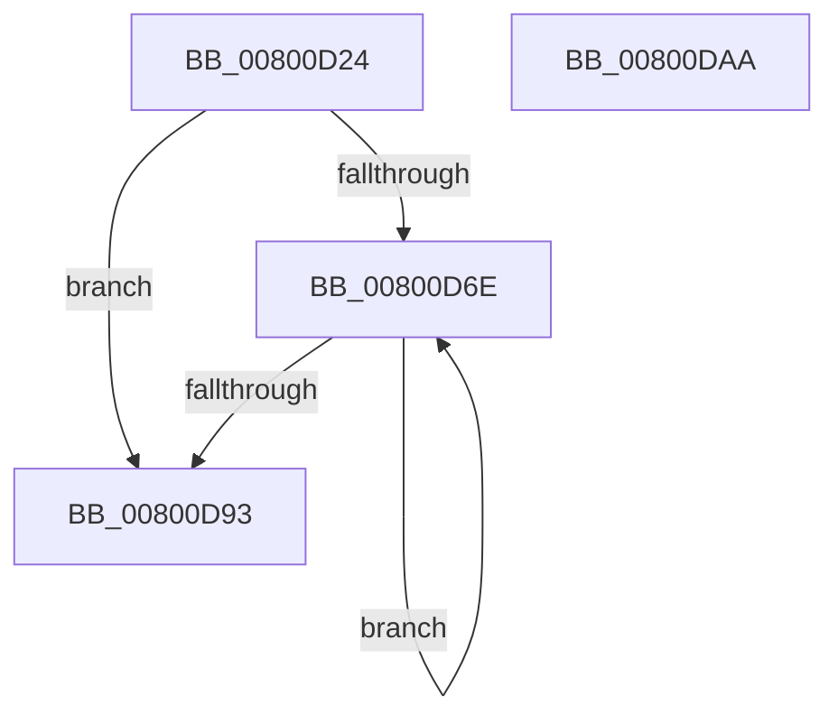

# MiCopyFromDirectMapExtent

- RVA: `0x00800D24`–`0x00800DAB` (길이 `135` bytes)
- VA: `0x0000000140800D24`
- 실행 섹션: `PAGE`
- PDB 이름 있음: `예`; PDB Function 태그: `아니요`
- unwind 정보 RVA: `0x0005C954`
- 디코드: `36`개 명령, `135/135` bytes 표시
- 미해석 바이트: `0` (있으면 어셈블리에 `.byte`로 보존)

> 이 문서는 커널 이미지의 기계어와 PDB 기호를 분석해 생성했습니다. 4번과 5번은 함수 원형과 자료형을 바이너리 사용 방식에서 추정한 C 해석이며 원본 소스 복구 결과는 아닙니다.

## 1. Dependencies

- 직접 호출 지점: **1**; 고유 호출 대상: **1**
- 직접 호출자로 확인된 함수: **1**
- RIP 상대 이미지 참조: **0**

### Outgoing calls
- `0x00800D7D` → [MiFillPageWithImageExtentContents](../../text/68/MiFillPageWithImageExtentContents_function_00680E44.md) (function, `0x00680E44`)

### Direct callers
- [MiReadImageHeaders](../98/MiReadImageHeaders_function_00987DAC.md) at `0x00987F20`

### Static image references
- 디코드된 RIP-relative 메모리 참조가 없습니다.

## 2. Other-region calls and transfers

- 다른 실행 섹션으로 향하는 call: **1**
  - `0x00800D7D` → [MiFillPageWithImageExtentContents](../../text/68/MiFillPageWithImageExtentContents_function_00680E44.md) (`PAGE` → `.text`)
- 별도 외부 분기/꼬리 이동을 확인하지 못했습니다.

## 3. Assembly (complete function range)

```asm
00800D24  48 89 5C 24 08                  mov qword ptr [rsp + 8], rbx
00800D29  48 89 6C 24 10                  mov qword ptr [rsp + 0x10], rbp
00800D2E  48 89 74 24 18                  mov qword ptr [rsp + 0x18], rsi
00800D33  57                              push rdi
00800D34  48 83 EC 20                     sub rsp, 0x20
00800D38  44 8B 52 18                     mov r10d, dword ptr [rdx + 0x18]
00800D3C  48 8D 72 30                     lea rsi, [rdx + 0x30]
00800D40  8B 5A 28                        mov ebx, dword ptr [rdx + 0x28]
00800D43  41 81 E2 FF 0F 00 00            and r10d, 0xfff
00800D4A  48 81 C3 FF 0F 00 00            add rbx, 0xfff
00800D51  49 8B F8                        mov rdi, r8
00800D54  49 03 DA                        add rbx, r10
00800D57  48 8B E9                        mov rbp, rcx
00800D5A  48 C1 EB 0C                     shr rbx, 0xc
00800D5E  48 8B C3                        mov rax, rbx
00800D61  48 C1 E0 0C                     shl rax, 0xc
00800D65  49 89 41 08                     mov qword ptr [r9 + 8], rax
00800D69  48 85 DB                        test rbx, rbx
00800D6C  74 25                           je 0x140800d93
00800D6E  4C 8B 07                        mov r8, qword ptr [rdi]
00800D71  41 B9 00 10 00 00               mov r9d, 0x1000
00800D77  48 8B 16                        mov rdx, qword ptr [rsi]
00800D7A  48 8B CD                        mov rcx, rbp
00800D7D  E8 C2 00 E8 FF                  call 0x140680e44
00800D82  48 81 07 00 10 00 00            add qword ptr [rdi], 0x1000
00800D89  48 8D 76 08                     lea rsi, [rsi + 8]
00800D8D  48 83 EB 01                     sub rbx, 1
00800D91  75 DB                           jne 0x140800d6e
00800D93  48 8B 5C 24 30                  mov rbx, qword ptr [rsp + 0x30]
00800D98  33 C0                           xor eax, eax
00800D9A  48 8B 6C 24 38                  mov rbp, qword ptr [rsp + 0x38]
00800D9F  48 8B 74 24 40                  mov rsi, qword ptr [rsp + 0x40]
00800DA4  48 83 C4 20                     add rsp, 0x20
00800DA8  5F                              pop rdi
00800DA9  C3                              ret
00800DAA  CC                              int3
```

## 4. C-style interpretation (structured pseudocode)

```c
__int64 __fastcall MiCopyFromDirectMapExtent(__int64 a1, __int64 a2, __int64 a3, __int64 a4)
{
    __int64 result;
    __int64 v_r10;
    __int64 v_rbx;
    __int64 v_rsp;
    unsigned __int64 v_stack_p10;
    unsigned __int64 v_stack_p18;
    unsigned __int64 v_stack_p8;

    v_stack_p8 = v_rbx;
    v_stack_p10 = v_rbp;
    v_stack_p18 = v_rsi;
    v_rsp = (v_rsp) - (32);
    v_r10 = (unsigned int)(((unsigned int)(*(unsigned int *)(a2 + 24))) & (0xFFFULL));
    v_rbx = ((unsigned int)(*(unsigned int *)(a2 + 40))) + (0xFFFULL);
    v_rbx = (v_rbx) + (v_r10);
    v_rbx = (v_rbx) >> (12);
    result = (v_rbx) << (12);
    *(unsigned __int64 *)(a4 + 8) = result;
    if (v_rbx == 0) goto loc_00800D93;
loc_00800D6E:
    result = MiFillPageWithImageExtentContents(a1, *(unsigned __int64 *)(a2 + 48), *(unsigned __int64 *)(a3), (unsigned int)(0x1000ULL));
    v_rbx = (v_rbx) - (1);
    if (condition_is_not_equal) goto loc_00800D6E;
loc_00800D93:
    result = 0;
    v_rsp = (v_rsp) + (32);
    return result;
}
```

## 5. (Beta) C Style

```c
int64_t MiCopyFromDirectMapExtent(int64_t Arg1, void *Arg2, void *Arg3, void *Arg4)
{
    uint8_t *arg2 = (uint8_t *)Arg2;
    uint8_t *arg3 = (uint8_t *)Arg3;
    uint8_t *arg4 = (uint8_t *)Arg4;

    int64_t result;
    int64_t local_r10;
    int64_t local_rbx;
    int64_t local_rsp;
    uint64_t v_stack_p10;
    uint64_t v_stack_p18;
    uint64_t v_stack_p8;

    v_stack_p8 = local_rbx;
    v_stack_p10 = local_rbp;
    v_stack_p18 = local_rsi;
    local_rsp = (local_rsp) - (32);
    local_r10 = (uint32_t)(((uint32_t)(*(uint32_t *)(arg2 + 0x18))) & (0xFFFULL));
    local_rbx = ((uint32_t)(*(uint32_t *)(arg2 + 0x28))) + (0xFFFULL);
    local_rbx = (local_rbx) + (local_r10);
    local_rbx = (local_rbx) >> (12);
    result = (local_rbx) << (12);
    *(uint64_t *)(arg4 + 0x8) = result;
    if (local_rbx == 0) goto loc_00800D93;
loc_00800D6E:
    result = MiFillPageWithImageExtentContents(Arg1, *(uint64_t *)(arg2 + 0x30), *(uint64_t *)(arg3), (uint32_t)(0x1000ULL));
    local_rbx = (local_rbx) - (1);
    if (condition_is_not_equal) goto loc_00800D6E;
loc_00800D93:
    result = 0;
    local_rsp = (local_rsp) + (32);
    return result;
}
```

### 관측된 메모리 오프셋

구조체 형식이 확인되지 않은 접근은 인자 기준의 오프셋으로만 기록했습니다.

| 기준 인자 | 오프셋 표현 | 폭 (bit) | 접근 |
|---|---:|---:|---|
| `Arg2` | `+ 0x0` | `64` | `R` |
| `Arg2` | `+ 0x8` | `64` | `R` |
| `Arg2` | `+ 0x18` | `32` | `R` |
| `Arg2` | `+ 0x28` | `32` | `R` |
| `Arg2` | `+ 0x30` | `64` | `R` |
| `Arg3` | `+ 0x0` | `64` | `R` |
| `Arg3` | `+ 0x0` | `64` | `R/W` |
| `Arg4` | `+ 0x8` | `64` | `W` |

## 6. Execution-region graph

[열기: 2D/3D 그래프와 함수 탐색 컨트롤 패널](../../../control-panel.html?section=page&rva=0x00800D24&view=graph)

- 2D 그래프는 위에서 아래로 흐르고, 3D 그래프는 빈 공간을 드래그해 회전합니다. Shift+드래그는 이동, 휠은 확대·축소, 함수 노드 선택은 대상 보고서 이동입니다.

### Static fallback


