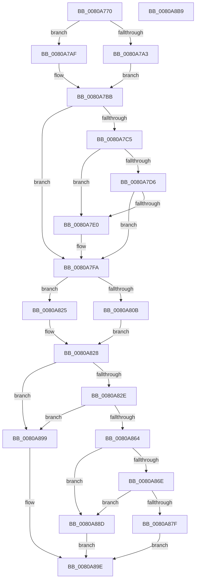

# MiCreateAweInfoBitMap

- RVA: `0x0080A770`–`0x0080A8BA` (길이 `330` bytes)
- VA: `0x000000014080A770`
- 실행 섹션: `PAGE`
- PDB 이름 있음: `예`; PDB Function 태그: `아니요`
- unwind 정보 RVA: `0x0005E6B4`
- 디코드: `89`개 명령, `330/330` bytes 표시
- 미해석 바이트: `0` (있으면 어셈블리에 `.byte`로 보존)

> 이 문서는 커널 이미지의 기계어와 PDB 기호를 분석해 생성했습니다. 4번과 5번은 함수 원형과 자료형을 바이너리 사용 방식에서 추정한 C 해석이며 원본 소스 복구 결과는 아닙니다.

## 1. Dependencies

- 직접 호출 지점: **5**; 고유 호출 대상: **5**
- 직접 호출자로 확인된 함수: **2**
- RIP 상대 이미지 참조: **0**

### Outgoing calls
- `0x0080A7AF` → [MiGetAweInfoPartition](../../text/2A/MiGetAweInfoPartition_function_002AA2CC.md) (function, `0x002AA2CC`)
- `0x0080A7FD` → [MiGetAwePageSize](../../text/46/MiGetAwePageSize_function_0046CFA8.md) (function, `0x0046CFA8`)
- `0x0080A857` → [MiAllocatePool](../../text/35/MiAllocatePool_function_0035B540.md) (function, `0x0035B540`)
- `0x0080A874` → [PsChargeProcessNonPagedPoolQuota](../../text/2A/PsChargeProcessNonPagedPoolQuota_function_002A7B80.md) (function, `0x002A7B80`)
- `0x0080A884` → [ExFreePoolWithTag](../../poolcode/B8/ExFreePoolWithTag_function_00B82870.md) (function, `0x00B82870`)

### Direct callers
- [MiAllocateAweInfo](MiAllocateAweInfo_function_00809518.md) at `0x00809666`
- [MiResizeAweBitMap](MiResizeAweBitMap_function_0080AD00.md) at `0x0080AD91`

### Static image references
- 디코드된 RIP-relative 메모리 참조가 없습니다.

## 2. Other-region calls and transfers

- 다른 실행 섹션으로 향하는 call: **5**
  - `0x0080A7AF` → [MiGetAweInfoPartition](../../text/2A/MiGetAweInfoPartition_function_002AA2CC.md) (`PAGE` → `.text`)
  - `0x0080A7FD` → [MiGetAwePageSize](../../text/46/MiGetAwePageSize_function_0046CFA8.md) (`PAGE` → `.text`)
  - `0x0080A857` → [MiAllocatePool](../../text/35/MiAllocatePool_function_0035B540.md) (`PAGE` → `.text`)
  - `0x0080A874` → [PsChargeProcessNonPagedPoolQuota](../../text/2A/PsChargeProcessNonPagedPoolQuota_function_002A7B80.md) (`PAGE` → `.text`)
  - `0x0080A884` → [ExFreePoolWithTag](../../poolcode/B8/ExFreePoolWithTag_function_00B82870.md) (`PAGE` → `POOLCODE`)
- 별도 외부 분기/꼬리 이동을 확인하지 못했습니다.

## 3. Assembly (complete function range)

```asm
0080A770  48 8B C4                        mov rax, rsp
0080A773  48 89 58 08                     mov qword ptr [rax + 8], rbx
0080A777  48 89 68 10                     mov qword ptr [rax + 0x10], rbp
0080A77B  48 89 70 18                     mov qword ptr [rax + 0x18], rsi
0080A77F  48 89 78 20                     mov qword ptr [rax + 0x20], rdi
0080A783  41 56                           push r14
0080A785  48 83 EC 20                     sub rsp, 0x20
0080A789  65 48 8B 04 25 88 01 00 00      mov rax, qword ptr gs:[0x188]
0080A792  48 8B F9                        mov rdi, rcx
0080A795  48 8B B0 B8 00 00 00            mov rsi, qword ptr [rax + 0xb8]
0080A79C  8B 41 08                        mov eax, dword ptr [rcx + 8]
0080A79F  A8 08                           test al, 8
0080A7A1  74 0C                           je 0x14080a7af
0080A7A3  48 BB FF FF FF FF FF 00 00 00   movabs rbx, 0xffffffffff
0080A7AD  EB 0C                           jmp 0x14080a7bb
0080A7AF  E8 18 FB A9 FF                  call 0x1402aa2cc
0080A7B4  48 8B 98 48 48 00 00            mov rbx, qword ptr [rax + 0x4848]
0080A7BB  48 83 BE 10 03 00 00 00         cmp qword ptr [rsi + 0x310], 0
0080A7C3  74 35                           je 0x14080a7fa
0080A7C5  0F B7 86 EC 06 00 00            movzx eax, word ptr [rsi + 0x6ec]
0080A7CC  B9 4C 01 00 00                  mov ecx, 0x14c
0080A7D1  66 3B C1                        cmp ax, cx
0080A7D4  74 0A                           je 0x14080a7e0
0080A7D6  B9 C4 01 00 00                  mov ecx, 0x1c4
0080A7DB  66 3B C1                        cmp ax, cx
0080A7DE  75 1A                           jne 0x14080a7fa
0080A7E0  48 8D 43 01                     lea rax, [rbx + 1]
0080A7E4  48 B9 00 00 00 00 01 00 00 00   movabs rcx, 0x100000000
0080A7EE  48 3B C1                        cmp rax, rcx
0080A7F1  BA FF FF FF FF                  mov edx, 0xffffffff
0080A7F6  48 0F 47 DA                     cmova rbx, rdx
0080A7FA  48 8B CF                        mov rcx, rdi
0080A7FD  E8 A6 27 C6 FF                  call 0x14046cfa8
0080A802  4C 8B C0                        mov r8, rax
0080A805  48 83 F8 01                     cmp rax, 1
0080A809  74 1A                           je 0x14080a825
0080A80B  48 FF C8                        dec rax
0080A80E  49 8D 48 FF                     lea rcx, [r8 - 1]
0080A812  48 03 C3                        add rax, rbx
0080A815  48 F7 D1                        not rcx
0080A818  48 23 C1                        and rax, rcx
0080A81B  33 D2                           xor edx, edx
0080A81D  49 F7 F0                        div r8
0080A820  48 8B D8                        mov rbx, rax
0080A823  EB 03                           jmp 0x14080a828
0080A825  48 FF C3                        inc rbx
0080A828  48 39 5F 18                     cmp qword ptr [rdi + 0x18], rbx
0080A82C  74 6B                           je 0x14080a899
0080A82E  41 BE 00 00 00 00               mov r14d, 0
0080A834  F6 C3 3F                        test bl, 0x3f
0080A837  48 8B C3                        mov rax, rbx
0080A83A  41 B8 56 61 64 4C               mov r8d, 0x4c646156
0080A840  41 0F 95 C6                     setne r14b
0080A844  B9 40 00 00 00                  mov ecx, 0x40
0080A849  48 C1 E8 06                     shr rax, 6
0080A84D  4C 03 F0                        add r14, rax
0080A850  49 C1 E6 03                     shl r14, 3
0080A854  49 8B D6                        mov rdx, r14
0080A857  E8 E4 0C B5 FF                  call 0x14035b540
0080A85C  48 8B E8                        mov rbp, rax
0080A85F  48 85 C0                        test rax, rax
0080A862  74 35                           je 0x14080a899
0080A864  44 8B 47 08                     mov r8d, dword ptr [rdi + 8]
0080A868  41 F6 C0 01                     test r8b, 1
0080A86C  74 1F                           je 0x14080a88d
0080A86E  49 8B D6                        mov rdx, r14
0080A871  48 8B CE                        mov rcx, rsi
0080A874  E8 07 D3 A9 FF                  call 0x1402a7b80
0080A879  8B F0                           mov esi, eax
0080A87B  85 C0                           test eax, eax
0080A87D  79 0E                           jns 0x14080a88d
0080A87F  33 D2                           xor edx, edx
0080A881  48 8B CD                        mov rcx, rbp
0080A884  E8 E7 7F 37 00                  call 0x140b82870
0080A889  8B C6                           mov eax, esi
0080A88B  EB 11                           jmp 0x14080a89e
0080A88D  48 89 5F 18                     mov qword ptr [rdi + 0x18], rbx
0080A891  33 C0                           xor eax, eax
0080A893  48 89 6F 20                     mov qword ptr [rdi + 0x20], rbp
0080A897  EB 05                           jmp 0x14080a89e
0080A899  B8 9A 00 00 C0                  mov eax, 0xc000009a
0080A89E  48 8B 5C 24 30                  mov rbx, qword ptr [rsp + 0x30]
0080A8A3  48 8B 6C 24 38                  mov rbp, qword ptr [rsp + 0x38]
0080A8A8  48 8B 74 24 40                  mov rsi, qword ptr [rsp + 0x40]
0080A8AD  48 8B 7C 24 48                  mov rdi, qword ptr [rsp + 0x48]
0080A8B2  48 83 C4 20                     add rsp, 0x20
0080A8B6  41 5E                           pop r14
0080A8B8  C3                              ret
0080A8B9  CC                              int3
```

## 4. C-style interpretation (structured pseudocode)

```c
__int64 __fastcall MiCreateAweInfoBitMap(__int64 a1)
{
    __int64 result;
    __int64 v_r14;
    __int64 v_rbx;
    __int64 v_rsp;
    unsigned __int64 v_stack_p10;
    unsigned __int64 v_stack_p18;
    unsigned __int64 v_stack_p20;
    unsigned __int64 v_stack_p8;

    *(unsigned __int64 *)(v_rsp + 8) = v_rbx;
    *(unsigned __int64 *)(v_rsp + 16) = v_rbp;
    *(unsigned __int64 *)(v_rsp + 24) = v_rsi;
    *(unsigned __int64 *)(v_rsp + 32) = v_rdi;
    v_rsp = (v_rsp) - (32);
    if ((((unsigned __int8)((unsigned int)(*(unsigned int *)(a1 + 8)))) & (8)) == 0) goto loc_0080A7AF;
    goto loc_0080A7BB;
loc_0080A7AF:
    result = MiGetAweInfoPartition(a1, a2, a3, a4);
loc_0080A7BB:
    if ((*(unsigned __int64 *)(*(unsigned __int64 *)(*(unsigned __int64 *)(gs_base + (0 + 392)) + 184) + 784)) == 0) goto loc_0080A7FA;
    if (((unsigned __int16)(*(unsigned __int16 *)(*(unsigned __int64 *)(*(unsigned __int64 *)(gs_base + (0 + 392)) + 184) + 1772))) == 332) goto loc_0080A7E0;
    result = *(unsigned __int16 *)(*(unsigned __int64 *)(*(unsigned __int64 *)(gs_base + (0 + 392)) + 184) + 1772);
    v_rbx = *(unsigned __int64 *)(result + 18504);
    if (((unsigned __int16)(*(unsigned __int16 *)(*(unsigned __int64 *)(*(unsigned __int64 *)(gs_base + (0 + 392)) + 184) + 1772))) == 452) {
        result = *(unsigned __int64 *)(result + 18504) + 1;
        a2 = 0xFFFFFFFFULL;
        v_rbx = *(unsigned __int64 *)(result + 18504);
        if (result > 452) { v_rbx = a2; }
    }
    result = MiGetAwePageSize(a1, a2, a3, a4);
    if (result == 1) goto loc_0080A825;
    result = (result) - 1;
    result = (result) + (v_rbx);
    a1 = ~(result - 1);
    result = (result) & (a1);
    a2 = 0;
    goto loc_0080A828;
loc_0080A825:
    v_rbx = (result) + 1;
loc_0080A828:
    if ((*(unsigned __int64 *)(a1 + 24)) == v_rbx) goto loc_0080A899;
    v_r14 = ((((unsigned __int8)(v_rbx)) & (63)) != 0) ? 1 : 0;
    result = (v_rbx) >> (6);
    v_r14 = (v_r14) + (result);
    v_r14 = (v_r14) << (3);
    result = MiAllocatePool(64, v_r14, (unsigned int)(0x4C646156ULL), a4);
    if (result == 0) goto loc_0080A899;
    if ((((unsigned __int8)((unsigned int)(*(unsigned int *)(a1 + 8)))) & (1)) == 0) goto loc_0080A88D;
    result = PsChargeProcessNonPagedPoolQuota(*(unsigned __int64 *)(*(unsigned __int64 *)(gs_base + (0 + 392)) + 184), v_r14, (unsigned int)(*(unsigned int *)(a1 + 8)), a4);
    if (!sign_flag) goto loc_0080A88D;
    a2 = 0;
    result = ExFreePoolWithTag(result, a2, (unsigned int)(*(unsigned int *)(a1 + 8)), a4);
    goto loc_0080A89E;
loc_0080A88D:
    *(unsigned __int64 *)(a1 + 24) = v_rbx;
    result = 0;
    *(unsigned __int64 *)(a1 + 32) = 0;
    goto loc_0080A89E;
loc_0080A899:
loc_0080A89E:
    v_rsp = (v_rsp) + (32);
    return (unsigned int)(0xC000009AULL);
}
```

## 5. (Beta) C Style

```c
int64_t MiCreateAweInfoBitMap(void *Arg1)
{
    uint8_t *arg1 = (uint8_t *)Arg1;

    int64_t result;
    int64_t local_r14;
    int64_t local_rbx;
    int64_t local_rsp;
    uint64_t v_stack_p10;
    uint64_t v_stack_p18;
    uint64_t v_stack_p20;
    uint64_t v_stack_p8;

    *(uint64_t *)(local_rsp + 0x8) = local_rbx;
    *(uint64_t *)(local_rsp + 0x10) = local_rbp;
    *(uint64_t *)(local_rsp + 0x18) = local_rsi;
    *(uint64_t *)(local_rsp + 0x20) = local_rdi;
    local_rsp = (local_rsp) - (32);
    if ((((uint8_t)((uint32_t)(*(uint32_t *)(arg1 + 0x8)))) & (8)) == 0) goto loc_0080A7AF;
    goto loc_0080A7BB;
loc_0080A7AF:
    result = MiGetAweInfoPartition(Arg1, a2, a3, a4);
loc_0080A7BB:
    if ((*(uint64_t *)(*(uint64_t *)(*(uint64_t *)(gs_base + (0 + 0x188)) + 0xB8) + 0x310)) == 0) goto loc_0080A7FA;
    if (((uint16_t)(*(uint16_t *)(*(uint64_t *)(*(uint64_t *)(gs_base + (0 + 0x188)) + 0xB8) + 0x6EC))) == 332) goto loc_0080A7E0;
    result = *(uint16_t *)(*(uint64_t *)(*(uint64_t *)(gs_base + (0 + 0x188)) + 0xB8) + 0x6EC);
    local_rbx = *(uint64_t *)(result + 0x4848);
    if (((uint16_t)(*(uint16_t *)(*(uint64_t *)(*(uint64_t *)(gs_base + (0 + 0x188)) + 0xB8) + 0x6EC))) == 452) {
        result = *(uint64_t *)(result + 0x4848) + 1;
        a2 = 0xFFFFFFFFULL;
        local_rbx = *(uint64_t *)(result + 0x4848);
        if (result > 452) { local_rbx = a2; }
    }
    result = MiGetAwePageSize(Arg1, a2, a3, a4);
    if (result == 1) goto loc_0080A825;
    result = (result) - 1;
    result = (result) + (local_rbx);
    Arg1 = ~(result - 1);
    result = (result) & (Arg1);
    a2 = 0;
    goto loc_0080A828;
loc_0080A825:
    local_rbx = (result) + 1;
loc_0080A828:
    if ((*(uint64_t *)(arg1 + 0x18)) == local_rbx) goto loc_0080A899;
    local_r14 = ((((uint8_t)(local_rbx)) & (63)) != 0) ? 1 : 0;
    result = (local_rbx) >> (6);
    local_r14 = (local_r14) + (result);
    local_r14 = (local_r14) << (3);
    result = MiAllocatePool(64, local_r14, (uint32_t)(0x4C646156ULL), a4);
    if (result == 0) goto loc_0080A899;
    if ((((uint8_t)((uint32_t)(*(uint32_t *)(arg1 + 0x8)))) & (1)) == 0) goto loc_0080A88D;
    result = PsChargeProcessNonPagedPoolQuota(*(uint64_t *)(*(uint64_t *)(gs_base + (0 + 0x188)) + 0xB8), local_r14, (uint32_t)(*(uint32_t *)(arg1 + 0x8)), a4);
    if (!sign_flag) goto loc_0080A88D;
    a2 = 0;
    result = ExFreePoolWithTag(result, a2, (uint32_t)(*(uint32_t *)(arg1 + 0x8)), a4);
    goto loc_0080A89E;
loc_0080A88D:
    *(uint64_t *)(arg1 + 0x18) = local_rbx;
    result = 0;
    *(uint64_t *)(arg1 + 0x20) = 0;
    goto loc_0080A89E;
loc_0080A899:
loc_0080A89E:
    local_rsp = (local_rsp) + (32);
    return (uint32_t)(0xC000009AULL);
}
```

### 관측된 메모리 오프셋

구조체 형식이 확인되지 않은 접근은 인자 기준의 오프셋으로만 기록했습니다.

| 기준 인자 | 오프셋 표현 | 폭 (bit) | 접근 |
|---|---:|---:|---|
| `Arg1` | `+ 0x8` | `32` | `R` |
| `Arg1` | `+ 0x18` | `64` | `R` |
| `Arg1` | `+ 0x18` | `64` | `W` |
| `Arg1` | `+ 0x20` | `64` | `W` |

## 6. Execution-region graph

[열기: 2D/3D 그래프와 함수 탐색 컨트롤 패널](../../../control-panel.html?section=page&rva=0x0080A770&view=graph)

- 2D 그래프는 위에서 아래로 흐르고, 3D 그래프는 빈 공간을 드래그해 회전합니다. Shift+드래그는 이동, 휠은 확대·축소, 함수 노드 선택은 대상 보고서 이동입니다.

### Static fallback


