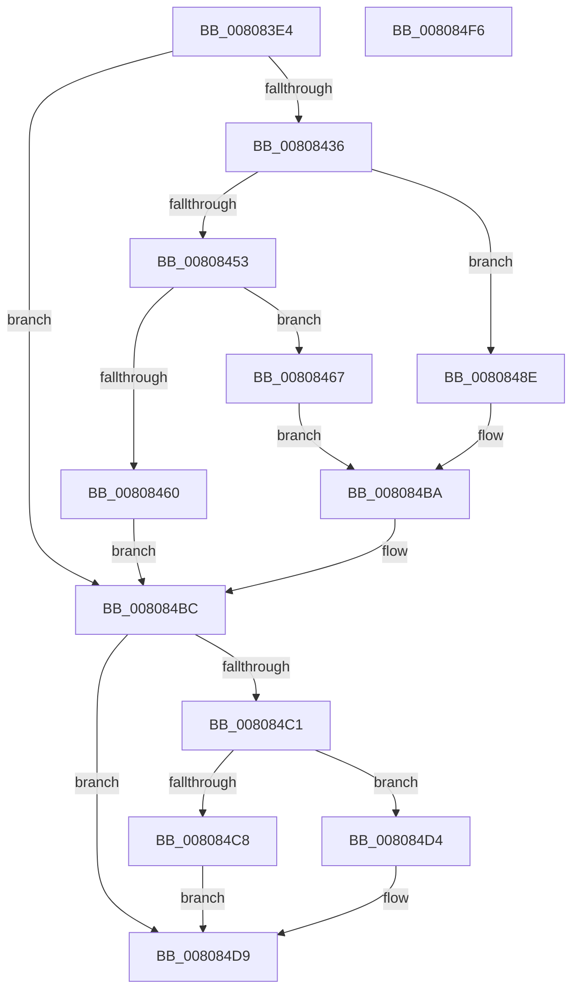

# MiCreateEnclave

- RVA: `0x008083E4`–`0x008084F7` (길이 `275` bytes)
- VA: `0x00000001408083E4`
- 실행 섹션: `PAGE`
- PDB 이름 있음: `예`; PDB Function 태그: `아니요`
- unwind 정보 RVA: `0x00060130`
- 디코드: `74`개 명령, `275/275` bytes 표시
- 미해석 바이트: `0` (있으면 어셈블리에 `.byte`로 보존)

> 이 문서는 커널 이미지의 기계어와 PDB 기호를 분석해 생성했습니다. 4번과 5번은 함수 원형과 자료형을 바이너리 사용 방식에서 추정한 C 해석이며 원본 소스 복구 결과는 아닙니다.

## 1. Dependencies

- 직접 호출 지점: **5**; 고유 호출 대상: **5**
- 직접 호출자로 확인된 함수: **1**
- RIP 상대 이미지 참조: **0**

### Outgoing calls
- `0x00808422` → [MiAllocateEnclaveVad](MiAllocateEnclaveVad_function_008080A4.md) (function, `0x008080A4`)
- `0x00808487` → [MiCreateHardwareEnclave](MiCreateHardwareEnclave_function_00808500.md) (function, `0x00808500`)
- `0x008084B5` → [MiCreateVsmEnclave](MiCreateVsmEnclave_function_00808890.md) (function, `0x00808890`)
- `0x008084CD` → [MiDeleteVad](../88/MiDeleteVad_function_00888C80.md) (function, `0x00888C80`)
- `0x008084D4` → [MiUnlockAndDereferenceVad](../../text/31/MiUnlockAndDereferenceVad_function_00316E60.md) (function, `0x00316E60`)

### Direct callers
- [NtCreateEnclave](NtCreateEnclave_function_00808CC0.md) at `0x00808FED`

### Static image references
- 디코드된 RIP-relative 메모리 참조가 없습니다.

## 2. Other-region calls and transfers

- 다른 실행 섹션으로 향하는 call: **1**
  - `0x008084D4` → [MiUnlockAndDereferenceVad](../../text/31/MiUnlockAndDereferenceVad_function_00316E60.md) (`PAGE` → `.text`)
- 별도 외부 분기/꼬리 이동을 확인하지 못했습니다.

## 3. Assembly (complete function range)

```asm
008083E4  4C 8B DC                        mov r11, rsp
008083E7  49 89 5B 08                     mov qword ptr [r11 + 8], rbx
008083EB  49 89 6B 10                     mov qword ptr [r11 + 0x10], rbp
008083EF  49 89 73 18                     mov qword ptr [r11 + 0x18], rsi
008083F3  49 89 7B 20                     mov qword ptr [r11 + 0x20], rdi
008083F7  41 56                           push r14
008083F9  48 83 EC 40                     sub rsp, 0x40
008083FD  8B 74 24 78                     mov esi, dword ptr [rsp + 0x78]
00808401  48 8B E9                        mov rbp, rcx
00808404  49 83 63 E8 00                  and qword ptr [r11 - 0x18], 0
00808409  49 8D 4B E8                     lea rcx, [r11 - 0x18]
0080840D  49 8B C1                        mov rax, r9
00808410  49 89 4B D8                     mov qword ptr [r11 - 0x28], rcx
00808414  4D 8B C8                        mov r9, r8
00808417  4C 8B F2                        mov r14, rdx
0080841A  4C 8B 02                        mov r8, qword ptr [rdx]
0080841D  8B CE                           mov ecx, esi
0080841F  48 8B D0                        mov rdx, rax
00808422  E8 7D FC FF FF                  call 0x1408080a4
00808427  48 8B 5C 24 30                  mov rbx, qword ptr [rsp + 0x30]
0080842C  8B F8                           mov edi, eax
0080842E  85 C0                           test eax, eax
00808430  0F 88 86 00 00 00               js 0x1408084bc
00808436  8B 43 18                        mov eax, dword ptr [rbx + 0x18]
00808439  0F B6 4B 20                     movzx ecx, byte ptr [rbx + 0x20]
0080843D  48 C1 E1 20                     shl rcx, 0x20
00808441  48 0B C8                        or rcx, rax
00808444  8D 46 F0                        lea eax, [rsi - 0x10]
00808447  48 C1 E1 0C                     shl rcx, 0xc
0080844B  49 89 0E                        mov qword ptr [r14], rcx
0080844E  83 F8 01                        cmp eax, 1
00808451  76 3B                           jbe 0x14080848e
00808453  81 BC 24 88 00 00 00 00 10 00 00  cmp dword ptr [rsp + 0x88], 0x1000
0080845E  74 07                           je 0x140808467
00808460  BF 0D 00 00 C0                  mov edi, 0xc000000d
00808465  EB 55                           jmp 0x1408084bc
00808467  48 8B 84 24 90 00 00 00         mov rax, qword ptr [rsp + 0x90]
0080846F  48 8B D3                        mov rdx, rbx
00808472  4C 8B 8C 24 80 00 00 00         mov r9, qword ptr [rsp + 0x80]
0080847A  48 8B CD                        mov rcx, rbp
0080847D  4C 8B 44 24 70                  mov r8, qword ptr [rsp + 0x70]
00808482  48 89 44 24 20                  mov qword ptr [rsp + 0x20], rax
00808487  E8 74 00 00 00                  call 0x140808500
0080848C  EB 2C                           jmp 0x1408084ba
0080848E  4C 8B 8C 24 80 00 00 00         mov r9, qword ptr [rsp + 0x80]
00808496  48 8D 43 50                     lea rax, [rbx + 0x50]
0080849A  48 89 40 08                     mov qword ptr [rax + 8], rax
0080849E  44 8B C6                        mov r8d, esi
008084A1  48 89 00                        mov qword ptr [rax], rax
008084A4  48 8B D3                        mov rdx, rbx
008084A7  8B 84 24 88 00 00 00            mov eax, dword ptr [rsp + 0x88]
008084AE  48 8B CD                        mov rcx, rbp
008084B1  89 44 24 20                     mov dword ptr [rsp + 0x20], eax
008084B5  E8 D6 03 00 00                  call 0x140808890
008084BA  8B F8                           mov edi, eax
008084BC  48 85 DB                        test rbx, rbx
008084BF  74 18                           je 0x1408084d9
008084C1  48 8B CB                        mov rcx, rbx
008084C4  85 FF                           test edi, edi
008084C6  79 0C                           jns 0x1408084d4
008084C8  45 33 C0                        xor r8d, r8d
008084CB  33 D2                           xor edx, edx
008084CD  E8 AE 07 08 00                  call 0x140888c80
008084D2  EB 05                           jmp 0x1408084d9
008084D4  E8 87 E9 B0 FF                  call 0x140316e60
008084D9  48 8B 5C 24 50                  mov rbx, qword ptr [rsp + 0x50]
008084DE  8B C7                           mov eax, edi
008084E0  48 8B 7C 24 68                  mov rdi, qword ptr [rsp + 0x68]
008084E5  48 8B 6C 24 58                  mov rbp, qword ptr [rsp + 0x58]
008084EA  48 8B 74 24 60                  mov rsi, qword ptr [rsp + 0x60]
008084EF  48 83 C4 40                     add rsp, 0x40
008084F3  41 5E                           pop r14
008084F5  C3                              ret
008084F6  CC                              int3
```

## 4. C-style interpretation (structured pseudocode)

```c
__int64 __fastcall MiCreateEnclave(__int64 a1, __int64 a2, __int64 a3, __int64 a4, __int64 a5, unsigned int a6, __int64 a7, unsigned int a8, __int64 a9)
{
    __int64 result;
    __int64 v_rsp;
    unsigned __int64 v_stack_m18;
    unsigned __int64 v_stack_m28;
    unsigned __int64 v_stack_p10;
    unsigned __int64 v_stack_p18;
    unsigned __int64 v_stack_p20;
    unsigned __int64 v_stack_p8;

    *(unsigned __int64 *)(v_rsp + 8) = v_rbx;
    *(unsigned __int64 *)(v_rsp + 16) = v_rbp;
    *(unsigned __int64 *)(v_rsp + 24) = v_rsi;
    *(unsigned __int64 *)(v_rsp + 32) = v_rdi;
    v_rsp = (v_rsp) - (64);
    *(unsigned __int64 *)(v_rsp - 40) = v_rsp - 24;
    result = MiAllocateEnclaveVad((unsigned int)((unsigned int)((unsigned int)(a6))), a4, *(unsigned __int64 *)(a2), a3);
    if (sign_flag) goto loc_008084BC;
    a1 = (*(unsigned __int8 *)(v_stack_m18 + 32)) << (32);
    a1 = (a1) | ((unsigned int)(*(unsigned int *)(v_stack_m18 + 24)));
    a1 = (a1) << (12);
    *(unsigned __int64 *)(a2) = a1;
    if (((unsigned int)((unsigned int)(a6) - 16)) <= 1) goto loc_0080848E;
    if (a8 == 0x1000ULL) goto loc_00808467;
    goto loc_008084BC;
loc_00808467:
    v_stack_m28 = a9;
    result = MiCreateHardwareEnclave(a1, v_stack_m18, a5, a7);
    goto loc_008084BA;
loc_0080848E:
    *(unsigned __int64 *)(v_stack_m18 + 80 + 8) = v_stack_m18 + 80;
    *(unsigned __int64 *)(v_stack_m18 + 80) = v_stack_m18 + 80;
    v_stack_m28 = (unsigned int)((unsigned int)(a8));
    result = MiCreateVsmEnclave(a1, v_stack_m18, (unsigned int)((unsigned int)((unsigned int)(a6))), a7);
loc_008084BA:
loc_008084BC:
    if (v_stack_m18 == 0) goto loc_008084D9;
    if (!sign_flag) goto loc_008084D4;
    a3 = 0;
    a2 = 0;
    result = MiDeleteVad(v_stack_m18, a2, a3, a7);
    goto loc_008084D9;
loc_008084D4:
    result = MiUnlockAndDereferenceVad(v_stack_m18, a2, a3, a7);
loc_008084D9:
    v_rsp = (v_rsp) + (64);
    return (unsigned int)((unsigned int)((unsigned int)((unsigned int)(result))));
}
```

## 5. (Beta) C Style

```c
int64_t MiCreateEnclave(int64_t Arg1, void *Arg2, int64_t Arg3, int64_t Arg4, int64_t Arg5, void *Arg6, int64_t Arg7, uint32_t Arg8, int64_t Arg9)
{
    uint8_t *arg2 = (uint8_t *)Arg2;
    uint8_t *arg6 = (uint8_t *)Arg6;

    int64_t result;
    int64_t local_rsp;
    uint64_t v_stack_m18;
    uint64_t v_stack_m28;
    uint64_t v_stack_p10;
    uint64_t v_stack_p18;
    uint64_t v_stack_p20;
    uint64_t v_stack_p8;

    *(uint64_t *)(local_rsp + 0x8) = local_rbx;
    *(uint64_t *)(local_rsp + 0x10) = local_rbp;
    *(uint64_t *)(local_rsp + 0x18) = local_rsi;
    *(uint64_t *)(local_rsp + 0x20) = local_rdi;
    local_rsp = (local_rsp) - (64);
    *(uint64_t *)(local_rsp - 0x28) = local_rsp - 24;
    result = MiAllocateEnclaveVad((uint32_t)((uint32_t)((uint32_t)(Arg6))), Arg4, *(uint64_t *)(arg2), Arg3);
    if (sign_flag) goto loc_008084BC;
    Arg1 = (*(uint8_t *)(v_stack_m18 + 0x20)) << (32);
    Arg1 = (Arg1) | ((uint32_t)(*(uint32_t *)(v_stack_m18 + 0x18)));
    Arg1 = (Arg1) << (12);
    *(uint64_t *)(arg2) = Arg1;
    if (((uint32_t)((uint32_t)(Arg6) - 16)) <= 1) goto loc_0080848E;
    if (Arg8 == 0x1000ULL) goto loc_00808467;
    goto loc_008084BC;
loc_00808467:
    v_stack_m28 = Arg9;
    result = MiCreateHardwareEnclave(Arg1, v_stack_m18, Arg5, Arg7);
    goto loc_008084BA;
loc_0080848E:
    *(uint64_t *)(v_stack_m18 + 0x50 + 0x8) = v_stack_m18 + 80;
    *(uint64_t *)(v_stack_m18 + 0x50) = v_stack_m18 + 80;
    v_stack_m28 = (uint32_t)((uint32_t)(Arg8));
    result = MiCreateVsmEnclave(Arg1, v_stack_m18, (uint32_t)((uint32_t)((uint32_t)(Arg6))), Arg7);
loc_008084BA:
loc_008084BC:
    if (v_stack_m18 == 0) goto loc_008084D9;
    if (!sign_flag) goto loc_008084D4;
    Arg3 = 0;
    Arg2 = 0;
    result = MiDeleteVad(v_stack_m18, Arg2, Arg3, Arg7);
    goto loc_008084D9;
loc_008084D4:
    result = MiUnlockAndDereferenceVad(v_stack_m18, Arg2, Arg3, Arg7);
loc_008084D9:
    local_rsp = (local_rsp) + (64);
    return (uint32_t)((uint32_t)((uint32_t)((uint32_t)(result))));
}
```

### 관측된 메모리 오프셋

구조체 형식이 확인되지 않은 접근은 인자 기준의 오프셋으로만 기록했습니다.

| 기준 인자 | 오프셋 표현 | 폭 (bit) | 접근 |
|---|---:|---:|---|
| `Arg2` | `+ 0x0` | `64` | `R` |
| `Arg2` | `+ 0x0` | `64` | `W` |
| `Arg6` | `- 0x10` | `32` | `R` |

## 6. Execution-region graph

[열기: 2D/3D 그래프와 함수 탐색 컨트롤 패널](../../../control-panel.html?section=page&rva=0x008083E4&view=graph)

- 2D 그래프는 위에서 아래로 흐르고, 3D 그래프는 빈 공간을 드래그해 회전합니다. Shift+드래그는 이동, 휠은 확대·축소, 함수 노드 선택은 대상 보고서 이동입니다.

### Static fallback


