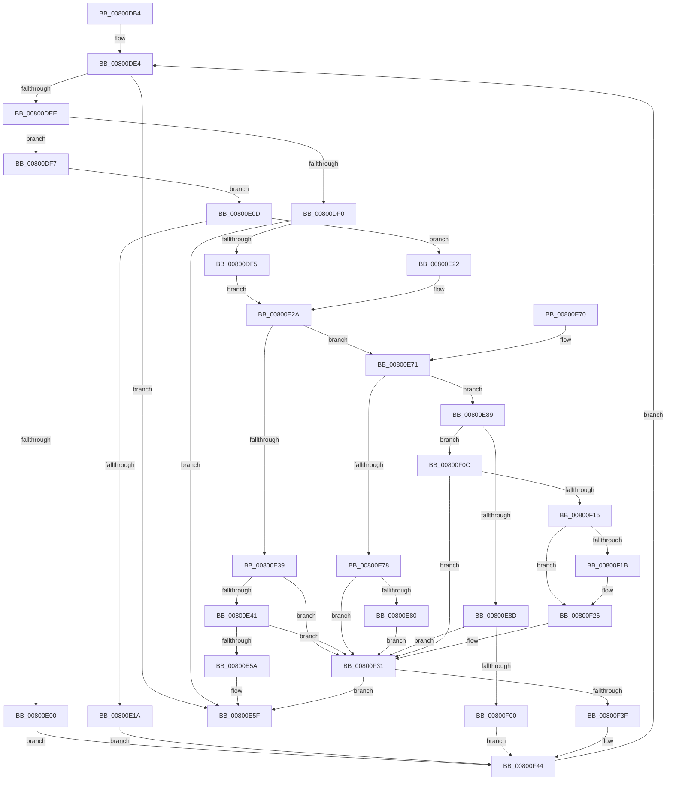

# MiCreateFileOnlyPfns

- RVA: `0x00800DB4`–`0x00800F64` (길이 `432` bytes)
- VA: `0x0000000140800DB4`
- 실행 섹션: `PAGE`
- PDB 이름 있음: `예`; PDB Function 태그: `아니요`
- unwind 정보 RVA: `0x000D8230`
- 디코드: `120`개 명령, `432/432` bytes 표시
- 미해석 바이트: `0` (있으면 어셈블리에 `.byte`로 보존)

> 이 문서는 커널 이미지의 기계어와 PDB 기호를 분석해 생성했습니다. 4번과 5번은 함수 원형과 자료형을 바이너리 사용 방식에서 추정한 C 해석이며 원본 소스 복구 결과는 아닙니다.

## 1. Dependencies

- 직접 호출 지점: **5**; 고유 호출 대상: **5**
- 직접 호출자로 확인된 함수: **1**
- RIP 상대 이미지 참조: **0**

### Outgoing calls
- `0x00800E4B` → [MiFillFileOnlyProtoAsBad](../../text/68/MiFillFileOnlyProtoAsBad_function_00680DB8.md) (function, `0x00680DB8`)
- `0x00800ED3` → [MiGetControlAreaPartition](../../text/43/MiGetControlAreaPartition_function_0043E560.md) (function, `0x0043E560`)
- `0x00800EF5` → [MiAddPhysicalMemory](../7F/MiAddPhysicalMemory_function_007F95FC.md) (function, `0x007F95FC`)
- `0x00800F21` → [MiDecrementProtoShareCounts](../../text/68/MiDecrementProtoShareCounts_function_00680844.md) (function, `0x00680844`)
- `0x00800F2C` → [MiRemoveFileOnlyPages](MiRemoveFileOnlyPages_function_008012FC.md) (function, `0x008012FC`)

### Direct callers
- [MiAllocateFileExtents](../AB/MiAllocateFileExtents_function_00ABDF54.md) at `0x00ABE3D8`

### Static image references
- 디코드된 RIP-relative 메모리 참조가 없습니다.

## 2. Other-region calls and transfers

- 다른 실행 섹션으로 향하는 call: **3**
  - `0x00800E4B` → [MiFillFileOnlyProtoAsBad](../../text/68/MiFillFileOnlyProtoAsBad_function_00680DB8.md) (`PAGE` → `.text`)
  - `0x00800ED3` → [MiGetControlAreaPartition](../../text/43/MiGetControlAreaPartition_function_0043E560.md) (`PAGE` → `.text`)
  - `0x00800F21` → [MiDecrementProtoShareCounts](../../text/68/MiDecrementProtoShareCounts_function_00680844.md) (`PAGE` → `.text`)
- 별도 외부 분기/꼬리 이동을 확인하지 못했습니다.

## 3. Assembly (complete function range)

```asm
00800DB4  44 89 44 24 18                  mov dword ptr [rsp + 0x18], r8d
00800DB9  48 89 54 24 10                  mov qword ptr [rsp + 0x10], rdx
00800DBE  48 89 4C 24 08                  mov qword ptr [rsp + 8], rcx
00800DC3  53                              push rbx
00800DC4  55                              push rbp
00800DC5  56                              push rsi
00800DC6  57                              push rdi
00800DC7  41 54                           push r12
00800DC9  41 55                           push r13
00800DCB  41 56                           push r14
00800DCD  48 83 EC 60                     sub rsp, 0x60
00800DD1  33 F6                           xor esi, esi
00800DD3  45 33 ED                        xor r13d, r13d
00800DD6  33 FF                           xor edi, edi
00800DD8  48 83 CD FF                     or rbp, 0xffffffffffffffff
00800DDC  33 DB                           xor ebx, ebx
00800DDE  4D 8B F1                        mov r14, r9
00800DE1  45 8B E0                        mov r12d, r8d
00800DE4  48 3B 9C 24 C0 00 00 00         cmp rbx, qword ptr [rsp + 0xc0]
00800DEC  77 71                           ja 0x140800e5f
00800DEE  75 07                           jne 0x140800df7
00800DF0  48 85 FF                        test rdi, rdi
00800DF3  74 6A                           je 0x140800e5f
00800DF5  EB 33                           jmp 0x140800e2a
00800DF7  49 8B 0C DE                     mov rcx, qword ptr [r14 + rbx*8]
00800DFB  48 85 FF                        test rdi, rdi
00800DFE  75 0D                           jne 0x140800e0d
00800E00  48 8B E9                        mov rbp, rcx
00800E03  BF 01 00 00 00                  mov edi, 1
00800E08  E9 37 01 00 00                  jmp 0x140800f44
00800E0D  49 8B 44 DE F8                  mov rax, qword ptr [r14 + rbx*8 - 8]
00800E12  48 FF C0                        inc rax
00800E15  48 3B C1                        cmp rax, rcx
00800E18  75 08                           jne 0x140800e22
00800E1A  48 FF C7                        inc rdi
00800E1D  E9 22 01 00 00                  jmp 0x140800f44
00800E22  48 8B 8C 24 A0 00 00 00         mov rcx, qword ptr [rsp + 0xa0]
00800E2A  48 B8 00 00 00 00 00 00 00 80   movabs rax, 0x8000000000000000
00800E34  48 3B E8                        cmp rbp, rax
00800E37  75 38                           jne 0x140800e71
00800E39  85 F6                           test esi, esi
00800E3B  0F 88 F0 00 00 00               js 0x140800f31
00800E41  48 8B C3                        mov rax, rbx
00800E44  48 2B C7                        sub rax, rdi
00800E47  48 8D 14 C2                     lea rdx, [rdx + rax*8]
00800E4B  E8 68 FF E7 FF                  call 0x140680db8
00800E50  41 F6 C4 02                     test r12b, 2
00800E54  0F 84 D7 00 00 00               je 0x140800f31
00800E5A  BE 09 07 00 C0                  mov esi, 0xc0000709
00800E5F  8B C6                           mov eax, esi
00800E61  48 83 C4 60                     add rsp, 0x60
00800E65  41 5E                           pop r14
00800E67  41 5D                           pop r13
00800E69  41 5C                           pop r12
00800E6B  5F                              pop rdi
00800E6C  5E                              pop rsi
00800E6D  5D                              pop rbp
00800E6E  5B                              pop rbx
00800E6F  C3                              ret
00800E70  CC                              int3
00800E71  48 0F BA E5 3E                  bt rbp, 0x3e
00800E76  73 11                           jae 0x140800e89
00800E78  85 F6                           test esi, esi
00800E7A  0F 89 B1 00 00 00               jns 0x140800f31
00800E80  49 8D 04 DE                     lea rax, [r14 + rbx*8]
00800E84  E9 A8 00 00 00                  jmp 0x140800f31
00800E89  85 F6                           test esi, esi
00800E8B  78 7F                           js 0x140800f0c
00800E8D  83 64 24 54 00                  and dword ptr [rsp + 0x54], 0
00800E92  B8 02 00 00 00                  mov eax, 2
00800E97  41 F6 C4 40                     test r12b, 0x40
00800E9B  48 89 4C 24 40                  mov qword ptr [rsp + 0x40], rcx
00800EA0  4C 8B E3                        mov r12, rbx
00800EA3  44 8D 40 04                     lea r8d, [rax + 4]
00800EA7  41 0F 45 C0                     cmovne eax, r8d
00800EAB  4C 2B E7                        sub r12, rdi
00800EAE  89 44 24 50                     mov dword ptr [rsp + 0x50], eax
00800EB2  48 C1 E7 0C                     shl rdi, 0xc
00800EB6  48 89 7C 24 30                  mov qword ptr [rsp + 0x30], rdi
00800EBB  4A 8D 04 E2                     lea rax, [rdx + r12*8]
00800EBF  48 89 44 24 48                  mov qword ptr [rsp + 0x48], rax
00800EC4  48 8B C5                        mov rax, rbp
00800EC7  48 8B 09                        mov rcx, qword ptr [rcx]
00800ECA  48 C1 E0 0C                     shl rax, 0xc
00800ECE  48 89 44 24 38                  mov qword ptr [rsp + 0x38], rax
00800ED3  E8 88 D6 C3 FF                  call 0x14043e560
00800ED8  48 8D 4C 24 40                  lea rcx, [rsp + 0x40]
00800EDD  41 B9 02 00 20 00               mov r9d, 0x200002
00800EE3  48 89 4C 24 20                  mov qword ptr [rsp + 0x20], rcx
00800EE8  4C 8D 44 24 30                  lea r8, [rsp + 0x30]
00800EED  48 8B C8                        mov rcx, rax
00800EF0  48 8D 54 24 38                  lea rdx, [rsp + 0x38]
00800EF5  E8 02 87 FF FF                  call 0x1407f95fc
00800EFA  8B F0                           mov esi, eax
00800EFC  85 C0                           test eax, eax
00800EFE  79 31                           jns 0x140800f31
00800F00  33 FF                           xor edi, edi
00800F02  4F 8D 2C E6                     lea r13, [r14 + r12*8]
00800F06  48 83 CB FF                     or rbx, 0xffffffffffffffff
00800F0A  EB 38                           jmp 0x140800f44
00800F0C  49 8D 04 DE                     lea rax, [r14 + rbx*8]
00800F10  49 3B C5                        cmp rax, r13
00800F13  77 1C                           ja 0x140800f31
00800F15  41 F6 C4 40                     test r12b, 0x40
00800F19  74 0B                           je 0x140800f26
00800F1B  48 8B D7                        mov rdx, rdi
00800F1E  48 8B CD                        mov rcx, rbp
00800F21  E8 1E F9 E7 FF                  call 0x140680844
00800F26  48 8B D7                        mov rdx, rdi
00800F29  48 8B CD                        mov rcx, rbp
00800F2C  E8 CB 03 00 00                  call 0x1408012fc
00800F31  48 3B 9C 24 C0 00 00 00         cmp rbx, qword ptr [rsp + 0xc0]
00800F39  0F 84 20 FF FF FF               je 0x140800e5f
00800F3F  33 FF                           xor edi, edi
00800F41  48 FF CB                        dec rbx
00800F44  44 8B A4 24 B0 00 00 00         mov r12d, dword ptr [rsp + 0xb0]
00800F4C  48 FF C3                        inc rbx
00800F4F  48 8B 8C 24 A0 00 00 00         mov rcx, qword ptr [rsp + 0xa0]
00800F57  48 8B 94 24 A8 00 00 00         mov rdx, qword ptr [rsp + 0xa8]
00800F5F  E9 80 FE FF FF                  jmp 0x140800de4
```

## 4. C-style interpretation (structured pseudocode)

```c
__int64 __fastcall MiCreateFileOnlyPfns(__int64 a1, __int64 a2, int a3, __int64 a4, __int64 a5)
{
    __int64 result;
    __int64 v_r12;
    __int64 v_r13;
    __int64 v_rbp;
    __int64 v_rbx;
    __int64 v_rdi;
    __int64 v_rsi;
    __int64 v_rsp;
    unsigned __int64 v_stack_p10;
    unsigned int v_stack_p18;
    unsigned __int64 v_stack_p20;
    unsigned __int64 v_stack_p30;
    unsigned __int64 v_stack_p38;
    unsigned __int64 v_stack_p40;
    unsigned __int64 v_stack_p48;
    unsigned int v_stack_p50;
    unsigned int v_stack_p54;
    unsigned __int64 v_stack_p8;
    unsigned __int64 v_stack_pA0;
    unsigned __int64 v_stack_pA8;
    unsigned int v_stack_pB0;

    v_stack_p18 = a3;
    v_stack_p10 = a2;
    v_stack_p8 = a1;
    v_rsp = (v_rsp) - (96);
    v_rsi = 0;
    v_r13 = 0;
    v_rdi = 0;
    v_rbp = (v_rbp) | (-1);
    v_rbx = 0;
loc_00800DE4:
    if (0 > a5) goto loc_00800E5F;
    if (0 != a5) goto loc_00800DF7;
    if (0 == 0) goto loc_00800E5F;
    goto loc_00800E2A;
loc_00800DF7:
    if (0 != 0) goto loc_00800E0D;
    goto loc_00800F44;
loc_00800E0D:
    result = (*(unsigned __int64 *)(a4 + v_rbx * 8 - 8)) + 1;
    if (result != (*(unsigned __int64 *)(a4 + v_rbx * 8))) goto loc_00800E22;
    v_rdi = (1) + 1;
    goto loc_00800F44;
loc_00800E22:
loc_00800E2A:
    if ((*(unsigned __int64 *)(a4 + v_rbx * 8)) != result) goto loc_00800E71;
    if (sign_flag) goto loc_00800F31;
    result = (0) - (v_rdi);
    result = MiFillFileOnlyProtoAsBad(v_stack_p8, a2 + result * 8, a3, a4);
    if ((((unsigned __int8)((unsigned int)(a3))) & (2)) == 0) goto loc_00800F31;
loc_00800E5F:
    v_rsp = (v_rsp) + (96);
    return (unsigned int)((unsigned int)((unsigned int)(0xC0000709ULL)));
loc_00800E71:
    if (condition_is_above_or_equal) goto loc_00800E89;
    if (!sign_flag) goto loc_00800F31;
    goto loc_00800F31;
loc_00800E89:
    if (sign_flag) goto loc_00800F0C;
    v_stack_p40 = v_stack_p8;
    result = 2;
    if ((((unsigned __int8)((unsigned int)(a3))) & (64)) != 0) { result = (unsigned int)(2 + 4); }
    v_r12 = (0) - (v_rdi);
    v_stack_p50 = (unsigned int)(result);
    v_rdi = (v_rdi) << (12);
    v_stack_p30 = v_rdi;
    v_stack_p48 = a2 + result * 8 + v_r12 * 8;
    result = (*(unsigned __int64 *)(a4 + v_rbx * 8)) << (12);
    v_stack_p38 = result;
    result = MiGetControlAreaPartition(*(unsigned __int64 *)(v_stack_p8), a2 + result * 8, 2 + 4, a4);
    v_stack_p20 = v_stack_p40;
    result = MiAddPhysicalMemory(result, v_stack_p38, v_stack_p30, (unsigned int)(0x200002ULL));
    if (!sign_flag) goto loc_00800F31;
    v_rdi = 0;
    v_rbx = (v_rbx) | (-1);
    goto loc_00800F44;
loc_00800F0C:
    if ((a4 + v_rbx * 8) > (a4 + v_r12 * 8)) goto loc_00800F31;
    result = a4 + v_rbx * 8;
    if ((((unsigned __int8)(v_r12)) & (64)) != 0) {
        a2 = 0;
        a1 = *(unsigned __int64 *)(a4 + v_rbx * 8);
        result = MiDecrementProtoShareCounts(a1, a2, v_stack_p30, (unsigned int)(0x200002ULL));
    }
    result = MiRemoveFileOnlyPages(*(unsigned __int64 *)(a4 + v_rbx * 8), 0, v_stack_p30, (unsigned int)(0x200002ULL));
loc_00800F31:
    if (v_rbx == a5) goto loc_00800E5F;
    v_rdi = 0;
    v_rbx = (v_rbx) - 1;
loc_00800F44:
    v_rbx = (v_rbx) + 1;
    goto loc_00800DE4;
}
```

## 5. (Beta) C Style

```c
int64_t MiCreateFileOnlyPfns(int64_t Arg1, int64_t Arg2, int32_t Arg3, void *Arg4, int64_t Arg5)
{
    uint8_t *arg4 = (uint8_t *)Arg4;

    int64_t result;
    int64_t local_r12;
    int64_t local_r13;
    int64_t local_rbp;
    int64_t local_rbx;
    int64_t local_rdi;
    int64_t local_rsi;
    int64_t local_rsp;
    uint64_t v_stack_p10;
    uint32_t v_stack_p18;
    uint64_t v_stack_p20;
    uint64_t v_stack_p30;
    uint64_t v_stack_p38;
    uint64_t v_stack_p40;
    uint64_t v_stack_p48;
    uint32_t v_stack_p50;
    uint32_t v_stack_p54;
    uint64_t v_stack_p8;
    uint64_t v_stack_pA0;
    uint64_t v_stack_pA8;
    uint32_t v_stack_pB0;

    v_stack_p18 = Arg3;
    v_stack_p10 = Arg2;
    v_stack_p8 = Arg1;
    local_rsp = (local_rsp) - (96);
    local_rsi = 0;
    local_r13 = 0;
    local_rdi = 0;
    local_rbp = (local_rbp) | (-1);
    local_rbx = 0;
loc_00800DE4:
    if (0 > Arg5) goto loc_00800E5F;
    if (0 != Arg5) goto loc_00800DF7;
    if (0 == 0) goto loc_00800E5F;
    goto loc_00800E2A;
loc_00800DF7:
    if (0 != 0) goto loc_00800E0D;
    goto loc_00800F44;
loc_00800E0D:
    result = (*(uint64_t *)(arg4 + local_rbx * 8 - 0x8)) + 1;
    if (result != (*(uint64_t *)(arg4 + local_rbx * 8))) goto loc_00800E22;
    local_rdi = (1) + 1;
    goto loc_00800F44;
loc_00800E22:
loc_00800E2A:
    if ((*(uint64_t *)(arg4 + local_rbx * 8)) != result) goto loc_00800E71;
    if (sign_flag) goto loc_00800F31;
    result = (0) - (local_rdi);
    result = MiFillFileOnlyProtoAsBad(v_stack_p8, Arg2 + result * 8, Arg3, Arg4);
    if ((((uint8_t)((uint32_t)(Arg3))) & (2)) == 0) goto loc_00800F31;
loc_00800E5F:
    local_rsp = (local_rsp) + (96);
    return (uint32_t)((uint32_t)((uint32_t)(0xC0000709ULL)));
loc_00800E71:
    if (condition_is_above_or_equal) goto loc_00800E89;
    if (!sign_flag) goto loc_00800F31;
    goto loc_00800F31;
loc_00800E89:
    if (sign_flag) goto loc_00800F0C;
    v_stack_p40 = v_stack_p8;
    result = 2;
    if ((((uint8_t)((uint32_t)(Arg3))) & (64)) != 0) { result = (uint32_t)(2 + 4); }
    local_r12 = (0) - (local_rdi);
    v_stack_p50 = (uint32_t)(result);
    local_rdi = (local_rdi) << (12);
    v_stack_p30 = local_rdi;
    v_stack_p48 = Arg2 + result * 8 + local_r12 * 8;
    result = (*(uint64_t *)(arg4 + local_rbx * 8)) << (12);
    v_stack_p38 = result;
    result = MiGetControlAreaPartition(*(uint64_t *)(v_stack_p8), Arg2 + result * 8, 2 + 4, Arg4);
    v_stack_p20 = v_stack_p40;
    result = MiAddPhysicalMemory(result, v_stack_p38, v_stack_p30, (uint32_t)(0x200002ULL));
    if (!sign_flag) goto loc_00800F31;
    local_rdi = 0;
    local_rbx = (local_rbx) | (-1);
    goto loc_00800F44;
loc_00800F0C:
    if ((Arg4 + local_rbx * 8) > (Arg4 + local_r12 * 8)) goto loc_00800F31;
    result = Arg4 + local_rbx * 8;
    if ((((uint8_t)(local_r12)) & (64)) != 0) {
        Arg2 = 0;
        Arg1 = *(uint64_t *)(arg4 + local_rbx * 8);
        result = MiDecrementProtoShareCounts(Arg1, Arg2, v_stack_p30, (uint32_t)(0x200002ULL));
    }
    result = MiRemoveFileOnlyPages(*(uint64_t *)(arg4 + local_rbx * 8), 0, v_stack_p30, (uint32_t)(0x200002ULL));
loc_00800F31:
    if (local_rbx == Arg5) goto loc_00800E5F;
    local_rdi = 0;
    local_rbx = (local_rbx) - 1;
loc_00800F44:
    local_rbx = (local_rbx) + 1;
    goto loc_00800DE4;
}
```

### 관측된 메모리 오프셋

구조체 형식이 확인되지 않은 접근은 인자 기준의 오프셋으로만 기록했습니다.

| 기준 인자 | 오프셋 표현 | 폭 (bit) | 접근 |
|---|---:|---:|---|
| `Arg4` | `- 0x8 + rbx*8` | `64` | `R` |
| `Arg4` | `+ 0x0 + r12*8` | `64` | `R` |
| `Arg4` | `+ 0x0 + rbx*8` | `64` | `R` |

## 6. Execution-region graph

[열기: 2D/3D 그래프와 함수 탐색 컨트롤 패널](../../../control-panel.html?section=page&rva=0x00800DB4&view=graph)

- 2D 그래프는 위에서 아래로 흐르고, 3D 그래프는 빈 공간을 드래그해 회전합니다. Shift+드래그는 이동, 휠은 확대·축소, 함수 노드 선택은 대상 보고서 이동입니다.

### Static fallback


