# MiCreateHardwareEnclave

- RVA: `0x00808500`–`0x00808888` (길이 `904` bytes)
- VA: `0x0000000140808500`
- 실행 섹션: `PAGE`
- PDB 이름 있음: `예`; PDB Function 태그: `아니요`
- unwind 정보 RVA: `0x000D889C`
- 디코드: `222`개 명령, `904/904` bytes 표시
- 미해석 바이트: `0` (있으면 어셈블리에 `.byte`로 보존)

> 이 문서는 커널 이미지의 기계어와 PDB 기호를 분석해 생성했습니다. 4번과 5번은 함수 원형과 자료형을 바이너리 사용 방식에서 추정한 C 해석이며 원본 소스 복구 결과는 아닙니다.

## 1. Dependencies

- 직접 호출 지점: **23**; 고유 호출 대상: **23**
- 직접 호출자로 확인된 함수: **1**
- RIP 상대 이미지 참조: **7**

### Outgoing calls
- `0x0080857B` → [MiGetVmPartition](../../text/41/MiGetVmPartition_function_00418950.md) (function, `0x00418950`)
- `0x0080858A` → [ExAcquireRundownProtection](../../text/21/ExAcquireRundownProtection_function_00216620.md) (function, `0x00216620`)
- `0x008085BA` → [KeAbPreAcquire](../../text/21/KeAbPreAcquire_function_00210230.md) (function, `0x00210230`)
- `0x008085DF` → [ExfAcquirePushLockExclusiveEx](../../text/20/ExfAcquirePushLockExclusiveEx_function_0020FC90.md) (function, `0x0020FC90`)
- `0x00808639` → [ExfTryToWakePushLock](../../text/26/ExfTryToWakePushLock_function_00265DD0.md) (function, `0x00265DD0`)
- `0x00808645` → [KeAbPostRelease](../../text/2E/KeAbPostRelease_function_002E1600.md) (function, `0x002E1600`)
- `0x00808666` → [KiCheckForKernelApcDelivery](../../text/2E/KiCheckForKernelApcDelivery_function_002E2C80.md) (function, `0x002E2C80`)
- `0x0080866B` → [MiPrepareEnclaveMetadataPage](../../text/68/MiPrepareEnclaveMetadataPage_function_00686EAC.md) (function, `0x00686EAC`)
- `0x00808699` → [MiReserveEnclavePages](../../text/3B/MiReserveEnclavePages_function_003BD430.md) (function, `0x003BD430`)
- `0x008086AD` → [KeGetIdealNodeNumberThread](../../text/49/KeGetIdealNodeNumberThread_function_00492A1C.md) (function, `0x00492A1C`)
- `0x008086C8` → [MiAllocateEnclavePages](../../text/3B/MiAllocateEnclavePages_function_003BC43C.md) (function, `0x003BC43C`)
- `0x008086D2` → [MiGetAwePageSize](../../text/46/MiGetAwePageSize_function_0046CFA8.md) (function, `0x0046CFA8`)
- `0x008086EB` → [MiDeleteEnclavePages](../../pagelk/B7/MiDeleteEnclavePages_function_00B7E228.md) (function, `0x00B7E228`)
- `0x008086F7` → [ExReleaseRundownProtection](../../text/34/ExReleaseRundownProtection_function_00349E80.md) (function, `0x00349E80`)
- `0x0080871C` → [MiUnlinkPageChainHead](../../text/36/MiUnlinkPageChainHead_function_00365C40.md) (function, `0x00365C40`)
- `0x00808754` → [MiInitializeEnclavePfn](../../text/36/MiInitializeEnclavePfn_function_003682A8.md) (function, `0x003682A8`)
- `0x00808765` → [MiMakeValidPte](../../text/2C/MiMakeValidPte_function_002C5590.md) (function, `0x002C5590`)
- `0x0080877A` → [MiPteInShadowRange](../../text/23/MiPteInShadowRange_function_0023FB00.md) (function, `0x0023FB00`)
- `0x0080878B` → [MiSanitizeShadowPxe](../../text/29/MiSanitizeShadowPxe_function_00294B68.md) (function, `0x00294B68`)
- `0x008087B4` → [MiGetPteAddress](../../text/43/MiGetPteAddress_function_0043E130.md) (function, `0x0043E130`)
- `0x008087CA` → [MiCheckLinearProtectedPteAccessedBit](../../text/29/MiCheckLinearProtectedPteAccessedBit_function_00292D80.md) (function, `0x00292D80`)
- `0x008087DC` → [MiWritePteShadow](../../text/29/MiWritePteShadow_function_00294EAC.md) (function, `0x00294EAC`)
- `0x00808864` → [KeCreateEnclave](../74/KeCreateEnclave_function_007461E4.md) (function, `0x007461E4`)

### Direct callers
- [MiCreateEnclave](MiCreateEnclave_function_008083E4.md) at `0x00808487`

### Static image references
- `0x00808580` → RVA `0x00E375F8` (`.data`; read)
- `0x008085B0` → RVA `0x00E375F0` (`.data`; read)
- `0x008085BF` → RVA `0x00E375F0` (`.data`; read/write)
- `0x008085ED` → RVA `0x00E375E8` (`.data`; read)
- `0x008085F4` → RVA `0x00E375E0` (`.data`; read)
- `0x00808618` → RVA `0x00E375E8` (`.data`; write)
- `0x0080879A` → RVA `0x00FC6A88` (`ALMOSTRO`; read)

## 2. Other-region calls and transfers

- 다른 실행 섹션으로 향하는 call: **22**
  - `0x0080857B` → [MiGetVmPartition](../../text/41/MiGetVmPartition_function_00418950.md) (`PAGE` → `.text`)
  - `0x0080858A` → [ExAcquireRundownProtection](../../text/21/ExAcquireRundownProtection_function_00216620.md) (`PAGE` → `.text`)
  - `0x008085BA` → [KeAbPreAcquire](../../text/21/KeAbPreAcquire_function_00210230.md) (`PAGE` → `.text`)
  - `0x008085DF` → [ExfAcquirePushLockExclusiveEx](../../text/20/ExfAcquirePushLockExclusiveEx_function_0020FC90.md) (`PAGE` → `.text`)
  - `0x00808639` → [ExfTryToWakePushLock](../../text/26/ExfTryToWakePushLock_function_00265DD0.md) (`PAGE` → `.text`)
  - `0x00808645` → [KeAbPostRelease](../../text/2E/KeAbPostRelease_function_002E1600.md) (`PAGE` → `.text`)
  - `0x00808666` → [KiCheckForKernelApcDelivery](../../text/2E/KiCheckForKernelApcDelivery_function_002E2C80.md) (`PAGE` → `.text`)
  - `0x0080866B` → [MiPrepareEnclaveMetadataPage](../../text/68/MiPrepareEnclaveMetadataPage_function_00686EAC.md) (`PAGE` → `.text`)
  - `0x00808699` → [MiReserveEnclavePages](../../text/3B/MiReserveEnclavePages_function_003BD430.md) (`PAGE` → `.text`)
  - `0x008086AD` → [KeGetIdealNodeNumberThread](../../text/49/KeGetIdealNodeNumberThread_function_00492A1C.md) (`PAGE` → `.text`)
  - `0x008086C8` → [MiAllocateEnclavePages](../../text/3B/MiAllocateEnclavePages_function_003BC43C.md) (`PAGE` → `.text`)
  - `0x008086D2` → [MiGetAwePageSize](../../text/46/MiGetAwePageSize_function_0046CFA8.md) (`PAGE` → `.text`)
  - `0x008086EB` → [MiDeleteEnclavePages](../../pagelk/B7/MiDeleteEnclavePages_function_00B7E228.md) (`PAGE` → `PAGELK`)
  - `0x008086F7` → [ExReleaseRundownProtection](../../text/34/ExReleaseRundownProtection_function_00349E80.md) (`PAGE` → `.text`)
  - `0x0080871C` → [MiUnlinkPageChainHead](../../text/36/MiUnlinkPageChainHead_function_00365C40.md) (`PAGE` → `.text`)
  - `0x00808754` → [MiInitializeEnclavePfn](../../text/36/MiInitializeEnclavePfn_function_003682A8.md) (`PAGE` → `.text`)
  - `0x00808765` → [MiMakeValidPte](../../text/2C/MiMakeValidPte_function_002C5590.md) (`PAGE` → `.text`)
  - `0x0080877A` → [MiPteInShadowRange](../../text/23/MiPteInShadowRange_function_0023FB00.md) (`PAGE` → `.text`)
  - `0x0080878B` → [MiSanitizeShadowPxe](../../text/29/MiSanitizeShadowPxe_function_00294B68.md) (`PAGE` → `.text`)
  - `0x008087B4` → [MiGetPteAddress](../../text/43/MiGetPteAddress_function_0043E130.md) (`PAGE` → `.text`)
  - `0x008087CA` → [MiCheckLinearProtectedPteAccessedBit](../../text/29/MiCheckLinearProtectedPteAccessedBit_function_00292D80.md) (`PAGE` → `.text`)
  - `0x008087DC` → [MiWritePteShadow](../../text/29/MiWritePteShadow_function_00294EAC.md) (`PAGE` → `.text`)
- 별도 외부 분기/꼬리 이동을 확인하지 못했습니다.

## 3. Assembly (complete function range)

```asm
00808500  48 8B C4                        mov rax, rsp
00808503  48 89 58 18                     mov qword ptr [rax + 0x18], rbx
00808507  4C 89 48 20                     mov qword ptr [rax + 0x20], r9
0080850B  48 89 48 08                     mov qword ptr [rax + 8], rcx
0080850F  55                              push rbp
00808510  56                              push rsi
00808511  57                              push rdi
00808512  41 54                           push r12
00808514  41 55                           push r13
00808516  41 56                           push r14
00808518  41 57                           push r15
0080851A  48 83 EC 60                     sub rsp, 0x60
0080851E  65 48 8B 1C 25 88 01 00 00      mov rbx, qword ptr gs:[0x188]
00808527  0F 57 C0                        xorps xmm0, xmm0
0080852A  83 60 08 00                     and dword ptr [rax + 8], 0
0080852E  49 8B E8                        mov rbp, r8
00808531  44 0F B6 6A 20                  movzx r13d, byte ptr [rdx + 0x20]
00808536  33 C0                           xor eax, eax
00808538  44 0F B6 7A 21                  movzx r15d, byte ptr [rdx + 0x21]
0080853D  48 8B FA                        mov rdi, rdx
00808540  4C 8B B3 B8 00 00 00            mov r14, qword ptr [rbx + 0xb8]
00808547  48 89 44 24 50                  mov qword ptr [rsp + 0x50], rax
0080854C  8B 42 18                        mov eax, dword ptr [rdx + 0x18]
0080854F  49 C1 E7 20                     shl r15, 0x20
00808553  49 C1 E5 20                     shl r13, 0x20
00808557  49 8D 8E 00 04 00 00            lea rcx, [r14 + 0x400]
0080855E  4C 0B E8                        or r13, rax
00808561  8B 42 1C                        mov eax, dword ptr [rdx + 0x1c]
00808564  4C 0B F8                        or r15, rax
00808567  49 C1 E5 0C                     shl r13, 0xc
0080856B  49 C1 E7 0C                     shl r15, 0xc
0080856F  49 81 CF FF 0F 00 00            or r15, 0xfff
00808576  0F 11 44 24 40                  movups xmmword ptr [rsp + 0x40], xmm0
0080857B  E8 D0 03 C1 FF                  call 0x140418950
00808580  48 8D 0D 71 F0 62 00            lea rcx, [rip + 0x62f071]
00808587  4C 8B E0                        mov r12, rax
0080858A  E8 91 E0 A0 FF                  call 0x140216620
0080858F  84 C0                           test al, al
00808591  75 0A                           jne 0x14080859d
00808593  B8 0A 01 00 C0                  mov eax, 0xc000010a
00808598  E9 61 01 00 00                  jmp 0x1408086fe
0080859D  4C 89 77 78                     mov qword ptr [rdi + 0x78], r14
008085A1  B9 01 00 00 00                  mov ecx, 1
008085A6  66 29 8B E6 01 00 00            sub word ptr [rbx + 0x1e6], cx
008085AD  45 33 C0                        xor r8d, r8d
008085B0  48 8D 0D 39 F0 62 00            lea rcx, [rip + 0x62f039]
008085B7  33 D2                           xor edx, edx
008085B9  90                              nop
008085BA  E8 71 7C A0 FF                  call 0x140210230
008085BF  F0 48 0F BA 2D 27 F0 62 00 00   lock bts qword ptr [rip + 0x62f027], 0
008085C9  48 8B F0                        mov rsi, rax
008085CC  73 16                           jae 0x1408085e4
008085CE  4C 8D 05 1B F0 62 00            lea r8, [rip + 0x62f01b]
008085D5  48 8B D0                        mov rdx, rax
008085D8  48 8D 0D 11 F0 62 00            lea rcx, [rip + 0x62f011]
008085DF  E8 AC 76 A0 FF                  call 0x14020fc90
008085E4  48 85 F6                        test rsi, rsi
008085E7  74 04                           je 0x1408085ed
008085E9  C6 46 0A 01                     mov byte ptr [rsi + 0xa], 1
008085ED  48 8B 0D F4 EF 62 00            mov rcx, qword ptr [rip + 0x62eff4]
008085F4  48 8D 15 E5 EF 62 00            lea rdx, [rip + 0x62efe5]
008085FB  48 8D 87 80 00 00 00            lea rax, [rdi + 0x80]
00808602  48 39 11                        cmp qword ptr [rcx], rdx
00808605  74 07                           je 0x14080860e
00808607  B9 03 00 00 00                  mov ecx, 3
0080860C  CD 29                           int 0x29
0080860E  48 89 10                        mov qword ptr [rax], rdx
00808611  48 89 48 08                     mov qword ptr [rax + 8], rcx
00808615  48 89 01                        mov qword ptr [rcx], rax
00808618  48 89 05 C9 EF 62 00            mov qword ptr [rip + 0x62efc9], rax
0080861F  48 83 C8 FF                     or rax, 0xffffffffffffffff
00808623  F0 48 0F C1 05 C4 EF 62 00      lock xadd qword ptr [rip + 0x62efc4], rax
0080862C  24 06                           and al, 6
0080862E  3C 02                           cmp al, 2
00808630  75 0C                           jne 0x14080863e
00808632  48 8D 0D B7 EF 62 00            lea rcx, [rip + 0x62efb7]
00808639  E8 92 D7 A5 FF                  call 0x140265dd0
0080863E  48 8D 0D AB EF 62 00            lea rcx, [rip + 0x62efab]
00808645  E8 B6 8F AD FF                  call 0x1402e1600
0080864A  BE 01 00 00 00                  mov esi, 1
0080864F  90                              nop
00808650  66 01 B3 E6 01 00 00            add word ptr [rbx + 0x1e6], si
00808657  75 12                           jne 0x14080866b
00808659  48 8D 83 98 00 00 00            lea rax, [rbx + 0x98]
00808660  90                              nop
00808661  48 39 00                        cmp qword ptr [rax], rax
00808664  74 05                           je 0x14080866b
00808666  E8 15 A6 AD FF                  call 0x1402e2c80
0080866B  E8 3C E8 E7 FF                  call 0x140686eac
00808670  8B D8                           mov ebx, eax
00808672  85 C0                           test eax, eax
00808674  78 6B                           js 0x1408086e1
00808676  48 85 ED                        test rbp, rbp
00808679  74 29                           je 0x1408086a4
0080867B  48 F7 C5 FF 0F 00 00            test rbp, 0xfff
00808682  41 B8 00 00 00 00               mov r8d, 0
00808688  49 8B D4                        mov rdx, r12
0080868B  48 8B CF                        mov rcx, rdi
0080868E  41 0F 95 C0                     setne r8b
00808692  48 C1 ED 0C                     shr rbp, 0xc
00808696  4C 03 C5                        add r8, rbp
00808699  E8 92 4D BB FF                  call 0x1403bd430
0080869E  8B D8                           mov ebx, eax
008086A0  85 C0                           test eax, eax
008086A2  78 3D                           js 0x1408086e1
008086A4  65 48 8B 0C 25 88 01 00 00      mov rcx, qword ptr gs:[0x188]
008086AD  E8 6A A3 C8 FF                  call 0x140492a1c
008086B2  0F B7 D0                        movzx edx, ax
008086B5  4C 8B CE                        mov r9, rsi
008086B8  48 8D 44 24 40                  lea rax, [rsp + 0x40]
008086BD  45 33 C0                        xor r8d, r8d
008086C0  49 8B CC                        mov rcx, r12
008086C3  48 89 44 24 20                  mov qword ptr [rsp + 0x20], rax
008086C8  E8 6F 3D BB FF                  call 0x1403bc43c
008086CD  48 8D 4C 24 40                  lea rcx, [rsp + 0x40]
008086D2  E8 D1 48 C6 FF                  call 0x14046cfa8
008086D7  48 85 C0                        test rax, rax
008086DA  75 3B                           jne 0x140808717
008086DC  BB 17 00 00 C0                  mov ebx, 0xc0000017
008086E1  83 4F 40 08                     or dword ptr [rdi + 0x40], 8
008086E5  48 8B D7                        mov rdx, rdi
008086E8  49 8B CE                        mov rcx, r14
008086EB  E8 38 5B 37 00                  call 0x140b7e228
008086F0  48 8D 0D 01 EF 62 00            lea rcx, [rip + 0x62ef01]
008086F7  E8 84 17 B4 FF                  call 0x140349e80
008086FC  8B C3                           mov eax, ebx
008086FE  48 8B 9C 24 B0 00 00 00         mov rbx, qword ptr [rsp + 0xb0]
00808706  48 83 C4 60                     add rsp, 0x60
0080870A  41 5F                           pop r15
0080870C  41 5E                           pop r14
0080870E  41 5D                           pop r13
00808710  41 5C                           pop r12
00808712  5F                              pop rdi
00808713  5E                              pop rsi
00808714  5D                              pop rbp
00808715  C3                              ret
00808716  CC                              int3
00808717  48 8D 4C 24 40                  lea rcx, [rsp + 0x40]
0080871C  E8 1F D5 B5 FF                  call 0x140365c40
00808721  48 8B D8                        mov rbx, rax
00808724  48 B8 00 00 00 00 00 DE FF FF   movabs rax, 0xffffde0000000000
0080872E  48 8B 77 50                     mov rsi, qword ptr [rdi + 0x50]
00808732  48 2B D8                        sub rbx, rax
00808735  48 B8 AB AA AA AA AA AA AA AA   movabs rax, 0xaaaaaaaaaaaaaaab
0080873F  48 C1 FB 04                     sar rbx, 4
00808743  48 0F AF D8                     imul rbx, rax
00808747  45 33 C9                        xor r9d, r9d
0080874A  48 8B D6                        mov rdx, rsi
0080874D  48 8B CB                        mov rcx, rbx
00808750  45 8D 41 04                     lea r8d, [r9 + 4]
00808754  E8 4F FB B5 FF                  call 0x1403682a8
00808759  41 B8 04 00 00 A0               mov r8d, 0xa0000004
0080875F  48 8B D3                        mov rdx, rbx
00808762  48 8B CE                        mov rcx, rsi
00808765  E8 26 CE AB FF                  call 0x1402c5590
0080876A  48 8B CE                        mov rcx, rsi
0080876D  48 89 84 24 A8 00 00 00         mov qword ptr [rsp + 0xa8], rax
00808775  48 8B D8                        mov rbx, rax
00808778  33 ED                           xor ebp, ebp
0080877A  E8 81 73 A3 FF                  call 0x14023fb00
0080877F  85 C0                           test eax, eax
00808781  74 17                           je 0x14080879a
00808783  48 8D 94 24 A8 00 00 00         lea rdx, [rsp + 0xa8]
0080878B  E8 D8 C3 A8 FF                  call 0x140294b68
00808790  48 8B 9C 24 A8 00 00 00         mov rbx, qword ptr [rsp + 0xa8]
00808798  8B E8                           mov ebp, eax
0080879A  48 0F BA 25 E5 E2 7B 00 24      bt qword ptr [rip + 0x7be2e5], 0x24
008087A3  73 2A                           jae 0x1408087cf
008087A5  F6 C3 20                        test bl, 0x20
008087A8  75 25                           jne 0x1408087cf
008087AA  48 B9 00 00 00 00 00 80 FF FF   movabs rcx, 0xffff800000000000
008087B4  E8 77 59 C3 FF                  call 0x14043e130
008087B9  48 3B F0                        cmp rsi, rax
008087BC  72 11                           jb 0x1408087cf
008087BE  41 B8 80 00 00 00               mov r8d, 0x80
008087C4  48 8B D3                        mov rdx, rbx
008087C7  48 8B CE                        mov rcx, rsi
008087CA  E8 B1 A5 A8 FF                  call 0x140292d80
008087CF  48 89 1E                        mov qword ptr [rsi], rbx
008087D2  85 ED                           test ebp, ebp
008087D4  74 0B                           je 0x1408087e1
008087D6  48 8B D3                        mov rdx, rbx
008087D9  48 8B CE                        mov rcx, rsi
008087DC  E8 CB C6 A8 FF                  call 0x140294eac
008087E1  8B 4F 48                        mov ecx, dword ptr [rdi + 0x48]
008087E4  41 B8 01 00 00 00               mov r8d, 1
008087EA  41 23 C8                        and ecx, r8d
008087ED  C1 E1 08                        shl ecx, 8
008087F0  49 83 BE 10 03 00 00 00         cmp qword ptr [r14 + 0x310], 0
008087F8  74 1C                           je 0x140808816
008087FA  41 0F B7 86 EC 06 00 00         movzx eax, word ptr [r14 + 0x6ec]
00808802  BA 4C 01 00 00                  mov edx, 0x14c
00808807  66 3B C2                        cmp ax, dx
0080880A  74 0D                           je 0x140808819
0080880C  BA C4 01 00 00                  mov edx, 0x1c4
00808811  66 3B C2                        cmp ax, dx
00808814  74 03                           je 0x140808819
00808816  41 0B C8                        or ecx, r8d
00808819  4D 2B FD                        sub r15, r13
0080881C  48 C1 E6 19                     shl rsi, 0x19
00808820  4D 03 C7                        add r8, r15
00808823  48 B8 00 00 00 00 80 F6 FF FF   movabs rax, 0xfffff68000000000
0080882D  4C 8B 8C 24 B8 00 00 00         mov r9, qword ptr [rsp + 0xb8]
00808835  49 8B D5                        mov rdx, r13
00808838  48 C1 E0 19                     shl rax, 0x19
0080883C  48 2B F0                        sub rsi, rax
0080883F  48 8B 84 24 C0 00 00 00         mov rax, qword ptr [rsp + 0xc0]
00808847  48 89 44 24 38                  mov qword ptr [rsp + 0x38], rax
0080884C  48 8D 84 24 A0 00 00 00         lea rax, [rsp + 0xa0]
00808854  48 89 44 24 30                  mov qword ptr [rsp + 0x30], rax
00808859  89 4C 24 28                     mov dword ptr [rsp + 0x28], ecx
0080885D  48 C1 FE 10                     sar rsi, 0x10
00808861  48 8B CE                        mov rcx, rsi
00808864  E8 7B D9 F3 FF                  call 0x1407461e4
00808869  8B D8                           mov ebx, eax
0080886B  85 C0                           test eax, eax
0080886D  0F 88 6E FE FF FF               js 0x1408086e1
00808873  F6 84 24 A0 00 00 00 02         test byte ptr [rsp + 0xa0], 2
0080887B  74 04                           je 0x140808881
0080887D  83 4F 40 04                     or dword ptr [rdi + 0x40], 4
00808881  33 DB                           xor ebx, ebx
00808883  E9 68 FE FF FF                  jmp 0x1408086f0
```

## 4. C-style interpretation (structured pseudocode)

```c
__int64 __fastcall MiCreateHardwareEnclave(__int64 a1, __int64 a2, __int64 a3, __int64 a4, __int64 a5)
{
    __int64 result;
    __int64 v_r13;
    __int64 v_r15;
    __int64 v_rbp;
    __int64 v_rbx;
    __int64 v_rsi;
    __int64 v_rsp;
    unsigned __int64 v_stack_m48;
    unsigned __int64 v_stack_m58;
    unsigned __int64 v_stack_m78;
    unsigned __int64 v_stack_p18;
    unsigned int v_stack_p28;
    unsigned __int64 v_stack_p30;
    unsigned __int64 v_stack_p38;
    unsigned __int64 v_stack_p40;
    unsigned __int64 v_stack_pA0;
    unsigned __int64 v_stack_pA8;
    unsigned __int64 v_stack_pB8;

    *(unsigned __int64 *)(v_rsp + 24) = v_rbx;
    *(unsigned __int64 *)(v_rsp + 32) = a4;
    *(unsigned __int64 *)(v_rsp + 8) = a1;
    v_rsp = (v_rsp) - (96);
    result = 0;
    v_stack_m48 = 0;
    v_r15 = (*(unsigned __int8 *)(a2 + 33)) << (32);
    v_r13 = (*(unsigned __int8 *)(a2 + 32)) << (32);
    v_r13 = (v_r13) | ((unsigned int)(*(unsigned int *)(a2 + 24)));
    v_r15 = (v_r15) | ((unsigned int)(*(unsigned int *)(a2 + 28)));
    v_r13 = (v_r13) << (12);
    v_r15 = (v_r15) << (12);
    v_r15 = (v_r15) | (0xFFFULL);
    v_stack_m58 = v_xmm0;
    result = MiGetVmPartition(*(unsigned __int64 *)(*(unsigned __int64 *)(gs_base + (0 + 392)) + 184) + 1024, a2, a3, a4);
    result = ExAcquireRundownProtection(v_rip + 6484081, a2, a3, a4);
    if ((unsigned __int8)(result) != 0) goto loc_0080859D;
    goto loc_008086FE;
loc_0080859D:
    *(unsigned __int64 *)(a2 + 120) = *(unsigned __int64 *)(*(unsigned __int64 *)(gs_base + (0 + 392)) + 184);
    a3 = 0;
    a2 = 0;
    result = KeAbPreAcquire(v_rip + 6484025, a2, a3, a4);
    if (!(condition_is_above_or_equal)) {
        a3 = v_rip + 6483995;
        a2 = result;
        a1 = v_rip + 6483985;
        result = ExfAcquirePushLockExclusiveEx(a1, a2, a3, a4);
    }
    if (result != 0) {
        *(unsigned __int8 *)(result + 10) = 1;
    }
    if ((*(unsigned __int64 *)(*(unsigned __int64 *)(v_rip + 6483956))) != (v_rip + 6483941)) {
        a1 = 3;
    }
    *(unsigned __int64 *)(a2 + 128) = v_rip + 6483941;
    *(unsigned __int64 *)(a2 + 128 + 8) = a1;
    *(unsigned __int64 *)(a1) = a2 + 128;
    *(unsigned __int64 *)(v_rip + 6483913) = a2 + 128;
    result = (a2 + 128) | (-1);
    result = (unsigned __int8)((result) & (6));
    if (((unsigned __int8)(result)) == 2) {
        a1 = v_rip + 6483895;
        result = ExfTryToWakePushLock(a1, v_rip + 6483941, a3, a4);
    }
    result = KeAbPostRelease(v_rip + 6483883, v_rip + 6483941, a3, a4);
    if (((unsigned __int8)(result)) != 2) goto loc_0080866B;
    result = *(unsigned __int64 *)(gs_base + (0 + 392)) + 152;
    if ((*(unsigned __int64 *)(*(unsigned __int64 *)(gs_base + (0 + 392)) + 152)) != (*(unsigned __int64 *)(gs_base + (0 + 392)) + 152)) {
        result = KiCheckForKernelApcDelivery(v_rip + 6483883, v_rip + 6483941, a3, a4);
    }
    result = MiPrepareEnclaveMetadataPage(v_rip + 6483883, v_rip + 6483941, a3, a4);
    if (sign_flag) goto loc_008086E1;
    if (a3 == 0) goto loc_008086A4;
    a3 = (((a3) & (0xFFFULL)) != 0) ? 1 : 0;
    v_rbp = (a3) >> (12);
    a3 = (a3) + (v_rbp);
    result = MiReserveEnclavePages(a2, result, a3, a4);
    if (sign_flag) goto loc_008086E1;
loc_008086A4:
    result = KeGetIdealNodeNumberThread(*(unsigned __int64 *)(gs_base + (0 + 392)), result, a3, a4);
    a3 = 0;
    v_stack_m78 = v_stack_m58;
    result = MiAllocateEnclavePages(result, (unsigned __int16)(result), a3, 1);
    result = MiGetAwePageSize(v_stack_m58, (unsigned __int16)(result), a3, 1);
    if (result != 0) goto loc_00808717;
loc_008086E1:
    result = MiDeleteEnclavePages(*(unsigned __int64 *)(*(unsigned __int64 *)(gs_base + (0 + 392)) + 184), a2, a3, 1);
loc_008086F0:
    result = ExReleaseRundownProtection(v_rip + 6483713, a2, a3, 1);
loc_008086FE:
    v_rsp = (v_rsp) + (96);
    return (unsigned int)((unsigned int)((unsigned int)(0xC0000017ULL)));
loc_00808717:
    result = MiUnlinkPageChainHead(v_stack_p40, a2, a3, 1);
    v_rbx = (result) - (result);
    v_rbx = (v_rbx) >> (4);
    v_rbx = (v_rbx) * (result);
    a4 = 0;
    result = MiInitializeEnclavePfn(v_rbx, *(unsigned __int64 *)(a2 + 80), a4 + 4, a4);
    result = MiMakeValidPte(*(unsigned __int64 *)(a2 + 80), v_rbx, (unsigned int)(0xA0000004ULL), a4);
    v_stack_pA8 = result;
    v_rbp = 0;
    result = MiPteInShadowRange(*(unsigned __int64 *)(a2 + 80), v_rbx, (unsigned int)(0xA0000004ULL), a4);
    v_rbx = result;
    if ((unsigned int)(result) != 0) {
        a2 = v_stack_pA8;
        result = MiSanitizeShadowPxe(*(unsigned __int64 *)(a2 + 80), a2, (unsigned int)(0xA0000004ULL), a4);
        v_rbx = v_stack_pA8;
        v_rbp = (unsigned int)(result);
    }
    if (condition_is_above_or_equal) goto loc_008087CF;
    if ((((unsigned __int8)(v_rbx)) & (32)) != 0) goto loc_008087CF;
    result = MiGetPteAddress(*(unsigned __int64 *)(a2 + 80), a2, (unsigned int)(0xA0000004ULL), a4);
    if ((*(unsigned __int64 *)(a2 + 80)) >= result) {
        a3 = 128;
        a2 = v_rbx;
        a1 = *(unsigned __int64 *)(a2 + 80);
        result = MiCheckLinearProtectedPteAccessedBit(a1, a2, a3, a4);
    }
    *(unsigned __int64 *)(*(unsigned __int64 *)(a2 + 80)) = v_rbx;
    if ((unsigned int)(v_rbp) != 0) {
        a2 = v_rbx;
        a1 = *(unsigned __int64 *)(a2 + 80);
        result = MiWritePteShadow(a1, a2, a3, a4);
    }
    a1 = (unsigned int)(((unsigned int)(*(unsigned int *)(a2 + 72))) & (1));
    a1 = (unsigned int)((a1) << (8));
    if ((*(unsigned __int64 *)(*(unsigned __int64 *)(*(unsigned __int64 *)(gs_base + (0 + 392)) + 184) + 784)) == 0) goto loc_00808816;
    if (((unsigned __int16)(*(unsigned __int16 *)(*(unsigned __int64 *)(*(unsigned __int64 *)(gs_base + (0 + 392)) + 184) + 1772))) == 332) goto loc_00808819;
    if (((unsigned __int16)(*(unsigned __int16 *)(*(unsigned __int64 *)(*(unsigned __int64 *)(gs_base + (0 + 392)) + 184) + 1772))) != 452) {
        a1 = (unsigned int)((a1) | (1));
    }
    v_r15 = (v_r15) - (v_r13);
    v_rsi = (*(unsigned __int64 *)(a2 + 80)) << (25);
    a3 = (1) + (v_r15);
    result = (*(unsigned __int16 *)(*(unsigned __int64 *)(*(unsigned __int64 *)(gs_base + (0 + 392)) + 184) + 1772)) << (25);
    v_rsi = (v_rsi) - (result);
    v_stack_p38 = a5;
    v_stack_p30 = v_stack_pA0;
    v_stack_p28 = (unsigned int)(a1);
    v_rsi = (v_rsi) >> (16);
    result = KeCreateEnclave(v_rsi, v_r13, a3, v_stack_pB8);
    if (sign_flag) goto loc_008086E1;
    if (((v_stack_pA0) & (2)) != 0) {
    }
    v_rbx = 0;
    goto loc_008086F0;
}
```

## 5. (Beta) C Style

```c
int64_t MiCreateHardwareEnclave(int64_t Arg1, void *Arg2, int64_t Arg3, int64_t Arg4, int64_t Arg5)
{
    uint8_t *arg2 = (uint8_t *)Arg2;

    int64_t result;
    int64_t local_r13;
    int64_t local_r15;
    int64_t local_rbp;
    int64_t local_rbx;
    int64_t local_rsi;
    int64_t local_rsp;
    uint64_t v_stack_m48;
    uint64_t v_stack_m58;
    uint64_t v_stack_m78;
    uint64_t v_stack_p18;
    uint32_t v_stack_p28;
    uint64_t v_stack_p30;
    uint64_t v_stack_p38;
    uint64_t v_stack_p40;
    uint64_t v_stack_pA0;
    uint64_t v_stack_pA8;
    uint64_t v_stack_pB8;

    *(uint64_t *)(local_rsp + 0x18) = local_rbx;
    *(uint64_t *)(local_rsp + 0x20) = Arg4;
    *(uint64_t *)(local_rsp + 0x8) = Arg1;
    local_rsp = (local_rsp) - (96);
    result = 0;
    v_stack_m48 = 0;
    local_r15 = (*(uint8_t *)(arg2 + 0x21)) << (32);
    local_r13 = (*(uint8_t *)(arg2 + 0x20)) << (32);
    local_r13 = (local_r13) | ((uint32_t)(*(uint32_t *)(arg2 + 0x18)));
    local_r15 = (local_r15) | ((uint32_t)(*(uint32_t *)(arg2 + 0x1C)));
    local_r13 = (local_r13) << (12);
    local_r15 = (local_r15) << (12);
    local_r15 = (local_r15) | (0xFFFULL);
    v_stack_m58 = v_xmm0;
    result = MiGetVmPartition(*(uint64_t *)(*(uint64_t *)(gs_base + (0 + 0x188)) + 0xB8) + 1024, Arg2, Arg3, Arg4);
    result = ExAcquireRundownProtection(v_rip + 6484081, Arg2, Arg3, Arg4);
    if ((uint8_t)(result) != 0) goto loc_0080859D;
    goto loc_008086FE;
loc_0080859D:
    *(uint64_t *)(arg2 + 0x78) = *(uint64_t *)(*(uint64_t *)(gs_base + (0 + 0x188)) + 0xB8);
    Arg3 = 0;
    Arg2 = 0;
    result = KeAbPreAcquire(v_rip + 6484025, Arg2, Arg3, Arg4);
    if (!(condition_is_above_or_equal)) {
        Arg3 = v_rip + 6483995;
        Arg2 = result;
        Arg1 = v_rip + 6483985;
        result = ExfAcquirePushLockExclusiveEx(Arg1, Arg2, Arg3, Arg4);
    }
    if (result != 0) {
        *(uint8_t *)(result + 0xA) = 1;
    }
    if ((*(uint64_t *)(*(uint64_t *)(v_rip + 0x62EFF4))) != (v_rip + 6483941)) {
        Arg1 = 3;
    }
    *(uint64_t *)(arg2 + 0x80) = v_rip + 6483941;
    *(uint64_t *)(arg2 + 0x80 + 0x8) = Arg1;
    *(void **)(Arg1) = Arg2 + 128;
    *(void **)(v_rip + 0x62EFC9) = Arg2 + 128;
    result = (Arg2 + 128) | (-1);
    result = (uint8_t)((result) & (6));
    if (((uint8_t)(result)) == 2) {
        Arg1 = v_rip + 6483895;
        result = ExfTryToWakePushLock(Arg1, v_rip + 6483941, Arg3, Arg4);
    }
    result = KeAbPostRelease(v_rip + 6483883, v_rip + 6483941, Arg3, Arg4);
    if (((uint8_t)(result)) != 2) goto loc_0080866B;
    result = *(uint64_t *)(gs_base + (0 + 0x188)) + 152;
    if ((*(uint64_t *)(*(uint64_t *)(gs_base + (0 + 0x188)) + 0x98)) != (*(uint64_t *)(gs_base + (0 + 0x188)) + 152)) {
        result = KiCheckForKernelApcDelivery(v_rip + 6483883, v_rip + 6483941, Arg3, Arg4);
    }
    result = MiPrepareEnclaveMetadataPage(v_rip + 6483883, v_rip + 6483941, Arg3, Arg4);
    if (sign_flag) goto loc_008086E1;
    if (Arg3 == 0) goto loc_008086A4;
    Arg3 = (((Arg3) & (0xFFFULL)) != 0) ? 1 : 0;
    local_rbp = (Arg3) >> (12);
    Arg3 = (Arg3) + (local_rbp);
    result = MiReserveEnclavePages(Arg2, result, Arg3, Arg4);
    if (sign_flag) goto loc_008086E1;
loc_008086A4:
    result = KeGetIdealNodeNumberThread(*(uint64_t *)(gs_base + (0 + 0x188)), result, Arg3, Arg4);
    Arg3 = 0;
    v_stack_m78 = v_stack_m58;
    result = MiAllocateEnclavePages(result, (uint16_t)(result), Arg3, 1);
    result = MiGetAwePageSize(v_stack_m58, (uint16_t)(result), Arg3, 1);
    if (result != 0) goto loc_00808717;
loc_008086E1:
    result = MiDeleteEnclavePages(*(uint64_t *)(*(uint64_t *)(gs_base + (0 + 0x188)) + 0xB8), Arg2, Arg3, 1);
loc_008086F0:
    result = ExReleaseRundownProtection(v_rip + 6483713, Arg2, Arg3, 1);
loc_008086FE:
    local_rsp = (local_rsp) + (96);
    return (uint32_t)((uint32_t)((uint32_t)(0xC0000017ULL)));
loc_00808717:
    result = MiUnlinkPageChainHead(v_stack_p40, Arg2, Arg3, 1);
    local_rbx = (result) - (result);
    local_rbx = (local_rbx) >> (4);
    local_rbx = (local_rbx) * (result);
    Arg4 = 0;
    result = MiInitializeEnclavePfn(local_rbx, *(uint64_t *)(arg2 + 0x50), Arg4 + 4, Arg4);
    result = MiMakeValidPte(*(uint64_t *)(arg2 + 0x50), local_rbx, (uint32_t)(0xA0000004ULL), Arg4);
    v_stack_pA8 = result;
    local_rbp = 0;
    result = MiPteInShadowRange(*(uint64_t *)(arg2 + 0x50), local_rbx, (uint32_t)(0xA0000004ULL), Arg4);
    local_rbx = result;
    if ((uint32_t)(result) != 0) {
        Arg2 = v_stack_pA8;
        result = MiSanitizeShadowPxe(*(uint64_t *)(arg2 + 0x50), Arg2, (uint32_t)(0xA0000004ULL), Arg4);
        local_rbx = v_stack_pA8;
        local_rbp = (uint32_t)(result);
    }
    if (condition_is_above_or_equal) goto loc_008087CF;
    if ((((uint8_t)(local_rbx)) & (32)) != 0) goto loc_008087CF;
    result = MiGetPteAddress(*(uint64_t *)(arg2 + 0x50), Arg2, (uint32_t)(0xA0000004ULL), Arg4);
    if ((*(uint64_t *)(arg2 + 0x50)) >= result) {
        Arg3 = 128;
        Arg2 = local_rbx;
        Arg1 = *(uint64_t *)(arg2 + 0x50);
        result = MiCheckLinearProtectedPteAccessedBit(Arg1, Arg2, Arg3, Arg4);
    }
    *(uint64_t *)(*(uint64_t *)(arg2 + 0x50)) = local_rbx;
    if ((uint32_t)(local_rbp) != 0) {
        Arg2 = local_rbx;
        Arg1 = *(uint64_t *)(arg2 + 0x50);
        result = MiWritePteShadow(Arg1, Arg2, Arg3, Arg4);
    }
    Arg1 = (uint32_t)(((uint32_t)(*(uint32_t *)(arg2 + 0x48))) & (1));
    Arg1 = (uint32_t)((Arg1) << (8));
    if ((*(uint64_t *)(*(uint64_t *)(*(uint64_t *)(gs_base + (0 + 0x188)) + 0xB8) + 0x310)) == 0) goto loc_00808816;
    if (((uint16_t)(*(uint16_t *)(*(uint64_t *)(*(uint64_t *)(gs_base + (0 + 0x188)) + 0xB8) + 0x6EC))) == 332) goto loc_00808819;
    if (((uint16_t)(*(uint16_t *)(*(uint64_t *)(*(uint64_t *)(gs_base + (0 + 0x188)) + 0xB8) + 0x6EC))) != 452) {
        Arg1 = (uint32_t)((Arg1) | (1));
    }
    local_r15 = (local_r15) - (local_r13);
    local_rsi = (*(uint64_t *)(arg2 + 0x50)) << (25);
    Arg3 = (1) + (local_r15);
    result = (*(uint16_t *)(*(uint64_t *)(*(uint64_t *)(gs_base + (0 + 0x188)) + 0xB8) + 0x6EC)) << (25);
    local_rsi = (local_rsi) - (result);
    v_stack_p38 = Arg5;
    v_stack_p30 = v_stack_pA0;
    v_stack_p28 = (uint32_t)(Arg1);
    local_rsi = (local_rsi) >> (16);
    result = KeCreateEnclave(local_rsi, local_r13, Arg3, v_stack_pB8);
    if (sign_flag) goto loc_008086E1;
    if (((v_stack_pA0) & (2)) != 0) {
    }
    local_rbx = 0;
    goto loc_008086F0;
}
```

### 관측된 메모리 오프셋

구조체 형식이 확인되지 않은 접근은 인자 기준의 오프셋으로만 기록했습니다.

| 기준 인자 | 오프셋 표현 | 폭 (bit) | 접근 |
|---|---:|---:|---|
| `Arg2` | `+ 0x0` | `64` | `W` |
| `Arg2` | `+ 0x8` | `64` | `W` |
| `Arg2` | `+ 0x18` | `32` | `R` |
| `Arg2` | `+ 0x1C` | `32` | `R` |
| `Arg2` | `+ 0x20` | `8` | `R` |
| `Arg2` | `+ 0x21` | `8` | `R` |
| `Arg2` | `+ 0x40` | `32` | `R/W` |
| `Arg2` | `+ 0x48` | `32` | `R` |
| `Arg2` | `+ 0x50` | `64` | `R` |
| `Arg2` | `+ 0x78` | `64` | `W` |
| `Arg2` | `+ 0x80` | `64` | `R` |

## 6. Execution-region graph

[열기: 2D/3D 그래프와 함수 탐색 컨트롤 패널](../../../control-panel.html?section=page&rva=0x00808500&view=graph)

- 2D 그래프는 위에서 아래로 흐르고, 3D 그래프는 빈 공간을 드래그해 회전합니다. Shift+드래그는 이동, 휠은 확대·축소, 함수 노드 선택은 대상 보고서 이동입니다.

### Static fallback

```mermaid
flowchart TD
  bb_00808500[BB_00808500]
  bb_00808593[BB_00808593]
  bb_0080859D[BB_0080859D]
  bb_008085CE[BB_008085CE]
  bb_008085E4[BB_008085E4]
  bb_008085E9[BB_008085E9]
  bb_008085ED[BB_008085ED]
  bb_00808607[BB_00808607]
  bb_0080860E[BB_0080860E]
  bb_00808632[BB_00808632]
  bb_0080863E[BB_0080863E]
  bb_00808659[BB_00808659]
  bb_00808666[BB_00808666]
  bb_0080866B[BB_0080866B]
  bb_00808676[BB_00808676]
  bb_0080867B[BB_0080867B]
  bb_008086A4[BB_008086A4]
  bb_008086DC[BB_008086DC]
  bb_008086E1[BB_008086E1]
  bb_008086F0[BB_008086F0]
  bb_008086FE[BB_008086FE]
  bb_00808716[BB_00808716]
  bb_00808717[BB_00808717]
  bb_00808783[BB_00808783]
  bb_0080879A[BB_0080879A]
  bb_008087A5[BB_008087A5]
  bb_008087AA[BB_008087AA]
  bb_008087BE[BB_008087BE]
  bb_008087CF[BB_008087CF]
  bb_008087D6[BB_008087D6]
  bb_008087E1[BB_008087E1]
  bb_008087FA[BB_008087FA]
  bb_0080880C[BB_0080880C]
  bb_00808816[BB_00808816]
  bb_00808819[BB_00808819]
  bb_00808873[BB_00808873]
  bb_0080887D[BB_0080887D]
  bb_00808881[BB_00808881]
  bb_00808500 -->|branch| bb_0080859D
  bb_00808500 -->|fallthrough| bb_00808593
  bb_00808593 -->|branch| bb_008086FE
  bb_0080859D -->|branch| bb_008085E4
  bb_0080859D -->|fallthrough| bb_008085CE
  bb_008085CE -->|flow| bb_008085E4
  bb_008085E4 -->|branch| bb_008085ED
  bb_008085E4 -->|fallthrough| bb_008085E9
  bb_008085E9 -->|flow| bb_008085ED
  bb_008085ED -->|branch| bb_0080860E
  bb_008085ED -->|fallthrough| bb_00808607
  bb_00808607 -->|flow| bb_0080860E
  bb_0080860E -->|branch| bb_0080863E
  bb_0080860E -->|fallthrough| bb_00808632
  bb_00808632 -->|flow| bb_0080863E
  bb_0080863E -->|branch| bb_0080866B
  bb_0080863E -->|fallthrough| bb_00808659
  bb_00808659 -->|branch| bb_0080866B
  bb_00808659 -->|fallthrough| bb_00808666
  bb_00808666 -->|flow| bb_0080866B
  bb_0080866B -->|branch| bb_008086E1
  bb_0080866B -->|fallthrough| bb_00808676
  bb_00808676 -->|branch| bb_008086A4
  bb_00808676 -->|fallthrough| bb_0080867B
  bb_0080867B -->|branch| bb_008086E1
  bb_0080867B -->|fallthrough| bb_008086A4
  bb_008086A4 -->|branch| bb_00808717
  bb_008086A4 -->|fallthrough| bb_008086DC
  bb_008086DC -->|flow| bb_008086E1
  bb_008086E1 -->|flow| bb_008086F0
  bb_008086F0 -->|flow| bb_008086FE
  bb_00808716 -->|flow| bb_00808717
  bb_00808717 -->|branch| bb_0080879A
  bb_00808717 -->|fallthrough| bb_00808783
  bb_00808783 -->|flow| bb_0080879A
  bb_0080879A -->|branch| bb_008087CF
  bb_0080879A -->|fallthrough| bb_008087A5
  bb_008087A5 -->|branch| bb_008087CF
  bb_008087A5 -->|fallthrough| bb_008087AA
  bb_008087AA -->|branch| bb_008087CF
  bb_008087AA -->|fallthrough| bb_008087BE
  bb_008087BE -->|flow| bb_008087CF
  bb_008087CF -->|branch| bb_008087E1
  bb_008087CF -->|fallthrough| bb_008087D6
  bb_008087D6 -->|flow| bb_008087E1
  bb_008087E1 -->|branch| bb_00808816
  bb_008087E1 -->|fallthrough| bb_008087FA
  bb_008087FA -->|branch| bb_00808819
  bb_008087FA -->|fallthrough| bb_0080880C
  bb_0080880C -->|branch| bb_00808819
  bb_0080880C -->|fallthrough| bb_00808816
  bb_00808816 -->|flow| bb_00808819
  bb_00808819 -->|branch| bb_008086E1
  bb_00808819 -->|fallthrough| bb_00808873
  bb_00808873 -->|branch| bb_00808881
  bb_00808873 -->|fallthrough| bb_0080887D
  bb_0080887D -->|flow| bb_00808881
  bb_00808881 -->|branch| bb_008086F0
```


