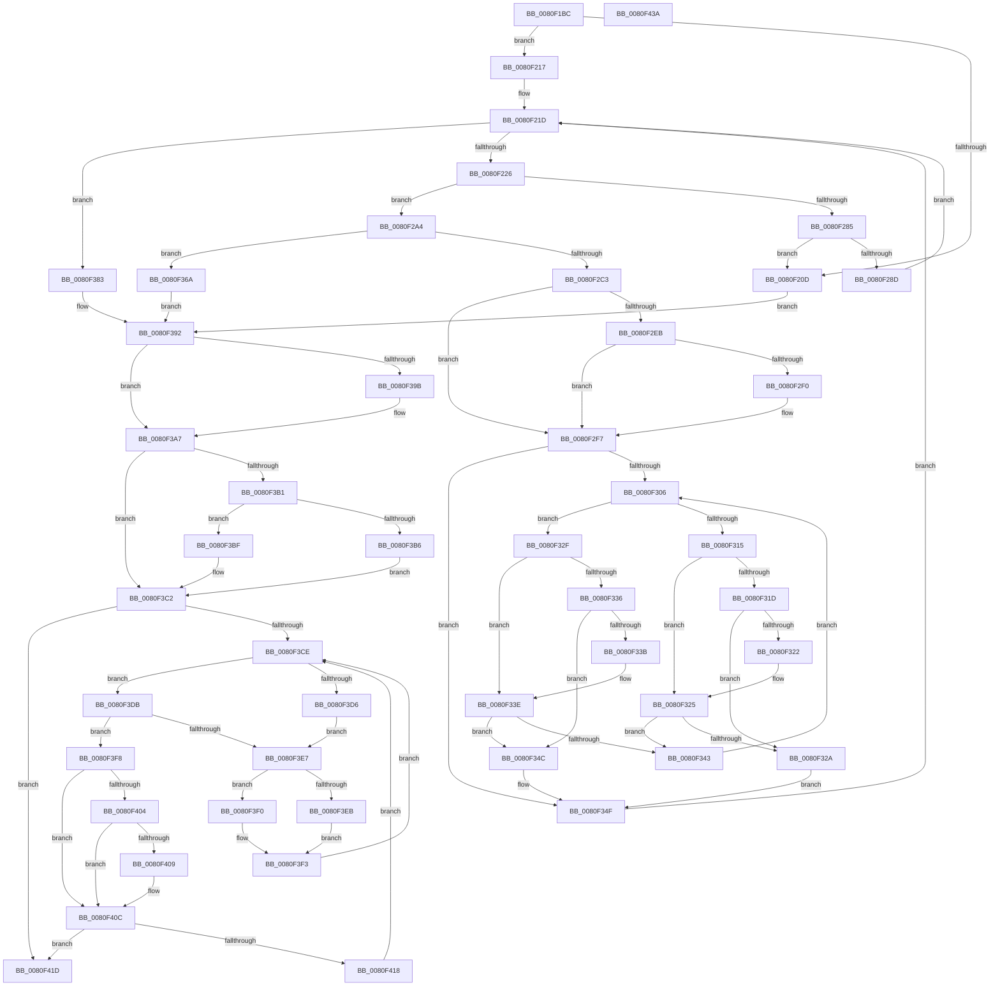

# MiCreatePagefileMemoryExtents

- RVA: `0x0080F1BC`–`0x0080F43B` (길이 `639` bytes)
- VA: `0x000000014080F1BC`
- 실행 섹션: `PAGE`
- PDB 이름 있음: `예`; PDB Function 태그: `아니요`
- unwind 정보 RVA: `0x000D8634`
- 디코드: `189`개 명령, `639/639` bytes 표시
- 미해석 바이트: `0` (있으면 어셈블리에 `.byte`로 보존)

> 이 문서는 커널 이미지의 기계어와 PDB 기호를 분석해 생성했습니다. 4번과 5번은 함수 원형과 자료형을 바이너리 사용 방식에서 추정한 C 해석이며 원본 소스 복구 결과는 아닙니다.

## 1. Dependencies

- 직접 호출 지점: **9**; 고유 호출 대상: **9**
- 직접 호출자로 확인된 함수: **1**
- RIP 상대 이미지 참조: **1**

### Outgoing calls
- `0x0080F1FC` → [MiGetSpecialPurposeMemoryPartitionForCaching](../../text/46/MiGetSpecialPurposeMemoryPartitionForCaching_function_004625D0.md) (function, `0x004625D0`)
- `0x0080F27C` → [MiFindContiguousPagesEx](../../text/28/MiFindContiguousPagesEx_function_0028BDE0.md) (function, `0x0028BDE0`)
- `0x0080F2B2` → [MiAllocatePool](../../text/35/MiAllocatePool_function_0035B540.md) (function, `0x0035B540`)
- `0x0080F30C` → [MiComparePageFileMemoryExtents](../../text/69/MiComparePageFileMemoryExtents_function_00694BE8.md) (function, `0x00694BE8`)
- `0x0080F359` → [RtlRbInsertNodeEx](../../text/2E/RtlRbInsertNodeEx_function_002E4570.md) (function, `0x002E4570`)
- `0x0080F374` → [MiFreeContiguousPages](../../text/3F/MiFreeContiguousPages_function_003F7178.md) (function, `0x003F7178`)
- `0x0080F38A` → [MiInsertPageFileMemoryExtents](../../text/69/MiInsertPageFileMemoryExtents_function_006950C8.md) (function, `0x006950C8`)
- `0x0080F3A2` → [MiSpecialPurposeMemoryTypeDereference](../81/MiSpecialPurposeMemoryTypeDereference_function_00810154.md) (function, `0x00810154`)
- `0x0080F40E` → [MiDeletePageFileMemoryExtents](MiDeletePageFileMemoryExtents_function_0080F4F8.md) (function, `0x0080F4F8`)

### Direct callers
- [MiCreateSpecialPurposeMemoryPageFile](MiCreateSpecialPurposeMemoryPageFile_function_0080F444.md) at `0x0080F4A1`

### Static image references
- `0x0080F226` → RVA `0x00E2DCE0` (`.data`; read)

## 2. Other-region calls and transfers

- 다른 실행 섹션으로 향하는 call: **7**
  - `0x0080F1FC` → [MiGetSpecialPurposeMemoryPartitionForCaching](../../text/46/MiGetSpecialPurposeMemoryPartitionForCaching_function_004625D0.md) (`PAGE` → `.text`)
  - `0x0080F27C` → [MiFindContiguousPagesEx](../../text/28/MiFindContiguousPagesEx_function_0028BDE0.md) (`PAGE` → `.text`)
  - `0x0080F2B2` → [MiAllocatePool](../../text/35/MiAllocatePool_function_0035B540.md) (`PAGE` → `.text`)
  - `0x0080F30C` → [MiComparePageFileMemoryExtents](../../text/69/MiComparePageFileMemoryExtents_function_00694BE8.md) (`PAGE` → `.text`)
  - `0x0080F359` → [RtlRbInsertNodeEx](../../text/2E/RtlRbInsertNodeEx_function_002E4570.md) (`PAGE` → `.text`)
  - `0x0080F374` → [MiFreeContiguousPages](../../text/3F/MiFreeContiguousPages_function_003F7178.md) (`PAGE` → `.text`)
  - `0x0080F38A` → [MiInsertPageFileMemoryExtents](../../text/69/MiInsertPageFileMemoryExtents_function_006950C8.md) (`PAGE` → `.text`)
- 별도 외부 분기/꼬리 이동을 확인하지 못했습니다.

## 3. Assembly (complete function range)

```asm
0080F1BC  48 89 5C 24 10                  mov qword ptr [rsp + 0x10], rbx
0080F1C1  55                              push rbp
0080F1C2  56                              push rsi
0080F1C3  57                              push rdi
0080F1C4  41 54                           push r12
0080F1C6  41 55                           push r13
0080F1C8  41 56                           push r14
0080F1CA  41 57                           push r15
0080F1CC  48 8D 6C 24 D9                  lea rbp, [rsp - 0x27]
0080F1D1  48 81 EC 90 00 00 00            sub rsp, 0x90
0080F1D8  4C 8B E9                        mov r13, rcx
0080F1DB  48 8D 55 07                     lea rdx, [rbp + 7]
0080F1DF  48 8B 89 D8 00 00 00            mov rcx, qword ptr [rcx + 0xd8]
0080F1E6  45 33 FF                        xor r15d, r15d
0080F1E9  0F 57 C0                        xorps xmm0, xmm0
0080F1EC  4C 89 7D 67                     mov qword ptr [rbp + 0x67], r15
0080F1F0  F3 0F 7F 45 0F                  movdqu xmmword ptr [rbp + 0xf], xmm0
0080F1F5  4C 89 7D 07                     mov qword ptr [rbp + 7], r15
0080F1F9  45 8B F0                        mov r14d, r8d
0080F1FC  E8 CF 33 C5 FF                  call 0x1404625d0
0080F201  48 89 45 7F                     mov qword ptr [rbp + 0x7f], rax
0080F205  48 8B C8                        mov rcx, rax
0080F208  48 85 C0                        test rax, rax
0080F20B  75 0A                           jne 0x14080f217
0080F20D  BF 9A 00 00 C0                  mov edi, 0xc000009a
0080F212  E9 7B 01 00 00                  jmp 0x14080f392
0080F217  45 8B E7                        mov r12d, r15d
0080F21A  41 8B FE                        mov edi, r14d
0080F21D  45 85 F6                        test r14d, r14d
0080F220  0F 84 5D 01 00 00               je 0x14080f383
0080F226  4C 8B 05 B3 EA 61 00            mov r8, qword ptr [rip + 0x61eab3]
0080F22D  41 3B FE                        cmp edi, r14d
0080F230  41 8B C6                        mov eax, r14d
0080F233  0F 46 C7                        cmovbe eax, edi
0080F236  45 33 C9                        xor r9d, r9d
0080F239  8B F8                           mov edi, eax
0080F23B  33 D2                           xor edx, edx
0080F23D  48 8D 45 67                     lea rax, [rbp + 0x67]
0080F241  48 89 44 24 68                  mov qword ptr [rsp + 0x68], rax
0080F246  4C 89 7C 24 60                  mov qword ptr [rsp + 0x60], r15
0080F24B  4C 89 7C 24 58                  mov qword ptr [rsp + 0x58], r15
0080F250  44 89 7C 24 50                  mov dword ptr [rsp + 0x50], r15d
0080F255  C7 44 24 48 01 00 10 00         mov dword ptr [rsp + 0x48], 0x100001
0080F25D  C6 44 24 40 FF                  mov byte ptr [rsp + 0x40], 0xff
0080F262  C7 44 24 38 00 00 00 80         mov dword ptr [rsp + 0x38], 0x80000000
0080F26A  C7 44 24 30 01 00 00 00         mov dword ptr [rsp + 0x30], 1
0080F272  48 89 7C 24 28                  mov qword ptr [rsp + 0x28], rdi
0080F277  4C 89 7C 24 20                  mov qword ptr [rsp + 0x20], r15
0080F27C  E8 5F CB A7 FF                  call 0x14028bde0
0080F281  85 C0                           test eax, eax
0080F283  79 1F                           jns 0x14080f2a4
0080F285  81 FF 00 02 00 00               cmp edi, 0x200
0080F28B  74 80                           je 0x14080f20d
0080F28D  48 8B 4D 7F                     mov rcx, qword ptr [rbp + 0x7f]
0080F291  D1 EF                           shr edi, 1
0080F293  81 C7 FF 01 00 00               add edi, 0x1ff
0080F299  81 E7 00 FE FF FF               and edi, 0xfffffe00
0080F29F  E9 79 FF FF FF                  jmp 0x14080f21d
0080F2A4  BA 28 00 00 00                  mov edx, 0x28
0080F2A9  41 B8 4D 69 50 65               mov r8d, 0x6550694d
0080F2AF  8D 4A 18                        lea ecx, [rdx + 0x18]
0080F2B2  E8 89 C2 B4 FF                  call 0x14035b540
0080F2B7  4C 8B F8                        mov r15, rax
0080F2BA  48 85 C0                        test rax, rax
0080F2BD  0F 84 A7 00 00 00               je 0x14080f36a
0080F2C3  48 83 C0 18                     add rax, 0x18
0080F2C7  44 2B F7                        sub r14d, edi
0080F2CA  44 89 20                        mov dword ptr [rax], r12d
0080F2CD  44 03 E7                        add r12d, edi
0080F2D0  41 8D 4C 24 FF                  lea ecx, [r12 - 1]
0080F2D5  41 89 4F 1C                     mov dword ptr [r15 + 0x1c], ecx
0080F2D9  48 8B 4D 67                     mov rcx, qword ptr [rbp + 0x67]
0080F2DD  49 89 4F 20                     mov qword ptr [r15 + 0x20], rcx
0080F2E1  F6 45 17 01                     test byte ptr [rbp + 0x17], 1
0080F2E5  48 8B 5D 0F                     mov rbx, qword ptr [rbp + 0xf]
0080F2E9  74 0C                           je 0x14080f2f7
0080F2EB  48 85 DB                        test rbx, rbx
0080F2EE  74 07                           je 0x14080f2f7
0080F2F0  48 8D 4D 0F                     lea rcx, [rbp + 0xf]
0080F2F4  48 33 D9                        xor rbx, rcx
0080F2F7  0F B6 75 17                     movzx esi, byte ptr [rbp + 0x17]
0080F2FB  45 32 C0                        xor r8b, r8b
0080F2FE  83 E6 01                        and esi, 1
0080F301  48 85 DB                        test rbx, rbx
0080F304  74 49                           je 0x14080f34f
0080F306  48 8B D3                        mov rdx, rbx
0080F309  48 8B C8                        mov rcx, rax
0080F30C  E8 D7 58 E8 FF                  call 0x140694be8
0080F311  85 C0                           test eax, eax
0080F313  78 1A                           js 0x14080f32f
0080F315  48 8B 43 08                     mov rax, qword ptr [rbx + 8]
0080F319  85 F6                           test esi, esi
0080F31B  74 08                           je 0x14080f325
0080F31D  48 85 C0                        test rax, rax
0080F320  74 08                           je 0x14080f32a
0080F322  48 33 C3                        xor rax, rbx
0080F325  48 85 C0                        test rax, rax
0080F328  75 19                           jne 0x14080f343
0080F32A  41 B0 01                        mov r8b, 1
0080F32D  EB 20                           jmp 0x14080f34f
0080F32F  48 8B 03                        mov rax, qword ptr [rbx]
0080F332  85 F6                           test esi, esi
0080F334  74 08                           je 0x14080f33e
0080F336  48 85 C0                        test rax, rax
0080F339  74 11                           je 0x14080f34c
0080F33B  48 33 C3                        xor rax, rbx
0080F33E  48 85 C0                        test rax, rax
0080F341  74 09                           je 0x14080f34c
0080F343  48 8B D8                        mov rbx, rax
0080F346  49 8D 47 18                     lea rax, [r15 + 0x18]
0080F34A  EB BA                           jmp 0x14080f306
0080F34C  45 32 C0                        xor r8b, r8b
0080F34F  4D 8B CF                        mov r9, r15
0080F352  48 8D 4D 0F                     lea rcx, [rbp + 0xf]
0080F356  48 8B D3                        mov rdx, rbx
0080F359  E8 12 52 AD FF                  call 0x1402e4570
0080F35E  48 8B 4D 7F                     mov rcx, qword ptr [rbp + 0x7f]
0080F362  45 33 FF                        xor r15d, r15d
0080F365  E9 B3 FE FF FF                  jmp 0x14080f21d
0080F36A  48 8B 4D 67                     mov rcx, qword ptr [rbp + 0x67]
0080F36E  45 33 C0                        xor r8d, r8d
0080F371  48 8B D7                        mov rdx, rdi
0080F374  E8 FF 7D BE FF                  call 0x1403f7178
0080F379  45 33 FF                        xor r15d, r15d
0080F37C  BF 9A 00 00 C0                  mov edi, 0xc000009a
0080F381  EB 0F                           jmp 0x14080f392
0080F383  48 8D 55 0F                     lea rdx, [rbp + 0xf]
0080F387  49 8B CD                        mov rcx, r13
0080F38A  E8 39 5D E8 FF                  call 0x1406950c8
0080F38F  41 8B FF                        mov edi, r15d
0080F392  48 8B 55 07                     mov rdx, qword ptr [rbp + 7]
0080F396  48 85 D2                        test rdx, rdx
0080F399  74 0C                           je 0x14080f3a7
0080F39B  49 8B 8D D8 00 00 00            mov rcx, qword ptr [r13 + 0xd8]
0080F3A2  E8 AD 0D 00 00                  call 0x140810154
0080F3A7  F6 45 17 01                     test byte ptr [rbp + 0x17], 1
0080F3AB  48 8B 4D 0F                     mov rcx, qword ptr [rbp + 0xf]
0080F3AF  74 11                           je 0x14080f3c2
0080F3B1  48 85 C9                        test rcx, rcx
0080F3B4  74 09                           je 0x14080f3bf
0080F3B6  48 8D 45 0F                     lea rax, [rbp + 0xf]
0080F3BA  48 33 C8                        xor rcx, rax
0080F3BD  EB 03                           jmp 0x14080f3c2
0080F3BF  49 8B CF                        mov rcx, r15
0080F3C2  0F B6 75 17                     movzx esi, byte ptr [rbp + 0x17]
0080F3C6  83 E6 01                        and esi, 1
0080F3C9  48 85 C9                        test rcx, rcx
0080F3CC  74 4F                           je 0x14080f41d
0080F3CE  48 8B 01                        mov rax, qword ptr [rcx]
0080F3D1  48 85 C0                        test rax, rax
0080F3D4  74 05                           je 0x14080f3db
0080F3D6  48 8B D1                        mov rdx, rcx
0080F3D9  EB 0C                           jmp 0x14080f3e7
0080F3DB  48 8D 51 08                     lea rdx, [rcx + 8]
0080F3DF  48 8B 02                        mov rax, qword ptr [rdx]
0080F3E2  48 85 C0                        test rax, rax
0080F3E5  74 11                           je 0x14080f3f8
0080F3E7  85 F6                           test esi, esi
0080F3E9  74 05                           je 0x14080f3f0
0080F3EB  48 33 C8                        xor rcx, rax
0080F3EE  EB 03                           jmp 0x14080f3f3
0080F3F0  48 8B C8                        mov rcx, rax
0080F3F3  4C 89 3A                        mov qword ptr [rdx], r15
0080F3F6  EB D6                           jmp 0x14080f3ce
0080F3F8  48 8B 59 10                     mov rbx, qword ptr [rcx + 0x10]
0080F3FC  48 83 E3 FC                     and rbx, 0xfffffffffffffffc
0080F400  85 F6                           test esi, esi
0080F402  74 08                           je 0x14080f40c
0080F404  48 85 DB                        test rbx, rbx
0080F407  74 03                           je 0x14080f40c
0080F409  48 33 D9                        xor rbx, rcx
0080F40C  33 D2                           xor edx, edx
0080F40E  E8 E5 00 00 00                  call 0x14080f4f8
0080F413  48 85 DB                        test rbx, rbx
0080F416  74 05                           je 0x14080f41d
0080F418  48 8B CB                        mov rcx, rbx
0080F41B  EB B1                           jmp 0x14080f3ce
0080F41D  48 8B 9C 24 D8 00 00 00         mov rbx, qword ptr [rsp + 0xd8]
0080F425  8B C7                           mov eax, edi
0080F427  48 81 C4 90 00 00 00            add rsp, 0x90
0080F42E  41 5F                           pop r15
0080F430  41 5E                           pop r14
0080F432  41 5D                           pop r13
0080F434  41 5C                           pop r12
0080F436  5F                              pop rdi
0080F437  5E                              pop rsi
0080F438  5D                              pop rbp
0080F439  C3                              ret
0080F43A  CC                              int3
```

## 4. C-style interpretation (structured pseudocode)

```c
__int64 __fastcall MiCreatePagefileMemoryExtents(__int64 a1, __int64 a2, int a3, int a4)
{
    __int64 result;
    __int64 v_r12;
    __int64 v_r14;
    __int64 v_r15;
    __int64 v_rbx;
    __int64 v_rdi;
    __int64 v_rsi;
    __int64 v_rsp;
    unsigned __int8 v_stack_m48;
    unsigned __int64 v_stack_m50;
    unsigned __int64 v_stack_m58;
    unsigned __int64 v_stack_m5F;
    unsigned __int64 v_stack_m60;
    unsigned __int64 v_stack_m68;
    unsigned __int64 v_stack_m70;
    unsigned int v_stack_m78;
    unsigned int v_stack_m80;
    unsigned __int8 v_stack_m88;
    unsigned int v_stack_m90;
    unsigned int v_stack_m98;
    unsigned __int64 v_stack_mA0;
    unsigned __int64 v_stack_mA8;
    unsigned __int64 v_stack_p10;
    unsigned __int64 v_stack_p20;
    unsigned __int64 v_stack_p8;

    v_stack_p10 = v_rbx;
    v_rsp = (v_rsp) - (144);
    v_r15 = 0;
    v_stack_p8 = 0;
    v_stack_m50 = v_xmm0;
    v_stack_m58 = 0;
    result = MiGetSpecialPurposeMemoryPartitionForCaching(*(unsigned __int64 *)(a1 + 216), v_stack_m58, a3, a4);
    v_stack_p20 = result;
    if (result != 0) goto loc_0080F217;
loc_0080F20D:
    goto loc_0080F392;
loc_0080F217:
loc_0080F21D:
    if ((unsigned int)((unsigned int)(a3)) == 0) goto loc_0080F383;
    result = (unsigned int)((unsigned int)((unsigned int)(a3)));
    if (((unsigned int)((unsigned int)((unsigned int)((unsigned int)(a3))))) <= ((unsigned int)((unsigned int)(a3)))) { result = (unsigned int)((unsigned int)((unsigned int)((unsigned int)(a3)))); }
    a4 = 0;
    a2 = 0;
    v_stack_m60 = v_stack_p8;
    v_stack_m68 = 0;
    v_stack_m70 = 0;
    v_stack_m78 = 0;
    v_stack_m80 = 0x100001ULL;
    v_stack_m88 = 255;
    v_stack_m90 = 0x80000000ULL;
    v_stack_m98 = 1;
    v_stack_mA0 = (unsigned int)((unsigned int)(result));
    v_stack_mA8 = 0;
    result = MiFindContiguousPagesEx(result, a2, *(unsigned __int64 *)(v_rip + 6417075), a4);
    if (!sign_flag) goto loc_0080F2A4;
    if (((unsigned int)((unsigned int)((unsigned int)(result)))) == 512) goto loc_0080F20D;
    v_rdi = (unsigned int)(((unsigned int)((unsigned int)(result))) >> (1));
    v_rdi = (unsigned int)((v_rdi) + (511));
    v_rdi = (unsigned int)((v_rdi) & (0xFFFFFE00ULL));
    goto loc_0080F21D;
loc_0080F2A4:
    result = MiAllocatePool(40 + 24, 40, (unsigned int)(0x6550694DULL), a4);
    if (result == 0) goto loc_0080F36A;
    result = (result) + (24);
    v_r14 = (unsigned int)(((unsigned int)(a3)) - ((unsigned int)(v_rdi)));
    *(unsigned int *)(result) = 0;
    v_r12 = (unsigned int)((0) + ((unsigned int)(v_rdi)));
    *(unsigned int *)(result + 28) = (unsigned int)(v_r12 - 1);
    *(unsigned __int64 *)(result + 32) = v_stack_p8;
    if (((v_stack_m48) & (1)) == 0) goto loc_0080F2F7;
    v_rbx = v_stack_m50;
    if (v_stack_m50 != 0) {
        a1 = v_stack_m50;
        v_rbx = (v_stack_m50) ^ (a1);
    }
    a3 = 0;
    v_rsi = (unsigned int)((v_stack_m48) & (1));
    if (v_rbx == 0) goto loc_0080F34F;
loc_0080F306:
    result = MiComparePageFileMemoryExtents(result, v_rbx, a3, a4);
    if (sign_flag) goto loc_0080F32F;
    if ((unsigned int)(v_rsi) == 0) goto loc_0080F325;
    if (*(unsigned __int64 *)(v_rbx + 8) == 0) goto loc_0080F32A;
    result = (*(unsigned __int64 *)(v_rbx + 8)) ^ (v_rbx);
loc_0080F325:
    if (result != 0) goto loc_0080F343;
loc_0080F32A:
    goto loc_0080F34F;
loc_0080F32F:
    if ((unsigned int)(v_rsi) == 0) goto loc_0080F33E;
    if (*(unsigned __int64 *)(v_rbx) == 0) goto loc_0080F34C;
    result = (*(unsigned __int64 *)(v_rbx)) ^ (v_rbx);
loc_0080F33E:
    if (result == 0) goto loc_0080F34C;
loc_0080F343:
    goto loc_0080F306;
loc_0080F34C:
    a3 = 0;
loc_0080F34F:
    result = RtlRbInsertNodeEx(v_stack_m50, result, a3, result);
    v_r15 = 0;
    goto loc_0080F21D;
loc_0080F36A:
    a3 = 0;
    result = MiFreeContiguousPages(v_stack_p8, v_rdi, a3, result);
    v_r15 = 0;
    goto loc_0080F392;
loc_0080F383:
    result = MiInsertPageFileMemoryExtents(a1, v_stack_m50, a3, result);
loc_0080F392:
    if (v_stack_m58 != 0) {
        a1 = *(unsigned __int64 *)(a1 + 216);
        result = MiSpecialPurposeMemoryTypeDereference(a1, v_stack_m58, a3, result);
    }
    if (((v_stack_m48) & (1)) == 0) goto loc_0080F3C2;
    if (v_stack_m50 == 0) goto loc_0080F3BF;
    a1 = (v_stack_m50) ^ (v_stack_m50);
    goto loc_0080F3C2;
loc_0080F3BF:
loc_0080F3C2:
    v_rsi = (unsigned int)((v_stack_m48) & (1));
    if (0 == 0) goto loc_0080F41D;
loc_0080F3CE:
    if (*(unsigned __int64 *)(0) == 0) goto loc_0080F3DB;
    goto loc_0080F3E7;
loc_0080F3DB:
    if (*(unsigned __int64 *)(0 + 8) == 0) goto loc_0080F3F8;
loc_0080F3E7:
    if ((unsigned int)(v_rsi) == 0) goto loc_0080F3F0;
    a1 = (0) ^ (*(unsigned __int64 *)(0 + 8));
    goto loc_0080F3F3;
loc_0080F3F0:
loc_0080F3F3:
    *(unsigned __int64 *)(0 + 8) = 0;
    goto loc_0080F3CE;
loc_0080F3F8:
    v_rbx = (*(unsigned __int64 *)(*(unsigned __int64 *)(0 + 8) + 16)) & (-4);
    if ((unsigned int)(v_rsi) == 0) goto loc_0080F40C;
    if (v_rbx != 0) {
        v_rbx = (v_rbx) ^ (*(unsigned __int64 *)(0 + 8));
    }
    a2 = 0;
    result = MiDeletePageFileMemoryExtents(*(unsigned __int64 *)(0 + 8), a2, a3, result);
    if (v_rbx == 0) goto loc_0080F41D;
    goto loc_0080F3CE;
loc_0080F41D:
    v_rsp = (v_rsp) + (144);
    return 0;
}
```

## 5. (Beta) C Style

```c
int64_t MiCreatePagefileMemoryExtents(void *Arg1, int64_t Arg2, int32_t Arg3, int32_t Arg4)
{
    uint8_t *arg1 = (uint8_t *)Arg1;

    int64_t result;
    int64_t local_r12;
    int64_t local_r14;
    int64_t local_r15;
    int64_t local_rbx;
    int64_t local_rdi;
    int64_t local_rsi;
    int64_t local_rsp;
    uint8_t v_stack_m48;
    uint64_t v_stack_m50;
    uint64_t v_stack_m58;
    uint64_t v_stack_m5F;
    uint64_t v_stack_m60;
    uint64_t v_stack_m68;
    uint64_t v_stack_m70;
    uint32_t v_stack_m78;
    uint32_t v_stack_m80;
    uint8_t v_stack_m88;
    uint32_t v_stack_m90;
    uint32_t v_stack_m98;
    uint64_t v_stack_mA0;
    uint64_t v_stack_mA8;
    uint64_t v_stack_p10;
    uint64_t v_stack_p20;
    uint64_t v_stack_p8;

    v_stack_p10 = local_rbx;
    local_rsp = (local_rsp) - (144);
    local_r15 = 0;
    v_stack_p8 = 0;
    v_stack_m50 = v_xmm0;
    v_stack_m58 = 0;
    result = MiGetSpecialPurposeMemoryPartitionForCaching(*(uint64_t *)(arg1 + 0xD8), v_stack_m58, Arg3, Arg4);
    v_stack_p20 = result;
    if (result != 0) goto loc_0080F217;
loc_0080F20D:
    goto loc_0080F392;
loc_0080F217:
loc_0080F21D:
    if ((uint32_t)((uint32_t)(Arg3)) == 0) goto loc_0080F383;
    result = (uint32_t)((uint32_t)((uint32_t)(Arg3)));
    if (((uint32_t)((uint32_t)((uint32_t)((uint32_t)(Arg3))))) <= ((uint32_t)((uint32_t)(Arg3)))) { result = (uint32_t)((uint32_t)((uint32_t)((uint32_t)(Arg3)))); }
    Arg4 = 0;
    Arg2 = 0;
    v_stack_m60 = v_stack_p8;
    v_stack_m68 = 0;
    v_stack_m70 = 0;
    v_stack_m78 = 0;
    v_stack_m80 = 0x100001ULL;
    v_stack_m88 = 255;
    v_stack_m90 = 0x80000000ULL;
    v_stack_m98 = 1;
    v_stack_mA0 = (uint32_t)((uint32_t)(result));
    v_stack_mA8 = 0;
    result = MiFindContiguousPagesEx(result, Arg2, *(uint64_t *)(v_rip + 0x61EAB3), Arg4);
    if (!sign_flag) goto loc_0080F2A4;
    if (((uint32_t)((uint32_t)((uint32_t)(result)))) == 512) goto loc_0080F20D;
    local_rdi = (uint32_t)(((uint32_t)((uint32_t)(result))) >> (1));
    local_rdi = (uint32_t)((local_rdi) + (511));
    local_rdi = (uint32_t)((local_rdi) & (0xFFFFFE00ULL));
    goto loc_0080F21D;
loc_0080F2A4:
    result = MiAllocatePool(40 + 24, 40, (uint32_t)(0x6550694DULL), Arg4);
    if (result == 0) goto loc_0080F36A;
    result = (result) + (24);
    local_r14 = (uint32_t)(((uint32_t)(Arg3)) - ((uint32_t)(local_rdi)));
    *(uint32_t *)(result) = 0;
    local_r12 = (uint32_t)((0) + ((uint32_t)(local_rdi)));
    *(uint32_t *)(result + 0x1C) = (uint32_t)(local_r12 - 1);
    *(uint64_t *)(result + 0x20) = v_stack_p8;
    if (((v_stack_m48) & (1)) == 0) goto loc_0080F2F7;
    local_rbx = v_stack_m50;
    if (v_stack_m50 != 0) {
        Arg1 = v_stack_m50;
        local_rbx = (v_stack_m50) ^ (Arg1);
    }
    Arg3 = 0;
    local_rsi = (uint32_t)((v_stack_m48) & (1));
    if (local_rbx == 0) goto loc_0080F34F;
loc_0080F306:
    result = MiComparePageFileMemoryExtents(result, local_rbx, Arg3, Arg4);
    if (sign_flag) goto loc_0080F32F;
    if ((uint32_t)(local_rsi) == 0) goto loc_0080F325;
    if (*(uint64_t *)(local_rbx + 0x8) == 0) goto loc_0080F32A;
    result = (*(uint64_t *)(local_rbx + 0x8)) ^ (local_rbx);
loc_0080F325:
    if (result != 0) goto loc_0080F343;
loc_0080F32A:
    goto loc_0080F34F;
loc_0080F32F:
    if ((uint32_t)(local_rsi) == 0) goto loc_0080F33E;
    if (*(uint64_t *)(local_rbx) == 0) goto loc_0080F34C;
    result = (*(uint64_t *)(local_rbx)) ^ (local_rbx);
loc_0080F33E:
    if (result == 0) goto loc_0080F34C;
loc_0080F343:
    goto loc_0080F306;
loc_0080F34C:
    Arg3 = 0;
loc_0080F34F:
    result = RtlRbInsertNodeEx(v_stack_m50, result, Arg3, result);
    local_r15 = 0;
    goto loc_0080F21D;
loc_0080F36A:
    Arg3 = 0;
    result = MiFreeContiguousPages(v_stack_p8, local_rdi, Arg3, result);
    local_r15 = 0;
    goto loc_0080F392;
loc_0080F383:
    result = MiInsertPageFileMemoryExtents(Arg1, v_stack_m50, Arg3, result);
loc_0080F392:
    if (v_stack_m58 != 0) {
        Arg1 = *(uint64_t *)(arg1 + 0xD8);
        result = MiSpecialPurposeMemoryTypeDereference(Arg1, v_stack_m58, Arg3, result);
    }
    if (((v_stack_m48) & (1)) == 0) goto loc_0080F3C2;
    if (v_stack_m50 == 0) goto loc_0080F3BF;
    Arg1 = (v_stack_m50) ^ (v_stack_m50);
    goto loc_0080F3C2;
loc_0080F3BF:
loc_0080F3C2:
    local_rsi = (uint32_t)((v_stack_m48) & (1));
    if (0 == 0) goto loc_0080F41D;
loc_0080F3CE:
    if (*(uint64_t *)(0) == 0) goto loc_0080F3DB;
    goto loc_0080F3E7;
loc_0080F3DB:
    if (*(uint64_t *)(0 + 0x8) == 0) goto loc_0080F3F8;
loc_0080F3E7:
    if ((uint32_t)(local_rsi) == 0) goto loc_0080F3F0;
    Arg1 = (0) ^ (*(uint64_t *)(0 + 0x8));
    goto loc_0080F3F3;
loc_0080F3F0:
loc_0080F3F3:
    *(uint64_t *)(0 + 0x8) = 0;
    goto loc_0080F3CE;
loc_0080F3F8:
    local_rbx = (*(uint64_t *)(*(uint64_t *)(0 + 0x8) + 0x10)) & (-4);
    if ((uint32_t)(local_rsi) == 0) goto loc_0080F40C;
    if (local_rbx != 0) {
        local_rbx = (local_rbx) ^ (*(uint64_t *)(0 + 0x8));
    }
    Arg2 = 0;
    result = MiDeletePageFileMemoryExtents(*(uint64_t *)(0 + 0x8), Arg2, Arg3, result);
    if (local_rbx == 0) goto loc_0080F41D;
    goto loc_0080F3CE;
loc_0080F41D:
    local_rsp = (local_rsp) + (144);
    return 0;
}
```

### 관측된 메모리 오프셋

구조체 형식이 확인되지 않은 접근은 인자 기준의 오프셋으로만 기록했습니다.

| 기준 인자 | 오프셋 표현 | 폭 (bit) | 접근 |
|---|---:|---:|---|
| `Arg1` | `+ 0xD8` | `64` | `R` |

## 6. Execution-region graph

[열기: 2D/3D 그래프와 함수 탐색 컨트롤 패널](../../../control-panel.html?section=page&rva=0x0080F1BC&view=graph)

- 2D 그래프는 위에서 아래로 흐르고, 3D 그래프는 빈 공간을 드래그해 회전합니다. Shift+드래그는 이동, 휠은 확대·축소, 함수 노드 선택은 대상 보고서 이동입니다.

### Static fallback


