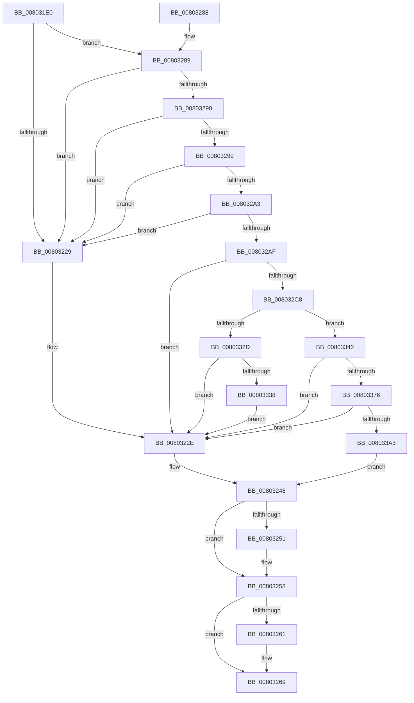

# MiCreatePatchSectionRequest

- RVA: `0x008031E0`–`0x008033B7` (길이 `471` bytes)
- VA: `0x00000001408031E0`
- 실행 섹션: `PAGE`
- PDB 이름 있음: `예`; PDB Function 태그: `아니요`
- unwind 정보 RVA: `0x000D840C`
- 디코드: `126`개 명령, `471/471` bytes 표시
- 미해석 바이트: `0` (있으면 어셈블리에 `.byte`로 보존)

> 이 문서는 커널 이미지의 기계어와 PDB 기호를 분석해 생성했습니다. 4번과 5번은 함수 원형과 자료형을 바이너리 사용 방식에서 추정한 C 해석이며 원본 소스 복구 결과는 아닙니다.

## 1. Dependencies

- 직접 호출 지점: **11**; 고유 호출 대상: **10**
- 직접 호출자로 확인된 함수: **1**
- RIP 상대 이미지 참조: **0**

### Outgoing calls
- `0x0080321E` → [RtlInitUnicodeString](../../text/42/RtlInitUnicodeString_function_0042A780.md) (function, `0x0042A780`)
- `0x00803243` → [MiLogHotPatchOperationStatus](MiLogHotPatchOperationStatus_function_00804E84.md) (function, `0x00804E84`)
- `0x00803253` → [ObCloseHandle](../8A/ObCloseHandle_function_008A1870.md) (function, `0x008A1870`)
- `0x00803264` → [ObCloseHandle](../8A/ObCloseHandle_function_008A1870.md) (function, `0x008A1870`)
- `0x0080326D` → [RtlFreeAnsiString](../9C/RtlFreeAnsiString_function_009C0800.md) (function, `0x009C0800`)
- `0x008032B9` → [MiGetVadForHotPatchInProgress](MiGetVadForHotPatchInProgress_function_008039C4.md) (function, `0x008039C4`)
- `0x008032F4` → [MiSetVadFlags](../../text/43/MiSetVadFlags_function_004311FC.md) (function, `0x004311FC`)
- `0x008032FC` → [MiUnlockAndDereferenceVad](../../text/31/MiUnlockAndDereferenceVad_function_00316E60.md) (function, `0x00316E60`)
- `0x00803322` → [MiFindProcessImageHotPatchRecord](../A4/MiFindProcessImageHotPatchRecord_function_00A4206C.md) (function, `0x00A4206C`)
- `0x00803367` → [MiOpenHotPatchFile](../AB/MiOpenHotPatchFile_function_00AB5684.md) (function, `0x00AB5684`)
- `0x00803394` → [MmCreateSectionForHotpatch](MmCreateSectionForHotpatch_function_00807360.md) (function, `0x00807360`)

### Direct callers
- [NtManageHotPatch](../AF/NtManageHotPatch_function_00AF8660.md) at `0x00AF8C2A`

### Static image references
- 디코드된 RIP-relative 메모리 참조가 없습니다.

## 2. Other-region calls and transfers

- 다른 실행 섹션으로 향하는 call: **3**
  - `0x0080321E` → [RtlInitUnicodeString](../../text/42/RtlInitUnicodeString_function_0042A780.md) (`PAGE` → `.text`)
  - `0x008032F4` → [MiSetVadFlags](../../text/43/MiSetVadFlags_function_004311FC.md) (`PAGE` → `.text`)
  - `0x008032FC` → [MiUnlockAndDereferenceVad](../../text/31/MiUnlockAndDereferenceVad_function_00316E60.md) (`PAGE` → `.text`)
- 별도 외부 분기/꼬리 이동을 확인하지 못했습니다.

## 3. Assembly (complete function range)

```asm
008031E0  48 89 5C 24 10                  mov qword ptr [rsp + 0x10], rbx
008031E5  55                              push rbp
008031E6  56                              push rsi
008031E7  57                              push rdi
008031E8  41 56                           push r14
008031EA  41 57                           push r15
008031EC  48 8B EC                        mov rbp, rsp
008031EF  48 83 EC 60                     sub rsp, 0x60
008031F3  48 83 65 40 00                  and qword ptr [rbp + 0x40], 0
008031F8  44 8A FA                        mov r15b, dl
008031FB  83 65 30 00                     and dword ptr [rbp + 0x30], 0
008031FF  4C 8B F1                        mov r14, rcx
00803202  48 83 65 E8 00                  and qword ptr [rbp - 0x18], 0
00803207  48 8D 4D F0                     lea rcx, [rbp - 0x10]
0080320B  48 83 65 E0 00                  and qword ptr [rbp - 0x20], 0
00803210  0F 57 C0                        xorps xmm0, xmm0
00803213  48 83 65 48 00                  and qword ptr [rbp + 0x48], 0
00803218  33 D2                           xor edx, edx
0080321A  0F 11 45 F0                     movups xmmword ptr [rbp - 0x10], xmm0
0080321E  E8 5D 75 C2 FF                  call 0x14042a780
00803223  41 83 3E 01                     cmp dword ptr [r14], 1
00803227  74 60                           je 0x140803289
00803229  BB 0D 00 00 C0                  mov ebx, 0xc000000d
0080322E  8B 55 44                        mov edx, dword ptr [rbp + 0x44]
00803231  4C 8D 45 F0                     lea r8, [rbp - 0x10]
00803235  8B 4D 40                        mov ecx, dword ptr [rbp + 0x40]
00803238  44 8B CB                        mov r9d, ebx
0080323B  C7 44 24 20 07 00 00 00         mov dword ptr [rsp + 0x20], 7
00803243  E8 3C 1C 00 00                  call 0x140804e84
00803248  48 8B 4D E0                     mov rcx, qword ptr [rbp - 0x20]
0080324C  48 85 C9                        test rcx, rcx
0080324F  74 07                           je 0x140803258
00803251  33 D2                           xor edx, edx
00803253  E8 18 E6 09 00                  call 0x1408a1870
00803258  48 8B 4D 48                     mov rcx, qword ptr [rbp + 0x48]
0080325C  48 85 C9                        test rcx, rcx
0080325F  74 08                           je 0x140803269
00803261  41 8A D7                        mov dl, r15b
00803264  E8 07 E6 09 00                  call 0x1408a1870
00803269  48 8D 4D F0                     lea rcx, [rbp - 0x10]
0080326D  E8 8E D5 1B 00                  call 0x1409c0800
00803272  8B C3                           mov eax, ebx
00803274  48 8B 9C 24 98 00 00 00         mov rbx, qword ptr [rsp + 0x98]
0080327C  48 83 C4 60                     add rsp, 0x60
00803280  41 5F                           pop r15
00803282  41 5E                           pop r14
00803284  5F                              pop rdi
00803285  5E                              pop rsi
00803286  5D                              pop rbp
00803287  C3                              ret
00803288  CC                              int3
00803289  41 83 7E 04 00                  cmp dword ptr [r14 + 4], 0
0080328E  75 99                           jne 0x140803229
00803290  49 8B 4E 18                     mov rcx, qword ptr [r14 + 0x18]
00803294  48 85 C9                        test rcx, rcx
00803297  74 90                           je 0x140803229
00803299  41 F7 46 10 00 00 00 01         test dword ptr [r14 + 0x10], 0x1000000
008032A1  74 86                           je 0x140803229
008032A3  41 8B 46 0C                     mov eax, dword ptr [r14 + 0xc]
008032A7  A8 F0                           test al, 0xf0
008032A9  0F 84 7A FF FF FF               je 0x140803229
008032AF  4C 8D 4D 30                     lea r9, [rbp + 0x30]
008032B3  33 D2                           xor edx, edx
008032B5  4C 8D 45 E8                     lea r8, [rbp - 0x18]
008032B9  E8 06 07 00 00                  call 0x1408039c4
008032BE  8B D8                           mov ebx, eax
008032C0  85 C0                           test eax, eax
008032C2  0F 88 66 FF FF FF               js 0x14080322e
008032C8  48 8B 5D E8                     mov rbx, qword ptr [rbp - 0x18]
008032CC  48 8B CB                        mov rcx, rbx
008032CF  48 8B 43 48                     mov rax, qword ptr [rbx + 0x48]
008032D3  48 8B 10                        mov rdx, qword ptr [rax]
008032D6  48 8B 02                        mov rax, qword ptr [rdx]
008032D9  BA 04 00 00 00                  mov edx, 4
008032DE  4C 8B 40 38                     mov r8, qword ptr [rax + 0x38]
008032E2  41 8B 70 3C                     mov esi, dword ptr [r8 + 0x3c]
008032E6  41 8B 78 48                     mov edi, dword ptr [r8 + 0x48]
008032EA  44 8B 45 30                     mov r8d, dword ptr [rbp + 0x30]
008032EE  89 75 40                        mov dword ptr [rbp + 0x40], esi
008032F1  89 7D 44                        mov dword ptr [rbp + 0x44], edi
008032F4  E8 03 DF C2 FF                  call 0x1404311fc
008032F9  48 8B CB                        mov rcx, rbx
008032FC  E8 5F 3B B1 FF                  call 0x140316e60
00803301  65 48 8B 04 25 88 01 00 00      mov rax, qword ptr gs:[0x188]
0080330A  45 33 C9                        xor r9d, r9d
0080330D  44 8B C7                        mov r8d, edi
00803310  8B D6                           mov edx, esi
00803312  48 8B 88 B8 00 00 00            mov rcx, qword ptr [rax + 0xb8]
00803319  48 8D 45 F0                     lea rax, [rbp - 0x10]
0080331D  48 89 44 24 20                  mov qword ptr [rsp + 0x20], rax
00803322  E8 45 ED 23 00                  call 0x140a4206c
00803327  8B D8                           mov ebx, eax
00803329  85 C0                           test eax, eax
0080332B  79 15                           jns 0x140803342
0080332D  3D 25 02 00 C0                  cmp eax, 0xc0000225
00803332  0F 85 F6 FE FF FF               jne 0x14080322e
00803338  BB D4 04 00 C0                  mov ebx, 0xc00004d4
0080333D  E9 EC FE FF FF                  jmp 0x14080322e
00803342  48 83 64 24 38 00               and qword ptr [rsp + 0x38], 0
00803348  4C 8D 4D E0                     lea r9, [rbp - 0x20]
0080334C  48 83 64 24 30 00               and qword ptr [rsp + 0x30], 0
00803352  48 8D 4D F0                     lea rcx, [rbp - 0x10]
00803356  48 83 64 24 28 00               and qword ptr [rsp + 0x28], 0
0080335C  45 33 C0                        xor r8d, r8d
0080335F  48 83 64 24 20 00               and qword ptr [rsp + 0x20], 0
00803365  33 D2                           xor edx, edx
00803367  E8 18 23 2B 00                  call 0x140ab5684
0080336C  8B D8                           mov ebx, eax
0080336E  85 C0                           test eax, eax
00803370  0F 88 B8 FE FF FF               js 0x14080322e
00803376  45 8B 4E 10                     mov r9d, dword ptr [r14 + 0x10]
0080337A  48 8D 45 48                     lea rax, [rbp + 0x48]
0080337E  45 8B 46 0C                     mov r8d, dword ptr [r14 + 0xc]
00803382  41 8B 56 08                     mov edx, dword ptr [r14 + 8]
00803386  48 8B 4D E0                     mov rcx, qword ptr [rbp - 0x20]
0080338A  48 89 44 24 28                  mov qword ptr [rsp + 0x28], rax
0080338F  44 88 7C 24 20                  mov byte ptr [rsp + 0x20], r15b
00803394  E8 C7 3F 00 00                  call 0x140807360
00803399  8B D8                           mov ebx, eax
0080339B  85 C0                           test eax, eax
0080339D  0F 88 8B FE FF FF               js 0x14080322e
008033A3  48 8B 45 48                     mov rax, qword ptr [rbp + 0x48]
008033A7  48 83 65 48 00                  and qword ptr [rbp + 0x48], 0
008033AC  33 DB                           xor ebx, ebx
008033AE  49 89 46 20                     mov qword ptr [r14 + 0x20], rax
008033B2  E9 91 FE FF FF                  jmp 0x140803248
```

## 4. C-style interpretation (structured pseudocode)

```c
__int64 __fastcall MiCreatePatchSectionRequest(__int64 a1, int a2)
{
    __int64 result;
    __int64 v_rbx;
    __int64 v_rsp;
    unsigned __int64 v_stack_m38;
    unsigned __int64 v_stack_m40;
    unsigned __int64 v_stack_m48;
    unsigned int v_stack_m68;
    unsigned __int64 v_stack_p10;
    unsigned __int64 v_stack_p18;
    unsigned int v_stack_p1C;
    unsigned __int64 v_stack_p20;
    unsigned __int64 v_stack_p28;
    unsigned __int64 v_stack_p30;
    unsigned __int64 v_stack_p38;
    unsigned int v_stack_p8;

    v_stack_p10 = v_rbx;
    v_rsp = (v_rsp) - (96);
    a2 = 0;
    v_stack_m38 = v_xmm0;
    result = RtlInitUnicodeString(v_stack_m38, a2, a3, a4);
    if ((*(unsigned int *)(a1)) == 1) goto loc_00803289;
loc_00803229:
loc_0080322E:
    v_stack_m68 = 7;
    result = MiLogHotPatchOperationStatus((unsigned int)(v_stack_p18), (unsigned int)(v_stack_p1C), v_stack_m38, (unsigned int)((unsigned int)((unsigned int)(0xC000000DULL))));
loc_00803248:
    if (v_stack_m48 != 0) {
        a2 = 0;
        result = ObCloseHandle(v_stack_m48, a2, v_stack_m38, (unsigned int)((unsigned int)((unsigned int)(0xC000000DULL))));
    }
    if (v_stack_p20 != 0) {
        a2 = (unsigned __int8)((unsigned __int8)(a2));
        result = ObCloseHandle(v_stack_p20, a2, v_stack_m38, (unsigned int)((unsigned int)((unsigned int)(0xC000000DULL))));
    }
    result = RtlFreeAnsiString(v_stack_m38, a2, v_stack_m38, (unsigned int)((unsigned int)((unsigned int)(0xC000000DULL))));
    v_rsp = (v_rsp) + (96);
    return (unsigned int)((unsigned int)((unsigned int)(0xC000000DULL)));
loc_00803289:
    if ((*(unsigned int *)(a1 + 4)) != 0) goto loc_00803229;
    if (*(unsigned __int64 *)(a1 + 24) == 0) goto loc_00803229;
    if (((*(unsigned int *)(a1 + 16)) & (0x1000000ULL)) == 0) goto loc_00803229;
    if ((((unsigned __int8)((unsigned int)(*(unsigned int *)(a1 + 12)))) & (240)) == 0) goto loc_00803229;
    a2 = 0;
    result = MiGetVadForHotPatchInProgress(*(unsigned __int64 *)(a1 + 24), a2, v_stack_m40, v_stack_p8);
    if (sign_flag) goto loc_0080322E;
    v_stack_p18 = (unsigned int)((unsigned int)(*(unsigned int *)(*(unsigned __int64 *)(*(unsigned __int64 *)(*(unsigned __int64 *)(*(unsigned __int64 *)(v_stack_m40 + 72))) + 56) + 60)));
    v_stack_p1C = (unsigned int)((unsigned int)(*(unsigned int *)(*(unsigned __int64 *)(*(unsigned __int64 *)(*(unsigned __int64 *)(*(unsigned __int64 *)(v_stack_m40 + 72))) + 56) + 72)));
    result = MiSetVadFlags(v_stack_m40, 4, (unsigned int)(v_stack_p8), v_stack_p8);
    result = MiUnlockAndDereferenceVad(v_stack_m40, 4, (unsigned int)(v_stack_p8), v_stack_p8);
    a4 = 0;
    v_stack_p20 = v_stack_m38;
    result = MiFindProcessImageHotPatchRecord(*(unsigned __int64 *)(*(unsigned __int64 *)(gs_base + (0 + 392)) + 184), (unsigned int)((unsigned int)((unsigned int)(*(unsigned int *)(*(unsigned __int64 *)(*(unsigned __int64 *)(*(unsigned __int64 *)(*(unsigned __int64 *)(v_stack_m40 + 72))) + 56) + 60)))), (unsigned int)((unsigned int)((unsigned int)(*(unsigned int *)(*(unsigned __int64 *)(*(unsigned __int64 *)(*(unsigned __int64 *)(*(unsigned __int64 *)(v_stack_m40 + 72))) + 56) + 72)))), a4);
    if (!sign_flag) goto loc_00803342;
    if (((unsigned int)(result)) != 0xC0000225ULL) goto loc_0080322E;
    goto loc_0080322E;
loc_00803342:
    a3 = 0;
    a2 = 0;
    result = MiOpenHotPatchFile(v_stack_m38, a2, a3, v_stack_m48);
    if (sign_flag) goto loc_0080322E;
    v_stack_p28 = v_stack_p20;
    v_stack_p20 = (unsigned __int8)((unsigned __int8)(a2));
    result = MmCreateSectionForHotpatch(v_stack_m48, (unsigned int)(*(unsigned int *)(a1 + 8)), (unsigned int)(*(unsigned int *)(a1 + 12)), (unsigned int)(*(unsigned int *)(a1 + 16)));
    if (sign_flag) goto loc_0080322E;
    v_rbx = 0;
    *(unsigned __int64 *)(a1 + 32) = v_stack_p20;
    goto loc_00803248;
}
```

## 5. (Beta) C Style

```c
int64_t MiCreatePatchSectionRequest(void *Arg1, int32_t Arg2)
{
    uint8_t *arg1 = (uint8_t *)Arg1;

    int64_t result;
    int64_t local_rbx;
    int64_t local_rsp;
    uint64_t v_stack_m38;
    uint64_t v_stack_m40;
    uint64_t v_stack_m48;
    uint32_t v_stack_m68;
    uint64_t v_stack_p10;
    uint64_t v_stack_p18;
    uint32_t v_stack_p1C;
    uint64_t v_stack_p20;
    uint64_t v_stack_p28;
    uint64_t v_stack_p30;
    uint64_t v_stack_p38;
    uint32_t v_stack_p8;

    v_stack_p10 = local_rbx;
    local_rsp = (local_rsp) - (96);
    Arg2 = 0;
    v_stack_m38 = v_xmm0;
    result = RtlInitUnicodeString(v_stack_m38, Arg2, a3, a4);
    if ((*(uint32_t *)(arg1)) == 1) goto loc_00803289;
loc_00803229:
loc_0080322E:
    v_stack_m68 = 7;
    result = MiLogHotPatchOperationStatus((uint32_t)(v_stack_p18), (uint32_t)(v_stack_p1C), v_stack_m38, (uint32_t)((uint32_t)((uint32_t)(0xC000000DULL))));
loc_00803248:
    if (v_stack_m48 != 0) {
        Arg2 = 0;
        result = ObCloseHandle(v_stack_m48, Arg2, v_stack_m38, (uint32_t)((uint32_t)((uint32_t)(0xC000000DULL))));
    }
    if (v_stack_p20 != 0) {
        Arg2 = (uint8_t)((uint8_t)(Arg2));
        result = ObCloseHandle(v_stack_p20, Arg2, v_stack_m38, (uint32_t)((uint32_t)((uint32_t)(0xC000000DULL))));
    }
    result = RtlFreeAnsiString(v_stack_m38, Arg2, v_stack_m38, (uint32_t)((uint32_t)((uint32_t)(0xC000000DULL))));
    local_rsp = (local_rsp) + (96);
    return (uint32_t)((uint32_t)((uint32_t)(0xC000000DULL)));
loc_00803289:
    if ((*(uint32_t *)(arg1 + 0x4)) != 0) goto loc_00803229;
    if (*(uint64_t *)(arg1 + 0x18) == 0) goto loc_00803229;
    if (((*(uint32_t *)(arg1 + 0x10)) & (0x1000000ULL)) == 0) goto loc_00803229;
    if ((((uint8_t)((uint32_t)(*(uint32_t *)(arg1 + 0xC)))) & (240)) == 0) goto loc_00803229;
    Arg2 = 0;
    result = MiGetVadForHotPatchInProgress(*(uint64_t *)(arg1 + 0x18), Arg2, v_stack_m40, v_stack_p8);
    if (sign_flag) goto loc_0080322E;
    v_stack_p18 = (uint32_t)((uint32_t)(*(uint32_t *)(*(uint64_t *)(*(uint64_t *)(*(uint64_t *)(*(uint64_t *)(v_stack_m40 + 0x48))) + 0x38) + 0x3C)));
    v_stack_p1C = (uint32_t)((uint32_t)(*(uint32_t *)(*(uint64_t *)(*(uint64_t *)(*(uint64_t *)(*(uint64_t *)(v_stack_m40 + 0x48))) + 0x38) + 0x48)));
    result = MiSetVadFlags(v_stack_m40, 4, (uint32_t)(v_stack_p8), v_stack_p8);
    result = MiUnlockAndDereferenceVad(v_stack_m40, 4, (uint32_t)(v_stack_p8), v_stack_p8);
    a4 = 0;
    v_stack_p20 = v_stack_m38;
    result = MiFindProcessImageHotPatchRecord(*(uint64_t *)(*(uint64_t *)(gs_base + (0 + 0x188)) + 0xB8), (uint32_t)((uint32_t)((uint32_t)(*(uint32_t *)(*(uint64_t *)(*(uint64_t *)(*(uint64_t *)(*(uint64_t *)(v_stack_m40 + 0x48))) + 0x38) + 0x3C)))), (uint32_t)((uint32_t)((uint32_t)(*(uint32_t *)(*(uint64_t *)(*(uint64_t *)(*(uint64_t *)(*(uint64_t *)(v_stack_m40 + 0x48))) + 0x38) + 0x48)))), a4);
    if (!sign_flag) goto loc_00803342;
    if (((uint32_t)(result)) != 0xC0000225ULL) goto loc_0080322E;
    goto loc_0080322E;
loc_00803342:
    a3 = 0;
    Arg2 = 0;
    result = MiOpenHotPatchFile(v_stack_m38, Arg2, a3, v_stack_m48);
    if (sign_flag) goto loc_0080322E;
    v_stack_p28 = v_stack_p20;
    v_stack_p20 = (uint8_t)((uint8_t)(Arg2));
    result = MmCreateSectionForHotpatch(v_stack_m48, (uint32_t)(*(uint32_t *)(arg1 + 0x8)), (uint32_t)(*(uint32_t *)(arg1 + 0xC)), (uint32_t)(*(uint32_t *)(arg1 + 0x10)));
    if (sign_flag) goto loc_0080322E;
    local_rbx = 0;
    *(uint64_t *)(arg1 + 0x20) = v_stack_p20;
    goto loc_00803248;
}
```

### 관측된 메모리 오프셋

구조체 형식이 확인되지 않은 접근은 인자 기준의 오프셋으로만 기록했습니다.

| 기준 인자 | 오프셋 표현 | 폭 (bit) | 접근 |
|---|---:|---:|---|
| `Arg1` | `+ 0x0` | `32` | `R` |
| `Arg1` | `+ 0x4` | `32` | `R` |
| `Arg1` | `+ 0x8` | `32` | `R` |
| `Arg1` | `+ 0xC` | `32` | `R` |
| `Arg1` | `+ 0x10` | `32` | `R` |
| `Arg1` | `+ 0x18` | `64` | `R` |
| `Arg1` | `+ 0x20` | `64` | `W` |

## 6. Execution-region graph

[열기: 2D/3D 그래프와 함수 탐색 컨트롤 패널](../../../control-panel.html?section=page&rva=0x008031E0&view=graph)

- 2D 그래프는 위에서 아래로 흐르고, 3D 그래프는 빈 공간을 드래그해 회전합니다. Shift+드래그는 이동, 휠은 확대·축소, 함수 노드 선택은 대상 보고서 이동입니다.

### Static fallback


