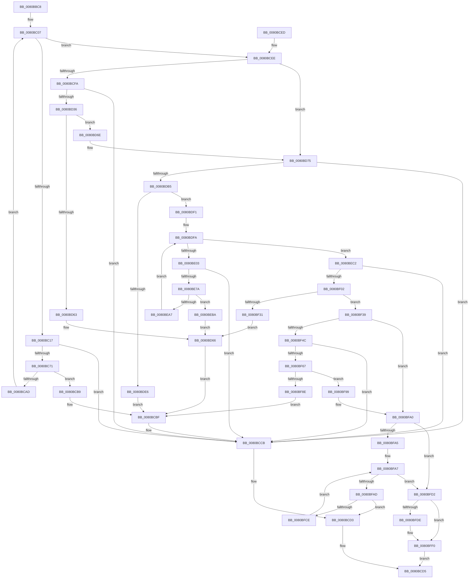

# MiCreatePfnBitMaps

- RVA: `0x0080BBC8`–`0x0080C001` (길이 `1,081` bytes)
- VA: `0x000000014080BBC8`
- 실행 섹션: `PAGE`
- PDB 이름 있음: `예`; PDB Function 태그: `아니요`
- unwind 정보 RVA: `0x000D8D6C`
- 디코드: `269`개 명령, `1,081/1,081` bytes 표시
- 미해석 바이트: `0` (있으면 어셈블리에 `.byte`로 보존)

> 이 문서는 커널 이미지의 기계어와 PDB 기호를 분석해 생성했습니다. 4번과 5번은 함수 원형과 자료형을 바이너리 사용 방식에서 추정한 C 해석이며 원본 소스 복구 결과는 아닙니다.

## 1. Dependencies

- 직접 호출 지점: **16**; 고유 호출 대상: **6**
- 직접 호출자로 확인된 함수: **2**
- RIP 상대 이미지 참조: **4**

### Outgoing calls
- `0x0080BC64` → [MiReservePtes](../../text/31/MiReservePtes_function_00318D20.md) (function, `0x00318D20`)
- `0x0080BCA4` → [MiInitializeDynamicBitmap](../../text/67/MiInitializeDynamicBitmap_function_0067F5BC.md) (function, `0x0067F5BC`)
- `0x0080BCC6` → [MiReleasePtes](../../text/24/MiReleasePtes_function_00247240.md) (function, `0x00247240`)
- `0x0080BCCE` → [MiDeletePfnBitMaps](MiDeletePfnBitMaps_function_0080C008.md) (function, `0x0080C008`)
- `0x0080BD29` → [MiReservePtes](../../text/31/MiReservePtes_function_00318D20.md) (function, `0x00318D20`)
- `0x0080BD5A` → [MiInitializeDynamicBitmap](../../text/67/MiInitializeDynamicBitmap_function_0067F5BC.md) (function, `0x0067F5BC`)
- `0x0080BDA4` → [MiReservePtes](../../text/31/MiReservePtes_function_00318D20.md) (function, `0x00318D20`)
- `0x0080BDDD` → [MiInitializeDynamicBitmap](../../text/67/MiInitializeDynamicBitmap_function_0067F5BC.md) (function, `0x0067F5BC`)
- `0x0080BE69` → [MiReservePtes](../../text/31/MiReservePtes_function_00318D20.md) (function, `0x00318D20`)
- `0x0080BE9E` → [MiInitializeDynamicBitmap](../../text/67/MiInitializeDynamicBitmap_function_0067F5BC.md) (function, `0x0067F5BC`)
- `0x0080BEF1` → [MiReservePtes](../../text/31/MiReservePtes_function_00318D20.md) (function, `0x00318D20`)
- `0x0080BF28` → [MiInitializeDynamicBitmap](../../text/67/MiInitializeDynamicBitmap_function_0067F5BC.md) (function, `0x0067F5BC`)
- `0x0080BF56` → [MiReservePtes](../../text/31/MiReservePtes_function_00318D20.md) (function, `0x00318D20`)
- `0x0080BF85` → [MiInitializeDynamicBitmap](../../text/67/MiInitializeDynamicBitmap_function_0067F5BC.md) (function, `0x0067F5BC`)
- `0x0080BFC1` → [MiSplitPfnBitMaps](MiSplitPfnBitMaps_function_0080C25C.md) (function, `0x0080C25C`)
- `0x0080BFEB` → [MiWalkPagesOnLists](../../text/3B/MiWalkPagesOnLists_function_003B6AA4.md) (function, `0x003B6AA4`)

### Direct callers
- [MmCreatePartition](MmCreatePartition_function_0080DC3C.md) at `0x0080DD58`
- [MiInitializePhysicalMemoryBlocks](../../init/C6/MiInitializePhysicalMemoryBlocks_function_00C60920.md) at `0x00C609FC`

### Static image references
- `0x0080BBDC` → RVA `0x00E2DCE0` (`.data`; read)
- `0x0080BC07` → RVA `0x00000000` (`image boundary/outside`; read)
- `0x0080BC1F` → RVA `0x00E37668` (`.data`; read)
- `0x0080BCEE` → RVA `0x00E38D00` (`.data`; read)

## 2. Other-region calls and transfers

- 다른 실행 섹션으로 향하는 call: **14**
  - `0x0080BC64` → [MiReservePtes](../../text/31/MiReservePtes_function_00318D20.md) (`PAGE` → `.text`)
  - `0x0080BCA4` → [MiInitializeDynamicBitmap](../../text/67/MiInitializeDynamicBitmap_function_0067F5BC.md) (`PAGE` → `.text`)
  - `0x0080BCC6` → [MiReleasePtes](../../text/24/MiReleasePtes_function_00247240.md) (`PAGE` → `.text`)
  - `0x0080BD29` → [MiReservePtes](../../text/31/MiReservePtes_function_00318D20.md) (`PAGE` → `.text`)
  - `0x0080BD5A` → [MiInitializeDynamicBitmap](../../text/67/MiInitializeDynamicBitmap_function_0067F5BC.md) (`PAGE` → `.text`)
  - `0x0080BDA4` → [MiReservePtes](../../text/31/MiReservePtes_function_00318D20.md) (`PAGE` → `.text`)
  - `0x0080BDDD` → [MiInitializeDynamicBitmap](../../text/67/MiInitializeDynamicBitmap_function_0067F5BC.md) (`PAGE` → `.text`)
  - `0x0080BE69` → [MiReservePtes](../../text/31/MiReservePtes_function_00318D20.md) (`PAGE` → `.text`)
  - `0x0080BE9E` → [MiInitializeDynamicBitmap](../../text/67/MiInitializeDynamicBitmap_function_0067F5BC.md) (`PAGE` → `.text`)
  - `0x0080BEF1` → [MiReservePtes](../../text/31/MiReservePtes_function_00318D20.md) (`PAGE` → `.text`)
  - `0x0080BF28` → [MiInitializeDynamicBitmap](../../text/67/MiInitializeDynamicBitmap_function_0067F5BC.md) (`PAGE` → `.text`)
  - `0x0080BF56` → [MiReservePtes](../../text/31/MiReservePtes_function_00318D20.md) (`PAGE` → `.text`)
  - `0x0080BF85` → [MiInitializeDynamicBitmap](../../text/67/MiInitializeDynamicBitmap_function_0067F5BC.md) (`PAGE` → `.text`)
  - `0x0080BFEB` → [MiWalkPagesOnLists](../../text/3B/MiWalkPagesOnLists_function_003B6AA4.md) (`PAGE` → `.text`)
- 별도 외부 분기/꼬리 이동을 확인하지 못했습니다.

## 3. Assembly (complete function range)

```asm
0080BBC8  48 89 5C 24 08                  mov qword ptr [rsp + 8], rbx
0080BBCD  55                              push rbp
0080BBCE  56                              push rsi
0080BBCF  57                              push rdi
0080BBD0  41 54                           push r12
0080BBD2  41 55                           push r13
0080BBD4  41 56                           push r14
0080BBD6  41 57                           push r15
0080BBD8  48 83 EC 50                     sub rsp, 0x50
0080BBDC  48 8B 35 FD 20 62 00            mov rsi, qword ptr [rip + 0x6220fd]
0080BBE3  0F 57 C0                        xorps xmm0, xmm0
0080BBE6  0F 11 44 24 38                  movups xmmword ptr [rsp + 0x38], xmm0
0080BBEB  48 FF C6                        inc rsi
0080BBEE  48 B8 00 00 00 00 80 F6 FF FF   movabs rax, 0xfffff68000000000
0080BBF8  4C 8B E2                        mov r12, rdx
0080BBFB  48 8B D9                        mov rbx, rcx
0080BBFE  33 FF                           xor edi, edi
0080BC00  4C 8B F8                        mov r15, rax
0080BC03  49 C1 E7 19                     shl r15, 0x19
0080BC07  4C 8D 05 F2 43 7F FF            lea r8, [rip - 0x80bc0e]
0080BC0E  83 FF 02                        cmp edi, 2
0080BC11  0F 83 D7 00 00 00               jae 0x14080bcee
0080BC17  33 D2                           xor edx, edx
0080BC19  8B C7                           mov eax, edi
0080BC1B  48 C1 E0 04                     shl rax, 4
0080BC1F  48 8D 0D 42 BA 62 00            lea rcx, [rip + 0x62ba42]
0080BC26  48 05 C8 3F 00 00               add rax, 0x3fc8
0080BC2C  45 33 ED                        xor r13d, r13d
0080BC2F  48 03 C3                        add rax, rbx
0080BC32  48 89 84 24 A0 00 00 00         mov qword ptr [rsp + 0xa0], rax
0080BC3A  48 8B C6                        mov rax, rsi
0080BC3D  49 F7 B4 F8 60 1C 01 00         div qword ptr [r8 + rdi*8 + 0x11c60]
0080BC45  48 85 D2                        test rdx, rdx
0080BC48  41 0F 95 C5                     setne r13b
0080BC4C  4C 03 E8                        add r13, rax
0080BC4F  49 8D 6D 07                     lea rbp, [r13 + 7]
0080BC53  48 C1 ED 03                     shr rbp, 3
0080BC57  48 81 C5 FF 0F 00 00            add rbp, 0xfff
0080BC5E  48 C1 ED 0C                     shr rbp, 0xc
0080BC62  8B D5                           mov edx, ebp
0080BC64  E8 B7 D0 B0 FF                  call 0x140318d20
0080BC69  4C 8B F0                        mov r14, rax
0080BC6C  48 85 C0                        test rax, rax
0080BC6F  74 5A                           je 0x14080bccb
0080BC71  48 B8 00 00 00 00 80 F6 FF FF   movabs rax, 0xfffff68000000000
0080BC7B  48 8B C8                        mov rcx, rax
0080BC7E  48 C1 E1 19                     shl rcx, 0x19
0080BC82  4D 8B C5                        mov r8, r13
0080BC85  4C 8B AC 24 A0 00 00 00         mov r13, qword ptr [rsp + 0xa0]
0080BC8D  49 8B D6                        mov rdx, r14
0080BC90  48 C1 E2 19                     shl rdx, 0x19
0080BC94  41 B9 02 00 00 00               mov r9d, 2
0080BC9A  48 2B D1                        sub rdx, rcx
0080BC9D  49 8B CD                        mov rcx, r13
0080BCA0  48 C1 FA 10                     sar rdx, 0x10
0080BCA4  E8 13 39 E7 FF                  call 0x14067f5bc
0080BCA9  85 C0                           test eax, eax
0080BCAB  74 0C                           je 0x14080bcb9
0080BCAD  49 83 65 00 00                  and qword ptr [r13], 0
0080BCB2  FF C7                           inc edi
0080BCB4  E9 4E FF FF FF                  jmp 0x14080bc07
0080BCB9  44 8B C5                        mov r8d, ebp
0080BCBC  49 8B D6                        mov rdx, r14
0080BCBF  48 8D 0D A2 B9 62 00            lea rcx, [rip + 0x62b9a2]
0080BCC6  E8 75 B5 A3 FF                  call 0x140247240
0080BCCB  48 8B CB                        mov rcx, rbx
0080BCCE  E8 35 03 00 00                  call 0x14080c008
0080BCD3  33 C0                           xor eax, eax
0080BCD5  48 8B 9C 24 90 00 00 00         mov rbx, qword ptr [rsp + 0x90]
0080BCDD  48 83 C4 50                     add rsp, 0x50
0080BCE1  41 5F                           pop r15
0080BCE3  41 5E                           pop r14
0080BCE5  41 5D                           pop r13
0080BCE7  41 5C                           pop r12
0080BCE9  5F                              pop rdi
0080BCEA  5E                              pop rsi
0080BCEB  5D                              pop rbp
0080BCEC  C3                              ret
0080BCED  CC                              int3
0080BCEE  48 8D 05 0B D0 62 00            lea rax, [rip + 0x62d00b]
0080BCF5  48 3B D8                        cmp rbx, rax
0080BCF8  75 7B                           jne 0x14080bd75
0080BCFA  BD 00 00 00 00                  mov ebp, 0
0080BCFF  48 8D 0D 62 B9 62 00            lea rcx, [rip + 0x62b962]
0080BD06  40 F6 C6 0F                     test sil, 0xf
0080BD0A  48 8B C6                        mov rax, rsi
0080BD0D  40 0F 95 C5                     setne bpl
0080BD11  48 C1 E8 04                     shr rax, 4
0080BD15  48 03 E8                        add rbp, rax
0080BD18  48 03 ED                        add rbp, rbp
0080BD1B  4C 8D B5 FF 0F 00 00            lea r14, [rbp + 0xfff]
0080BD22  49 C1 EE 0C                     shr r14, 0xc
0080BD26  41 8B D6                        mov edx, r14d
0080BD29  E8 F2 CF B0 FF                  call 0x140318d20
0080BD2E  4C 8B E8                        mov r13, rax
0080BD31  48 85 C0                        test rax, rax
0080BD34  74 95                           je 0x14080bccb
0080BD36  48 8B F8                        mov rdi, rax
0080BD39  4C 8D 04 ED 00 00 00 00         lea r8, [rbp*8]
0080BD41  48 C1 E7 19                     shl rdi, 0x19
0080BD45  48 8D 4C 24 38                  lea rcx, [rsp + 0x38]
0080BD4A  49 2B FF                        sub rdi, r15
0080BD4D  41 B9 02 00 00 00               mov r9d, 2
0080BD53  48 C1 FF 10                     sar rdi, 0x10
0080BD57  48 8B D7                        mov rdx, rdi
0080BD5A  E8 5D 38 E7 FF                  call 0x14067f5bc
0080BD5F  85 C0                           test eax, eax
0080BD61  75 0B                           jne 0x14080bd6e
0080BD63  45 8B C6                        mov r8d, r14d
0080BD66  49 8B D5                        mov rdx, r13
0080BD69  E9 51 FF FF FF                  jmp 0x14080bcbf
0080BD6E  48 89 BB F8 3F 00 00            mov qword ptr [rbx + 0x3ff8], rdi
0080BD75  B9 00 00 00 00                  mov ecx, 0
0080BD7A  48 F7 C6 FF 01 00 00            test rsi, 0x1ff
0080BD81  4C 8B EE                        mov r13, rsi
0080BD84  0F 95 C1                        setne cl
0080BD87  49 C1 ED 09                     shr r13, 9
0080BD8B  4C 03 E9                        add r13, rcx
0080BD8E  48 8D 0D D3 B8 62 00            lea rcx, [rip + 0x62b8d3]
0080BD95  4E 8D 34 6D FF 0F 00 00         lea r14, [r13*2 + 0xfff]
0080BD9D  49 C1 EE 0C                     shr r14, 0xc
0080BDA1  41 8B D6                        mov edx, r14d
0080BDA4  E8 77 CF B0 FF                  call 0x140318d20
0080BDA9  48 8B E8                        mov rbp, rax
0080BDAC  48 85 C0                        test rax, rax
0080BDAF  0F 84 16 FF FF FF               je 0x14080bccb
0080BDB5  48 8B F8                        mov rdi, rax
0080BDB8  49 C1 E5 04                     shl r13, 4
0080BDBC  48 C1 E7 19                     shl rdi, 0x19
0080BDC0  48 8D 4C 24 38                  lea rcx, [rsp + 0x38]
0080BDC5  49 2B FF                        sub rdi, r15
0080BDC8  4C 89 6C 24 30                  mov qword ptr [rsp + 0x30], r13
0080BDCD  48 C1 FF 10                     sar rdi, 0x10
0080BDD1  41 B9 02 00 00 00               mov r9d, 2
0080BDD7  48 8B D7                        mov rdx, rdi
0080BDDA  4D 8B C5                        mov r8, r13
0080BDDD  E8 DA 37 E7 FF                  call 0x14067f5bc
0080BDE2  85 C0                           test eax, eax
0080BDE4  75 0B                           jne 0x14080bdf1
0080BDE6  45 8B C6                        mov r8d, r14d
0080BDE9  48 8B D5                        mov rdx, rbp
0080BDEC  E9 CE FE FF FF                  jmp 0x14080bcbf
0080BDF1  48 89 BB 00 40 00 00            mov qword ptr [rbx + 0x4000], rdi
0080BDF8  33 FF                           xor edi, edi
0080BDFA  83 FF 03                        cmp edi, 3
0080BDFD  0F 83 BF 00 00 00               jae 0x14080bec2
0080BE03  33 D2                           xor edx, edx
0080BE05  8B C7                           mov eax, edi
0080BE07  48 C1 E0 04                     shl rax, 4
0080BE0B  41 B8 01 00 00 00               mov r8d, 1
0080BE11  48 05 08 40 00 00               add rax, 0x4008
0080BE17  48 03 C3                        add rax, rbx
0080BE1A  48 89 84 24 A0 00 00 00         mov qword ptr [rsp + 0xa0], rax
0080BE22  48 8D 05 D7 41 7F FF            lea rax, [rip - 0x80be29]
0080BE29  48 8B 8C F8 28 11 01 00         mov rcx, qword ptr [rax + rdi*8 + 0x11128]
0080BE31  48 8B C6                        mov rax, rsi
0080BE34  49 D3 E0                        shl r8, cl
0080BE37  33 C9                           xor ecx, ecx
0080BE39  49 F7 F0                        div r8
0080BE3C  48 85 D2                        test rdx, rdx
0080BE3F  0F 95 C1                        setne cl
0080BE42  48 03 C8                        add rcx, rax
0080BE45  48 89 8C 24 A8 00 00 00         mov qword ptr [rsp + 0xa8], rcx
0080BE4D  48 8D 69 07                     lea rbp, [rcx + 7]
0080BE51  48 C1 ED 03                     shr rbp, 3
0080BE55  48 8D 0D 0C B8 62 00            lea rcx, [rip + 0x62b80c]
0080BE5C  48 81 C5 FF 0F 00 00            add rbp, 0xfff
0080BE63  48 C1 ED 0C                     shr rbp, 0xc
0080BE67  8B D5                           mov edx, ebp
0080BE69  E8 B2 CE B0 FF                  call 0x140318d20
0080BE6E  4C 8B E8                        mov r13, rax
0080BE71  48 85 C0                        test rax, rax
0080BE74  0F 84 51 FE FF FF               je 0x14080bccb
0080BE7A  4C 8B 84 24 A8 00 00 00         mov r8, qword ptr [rsp + 0xa8]
0080BE82  48 8B D0                        mov rdx, rax
0080BE85  48 8B 8C 24 A0 00 00 00         mov rcx, qword ptr [rsp + 0xa0]
0080BE8D  41 B9 02 00 00 00               mov r9d, 2
0080BE93  48 C1 E2 19                     shl rdx, 0x19
0080BE97  49 2B D7                        sub rdx, r15
0080BE9A  48 C1 FA 10                     sar rdx, 0x10
0080BE9E  E8 19 37 E7 FF                  call 0x14067f5bc
0080BEA3  85 C0                           test eax, eax
0080BEA5  74 13                           je 0x14080beba
0080BEA7  48 8B 84 24 A0 00 00 00         mov rax, qword ptr [rsp + 0xa0]
0080BEAF  48 83 20 00                     and qword ptr [rax], 0
0080BEB3  FF C7                           inc edi
0080BEB5  E9 40 FF FF FF                  jmp 0x14080bdfa
0080BEBA  44 8B C5                        mov r8d, ebp
0080BEBD  E9 A4 FE FF FF                  jmp 0x14080bd66
0080BEC2  48 F7 C6 FF FF 03 00            test rsi, 0x3ffff
0080BEC9  48 8D 0D 98 B7 62 00            lea rcx, [rip + 0x62b798]
0080BED0  BD 00 00 00 00                  mov ebp, 0
0080BED5  40 0F 95 C5                     setne bpl
0080BED9  48 C1 EE 12                     shr rsi, 0x12
0080BEDD  48 03 EE                        add rbp, rsi
0080BEE0  48 C1 E5 02                     shl rbp, 2
0080BEE4  48 8D B5 FF 0F 00 00            lea rsi, [rbp + 0xfff]
0080BEEB  48 C1 EE 0C                     shr rsi, 0xc
0080BEEF  8B D6                           mov edx, esi
0080BEF1  E8 2A CE B0 FF                  call 0x140318d20
0080BEF6  4C 8B E8                        mov r13, rax
0080BEF9  48 85 C0                        test rax, rax
0080BEFC  0F 84 C9 FD FF FF               je 0x14080bccb
0080BF02  48 8B F8                        mov rdi, rax
0080BF05  4C 8D 04 ED 00 00 00 00         lea r8, [rbp*8]
0080BF0D  48 C1 E7 19                     shl rdi, 0x19
0080BF11  48 8D 4C 24 38                  lea rcx, [rsp + 0x38]
0080BF16  49 2B FF                        sub rdi, r15
0080BF19  BD 02 00 00 00                  mov ebp, 2
0080BF1E  48 C1 FF 10                     sar rdi, 0x10
0080BF22  44 8B CD                        mov r9d, ebp
0080BF25  48 8B D7                        mov rdx, rdi
0080BF28  E8 8F 36 E7 FF                  call 0x14067f5bc
0080BF2D  85 C0                           test eax, eax
0080BF2F  75 08                           jne 0x14080bf39
0080BF31  44 8B C6                        mov r8d, esi
0080BF34  E9 2D FE FF FF                  jmp 0x14080bd66
0080BF39  48 8D 05 C0 CD 62 00            lea rax, [rip + 0x62cdc0]
0080BF40  48 89 BB 38 40 00 00            mov qword ptr [rbx + 0x4038], rdi
0080BF47  48 3B D8                        cmp rbx, rax
0080BF4A  75 54                           jne 0x14080bfa0
0080BF4C  41 8B D6                        mov edx, r14d
0080BF4F  48 8D 0D 12 B7 62 00            lea rcx, [rip + 0x62b712]
0080BF56  E8 C5 CD B0 FF                  call 0x140318d20
0080BF5B  48 8B F0                        mov rsi, rax
0080BF5E  48 85 C0                        test rax, rax
0080BF61  0F 84 64 FD FF FF               je 0x14080bccb
0080BF67  4C 8B 44 24 30                  mov r8, qword ptr [rsp + 0x30]
0080BF6C  48 8D 4C 24 38                  lea rcx, [rsp + 0x38]
0080BF71  48 8B F8                        mov rdi, rax
0080BF74  44 8B CD                        mov r9d, ebp
0080BF77  48 C1 E7 19                     shl rdi, 0x19
0080BF7B  49 2B FF                        sub rdi, r15
0080BF7E  48 C1 FF 10                     sar rdi, 0x10
0080BF82  48 8B D7                        mov rdx, rdi
0080BF85  E8 32 36 E7 FF                  call 0x14067f5bc
0080BF8A  85 C0                           test eax, eax
0080BF8C  75 0B                           jne 0x14080bf99
0080BF8E  45 8B C6                        mov r8d, r14d
0080BF91  48 8B D6                        mov rdx, rsi
0080BF94  E9 26 FD FF FF                  jmp 0x14080bcbf
0080BF99  48 89 BB 40 45 00 00            mov qword ptr [rbx + 0x4540], rdi
0080BFA0  4D 85 E4                        test r12, r12
0080BFA3  74 2D                           je 0x14080bfd2
0080BFA5  33 FF                           xor edi, edi
0080BFA7  41 3B 3C 24                     cmp edi, dword ptr [r12]
0080BFAB  73 25                           jae 0x14080bfd2
0080BFAD  8B D7                           mov edx, edi
0080BFAF  48 8B CB                        mov rcx, rbx
0080BFB2  48 FF C2                        inc rdx
0080BFB5  48 03 D2                        add rdx, rdx
0080BFB8  4D 8B 44 D4 08                  mov r8, qword ptr [r12 + rdx*8 + 8]
0080BFBD  49 8B 14 D4                     mov rdx, qword ptr [r12 + rdx*8]
0080BFC1  E8 96 02 00 00                  call 0x14080c25c
0080BFC6  85 C0                           test eax, eax
0080BFC8  0F 84 05 FD FF FF               je 0x14080bcd3
0080BFCE  FF C7                           inc edi
0080BFD0  EB D5                           jmp 0x14080bfa7
0080BFD2  C6 83 E6 3E 00 00 01            mov byte ptr [rbx + 0x3ee6], 1
0080BFD9  4D 85 E4                        test r12, r12
0080BFDC  74 12                           je 0x14080bff0
0080BFDE  83 64 24 20 00                  and dword ptr [rsp + 0x20], 0
0080BFE3  45 33 C0                        xor r8d, r8d
0080BFE6  48 8B D3                        mov rdx, rbx
0080BFE9  33 C9                           xor ecx, ecx
0080BFEB  E8 B4 AA BA FF                  call 0x1403b6aa4
0080BFF0  40 88 AB E6 3E 00 00            mov byte ptr [rbx + 0x3ee6], bpl
0080BFF7  B8 01 00 00 00                  mov eax, 1
0080BFFC  E9 D4 FC FF FF                  jmp 0x14080bcd5
```

## 4. C-style interpretation (structured pseudocode)

```c
__int64 __fastcall MiCreatePfnBitMaps(__int64 a1, __int64 a2)
{
    __int64 result;
    __int64 v_r13;
    __int64 v_r14;
    __int64 v_r15;
    __int64 v_rbp;
    __int64 v_rdi;
    __int64 v_rsi;
    __int64 v_rsp;
    unsigned __int64 v_stack_m50;
    unsigned __int64 v_stack_p18;
    unsigned int v_stack_p20;
    unsigned __int64 v_stack_p30;
    unsigned __int64 v_stack_p38;
    unsigned __int64 v_stack_p8;
    unsigned __int64 v_stack_pA0;
    unsigned __int64 v_stack_pA8;

    v_stack_p8 = v_rbx;
    v_rsp = (v_rsp) - (80);
    v_stack_m50 = v_xmm0;
    v_rsi = (*(unsigned __int64 *)(v_rip + 6430973)) + 1;
    v_rdi = 0;
    v_r15 = (result) << (25);
loc_0080BC07:
    if (0 >= 2) goto loc_0080BCEE;
    a2 = 0;
    result = (0) << (4);
    result = (result) + (0x3FC8ULL);
    v_r13 = 0;
    result = (result) + (a1);
    v_stack_p18 = result;
    v_r13 = (0 != 0) ? 1 : 0;
    v_r13 = (v_r13) + (v_rsi);
    v_rbp = (v_r13 + 7) >> (3);
    v_rbp = (v_rbp) + (0xFFFULL);
    v_rbp = (v_rbp) >> (12);
    result = MiReservePtes(v_rip + 6470210, (unsigned int)((unsigned int)(v_rbp)), v_rip - 8436750, a4);
    if (result == 0) goto loc_0080BCCB;
    a1 = (result) << (25);
    a2 = (result) << (25);
    a2 = (a2) - (a1);
    a2 = (a2) >> (16);
    result = MiInitializeDynamicBitmap(v_stack_p18, a2, v_r13, 2);
    if ((unsigned int)(result) == 0) goto loc_0080BCB9;
    v_rdi = (unsigned int)((v_rdi) + 1);
    goto loc_0080BC07;
loc_0080BCB9:
loc_0080BCBF:
    result = MiReleasePtes(v_rip + 6470050, result, (unsigned int)((unsigned int)(v_rbp)), 2);
loc_0080BCCB:
    result = MiDeletePfnBitMaps(a1, result, (unsigned int)((unsigned int)(v_rbp)), 2);
loc_0080BCD3:
    result = 0;
loc_0080BCD5:
    v_rsp = (v_rsp) + (80);
    return result;
loc_0080BCEE:
    if (v_stack_p8 != (v_rip + 6475787)) goto loc_0080BD75;
    v_rbp = ((((unsigned __int8)(v_rsi)) & (15)) != 0) ? 1 : 0;
    result = (v_rsi) >> (4);
    v_rbp = (v_rbp) + (result);
    v_rbp = (v_rbp) + (v_rbp);
    v_r14 = (v_rbp + 4095) >> (12);
    result = MiReservePtes(v_rip + 6469986, (unsigned int)((unsigned int)(v_r14)), (unsigned int)((unsigned int)(v_rbp)), 2);
    if (result == 0) goto loc_0080BCCB;
    v_rdi = (result) << (25);
    v_rdi = (v_rdi) - (v_r15);
    v_rdi = (v_rdi) >> (16);
    result = MiInitializeDynamicBitmap(v_stack_p38, v_rdi, v_rbp * 8, 2);
    if ((unsigned int)(result) != 0) goto loc_0080BD6E;
loc_0080BD66:
    goto loc_0080BCBF;
loc_0080BD6E:
    *(unsigned __int64 *)(v_stack_p8 + 16376) = v_rdi;
loc_0080BD75:
    a1 = (((v_rsi) & (511)) != 0) ? 1 : 0;
    v_r13 = (v_rsi) >> (9);
    v_r13 = (v_r13) + (a1);
    v_r14 = (v_r13 * 2 + 4095) >> (12);
    result = MiReservePtes(v_rip + 6469843, (unsigned int)((unsigned int)(v_r14)), (unsigned int)((unsigned int)(v_r14)), 2);
    if (result == 0) goto loc_0080BCCB;
    v_r13 = (v_r13) << (4);
    v_rdi = (result) << (25);
    v_rdi = (v_rdi) - (v_r15);
    v_stack_p30 = v_r13;
    v_rdi = (v_rdi) >> (16);
    result = MiInitializeDynamicBitmap(v_stack_p38, v_rdi, v_r13, 2);
    if ((unsigned int)(result) != 0) goto loc_0080BDF1;
    goto loc_0080BCBF;
loc_0080BDF1:
    *(unsigned __int64 *)(v_stack_p8 + 16384) = v_rdi;
    v_rdi = 0;
loc_0080BDFA:
    if (0 >= 3) goto loc_0080BEC2;
    a2 = 0;
    result = (0) << (4);
    result = (result) + (0x4008ULL);
    result = (result) + (v_stack_p8);
    v_stack_pA0 = result;
    a3 = (1) << ((unsigned __int8)(*(unsigned __int64 *)(v_rip - 8437289 + v_rdi * 8 + 69928)));
    a1 = 0;
    a1 = (0 != 0) ? 1 : 0;
    a1 = (a1) + (v_rsi);
    v_stack_pA8 = a1;
    v_rbp = (a1 + 7) >> (3);
    v_rbp = (v_rbp) + (0xFFFULL);
    v_rbp = (v_rbp) >> (12);
    result = MiReservePtes(v_rip + 6469644, (unsigned int)((unsigned int)(v_rbp)), a3, 2);
    if (result == 0) goto loc_0080BCCB;
    a2 = (result) << (25);
    a2 = (a2) - (v_r15);
    a2 = (a2) >> (16);
    result = MiInitializeDynamicBitmap(v_stack_pA0, a2, v_stack_pA8, 2);
    if ((unsigned int)(result) == 0) goto loc_0080BEBA;
    v_rdi = (unsigned int)((v_rdi) + 1);
    goto loc_0080BDFA;
loc_0080BEBA:
    goto loc_0080BD66;
loc_0080BEC2:
    v_rbp = (((v_rsi) & (0x3FFFFULL)) != 0) ? 1 : 0;
    v_rsi = (v_rsi) >> (18);
    v_rbp = (v_rbp) + (v_rsi);
    v_rbp = (v_rbp) << (2);
    v_rsi = (v_rbp + 4095) >> (12);
    result = MiReservePtes(v_rip + 6469528, (unsigned int)((unsigned int)(v_rsi)), (unsigned int)((unsigned int)(v_rbp)), 2);
    if (result == 0) goto loc_0080BCCB;
    v_rdi = (result) << (25);
    v_rdi = (v_rdi) - (v_r15);
    v_rdi = (v_rdi) >> (16);
    result = MiInitializeDynamicBitmap(v_stack_p38, v_rdi, v_rbp * 8, 2);
    if ((unsigned int)(result) != 0) goto loc_0080BF39;
    goto loc_0080BD66;
loc_0080BF39:
    *(unsigned __int64 *)(v_stack_p8 + 16440) = v_rdi;
    if (v_stack_p8 != (v_rip + 6475200)) goto loc_0080BFA0;
    result = MiReservePtes(v_rip + 6469394, (unsigned int)((unsigned int)(v_r14)), (unsigned int)((unsigned int)(v_rsi)), 2);
    if (result == 0) goto loc_0080BCCB;
    v_rdi = (result) << (25);
    v_rdi = (v_rdi) - (v_r15);
    v_rdi = (v_rdi) >> (16);
    result = MiInitializeDynamicBitmap(v_stack_p38, v_rdi, v_stack_p30, 2);
    if ((unsigned int)(result) != 0) goto loc_0080BF99;
    goto loc_0080BCBF;
loc_0080BF99:
    *(unsigned __int64 *)(v_stack_p8 + 17728) = v_rdi;
loc_0080BFA0:
    if (a2 == 0) goto loc_0080BFD2;
    v_rdi = 0;
loc_0080BFA7:
    if (0 >= (*(unsigned int *)(a2))) goto loc_0080BFD2;
    a2 = (0) + 1;
    a2 = (a2) + (a2);
    result = MiSplitPfnBitMaps(v_stack_p8, *(unsigned __int64 *)(a2 + a2 * 8), *(unsigned __int64 *)(a2 + a2 * 8 + 8), 2);
    if ((unsigned int)(result) == 0) goto loc_0080BCD3;
    v_rdi = (unsigned int)((v_rdi) + 1);
    goto loc_0080BFA7;
loc_0080BFD2:
    *(unsigned __int8 *)(v_stack_p8 + 16102) = 1;
    if (a2 != 0) {
        a3 = 0;
        a2 = v_stack_p8;
        a1 = 0;
        result = MiWalkPagesOnLists(a1, a2, a3, 2);
    }
    *(unsigned __int8 *)(v_stack_p8 + 16102) = 2;
    goto loc_0080BCD5;
}
```

## 5. (Beta) C Style

```c
int64_t MiCreatePfnBitMaps(int64_t Arg1, int64_t Arg2)
{
    int64_t result;
    int64_t local_r13;
    int64_t local_r14;
    int64_t local_r15;
    int64_t local_rbp;
    int64_t local_rdi;
    int64_t local_rsi;
    int64_t local_rsp;
    uint64_t v_stack_m50;
    uint64_t v_stack_p18;
    uint32_t v_stack_p20;
    uint64_t v_stack_p30;
    uint64_t v_stack_p38;
    uint64_t v_stack_p8;
    uint64_t v_stack_pA0;
    uint64_t v_stack_pA8;

    v_stack_p8 = local_rbx;
    local_rsp = (local_rsp) - (80);
    v_stack_m50 = v_xmm0;
    local_rsi = (*(uint64_t *)(v_rip + 0x6220FD)) + 1;
    local_rdi = 0;
    local_r15 = (result) << (25);
loc_0080BC07:
    if (0 >= 2) goto loc_0080BCEE;
    Arg2 = 0;
    result = (0) << (4);
    result = (result) + (0x3FC8ULL);
    local_r13 = 0;
    result = (result) + (Arg1);
    v_stack_p18 = result;
    local_r13 = (0 != 0) ? 1 : 0;
    local_r13 = (local_r13) + (local_rsi);
    local_rbp = (local_r13 + 7) >> (3);
    local_rbp = (local_rbp) + (0xFFFULL);
    local_rbp = (local_rbp) >> (12);
    result = MiReservePtes(v_rip + 6470210, (uint32_t)((uint32_t)(local_rbp)), v_rip - 8436750, a4);
    if (result == 0) goto loc_0080BCCB;
    Arg1 = (result) << (25);
    Arg2 = (result) << (25);
    Arg2 = (Arg2) - (Arg1);
    Arg2 = (Arg2) >> (16);
    result = MiInitializeDynamicBitmap(v_stack_p18, Arg2, local_r13, 2);
    if ((uint32_t)(result) == 0) goto loc_0080BCB9;
    local_rdi = (uint32_t)((local_rdi) + 1);
    goto loc_0080BC07;
loc_0080BCB9:
loc_0080BCBF:
    result = MiReleasePtes(v_rip + 6470050, result, (uint32_t)((uint32_t)(local_rbp)), 2);
loc_0080BCCB:
    result = MiDeletePfnBitMaps(Arg1, result, (uint32_t)((uint32_t)(local_rbp)), 2);
loc_0080BCD3:
    result = 0;
loc_0080BCD5:
    local_rsp = (local_rsp) + (80);
    return result;
loc_0080BCEE:
    if (v_stack_p8 != (v_rip + 6475787)) goto loc_0080BD75;
    local_rbp = ((((uint8_t)(local_rsi)) & (15)) != 0) ? 1 : 0;
    result = (local_rsi) >> (4);
    local_rbp = (local_rbp) + (result);
    local_rbp = (local_rbp) + (local_rbp);
    local_r14 = (local_rbp + 4095) >> (12);
    result = MiReservePtes(v_rip + 6469986, (uint32_t)((uint32_t)(local_r14)), (uint32_t)((uint32_t)(local_rbp)), 2);
    if (result == 0) goto loc_0080BCCB;
    local_rdi = (result) << (25);
    local_rdi = (local_rdi) - (local_r15);
    local_rdi = (local_rdi) >> (16);
    result = MiInitializeDynamicBitmap(v_stack_p38, local_rdi, local_rbp * 8, 2);
    if ((uint32_t)(result) != 0) goto loc_0080BD6E;
loc_0080BD66:
    goto loc_0080BCBF;
loc_0080BD6E:
    *(uint64_t *)(v_stack_p8 + 0x3FF8) = local_rdi;
loc_0080BD75:
    Arg1 = (((local_rsi) & (511)) != 0) ? 1 : 0;
    local_r13 = (local_rsi) >> (9);
    local_r13 = (local_r13) + (Arg1);
    local_r14 = (local_r13 * 2 + 4095) >> (12);
    result = MiReservePtes(v_rip + 6469843, (uint32_t)((uint32_t)(local_r14)), (uint32_t)((uint32_t)(local_r14)), 2);
    if (result == 0) goto loc_0080BCCB;
    local_r13 = (local_r13) << (4);
    local_rdi = (result) << (25);
    local_rdi = (local_rdi) - (local_r15);
    v_stack_p30 = local_r13;
    local_rdi = (local_rdi) >> (16);
    result = MiInitializeDynamicBitmap(v_stack_p38, local_rdi, local_r13, 2);
    if ((uint32_t)(result) != 0) goto loc_0080BDF1;
    goto loc_0080BCBF;
loc_0080BDF1:
    *(uint64_t *)(v_stack_p8 + 0x4000) = local_rdi;
    local_rdi = 0;
loc_0080BDFA:
    if (0 >= 3) goto loc_0080BEC2;
    Arg2 = 0;
    result = (0) << (4);
    result = (result) + (0x4008ULL);
    result = (result) + (v_stack_p8);
    v_stack_pA0 = result;
    a3 = (1) << ((uint8_t)(*(uint64_t *)(v_rip - 0x80BE29 + local_rdi * 8 + 0x11128)));
    Arg1 = 0;
    Arg1 = (0 != 0) ? 1 : 0;
    Arg1 = (Arg1) + (local_rsi);
    v_stack_pA8 = Arg1;
    local_rbp = (Arg1 + 7) >> (3);
    local_rbp = (local_rbp) + (0xFFFULL);
    local_rbp = (local_rbp) >> (12);
    result = MiReservePtes(v_rip + 6469644, (uint32_t)((uint32_t)(local_rbp)), a3, 2);
    if (result == 0) goto loc_0080BCCB;
    Arg2 = (result) << (25);
    Arg2 = (Arg2) - (local_r15);
    Arg2 = (Arg2) >> (16);
    result = MiInitializeDynamicBitmap(v_stack_pA0, Arg2, v_stack_pA8, 2);
    if ((uint32_t)(result) == 0) goto loc_0080BEBA;
    local_rdi = (uint32_t)((local_rdi) + 1);
    goto loc_0080BDFA;
loc_0080BEBA:
    goto loc_0080BD66;
loc_0080BEC2:
    local_rbp = (((local_rsi) & (0x3FFFFULL)) != 0) ? 1 : 0;
    local_rsi = (local_rsi) >> (18);
    local_rbp = (local_rbp) + (local_rsi);
    local_rbp = (local_rbp) << (2);
    local_rsi = (local_rbp + 4095) >> (12);
    result = MiReservePtes(v_rip + 6469528, (uint32_t)((uint32_t)(local_rsi)), (uint32_t)((uint32_t)(local_rbp)), 2);
    if (result == 0) goto loc_0080BCCB;
    local_rdi = (result) << (25);
    local_rdi = (local_rdi) - (local_r15);
    local_rdi = (local_rdi) >> (16);
    result = MiInitializeDynamicBitmap(v_stack_p38, local_rdi, local_rbp * 8, 2);
    if ((uint32_t)(result) != 0) goto loc_0080BF39;
    goto loc_0080BD66;
loc_0080BF39:
    *(uint64_t *)(v_stack_p8 + 0x4038) = local_rdi;
    if (v_stack_p8 != (v_rip + 6475200)) goto loc_0080BFA0;
    result = MiReservePtes(v_rip + 6469394, (uint32_t)((uint32_t)(local_r14)), (uint32_t)((uint32_t)(local_rsi)), 2);
    if (result == 0) goto loc_0080BCCB;
    local_rdi = (result) << (25);
    local_rdi = (local_rdi) - (local_r15);
    local_rdi = (local_rdi) >> (16);
    result = MiInitializeDynamicBitmap(v_stack_p38, local_rdi, v_stack_p30, 2);
    if ((uint32_t)(result) != 0) goto loc_0080BF99;
    goto loc_0080BCBF;
loc_0080BF99:
    *(uint64_t *)(v_stack_p8 + 0x4540) = local_rdi;
loc_0080BFA0:
    if (Arg2 == 0) goto loc_0080BFD2;
    local_rdi = 0;
loc_0080BFA7:
    if (0 >= (*(uint32_t *)(Arg2))) goto loc_0080BFD2;
    Arg2 = (0) + 1;
    Arg2 = (Arg2) + (Arg2);
    result = MiSplitPfnBitMaps(v_stack_p8, *(uint64_t *)(Arg2 + Arg2 * 8), *(uint64_t *)(Arg2 + Arg2 * 8 + 0x8), 2);
    if ((uint32_t)(result) == 0) goto loc_0080BCD3;
    local_rdi = (uint32_t)((local_rdi) + 1);
    goto loc_0080BFA7;
loc_0080BFD2:
    *(uint8_t *)(v_stack_p8 + 0x3EE6) = 1;
    if (Arg2 != 0) {
        a3 = 0;
        Arg2 = v_stack_p8;
        Arg1 = 0;
        result = MiWalkPagesOnLists(Arg1, Arg2, a3, 2);
    }
    *(uint8_t *)(v_stack_p8 + 0x3EE6) = 2;
    goto loc_0080BCD5;
}
```

## 6. Execution-region graph

[열기: 2D/3D 그래프와 함수 탐색 컨트롤 패널](../../../control-panel.html?section=page&rva=0x0080BBC8&view=graph)

- 2D 그래프는 위에서 아래로 흐르고, 3D 그래프는 빈 공간을 드래그해 회전합니다. Shift+드래그는 이동, 휠은 확대·축소, 함수 노드 선택은 대상 보고서 이동입니다.

### Static fallback


