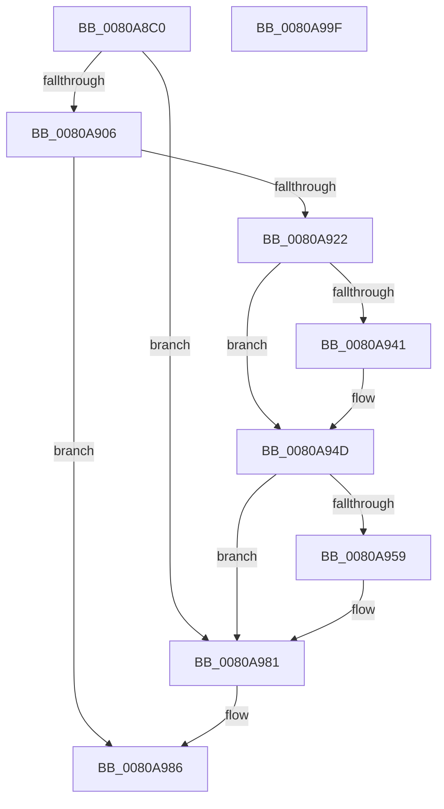

# MiCreateProcessDefaultAweInfo

- RVA: `0x0080A8C0`–`0x0080A9A0` (길이 `224` bytes)
- VA: `0x000000014080A8C0`
- 실행 섹션: `PAGE`
- PDB 이름 있음: `예`; PDB Function 태그: `아니요`
- unwind 정보 RVA: `0x000BD20C`
- 디코드: `56`개 명령, `224/224` bytes 표시
- 미해석 바이트: `0` (있으면 어셈블리에 `.byte`로 보존)

> 이 문서는 커널 이미지의 기계어와 PDB 기호를 분석해 생성했습니다. 4번과 5번은 함수 원형과 자료형을 바이너리 사용 방식에서 추정한 C 해석이며 원본 소스 복구 결과는 아닙니다.

## 1. Dependencies

- 직접 호출 지점: **4**; 고유 호출 대상: **4**
- 직접 호출자로 확인된 함수: **2**
- RIP 상대 이미지 참조: **0**

### Outgoing calls
- `0x0080A919` → [MiAllocateAweInfo](MiAllocateAweInfo_function_00809518.md) (function, `0x00809518`)
- `0x0080A927` → [MiLockAweVadsExclusive](../../text/4B/MiLockAweVadsExclusive_function_004BDEE4.md) (function, `0x004BDEE4`)
- `0x0080A950` → [MiUnlockAweVadsExclusive](../../text/4B/MiUnlockAweVadsExclusive_function_004BDF1C.md) (function, `0x004BDF1C`)
- `0x0080A96E` → [MiDeleteAweInfo](MiDeleteAweInfo_function_0080A9F8.md) (function, `0x0080A9F8`)

### Direct callers
- [MiAllocateUserPhysicalPages](MiAllocateUserPhysicalPages_function_00809828.md) at `0x00809B22`
- [MiCreateUserPhysicalView](../AD/MiCreateUserPhysicalView_function_00ADA4B4.md) at `0x00ADA644`

### Static image references
- 디코드된 RIP-relative 메모리 참조가 없습니다.

## 2. Other-region calls and transfers

- 다른 실행 섹션으로 향하는 call: **2**
  - `0x0080A927` → [MiLockAweVadsExclusive](../../text/4B/MiLockAweVadsExclusive_function_004BDEE4.md) (`PAGE` → `.text`)
  - `0x0080A950` → [MiUnlockAweVadsExclusive](../../text/4B/MiUnlockAweVadsExclusive_function_004BDF1C.md) (`PAGE` → `.text`)
- 별도 외부 분기/꼬리 이동을 확인하지 못했습니다.

## 3. Assembly (complete function range)

```asm
0080A8C0  4C 8B DC                        mov r11, rsp
0080A8C3  49 89 5B 08                     mov qword ptr [r11 + 8], rbx
0080A8C7  49 89 6B 18                     mov qword ptr [r11 + 0x18], rbp
0080A8CB  49 89 73 20                     mov qword ptr [r11 + 0x20], rsi
0080A8CF  57                              push rdi
0080A8D0  41 56                           push r14
0080A8D2  41 57                           push r15
0080A8D4  48 83 EC 30                     sub rsp, 0x30
0080A8D8  48 83 22 00                     and qword ptr [rdx], 0
0080A8DC  4C 8B F2                        mov r14, rdx
0080A8DF  65 48 8B 34 25 88 01 00 00      mov rsi, qword ptr gs:[0x188]
0080A8E8  48 8B AE B8 00 00 00            mov rbp, qword ptr [rsi + 0xb8]
0080A8EF  4C 8B BD 10 04 00 00            mov r15, qword ptr [rbp + 0x410]
0080A8F6  49 8B 9F 48 04 00 00            mov rbx, qword ptr [r15 + 0x448]
0080A8FD  49 89 5B 10                     mov qword ptr [r11 + 0x10], rbx
0080A901  48 85 DB                        test rbx, rbx
0080A904  75 7B                           jne 0x14080a981
0080A906  49 8D 43 10                     lea rax, [r11 + 0x10]
0080A90A  44 8A C9                        mov r9b, cl
0080A90D  33 C9                           xor ecx, ecx
0080A90F  49 89 43 D8                     mov qword ptr [r11 - 0x28], rax
0080A913  45 33 C0                        xor r8d, r8d
0080A916  8D 53 01                        lea edx, [rbx + 1]
0080A919  E8 FA EB FF FF                  call 0x140809518
0080A91E  85 C0                           test eax, eax
0080A920  78 64                           js 0x14080a986
0080A922  48 8B CE                        mov rcx, rsi
0080A925  33 FF                           xor edi, edi
0080A927  E8 B8 35 CB FF                  call 0x1404bdee4
0080A92C  48 8B 85 10 04 00 00            mov rax, qword ptr [rbp + 0x410]
0080A933  48 8B 5C 24 58                  mov rbx, qword ptr [rsp + 0x58]
0080A938  48 39 B8 48 04 00 00            cmp qword ptr [rax + 0x448], rdi
0080A93F  75 0C                           jne 0x14080a94d
0080A941  49 89 9F 48 04 00 00            mov qword ptr [r15 + 0x448], rbx
0080A948  BF 01 00 00 00                  mov edi, 1
0080A94D  48 8B CE                        mov rcx, rsi
0080A950  E8 C7 35 CB FF                  call 0x1404bdf1c
0080A955  85 FF                           test edi, edi
0080A957  75 28                           jne 0x14080a981
0080A959  65 48 8B 0C 25 88 01 00 00      mov rcx, qword ptr gs:[0x188]
0080A962  48 8B 54 24 58                  mov rdx, qword ptr [rsp + 0x58]
0080A967  48 8B 89 B8 00 00 00            mov rcx, qword ptr [rcx + 0xb8]
0080A96E  E8 85 00 00 00                  call 0x14080a9f8
0080A973  48 8B 85 10 04 00 00            mov rax, qword ptr [rbp + 0x410]
0080A97A  48 8B 98 48 04 00 00            mov rbx, qword ptr [rax + 0x448]
0080A981  49 89 1E                        mov qword ptr [r14], rbx
0080A984  33 C0                           xor eax, eax
0080A986  48 8B 5C 24 50                  mov rbx, qword ptr [rsp + 0x50]
0080A98B  48 8B 6C 24 60                  mov rbp, qword ptr [rsp + 0x60]
0080A990  48 8B 74 24 68                  mov rsi, qword ptr [rsp + 0x68]
0080A995  48 83 C4 30                     add rsp, 0x30
0080A999  41 5F                           pop r15
0080A99B  41 5E                           pop r14
0080A99D  5F                              pop rdi
0080A99E  C3                              ret
0080A99F  CC                              int3
```

## 4. C-style interpretation (structured pseudocode)

```c
__int64 __fastcall MiCreateProcessDefaultAweInfo(int a1, __int64 a2, int a3)
{
    __int64 result;
    __int64 v_rbx;
    __int64 v_rdi;
    __int64 v_rsp;
    unsigned __int64 v_stack_p10;
    unsigned __int64 v_stack_p18;
    unsigned __int64 v_stack_p20;
    unsigned __int64 v_stack_p8;

    *(unsigned __int64 *)(v_rsp + 8) = v_rbx;
    *(unsigned __int64 *)(v_rsp + 24) = v_rbp;
    *(unsigned __int64 *)(v_rsp + 32) = v_rsi;
    v_rsp = (v_rsp) - (48);
    *(unsigned __int64 *)(v_rsp + 16) = *(unsigned __int64 *)(*(unsigned __int64 *)(*(unsigned __int64 *)(*(unsigned __int64 *)(gs_base + (0 + 392)) + 184) + 1040) + 1096);
    if (*(unsigned __int64 *)(*(unsigned __int64 *)(*(unsigned __int64 *)(*(unsigned __int64 *)(gs_base + (0 + 392)) + 184) + 1040) + 1096) != 0) goto loc_0080A981;
    a1 = 0;
    *(unsigned __int64 *)(v_rsp - 40) = v_rsp + 16;
    a3 = 0;
    result = MiAllocateAweInfo(a1, *(unsigned __int64 *)(*(unsigned __int64 *)(*(unsigned __int64 *)(*(unsigned __int64 *)(gs_base + (0 + 392)) + 184) + 1040) + 1096) + 1, a3, (unsigned __int8)(a1));
    if (sign_flag) goto loc_0080A986;
    v_rdi = 0;
    result = MiLockAweVadsExclusive(*(unsigned __int64 *)(gs_base + (0 + 392)), *(unsigned __int64 *)(*(unsigned __int64 *)(*(unsigned __int64 *)(*(unsigned __int64 *)(gs_base + (0 + 392)) + 184) + 1040) + 1096) + 1, a3, (unsigned __int8)(a1));
    if ((*(unsigned __int64 *)(*(unsigned __int64 *)(*(unsigned __int64 *)(*(unsigned __int64 *)(gs_base + (0 + 392)) + 184) + 1040) + 1096)) == 0) {
        *(unsigned __int64 *)(*(unsigned __int64 *)(*(unsigned __int64 *)(*(unsigned __int64 *)(gs_base + (0 + 392)) + 184) + 1040) + 1096) = v_stack_p10;
        v_rdi = 1;
    }
    result = MiUnlockAweVadsExclusive(*(unsigned __int64 *)(gs_base + (0 + 392)), *(unsigned __int64 *)(*(unsigned __int64 *)(*(unsigned __int64 *)(*(unsigned __int64 *)(gs_base + (0 + 392)) + 184) + 1040) + 1096) + 1, a3, (unsigned __int8)(a1));
    v_rbx = v_stack_p10;
    if ((unsigned int)(v_rdi) == 0) {
        a1 = *(unsigned __int64 *)(gs_base + (0 + 392));
        a2 = v_stack_p10;
        a1 = *(unsigned __int64 *)(a1 + 184);
        result = MiDeleteAweInfo(a1, a2, a3, (unsigned __int8)(a1));
        result = *(unsigned __int64 *)(*(unsigned __int64 *)(*(unsigned __int64 *)(gs_base + (0 + 392)) + 184) + 1040);
        v_rbx = *(unsigned __int64 *)(result + 1096);
    }
    *(unsigned __int64 *)(a2) = v_rbx;
    result = 0;
loc_0080A986:
    v_rsp = (v_rsp) + (48);
    return result;
}
```

## 5. (Beta) C Style

```c
int64_t MiCreateProcessDefaultAweInfo(int32_t Arg1, void *Arg2, int32_t Arg3)
{
    uint8_t *arg2 = (uint8_t *)Arg2;

    int64_t result;
    int64_t local_rbx;
    int64_t local_rdi;
    int64_t local_rsp;
    uint64_t v_stack_p10;
    uint64_t v_stack_p18;
    uint64_t v_stack_p20;
    uint64_t v_stack_p8;

    *(uint64_t *)(local_rsp + 0x8) = local_rbx;
    *(uint64_t *)(local_rsp + 0x18) = local_rbp;
    *(uint64_t *)(local_rsp + 0x20) = local_rsi;
    local_rsp = (local_rsp) - (48);
    *(uint64_t *)(local_rsp + 0x10) = *(uint64_t *)(*(uint64_t *)(*(uint64_t *)(*(uint64_t *)(gs_base + (0 + 0x188)) + 0xB8) + 0x410) + 0x448);
    if (*(uint64_t *)(*(uint64_t *)(*(uint64_t *)(*(uint64_t *)(gs_base + (0 + 0x188)) + 0xB8) + 0x410) + 0x448) != 0) goto loc_0080A981;
    Arg1 = 0;
    *(uint64_t *)(local_rsp - 0x28) = local_rsp + 16;
    Arg3 = 0;
    result = MiAllocateAweInfo(Arg1, *(uint64_t *)(*(uint64_t *)(*(uint64_t *)(*(uint64_t *)(gs_base + (0 + 0x188)) + 0xB8) + 0x410) + 0x448) + 1, Arg3, (uint8_t)(Arg1));
    if (sign_flag) goto loc_0080A986;
    local_rdi = 0;
    result = MiLockAweVadsExclusive(*(uint64_t *)(gs_base + (0 + 0x188)), *(uint64_t *)(*(uint64_t *)(*(uint64_t *)(*(uint64_t *)(gs_base + (0 + 0x188)) + 0xB8) + 0x410) + 0x448) + 1, Arg3, (uint8_t)(Arg1));
    if ((*(uint64_t *)(*(uint64_t *)(*(uint64_t *)(*(uint64_t *)(gs_base + (0 + 0x188)) + 0xB8) + 0x410) + 0x448)) == 0) {
        *(uint64_t *)(*(uint64_t *)(*(uint64_t *)(*(uint64_t *)(gs_base + (0 + 0x188)) + 0xB8) + 0x410) + 0x448) = v_stack_p10;
        local_rdi = 1;
    }
    result = MiUnlockAweVadsExclusive(*(uint64_t *)(gs_base + (0 + 0x188)), *(uint64_t *)(*(uint64_t *)(*(uint64_t *)(*(uint64_t *)(gs_base + (0 + 0x188)) + 0xB8) + 0x410) + 0x448) + 1, Arg3, (uint8_t)(Arg1));
    local_rbx = v_stack_p10;
    if ((uint32_t)(local_rdi) == 0) {
        Arg1 = *(uint64_t *)(gs_base + (0 + 0x188));
        Arg2 = v_stack_p10;
        Arg1 = *(uint64_t *)(Arg1 + 0xB8);
        result = MiDeleteAweInfo(Arg1, Arg2, Arg3, (uint8_t)(Arg1));
        result = *(uint64_t *)(*(uint64_t *)(*(uint64_t *)(gs_base + (0 + 0x188)) + 0xB8) + 0x410);
        local_rbx = *(uint64_t *)(result + 0x448);
    }
    *(uint64_t *)(arg2) = local_rbx;
    result = 0;
loc_0080A986:
    local_rsp = (local_rsp) + (48);
    return result;
}
```

### 관측된 메모리 오프셋

구조체 형식이 확인되지 않은 접근은 인자 기준의 오프셋으로만 기록했습니다.

| 기준 인자 | 오프셋 표현 | 폭 (bit) | 접근 |
|---|---:|---:|---|
| `Arg2` | `+ 0x0` | `64` | `R/W` |
| `Arg2` | `+ 0x0` | `64` | `W` |

## 6. Execution-region graph

[열기: 2D/3D 그래프와 함수 탐색 컨트롤 패널](../../../control-panel.html?section=page&rva=0x0080A8C0&view=graph)

- 2D 그래프는 위에서 아래로 흐르고, 3D 그래프는 빈 공간을 드래그해 회전합니다. Shift+드래그는 이동, 휠은 확대·축소, 함수 노드 선택은 대상 보고서 이동입니다.

### Static fallback


