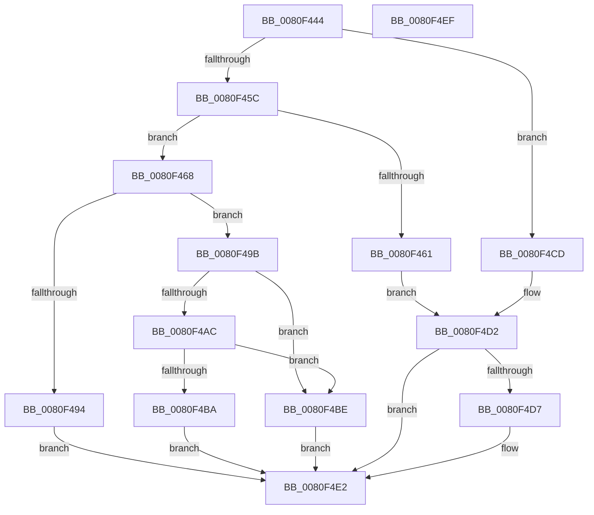

# MiCreateSpecialPurposeMemoryPageFile

- RVA: `0x0080F444`–`0x0080F4F0` (길이 `172` bytes)
- VA: `0x000000014080F444`
- 실행 섹션: `PAGE`
- PDB 이름 있음: `예`; PDB Function 태그: `아니요`
- unwind 정보 RVA: `0x00065960`
- 디코드: `54`개 명령, `172/172` bytes 표시
- 미해석 바이트: `0` (있으면 어셈블리에 `.byte`로 보존)

> 이 문서는 커널 이미지의 기계어와 PDB 기호를 분석해 생성했습니다. 4번과 5번은 함수 원형과 자료형을 바이너리 사용 방식에서 추정한 C 해석이며 원본 소스 복구 결과는 아닙니다.

## 1. Dependencies

- 직접 호출 지점: **5**; 고유 호출 대상: **5**
- 직접 호출자로 확인된 함수: **1**
- RIP 상대 이미지 참조: **0**

### Outgoing calls
- `0x0080F487` → [MiCreatePagefile](../7F/MiCreatePagefile_function_007FEC30.md) (function, `0x007FEC30`)
- `0x0080F4A1` → [MiCreatePagefileMemoryExtents](MiCreatePagefileMemoryExtents_function_0080F1BC.md) (function, `0x0080F1BC`)
- `0x0080F4AF` → [MiInsertPageFileInList](../7F/MiInsertPageFileInList_function_007FFF80.md) (function, `0x007FFF80`)
- `0x0080F4C6` → [MiDeletePagefile](../7F/MiDeletePagefile_function_007FFB88.md) (function, `0x007FFB88`)
- `0x0080F4DD` → [ExFreePoolWithTag](../../poolcode/B8/ExFreePoolWithTag_function_00B82870.md) (function, `0x00B82870`)

### Direct callers
- [MiCreatePagingFile](../7F/MiCreatePagingFile_function_007FEFF4.md) at `0x007FF2E6`

### Static image references
- 디코드된 RIP-relative 메모리 참조가 없습니다.

## 2. Other-region calls and transfers

- 다른 실행 섹션으로 향하는 call: **1**
  - `0x0080F4DD` → [ExFreePoolWithTag](../../poolcode/B8/ExFreePoolWithTag_function_00B82870.md) (`PAGE` → `POOLCODE`)
- 별도 외부 분기/꼬리 이동을 확인하지 못했습니다.

## 3. Assembly (complete function range)

```asm
0080F444  48 89 5C 24 08                  mov qword ptr [rsp + 8], rbx
0080F449  57                              push rdi
0080F44A  48 83 EC 40                     sub rsp, 0x40
0080F44E  8B C2                           mov eax, edx
0080F450  8B DA                           mov ebx, edx
0080F452  41 0B C0                        or eax, r8d
0080F455  A9 FF 01 00 00                  test eax, 0x1ff
0080F45A  75 71                           jne 0x14080f4cd
0080F45C  41 3B D0                        cmp edx, r8d
0080F45F  74 07                           je 0x14080f468
0080F461  BB BB 00 00 C0                  mov ebx, 0xc00000bb
0080F466  EB 6A                           jmp 0x14080f4d2
0080F468  C7 44 24 38 04 00 00 00         mov dword ptr [rsp + 0x38], 4
0080F470  33 D2                           xor edx, edx
0080F472  83 64 24 30 00                  and dword ptr [rsp + 0x30], 0
0080F477  4C 89 4C 24 28                  mov qword ptr [rsp + 0x28], r9
0080F47C  44 8B CB                        mov r9d, ebx
0080F47F  44 89 44 24 20                  mov dword ptr [rsp + 0x20], r8d
0080F484  45 33 C0                        xor r8d, r8d
0080F487  E8 A4 F7 FE FF                  call 0x1407fec30
0080F48C  48 8B F8                        mov rdi, rax
0080F48F  48 85 C0                        test rax, rax
0080F492  75 07                           jne 0x14080f49b
0080F494  BB 9A 00 00 C0                  mov ebx, 0xc000009a
0080F499  EB 47                           jmp 0x14080f4e2
0080F49B  44 8B C3                        mov r8d, ebx
0080F49E  48 8B CF                        mov rcx, rdi
0080F4A1  E8 16 FD FF FF                  call 0x14080f1bc
0080F4A6  8B D8                           mov ebx, eax
0080F4A8  85 C0                           test eax, eax
0080F4AA  78 12                           js 0x14080f4be
0080F4AC  48 8B CF                        mov rcx, rdi
0080F4AF  E8 CC 0A FF FF                  call 0x1407fff80
0080F4B4  8B D8                           mov ebx, eax
0080F4B6  85 C0                           test eax, eax
0080F4B8  78 04                           js 0x14080f4be
0080F4BA  33 DB                           xor ebx, ebx
0080F4BC  EB 24                           jmp 0x14080f4e2
0080F4BE  BA 01 00 00 00                  mov edx, 1
0080F4C3  48 8B CF                        mov rcx, rdi
0080F4C6  E8 BD 06 FF FF                  call 0x1407ffb88
0080F4CB  EB 15                           jmp 0x14080f4e2
0080F4CD  BB 0D 00 00 C0                  mov ebx, 0xc000000d
0080F4D2  4D 85 C9                        test r9, r9
0080F4D5  74 0B                           je 0x14080f4e2
0080F4D7  49 8B 49 08                     mov rcx, qword ptr [r9 + 8]
0080F4DB  33 D2                           xor edx, edx
0080F4DD  E8 8E 33 37 00                  call 0x140b82870
0080F4E2  8B C3                           mov eax, ebx
0080F4E4  48 8B 5C 24 50                  mov rbx, qword ptr [rsp + 0x50]
0080F4E9  48 83 C4 40                     add rsp, 0x40
0080F4ED  5F                              pop rdi
0080F4EE  C3                              ret
0080F4EF  CC                              int3
```

## 4. C-style interpretation (structured pseudocode)

```c
__int64 __fastcall MiCreateSpecialPurposeMemoryPageFile(__int64 a1, int a2, int a3, __int64 a4)
{
    __int64 result;
    __int64 v_rbx;
    __int64 v_rsp;
    unsigned int v_stack_m10;
    unsigned int v_stack_m18;
    unsigned __int64 v_stack_m20;
    unsigned int v_stack_m28;
    unsigned __int64 v_stack_p8;

    v_stack_p8 = v_rbx;
    v_rsp = (v_rsp) - (64);
    result = (unsigned int)(((unsigned int)(a2)) | (a3));
    if ((((unsigned int)(result)) & (511)) != 0) goto loc_0080F4CD;
    if (a2 == a3) goto loc_0080F468;
    goto loc_0080F4D2;
loc_0080F468:
    v_stack_m10 = 4;
    a2 = 0;
    v_stack_m20 = a4;
    v_stack_m28 = a3;
    a3 = 0;
    result = MiCreatePagefile(a1, a2, a3, (unsigned int)((unsigned int)((unsigned int)(0xC00000BBULL))));
    if (result != 0) goto loc_0080F49B;
    goto loc_0080F4E2;
loc_0080F49B:
    result = MiCreatePagefileMemoryExtents(result, a2, (unsigned int)((unsigned int)((unsigned int)(0xC000009AULL))), (unsigned int)((unsigned int)((unsigned int)(0xC00000BBULL))));
    if (sign_flag) goto loc_0080F4BE;
    result = MiInsertPageFileInList(result, a2, (unsigned int)((unsigned int)((unsigned int)(0xC000009AULL))), (unsigned int)((unsigned int)((unsigned int)(0xC00000BBULL))));
    if (sign_flag) goto loc_0080F4BE;
    v_rbx = 0;
    goto loc_0080F4E2;
loc_0080F4BE:
    result = MiDeletePagefile(result, 1, (unsigned int)((unsigned int)((unsigned int)(0xC000009AULL))), (unsigned int)((unsigned int)((unsigned int)(0xC00000BBULL))));
    goto loc_0080F4E2;
loc_0080F4CD:
loc_0080F4D2:
    if ((unsigned int)((unsigned int)((unsigned int)(0xC00000BBULL))) != 0) {
        a1 = *(unsigned __int64 *)((unsigned int)((unsigned int)((unsigned int)(0xC00000BBULL))) + 8);
        a2 = 0;
        result = ExFreePoolWithTag(a1, a2, (unsigned int)((unsigned int)((unsigned int)(0xC000009AULL))), (unsigned int)((unsigned int)((unsigned int)(0xC00000BBULL))));
    }
    v_rsp = (v_rsp) + (64);
    return (unsigned int)((unsigned int)((unsigned int)(0xC000000DULL)));
}
```

## 5. (Beta) C Style

```c
int64_t MiCreateSpecialPurposeMemoryPageFile(int64_t Arg1, int32_t Arg2, int32_t Arg3, int64_t Arg4)
{
    int64_t result;
    int64_t local_rbx;
    int64_t local_rsp;
    uint32_t v_stack_m10;
    uint32_t v_stack_m18;
    uint64_t v_stack_m20;
    uint32_t v_stack_m28;
    uint64_t v_stack_p8;

    v_stack_p8 = local_rbx;
    local_rsp = (local_rsp) - (64);
    result = (uint32_t)(((uint32_t)(Arg2)) | (Arg3));
    if ((((uint32_t)(result)) & (511)) != 0) goto loc_0080F4CD;
    if (Arg2 == Arg3) goto loc_0080F468;
    goto loc_0080F4D2;
loc_0080F468:
    v_stack_m10 = 4;
    Arg2 = 0;
    v_stack_m20 = Arg4;
    v_stack_m28 = Arg3;
    Arg3 = 0;
    result = MiCreatePagefile(Arg1, Arg2, Arg3, (uint32_t)((uint32_t)((uint32_t)(0xC00000BBULL))));
    if (result != 0) goto loc_0080F49B;
    goto loc_0080F4E2;
loc_0080F49B:
    result = MiCreatePagefileMemoryExtents(result, Arg2, (uint32_t)((uint32_t)((uint32_t)(0xC000009AULL))), (uint32_t)((uint32_t)((uint32_t)(0xC00000BBULL))));
    if (sign_flag) goto loc_0080F4BE;
    result = MiInsertPageFileInList(result, Arg2, (uint32_t)((uint32_t)((uint32_t)(0xC000009AULL))), (uint32_t)((uint32_t)((uint32_t)(0xC00000BBULL))));
    if (sign_flag) goto loc_0080F4BE;
    local_rbx = 0;
    goto loc_0080F4E2;
loc_0080F4BE:
    result = MiDeletePagefile(result, 1, (uint32_t)((uint32_t)((uint32_t)(0xC000009AULL))), (uint32_t)((uint32_t)((uint32_t)(0xC00000BBULL))));
    goto loc_0080F4E2;
loc_0080F4CD:
loc_0080F4D2:
    if ((uint32_t)((uint32_t)((uint32_t)(0xC00000BBULL))) != 0) {
        Arg1 = *(uint64_t *)((uint32_t)((uint32_t)((uint32_t)(0xC00000BBULL))) + 0x8);
        Arg2 = 0;
        result = ExFreePoolWithTag(Arg1, Arg2, (uint32_t)((uint32_t)((uint32_t)(0xC000009AULL))), (uint32_t)((uint32_t)((uint32_t)(0xC00000BBULL))));
    }
    local_rsp = (local_rsp) + (64);
    return (uint32_t)((uint32_t)((uint32_t)(0xC000000DULL)));
}
```

## 6. Execution-region graph

[열기: 2D/3D 그래프와 함수 탐색 컨트롤 패널](../../../control-panel.html?section=page&rva=0x0080F444&view=graph)

- 2D 그래프는 위에서 아래로 흐르고, 3D 그래프는 빈 공간을 드래그해 회전합니다. Shift+드래그는 이동, 휠은 확대·축소, 함수 노드 선택은 대상 보고서 이동입니다.

### Static fallback


