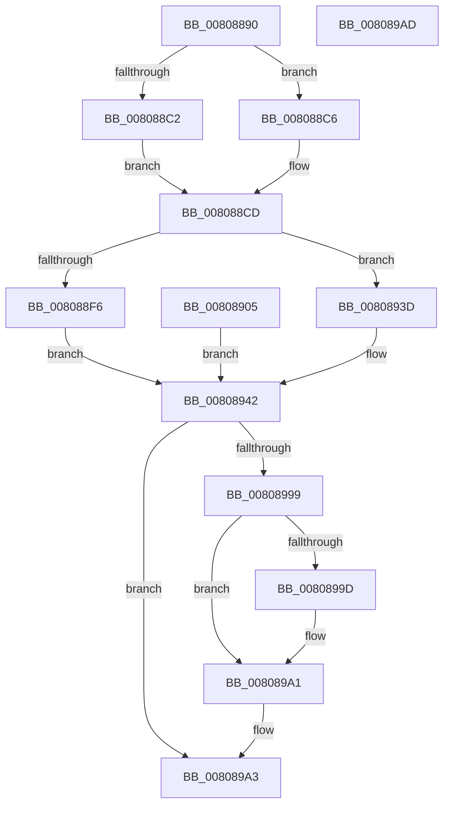

# MiCreateVsmEnclave

- RVA: `0x00808890`–`0x008089AE` (길이 `286` bytes)
- VA: `0x0000000140808890`
- 실행 섹션: `PAGE`
- PDB 이름 있음: `예`; PDB Function 태그: `아니요`
- unwind 정보 RVA: `0x000D8870`
- 디코드: `75`개 명령, `286/286` bytes 표시
- 미해석 바이트: `0` (있으면 어셈블리에 `.byte`로 보존)

> 이 문서는 커널 이미지의 기계어와 PDB 기호를 분석해 생성했습니다. 4번과 5번은 함수 원형과 자료형을 바이너리 사용 방식에서 추정한 C 해석이며 원본 소스 복구 결과는 아닙니다.

## 1. Dependencies

- 직접 호출 지점: **2**; 고유 호출 대상: **2**
- 직접 호출자로 확인된 함수: **1**
- RIP 상대 이미지 참조: **1**

### Outgoing calls
- `0x008088B1` → [MiGetProcessPartition](../../text/44/MiGetProcessPartition_function_00443B10.md) (function, `0x00443B10`)
- `0x00808990` → [PsCreateVsmEnclave](../A9/PsCreateVsmEnclave_function_00A9BCCC.md) (function, `0x00A9BCCC`)

### Direct callers
- [MiCreateEnclave](MiCreateEnclave_function_008083E4.md) at `0x008084B5`

### Static image references
- `0x008088B6` → RVA `0x00E38D00` (`.data`; read)

## 2. Other-region calls and transfers

- 다른 실행 섹션으로 향하는 call: **1**
  - `0x008088B1` → [MiGetProcessPartition](../../text/44/MiGetProcessPartition_function_00443B10.md) (`PAGE` → `.text`)
- 별도 외부 분기/꼬리 이동을 확인하지 못했습니다.

## 3. Assembly (complete function range)

```asm
00808890  4C 89 4C 24 20                  mov qword ptr [rsp + 0x20], r9
00808895  48 89 54 24 10                  mov qword ptr [rsp + 0x10], rdx
0080889A  48 89 4C 24 08                  mov qword ptr [rsp + 8], rcx
0080889F  53                              push rbx
008088A0  56                              push rsi
008088A1  57                              push rdi
008088A2  41 56                           push r14
008088A4  48 83 EC 58                     sub rsp, 0x58
008088A8  4D 8B D9                        mov r11, r9
008088AB  48 8B FA                        mov rdi, rdx
008088AE  4C 8B D1                        mov r10, rcx
008088B1  E8 5A B2 C3 FF                  call 0x140443b10
008088B6  48 8D 0D 43 04 63 00            lea rcx, [rip + 0x630443]
008088BD  48 3B C1                        cmp rax, rcx
008088C0  75 04                           jne 0x1408088c6
008088C2  33 D2                           xor edx, edx
008088C4  EB 07                           jmp 0x1408088cd
008088C6  48 8B 90 B8 00 00 00            mov rdx, qword ptr [rax + 0xb8]
008088CD  48 89 54 24 48                  mov qword ptr [rsp + 0x48], rdx
008088D2  41 83 F8 11                     cmp r8d, 0x11
008088D6  40 0F 94 C6                     sete sil
008088DA  40 88 B4 24 90 00 00 00         mov byte ptr [rsp + 0x90], sil
008088E2  33 DB                           xor ebx, ebx
008088E4  89 5C 24 40                     mov dword ptr [rsp + 0x40], ebx
008088E8  44 8B B4 24 A0 00 00 00         mov r14d, dword ptr [rsp + 0xa0]
008088F0  41 83 FE 04                     cmp r14d, 4
008088F4  72 47                           jb 0x14080893d
008088F6  8D 4B 01                        lea ecx, [rbx + 1]
008088F9  41 84 09                        test byte ptr [r9], cl
008088FC  0F 45 D9                        cmovne ebx, ecx
008088FF  89 5C 24 40                     mov dword ptr [rsp + 0x40], ebx
00808903  EB 3D                           jmp 0x140808942
00808905  B9 01 00 00 00                  mov ecx, 1
0080890A  44 8B B4 24 A0 00 00 00         mov r14d, dword ptr [rsp + 0xa0]
00808912  4C 8B 9C 24 98 00 00 00         mov r11, qword ptr [rsp + 0x98]
0080891A  48 8B BC 24 88 00 00 00         mov rdi, qword ptr [rsp + 0x88]
00808922  4C 8B 94 24 80 00 00 00         mov r10, qword ptr [rsp + 0x80]
0080892A  8B 5C 24 40                     mov ebx, dword ptr [rsp + 0x40]
0080892E  48 8B 54 24 48                  mov rdx, qword ptr [rsp + 0x48]
00808933  40 8A B4 24 90 00 00 00         mov sil, byte ptr [rsp + 0x90]
0080893B  EB 05                           jmp 0x140808942
0080893D  B9 01 00 00 00                  mov ecx, 1
00808942  44 0F B6 47 20                  movzx r8d, byte ptr [rdi + 0x20]
00808947  49 C1 E0 20                     shl r8, 0x20
0080894B  8B 47 18                        mov eax, dword ptr [rdi + 0x18]
0080894E  4C 0B C0                        or r8, rax
00808951  49 C1 E0 0C                     shl r8, 0xc
00808955  44 0F B6 4F 21                  movzx r9d, byte ptr [rdi + 0x21]
0080895A  49 C1 E1 20                     shl r9, 0x20
0080895E  8B 47 1C                        mov eax, dword ptr [rdi + 0x1c]
00808961  4C 0B C8                        or r9, rax
00808964  48 8D 47 48                     lea rax, [rdi + 0x48]
00808968  49 C1 E1 0C                     shl r9, 0xc
0080896C  49 81 C9 FF 0F 00 00            or r9, 0xfff
00808973  4D 2B C8                        sub r9, r8
00808976  4C 03 C9                        add r9, rcx
00808979  48 89 44 24 38                  mov qword ptr [rsp + 0x38], rax
0080897E  44 89 74 24 30                  mov dword ptr [rsp + 0x30], r14d
00808983  4C 89 5C 24 28                  mov qword ptr [rsp + 0x28], r11
00808988  40 88 74 24 20                  mov byte ptr [rsp + 0x20], sil
0080898D  49 8B CA                        mov rcx, r10
00808990  E8 37 33 29 00                  call 0x140a9bccc
00808995  85 C0                           test eax, eax
00808997  78 0A                           js 0x1408089a3
00808999  85 DB                           test ebx, ebx
0080899B  74 04                           je 0x1408089a1
0080899D  83 4F 40 04                     or dword ptr [rdi + 0x40], 4
008089A1  33 C0                           xor eax, eax
008089A3  48 83 C4 58                     add rsp, 0x58
008089A7  41 5E                           pop r14
008089A9  5F                              pop rdi
008089AA  5E                              pop rsi
008089AB  5B                              pop rbx
008089AC  C3                              ret
008089AD  CC                              int3
```

## 4. C-style interpretation (structured pseudocode)

```c
__int64 __fastcall MiCreateVsmEnclave(__int64 a1, __int64 a2, int a3, __int64 a4, unsigned int a5)
{
    __int64 result;
    __int64 v_rbx;
    __int64 v_rsi;
    __int64 v_rsp;
    unsigned __int64 v_stack_m30;
    unsigned int v_stack_m38;
    unsigned __int64 v_stack_m40;
    unsigned int v_stack_m48;
    unsigned __int64 v_stack_m50;
    unsigned __int8 v_stack_m58;
    unsigned __int64 v_stack_p10;
    unsigned __int8 v_stack_p18;
    unsigned __int64 v_stack_p20;
    unsigned int v_stack_p28;
    unsigned __int64 v_stack_p8;

    v_stack_p20 = a4;
    v_stack_p10 = a2;
    v_stack_p8 = a1;
    v_rsp = (v_rsp) - (88);
    result = MiGetProcessPartition(a1, a2, a3, a4);
    if (result != (v_rip + 6489155)) goto loc_008088C6;
    a2 = 0;
    goto loc_008088CD;
loc_008088C6:
loc_008088CD:
    v_stack_m30 = *(unsigned __int64 *)(result + 184);
    v_rsi = (a3 == 17) ? 1 : 0;
    v_stack_p18 = (unsigned __int8)(v_rsi);
    v_rbx = 0;
    v_stack_m38 = 0;
    if (((unsigned int)((unsigned int)(a5))) < 4) goto loc_0080893D;
    if (((*(unsigned __int8 *)(a4)) & ((unsigned __int8)(v_rbx + 1))) != 0) { v_rbx = (unsigned int)(v_rbx + 1); }
    v_stack_m38 = (unsigned int)(v_rbx);
    goto loc_00808942;
loc_0080893D:
loc_00808942:
    a3 = (*(unsigned __int8 *)(a2 + 32)) << (32);
    a3 = (a3) | ((unsigned int)(*(unsigned int *)(a2 + 24)));
    a3 = (a3) << (12);
    a4 = (*(unsigned __int8 *)(a2 + 33)) << (32);
    a4 = (a4) | ((unsigned int)(*(unsigned int *)(a2 + 28)));
    a4 = (a4) << (12);
    a4 = (a4) | (0xFFFULL);
    a4 = (a4) - (a3);
    a4 = (a4) + (1);
    v_stack_m40 = a2 + 72;
    v_stack_m48 = (unsigned int)((unsigned int)(a5));
    v_stack_m50 = a4;
    v_stack_m58 = (unsigned __int8)(v_rsi);
    result = PsCreateVsmEnclave(a1, *(unsigned __int64 *)(result + 184), a3, a4);
    if (sign_flag) goto loc_008089A3;
    if ((unsigned int)(v_rbx) != 0) {
    }
    result = 0;
loc_008089A3:
    v_rsp = (v_rsp) + (88);
    return result;
}
```

## 5. (Beta) C Style

```c
int64_t MiCreateVsmEnclave(int64_t Arg1, void *Arg2, int32_t Arg3, int64_t Arg4, uint32_t Arg5)
{
    uint8_t *arg2 = (uint8_t *)Arg2;

    int64_t result;
    int64_t local_rbx;
    int64_t local_rsi;
    int64_t local_rsp;
    uint64_t v_stack_m30;
    uint32_t v_stack_m38;
    uint64_t v_stack_m40;
    uint32_t v_stack_m48;
    uint64_t v_stack_m50;
    uint8_t v_stack_m58;
    uint64_t v_stack_p10;
    uint8_t v_stack_p18;
    uint64_t v_stack_p20;
    uint32_t v_stack_p28;
    uint64_t v_stack_p8;

    v_stack_p20 = Arg4;
    v_stack_p10 = Arg2;
    v_stack_p8 = Arg1;
    local_rsp = (local_rsp) - (88);
    result = MiGetProcessPartition(Arg1, Arg2, Arg3, Arg4);
    if (result != (v_rip + 6489155)) goto loc_008088C6;
    Arg2 = 0;
    goto loc_008088CD;
loc_008088C6:
loc_008088CD:
    v_stack_m30 = *(uint64_t *)(result + 0xB8);
    local_rsi = (Arg3 == 17) ? 1 : 0;
    v_stack_p18 = (uint8_t)(local_rsi);
    local_rbx = 0;
    v_stack_m38 = 0;
    if (((uint32_t)((uint32_t)(Arg5))) < 4) goto loc_0080893D;
    if (((*(uint8_t *)(Arg4)) & ((uint8_t)(local_rbx + 1))) != 0) { local_rbx = (uint32_t)(local_rbx + 1); }
    v_stack_m38 = (uint32_t)(local_rbx);
    goto loc_00808942;
loc_0080893D:
loc_00808942:
    Arg3 = (*(uint8_t *)(arg2 + 0x20)) << (32);
    Arg3 = (Arg3) | ((uint32_t)(*(uint32_t *)(arg2 + 0x18)));
    Arg3 = (Arg3) << (12);
    Arg4 = (*(uint8_t *)(arg2 + 0x21)) << (32);
    Arg4 = (Arg4) | ((uint32_t)(*(uint32_t *)(arg2 + 0x1C)));
    Arg4 = (Arg4) << (12);
    Arg4 = (Arg4) | (0xFFFULL);
    Arg4 = (Arg4) - (Arg3);
    Arg4 = (Arg4) + (1);
    v_stack_m40 = Arg2 + 72;
    v_stack_m48 = (uint32_t)((uint32_t)(Arg5));
    v_stack_m50 = Arg4;
    v_stack_m58 = (uint8_t)(local_rsi);
    result = PsCreateVsmEnclave(Arg1, *(uint64_t *)(result + 0xB8), Arg3, Arg4);
    if (sign_flag) goto loc_008089A3;
    if ((uint32_t)(local_rbx) != 0) {
    }
    result = 0;
loc_008089A3:
    local_rsp = (local_rsp) + (88);
    return result;
}
```

### 관측된 메모리 오프셋

구조체 형식이 확인되지 않은 접근은 인자 기준의 오프셋으로만 기록했습니다.

| 기준 인자 | 오프셋 표현 | 폭 (bit) | 접근 |
|---|---:|---:|---|
| `Arg2` | `+ 0x18` | `32` | `R` |
| `Arg2` | `+ 0x1C` | `32` | `R` |
| `Arg2` | `+ 0x20` | `8` | `R` |
| `Arg2` | `+ 0x21` | `8` | `R` |
| `Arg2` | `+ 0x40` | `32` | `R/W` |
| `Arg2` | `+ 0x48` | `64` | `R` |

## 6. Execution-region graph

[열기: 2D/3D 그래프와 함수 탐색 컨트롤 패널](../../../control-panel.html?section=page&rva=0x00808890&view=graph)

- 2D 그래프는 위에서 아래로 흐르고, 3D 그래프는 빈 공간을 드래그해 회전합니다. Shift+드래그는 이동, 휠은 확대·축소, 함수 노드 선택은 대상 보고서 이동입니다.

### Static fallback


