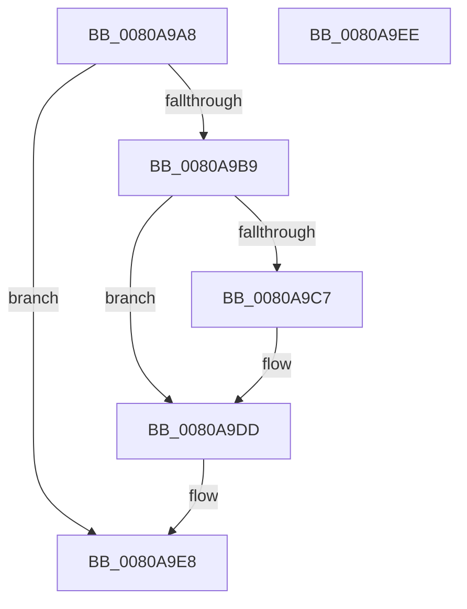

# MiDeleteAweBitMap

- RVA: `0x0080A9A8`–`0x0080A9EF` (길이 `71` bytes)
- VA: `0x000000014080A9A8`
- 실행 섹션: `PAGE`
- PDB 이름 있음: `예`; PDB Function 태그: `아니요`
- unwind 정보 RVA: `0x0005CF00`
- 디코드: `24`개 명령, `71/71` bytes 표시
- 미해석 바이트: `0` (있으면 어셈블리에 `.byte`로 보존)

> 이 문서는 커널 이미지의 기계어와 PDB 기호를 분석해 생성했습니다. 4번과 5번은 함수 원형과 자료형을 바이너리 사용 방식에서 추정한 C 해석이며 원본 소스 복구 결과는 아닙니다.

## 1. Dependencies

- 직접 호출 지점: **2**; 고유 호출 대상: **2**
- 직접 호출자로 확인된 함수: **2**
- RIP 상대 이미지 참조: **0**

### Outgoing calls
- `0x0080A9D8` → [PsReturnProcessNonPagedPoolQuota](../../text/41/PsReturnProcessNonPagedPoolQuota_function_0041C200.md) (function, `0x0041C200`)
- `0x0080A9E3` → [ExFreePoolWithTag](../../poolcode/B8/ExFreePoolWithTag_function_00B82870.md) (function, `0x00B82870`)

### Direct callers
- [MiDeleteAweInfo](MiDeleteAweInfo_function_0080A9F8.md) at `0x0080AA1F`
- [MiResizeAweBitMap](MiResizeAweBitMap_function_0080AD00.md) at `0x0080ADCE`
- [MiResizeAweBitMap](MiResizeAweBitMap_function_0080AD00.md) at `0x0080AE5C`

### Static image references
- 디코드된 RIP-relative 메모리 참조가 없습니다.

## 2. Other-region calls and transfers

- 다른 실행 섹션으로 향하는 call: **2**
  - `0x0080A9D8` → [PsReturnProcessNonPagedPoolQuota](../../text/41/PsReturnProcessNonPagedPoolQuota_function_0041C200.md) (`PAGE` → `.text`)
  - `0x0080A9E3` → [ExFreePoolWithTag](../../poolcode/B8/ExFreePoolWithTag_function_00B82870.md) (`PAGE` → `POOLCODE`)
- 별도 외부 분기/꼬리 이동을 확인하지 못했습니다.

## 3. Assembly (complete function range)

```asm
0080A9A8  40 53                           push rbx
0080A9AA  48 83 EC 20                     sub rsp, 0x20
0080A9AE  48 8B DA                        mov rbx, rdx
0080A9B1  33 D2                           xor edx, edx
0080A9B3  48 39 53 08                     cmp qword ptr [rbx + 8], rdx
0080A9B7  74 2F                           je 0x14080a9e8
0080A9B9  4C 8B 03                        mov r8, qword ptr [rbx]
0080A9BC  49 8B C0                        mov rax, r8
0080A9BF  83 E0 3F                        and eax, 0x3f
0080A9C2  48 85 C9                        test rcx, rcx
0080A9C5  74 16                           je 0x14080a9dd
0080A9C7  48 85 C0                        test rax, rax
0080A9CA  0F 95 C2                        setne dl
0080A9CD  49 C1 E8 06                     shr r8, 6
0080A9D1  49 03 D0                        add rdx, r8
0080A9D4  48 C1 E2 03                     shl rdx, 3
0080A9D8  E8 23 18 C1 FF                  call 0x14041c200
0080A9DD  48 8B 4B 08                     mov rcx, qword ptr [rbx + 8]
0080A9E1  33 D2                           xor edx, edx
0080A9E3  E8 88 7E 37 00                  call 0x140b82870
0080A9E8  48 83 C4 20                     add rsp, 0x20
0080A9EC  5B                              pop rbx
0080A9ED  C3                              ret
0080A9EE  CC                              int3
```

## 4. C-style interpretation (structured pseudocode)

```c
__int64 __fastcall MiDeleteAweBitMap(__int64 a1, __int64 a2)
{
    __int64 result;
    __int64 v_rsp;

    v_rsp = (v_rsp) - (32);
    a2 = 0;
    if ((*(unsigned __int64 *)(a2 + 8)) == 0) goto loc_0080A9E8;
    result = (unsigned int)((*(unsigned __int64 *)(a2)) & (63));
    if (a1 != 0) {
        a2 = (result != 0) ? 1 : 0;
        a3 = (*(unsigned __int64 *)(a2)) >> (6);
        a2 = (a2) + (a3);
        a2 = (a2) << (3);
        result = PsReturnProcessNonPagedPoolQuota(a1, a2, a3, a4);
    }
    a2 = 0;
    result = ExFreePoolWithTag(*(unsigned __int64 *)(a2 + 8), a2, a3, a4);
loc_0080A9E8:
    v_rsp = (v_rsp) + (32);
    return result;
}
```

## 5. (Beta) C Style

```c
int64_t MiDeleteAweBitMap(int64_t Arg1, void *Arg2)
{
    uint8_t *arg2 = (uint8_t *)Arg2;

    int64_t result;
    int64_t local_rsp;

    local_rsp = (local_rsp) - (32);
    Arg2 = 0;
    if ((*(uint64_t *)(arg2 + 0x8)) == 0) goto loc_0080A9E8;
    result = (uint32_t)((*(uint64_t *)(arg2)) & (63));
    if (Arg1 != 0) {
        Arg2 = (result != 0) ? 1 : 0;
        a3 = (*(uint64_t *)(arg2)) >> (6);
        Arg2 = (Arg2) + (a3);
        Arg2 = (Arg2) << (3);
        result = PsReturnProcessNonPagedPoolQuota(Arg1, Arg2, a3, a4);
    }
    Arg2 = 0;
    result = ExFreePoolWithTag(*(uint64_t *)(arg2 + 0x8), Arg2, a3, a4);
loc_0080A9E8:
    local_rsp = (local_rsp) + (32);
    return result;
}
```

### 관측된 메모리 오프셋

구조체 형식이 확인되지 않은 접근은 인자 기준의 오프셋으로만 기록했습니다.

| 기준 인자 | 오프셋 표현 | 폭 (bit) | 접근 |
|---|---:|---:|---|
| `Arg2` | `+ 0x0` | `64` | `R` |
| `Arg2` | `+ 0x8` | `64` | `R` |

## 6. Execution-region graph

[열기: 2D/3D 그래프와 함수 탐색 컨트롤 패널](../../../control-panel.html?section=page&rva=0x0080A9A8&view=graph)

- 2D 그래프는 위에서 아래로 흐르고, 3D 그래프는 빈 공간을 드래그해 회전합니다. Shift+드래그는 이동, 휠은 확대·축소, 함수 노드 선택은 대상 보고서 이동입니다.

### Static fallback


