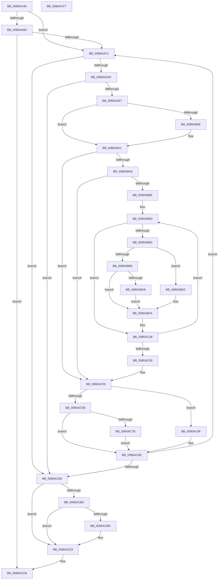

# MiDeleteAweInfoPages

- RVA: `0x0080AA40`–`0x0080ACF8` (길이 `696` bytes)
- VA: `0x000000014080AA40`
- 실행 섹션: `PAGE`
- PDB 이름 있음: `예`; PDB Function 태그: `아니요`
- unwind 정보 RVA: `0x000C3C34`
- 디코드: `181`개 명령, `696/696` bytes 표시
- 미해석 바이트: `0` (있으면 어셈블리에 `.byte`로 보존)

> 이 문서는 커널 이미지의 기계어와 PDB 기호를 분석해 생성했습니다. 4번과 5번은 함수 원형과 자료형을 바이너리 사용 방식에서 추정한 C 해석이며 원본 소스 복구 결과는 아닙니다.

## 1. Dependencies

- 직접 호출 지점: **14**; 고유 호출 대상: **11**
- 직접 호출자로 확인된 함수: **2**
- RIP 상대 이미지 참조: **0**

### Outgoing calls
- `0x0080AA79` → [MiGetProcessPartition](../../text/44/MiGetProcessPartition_function_00443B10.md) (function, `0x00443B10`)
- `0x0080AA89` → [MiGetAweInfoPartition](../../text/2A/MiGetAweInfoPartition_function_002AA2CC.md) (function, `0x002AA2CC`)
- `0x0080AA97` → [MiLockAwePagesExclusive](../../text/68/MiLockAwePagesExclusive_function_00689080.md) (function, `0x00689080`)
- `0x0080AA9F` → [MiGetAwePageSize](../../text/46/MiGetAwePageSize_function_0046CFA8.md) (function, `0x0046CFA8`)
- `0x0080AACC` → [RtlFindSetBitsEx](../../text/40/RtlFindSetBitsEx_function_0040B880.md) (function, `0x0040B880`)
- `0x0080AAF5` → [RtlFindNextForwardRunClearEx](../../text/43/RtlFindNextForwardRunClearEx_function_0043CCA0.md) (function, `0x0043CCA0`)
- `0x0080AB1A` → [RtlClearBitsEx](../../text/29/RtlClearBitsEx_function_00297740.md) (function, `0x00297740`)
- `0x0080ABC9` → [MiFreeMdlPageRun](../../text/37/MiFreeMdlPageRun_function_00375A4C.md) (function, `0x00375A4C`)
- `0x0080ABE5` → [MiReturnCrossPartitionCharges](../../text/28/MiReturnCrossPartitionCharges_function_002867D0.md) (function, `0x002867D0`)
- `0x0080ABF5` → [MiFreeContiguousLargePageRun](../../text/68/MiFreeContiguousLargePageRun_function_00688A34.md) (function, `0x00688A34`)
- `0x0080AC6C` → [MiFreeMdlPageRun](../../text/37/MiFreeMdlPageRun_function_00375A4C.md) (function, `0x00375A4C`)
- `0x0080AC88` → [MiReturnCrossPartitionCharges](../../text/28/MiReturnCrossPartitionCharges_function_002867D0.md) (function, `0x002867D0`)
- `0x0080AC98` → [MiFreeContiguousLargePageRun](../../text/68/MiFreeContiguousLargePageRun_function_00688A34.md) (function, `0x00688A34`)
- `0x0080ACDE` → [MiUnlockAwePagesExclusive](../../text/68/MiUnlockAwePagesExclusive_function_006898FC.md) (function, `0x006898FC`)

### Direct callers
- [MiDeleteSectionAwe](../../text/68/MiDeleteSectionAwe_function_006887A8.md) at `0x006887B5`
- [MiCleanProcessPhysicalPages](../A1/MiCleanProcessPhysicalPages_function_00A18234.md) at `0x00A18257`

### Static image references
- 디코드된 RIP-relative 메모리 참조가 없습니다.

## 2. Other-region calls and transfers

- 다른 실행 섹션으로 향하는 call: **14**
  - `0x0080AA79` → [MiGetProcessPartition](../../text/44/MiGetProcessPartition_function_00443B10.md) (`PAGE` → `.text`)
  - `0x0080AA89` → [MiGetAweInfoPartition](../../text/2A/MiGetAweInfoPartition_function_002AA2CC.md) (`PAGE` → `.text`)
  - `0x0080AA97` → [MiLockAwePagesExclusive](../../text/68/MiLockAwePagesExclusive_function_00689080.md) (`PAGE` → `.text`)
  - `0x0080AA9F` → [MiGetAwePageSize](../../text/46/MiGetAwePageSize_function_0046CFA8.md) (`PAGE` → `.text`)
  - `0x0080AACC` → [RtlFindSetBitsEx](../../text/40/RtlFindSetBitsEx_function_0040B880.md) (`PAGE` → `.text`)
  - `0x0080AAF5` → [RtlFindNextForwardRunClearEx](../../text/43/RtlFindNextForwardRunClearEx_function_0043CCA0.md) (`PAGE` → `.text`)
  - `0x0080AB1A` → [RtlClearBitsEx](../../text/29/RtlClearBitsEx_function_00297740.md) (`PAGE` → `.text`)
  - `0x0080ABC9` → [MiFreeMdlPageRun](../../text/37/MiFreeMdlPageRun_function_00375A4C.md) (`PAGE` → `.text`)
  - `0x0080ABE5` → [MiReturnCrossPartitionCharges](../../text/28/MiReturnCrossPartitionCharges_function_002867D0.md) (`PAGE` → `.text`)
  - `0x0080ABF5` → [MiFreeContiguousLargePageRun](../../text/68/MiFreeContiguousLargePageRun_function_00688A34.md) (`PAGE` → `.text`)
  - `0x0080AC6C` → [MiFreeMdlPageRun](../../text/37/MiFreeMdlPageRun_function_00375A4C.md) (`PAGE` → `.text`)
  - `0x0080AC88` → [MiReturnCrossPartitionCharges](../../text/28/MiReturnCrossPartitionCharges_function_002867D0.md) (`PAGE` → `.text`)
  - `0x0080AC98` → [MiFreeContiguousLargePageRun](../../text/68/MiFreeContiguousLargePageRun_function_00688A34.md) (`PAGE` → `.text`)
  - `0x0080ACDE` → [MiUnlockAwePagesExclusive](../../text/68/MiUnlockAwePagesExclusive_function_006898FC.md) (`PAGE` → `.text`)
- 별도 외부 분기/꼬리 이동을 확인하지 못했습니다.

## 3. Assembly (complete function range)

```asm
0080AA40  48 8B C4                        mov rax, rsp
0080AA43  53                              push rbx
0080AA44  55                              push rbp
0080AA45  56                              push rsi
0080AA46  57                              push rdi
0080AA47  41 54                           push r12
0080AA49  41 55                           push r13
0080AA4B  41 56                           push r14
0080AA4D  41 57                           push r15
0080AA4F  48 83 EC 58                     sub rsp, 0x58
0080AA53  65 4C 8B 04 25 88 01 00 00      mov r8, qword ptr gs:[0x188]
0080AA5C  33 FF                           xor edi, edi
0080AA5E  4C 8B F9                        mov r15, rcx
0080AA61  48 89 78 08                     mov qword ptr [rax + 8], rdi
0080AA65  8B F7                           mov esi, edi
0080AA67  4C 89 44 24 40                  mov qword ptr [rsp + 0x40], r8
0080AA6C  44 8B E7                        mov r12d, edi
0080AA6F  49 8B 98 B8 00 00 00            mov rbx, qword ptr [r8 + 0xb8]
0080AA76  48 8B CB                        mov rcx, rbx
0080AA79  E8 92 90 C3 FF                  call 0x140443b10
0080AA7E  49 8B CF                        mov rcx, r15
0080AA81  48 89 84 24 B0 00 00 00         mov qword ptr [rsp + 0xb0], rax
0080AA89  E8 3E F8 A9 FF                  call 0x1402aa2cc
0080AA8E  49 8B D0                        mov rdx, r8
0080AA91  49 8B CF                        mov rcx, r15
0080AA94  4C 8B F0                        mov r14, rax
0080AA97  E8 E4 E5 E7 FF                  call 0x140689080
0080AA9C  49 8B CF                        mov rcx, r15
0080AA9F  E8 04 25 C6 FF                  call 0x14046cfa8
0080AAA4  41 8B 4F 08                     mov ecx, dword ptr [r15 + 8]
0080AAA8  49 8D 6F 18                     lea rbp, [r15 + 0x18]
0080AAAC  4C 8B E8                        mov r13, rax
0080AAAF  F6 C1 01                        test cl, 1
0080AAB2  74 0D                           je 0x14080aac1
0080AAB4  48 39 BB 70 05 00 00            cmp qword ptr [rbx + 0x570], rdi
0080AABB  0F 84 15 02 00 00               je 0x14080acd6
0080AAC1  4C 8B C6                        mov r8, rsi
0080AAC4  BA 01 00 00 00                  mov edx, 1
0080AAC9  48 8B CD                        mov rcx, rbp
0080AACC  E8 AF 0D C0 FF                  call 0x14040b880
0080AAD1  48 8B D8                        mov rbx, rax
0080AAD4  48 3B C6                        cmp rax, rsi
0080AAD7  0F 82 D3 01 00 00               jb 0x14080acb0
0080AADD  48 83 F8 FF                     cmp rax, -1
0080AAE1  0F 84 C9 01 00 00               je 0x14080acb0
0080AAE7  4C 8D 84 24 A0 00 00 00         lea r8, [rsp + 0xa0]
0080AAEF  48 8B D0                        mov rdx, rax
0080AAF2  48 8B CD                        mov rcx, rbp
0080AAF5  E8 A6 21 C3 FF                  call 0x14043cca0
0080AAFA  48 8B B4 24 A0 00 00 00         mov rsi, qword ptr [rsp + 0xa0]
0080AB02  48 8B E8                        mov rbp, rax
0080AB05  49 8D 4F 18                     lea rcx, [r15 + 0x18]
0080AB09  48 85 C0                        test rax, rax
0080AB0C  75 03                           jne 0x14080ab11
0080AB0E  48 8B 31                        mov rsi, qword ptr [rcx]
0080AB11  48 2B F3                        sub rsi, rbx
0080AB14  48 8B D3                        mov rdx, rbx
0080AB17  4C 8B C6                        mov r8, rsi
0080AB1A  E8 21 CC A8 FF                  call 0x140297740
0080AB1F  48 8D 04 2E                     lea rax, [rsi + rbp]
0080AB23  48 8B EE                        mov rbp, rsi
0080AB26  48 03 C3                        add rax, rbx
0080AB29  49 0F AF ED                     imul rbp, r13
0080AB2D  49 0F AF DD                     imul rbx, r13
0080AB31  4C 03 E5                        add r12, rbp
0080AB34  48 89 44 24 38                  mov qword ptr [rsp + 0x38], rax
0080AB39  41 8B 47 08                     mov eax, dword ptr [r15 + 8]
0080AB3D  4C 89 64 24 30                  mov qword ptr [rsp + 0x30], r12
0080AB42  A8 08                           test al, 8
0080AB44  0F 85 0B 01 00 00               jne 0x14080ac55
0080AB4A  48 8D 0C 5B                     lea rcx, [rbx + rbx*2]
0080AB4E  48 C1 E1 04                     shl rcx, 4
0080AB52  48 B8 20 00 00 00 00 DE FF FF   movabs rax, 0xffffde0000000020
0080AB5C  8B 04 01                        mov eax, dword ptr [rcx + rax]
0080AB5F  C1 E8 10                        shr eax, 0x10
0080AB62  44 0F B6 C0                     movzx r8d, al
0080AB66  41 C1 E8 06                     shr r8d, 6
0080AB6A  48 B8 00 00 00 00 00 DE FF FF   movabs rax, 0xffffde0000000000
0080AB74  48 8B C0                        mov rax, rax
0080AB77  48 03 C8                        add rcx, rax
0080AB7A  48 8B EF                        mov rbp, rdi
0080AB7D  48 89 8C 24 A8 00 00 00         mov qword ptr [rsp + 0xa8], rcx
0080AB85  48 85 F6                        test rsi, rsi
0080AB88  0F 84 C7 00 00 00               je 0x14080ac55
0080AB8E  4E 8D 24 6D 00 00 00 00         lea r12, [r13*2]
0080AB96  4D 03 E5                        add r12, r13
0080AB99  49 C1 E4 04                     shl r12, 4
0080AB9D  8B 41 20                        mov eax, dword ptr [rcx + 0x20]
0080ABA0  C1 E8 10                        shr eax, 0x10
0080ABA3  0F B6 D0                        movzx edx, al
0080ABA6  C1 EA 06                        shr edx, 6
0080ABA9  41 3B D0                        cmp edx, r8d
0080ABAC  0F 84 86 00 00 00               je 0x14080ac38
0080ABB2  49 83 FD 01                     cmp r13, 1
0080ABB6  75 34                           jne 0x14080abec
0080ABB8  45 33 C9                        xor r9d, r9d
0080ABBB  48 89 7C 24 20                  mov qword ptr [rsp + 0x20], rdi
0080ABC0  45 33 C0                        xor r8d, r8d
0080ABC3  48 8B D5                        mov rdx, rbp
0080ABC6  48 8B CB                        mov rcx, rbx
0080ABC9  E8 7E AE B6 FF                  call 0x140375a4c
0080ABCE  4C 3B B4 24 B0 00 00 00         cmp r14, qword ptr [rsp + 0xb0]
0080ABD6  74 22                           je 0x14080abfa
0080ABD8  4C 8B CD                        mov r9, rbp
0080ABDB  41 8D 55 03                     lea edx, [r13 + 3]
0080ABDF  45 8B C5                        mov r8d, r13d
0080ABE2  49 8B CE                        mov rcx, r14
0080ABE5  E8 E6 BB A7 FF                  call 0x1402867d0
0080ABEA  EB 0E                           jmp 0x14080abfa
0080ABEC  4C 8B C5                        mov r8, rbp
0080ABEF  48 8B D3                        mov rdx, rbx
0080ABF2  49 8B CF                        mov rcx, r15
0080ABF5  E8 3A DE E7 FF                  call 0x140688a34
0080ABFA  48 8B 8C 24 A8 00 00 00         mov rcx, qword ptr [rsp + 0xa8]
0080AC02  8B 41 20                        mov eax, dword ptr [rcx + 0x20]
0080AC05  C1 E8 10                        shr eax, 0x10
0080AC08  44 0F B6 C0                     movzx r8d, al
0080AC0C  41 C1 E8 06                     shr r8d, 6
0080AC10  48 B8 00 00 00 00 00 DE FF FF   movabs rax, 0xffffde0000000000
0080AC1A  48 8B C0                        mov rax, rax
0080AC1D  48 8B D9                        mov rbx, rcx
0080AC20  48 8B EF                        mov rbp, rdi
0080AC23  48 2B D8                        sub rbx, rax
0080AC26  48 B8 AB AA AA AA AA AA AA AA   movabs rax, 0xaaaaaaaaaaaaaaab
0080AC30  48 C1 FB 04                     sar rbx, 4
0080AC34  48 0F AF D8                     imul rbx, rax
0080AC38  49 03 CC                        add rcx, r12
0080AC3B  49 03 ED                        add rbp, r13
0080AC3E  48 89 8C 24 A8 00 00 00         mov qword ptr [rsp + 0xa8], rcx
0080AC46  48 83 EE 01                     sub rsi, 1
0080AC4A  0F 85 4D FF FF FF               jne 0x14080ab9d
0080AC50  4C 8B 64 24 30                  mov r12, qword ptr [rsp + 0x30]
0080AC55  49 83 FD 01                     cmp r13, 1
0080AC59  75 34                           jne 0x14080ac8f
0080AC5B  45 33 C9                        xor r9d, r9d
0080AC5E  48 89 7C 24 20                  mov qword ptr [rsp + 0x20], rdi
0080AC63  45 33 C0                        xor r8d, r8d
0080AC66  48 8B D5                        mov rdx, rbp
0080AC69  48 8B CB                        mov rcx, rbx
0080AC6C  E8 DB AD B6 FF                  call 0x140375a4c
0080AC71  4C 3B B4 24 B0 00 00 00         cmp r14, qword ptr [rsp + 0xb0]
0080AC79  74 22                           je 0x14080ac9d
0080AC7B  4C 8B CD                        mov r9, rbp
0080AC7E  41 8D 55 03                     lea edx, [r13 + 3]
0080AC82  45 8B C5                        mov r8d, r13d
0080AC85  49 8B CE                        mov rcx, r14
0080AC88  E8 43 BB A7 FF                  call 0x1402867d0
0080AC8D  EB 0E                           jmp 0x14080ac9d
0080AC8F  4C 8B C5                        mov r8, rbp
0080AC92  48 8B D3                        mov rdx, rbx
0080AC95  49 8B CF                        mov rcx, r15
0080AC98  E8 97 DD E7 FF                  call 0x140688a34
0080AC9D  48 8B 74 24 38                  mov rsi, qword ptr [rsp + 0x38]
0080ACA2  49 8D 6F 18                     lea rbp, [r15 + 0x18]
0080ACA6  48 3B 75 00                     cmp rsi, qword ptr [rbp]
0080ACAA  0F 82 11 FE FF FF               jb 0x14080aac1
0080ACB0  4D 85 E4                        test r12, r12
0080ACB3  74 1E                           je 0x14080acd3
0080ACB5  41 8B 47 08                     mov eax, dword ptr [r15 + 8]
0080ACB9  A8 08                           test al, 8
0080ACBB  75 16                           jne 0x14080acd3
0080ACBD  49 8B C4                        mov rax, r12
0080ACC0  48 F7 D8                        neg rax
0080ACC3  F0 49 01 86 A8 4C 00 00         lock add qword ptr [r14 + 0x4ca8], rax
0080ACCB  F0 49 01 86 C0 4C 00 00         lock add qword ptr [r14 + 0x4cc0], rax
0080ACD3  49 8B FC                        mov rdi, r12
0080ACD6  48 8B 54 24 40                  mov rdx, qword ptr [rsp + 0x40]
0080ACDB  49 8B CF                        mov rcx, r15
0080ACDE  E8 19 EC E7 FF                  call 0x1406898fc
0080ACE3  48 8B C7                        mov rax, rdi
0080ACE6  48 83 C4 58                     add rsp, 0x58
0080ACEA  41 5F                           pop r15
0080ACEC  41 5E                           pop r14
0080ACEE  41 5D                           pop r13
0080ACF0  41 5C                           pop r12
0080ACF2  5F                              pop rdi
0080ACF3  5E                              pop rsi
0080ACF4  5D                              pop rbp
0080ACF5  5B                              pop rbx
0080ACF6  C3                              ret
0080ACF7  CC                              int3
```

## 4. C-style interpretation (structured pseudocode)

```c
__int64 __fastcall MiDeleteAweInfoPages(__int64 a1, __int64 a2, __int64 a3, int a4)
{
    __int64 result;
    __int64 v_r12;
    __int64 v_rbp;
    __int64 v_rbx;
    __int64 v_rdi;
    __int64 v_rsi;
    __int64 v_rsp;
    unsigned __int64 v_stack_m58;
    unsigned __int64 v_stack_m60;
    unsigned __int64 v_stack_m68;
    unsigned __int64 v_stack_m78;
    unsigned __int64 v_stack_p10;
    unsigned __int64 v_stack_p18;
    unsigned __int64 v_stack_p8;

    v_rsp = (v_rsp) - (88);
    v_rdi = 0;
    *(unsigned __int64 *)(v_rsp + 8) = 0;
    v_stack_m58 = *(unsigned __int64 *)(gs_base + (0 + 392));
    result = MiGetProcessPartition(*(unsigned __int64 *)(*(unsigned __int64 *)(gs_base + (0 + 392)) + 184), a2, *(unsigned __int64 *)(gs_base + (0 + 392)), a4);
    v_stack_p18 = result;
    result = MiGetAweInfoPartition(a1, a2, *(unsigned __int64 *)(gs_base + (0 + 392)), a4);
    result = MiLockAwePagesExclusive(a1, *(unsigned __int64 *)(gs_base + (0 + 392)), *(unsigned __int64 *)(gs_base + (0 + 392)), a4);
    result = MiGetAwePageSize(a1, *(unsigned __int64 *)(gs_base + (0 + 392)), *(unsigned __int64 *)(gs_base + (0 + 392)), a4);
    if ((((unsigned __int8)((unsigned int)(*(unsigned int *)(a1 + 8)))) & (1)) == 0) goto loc_0080AAC1;
    if ((*(unsigned __int64 *)(*(unsigned __int64 *)(*(unsigned __int64 *)(gs_base + (0 + 392)) + 184) + 1392)) == 0) goto loc_0080ACD6;
loc_0080AAC1:
    result = RtlFindSetBitsEx(a1 + 24, 1, 0, a4);
    if (result < 0) goto loc_0080ACB0;
    if (result == -1) goto loc_0080ACB0;
    result = RtlFindNextForwardRunClearEx(a1 + 24, result, v_stack_p8, a4);
    v_rsi = v_stack_p8;
    if (result == 0) {
        v_rsi = *(unsigned __int64 *)(a1 + 24);
    }
    v_rsi = (v_rsi) - (result);
    result = RtlClearBitsEx(a1 + 24, result, v_rsi, a4);
    result = (v_rsi + result * 1) + (result);
    v_rbp = (v_rsi) * (result);
    v_rbx = (result) * (result);
    v_r12 = (0) + (v_rbp);
    v_stack_m60 = result;
    v_stack_m68 = v_r12;
    if ((((unsigned __int8)((unsigned int)(*(unsigned int *)(a1 + 8)))) & (8)) != 0) goto loc_0080AC55;
    a1 = (v_rbx + v_rbx * 2) << (4);
    result = (unsigned int)(((unsigned int)(*(unsigned int *)(a1 + (unsigned int)(*(unsigned int *)(a1 + 8)) * 1))) >> (16));
    a3 = (unsigned int)(((unsigned __int8)(result)) >> (6));
    a1 = (a1) + (result);
    v_stack_p10 = a1;
    if (v_rsi == 0) goto loc_0080AC55;
    v_r12 = (result * 2) + (result);
    v_r12 = (v_r12) << (4);
loc_0080AB9D:
    result = (unsigned int)(((unsigned int)(*(unsigned int *)(a1 + 32))) >> (16));
    a2 = (unsigned int)(((unsigned __int8)(result)) >> (6));
    if (((unsigned int)(a2)) == ((unsigned int)(a3))) goto loc_0080AC38;
    if (result != 1) goto loc_0080ABEC;
    a4 = 0;
    v_stack_m78 = 0;
    a3 = 0;
    result = MiFreeMdlPageRun(v_rbx, 0, a3, a4);
    if (result == v_stack_p18) goto loc_0080ABFA;
    result = MiReturnCrossPartitionCharges(result, result + 3, (unsigned int)((unsigned int)(result)), 0);
    goto loc_0080ABFA;
loc_0080ABEC:
    result = MiFreeContiguousLargePageRun(a1, v_rbx, 0, 0);
loc_0080ABFA:
    result = (unsigned int)(((unsigned int)(*(unsigned int *)(v_stack_p10 + 32))) >> (16));
    a3 = (unsigned int)(((unsigned __int8)(result)) >> (6));
    v_rbx = (v_stack_p10) - (result);
    v_rbx = (v_rbx) >> (4);
    v_rbx = (v_rbx) * (result);
loc_0080AC38:
    a1 = (v_stack_p10) + (v_r12);
    v_rbp = (0) + (result);
    v_stack_p10 = a1;
    v_rsi = (v_rsi) - (1);
    if (condition_is_not_equal) goto loc_0080AB9D;
loc_0080AC55:
    if (result != 1) goto loc_0080AC8F;
    a4 = 0;
    v_stack_m78 = 0;
    a3 = 0;
    result = MiFreeMdlPageRun(v_rbx, v_rbp, a3, a4);
    if (result == v_stack_p18) goto loc_0080AC9D;
    result = MiReturnCrossPartitionCharges(result, result + 3, (unsigned int)((unsigned int)(result)), v_rbp);
    goto loc_0080AC9D;
loc_0080AC8F:
    result = MiFreeContiguousLargePageRun(a1, v_rbx, v_rbp, v_rbp);
loc_0080AC9D:
    if (v_stack_m60 < (*(unsigned __int64 *)(a1 + 24))) goto loc_0080AAC1;
loc_0080ACB0:
    if (v_stack_m68 == 0) goto loc_0080ACD3;
    result = (unsigned int)(*(unsigned int *)(a1 + 8));
    if ((((unsigned __int8)((unsigned int)(*(unsigned int *)(a1 + 8)))) & (8)) == 0) {
        result = v_stack_m68;
        result = -(result);
    }
loc_0080ACD6:
    result = MiUnlockAwePagesExclusive(a1, v_stack_m58, v_rbp, v_rbp);
    v_rsp = (v_rsp) + (88);
    return v_stack_m68;
}
```

## 5. (Beta) C Style

```c
int64_t MiDeleteAweInfoPages(void *Arg1, int64_t Arg2, int64_t Arg3, int32_t Arg4)
{
    uint8_t *arg1 = (uint8_t *)Arg1;

    int64_t result;
    int64_t local_r12;
    int64_t local_rbp;
    int64_t local_rbx;
    int64_t local_rdi;
    int64_t local_rsi;
    int64_t local_rsp;
    uint64_t v_stack_m58;
    uint64_t v_stack_m60;
    uint64_t v_stack_m68;
    uint64_t v_stack_m78;
    uint64_t v_stack_p10;
    uint64_t v_stack_p18;
    uint64_t v_stack_p8;

    local_rsp = (local_rsp) - (88);
    local_rdi = 0;
    *(uint64_t *)(local_rsp + 0x8) = 0;
    v_stack_m58 = *(uint64_t *)(gs_base + (0 + 0x188));
    result = MiGetProcessPartition(*(uint64_t *)(*(uint64_t *)(gs_base + (0 + 0x188)) + 0xB8), Arg2, *(uint64_t *)(gs_base + (0 + 0x188)), Arg4);
    v_stack_p18 = result;
    result = MiGetAweInfoPartition(Arg1, Arg2, *(uint64_t *)(gs_base + (0 + 0x188)), Arg4);
    result = MiLockAwePagesExclusive(Arg1, *(uint64_t *)(gs_base + (0 + 0x188)), *(uint64_t *)(gs_base + (0 + 0x188)), Arg4);
    result = MiGetAwePageSize(Arg1, *(uint64_t *)(gs_base + (0 + 0x188)), *(uint64_t *)(gs_base + (0 + 0x188)), Arg4);
    if ((((uint8_t)((uint32_t)(*(uint32_t *)(arg1 + 0x8)))) & (1)) == 0) goto loc_0080AAC1;
    if ((*(uint64_t *)(*(uint64_t *)(*(uint64_t *)(gs_base + (0 + 0x188)) + 0xB8) + 0x570)) == 0) goto loc_0080ACD6;
loc_0080AAC1:
    result = RtlFindSetBitsEx(Arg1 + 24, 1, 0, Arg4);
    if (result < 0) goto loc_0080ACB0;
    if (result == -1) goto loc_0080ACB0;
    result = RtlFindNextForwardRunClearEx(Arg1 + 24, result, v_stack_p8, Arg4);
    local_rsi = v_stack_p8;
    if (result == 0) {
        local_rsi = *(uint64_t *)(arg1 + 0x18);
    }
    local_rsi = (local_rsi) - (result);
    result = RtlClearBitsEx(Arg1 + 24, result, local_rsi, Arg4);
    result = (local_rsi + result * 1) + (result);
    local_rbp = (local_rsi) * (result);
    local_rbx = (result) * (result);
    local_r12 = (0) + (local_rbp);
    v_stack_m60 = result;
    v_stack_m68 = local_r12;
    if ((((uint8_t)((uint32_t)(*(uint32_t *)(arg1 + 0x8)))) & (8)) != 0) goto loc_0080AC55;
    Arg1 = (local_rbx + local_rbx * 2) << (4);
    result = (uint32_t)(((uint32_t)(*(uint32_t *)(arg1 + (uint32_t)(*(uint32_t *)(arg1 + 0x8)) * 1))) >> (16));
    Arg3 = (uint32_t)(((uint8_t)(result)) >> (6));
    Arg1 = (Arg1) + (result);
    v_stack_p10 = Arg1;
    if (local_rsi == 0) goto loc_0080AC55;
    local_r12 = (result * 2) + (result);
    local_r12 = (local_r12) << (4);
loc_0080AB9D:
    result = (uint32_t)(((uint32_t)(*(uint32_t *)(arg1 + 0x20))) >> (16));
    Arg2 = (uint32_t)(((uint8_t)(result)) >> (6));
    if (((uint32_t)(Arg2)) == ((uint32_t)(Arg3))) goto loc_0080AC38;
    if (result != 1) goto loc_0080ABEC;
    Arg4 = 0;
    v_stack_m78 = 0;
    Arg3 = 0;
    result = MiFreeMdlPageRun(local_rbx, 0, Arg3, Arg4);
    if (result == v_stack_p18) goto loc_0080ABFA;
    result = MiReturnCrossPartitionCharges(result, result + 3, (uint32_t)((uint32_t)(result)), 0);
    goto loc_0080ABFA;
loc_0080ABEC:
    result = MiFreeContiguousLargePageRun(Arg1, local_rbx, 0, 0);
loc_0080ABFA:
    result = (uint32_t)(((uint32_t)(*(uint32_t *)(v_stack_p10 + 0x20))) >> (16));
    Arg3 = (uint32_t)(((uint8_t)(result)) >> (6));
    local_rbx = (v_stack_p10) - (result);
    local_rbx = (local_rbx) >> (4);
    local_rbx = (local_rbx) * (result);
loc_0080AC38:
    Arg1 = (v_stack_p10) + (local_r12);
    local_rbp = (0) + (result);
    v_stack_p10 = Arg1;
    local_rsi = (local_rsi) - (1);
    if (condition_is_not_equal) goto loc_0080AB9D;
loc_0080AC55:
    if (result != 1) goto loc_0080AC8F;
    Arg4 = 0;
    v_stack_m78 = 0;
    Arg3 = 0;
    result = MiFreeMdlPageRun(local_rbx, local_rbp, Arg3, Arg4);
    if (result == v_stack_p18) goto loc_0080AC9D;
    result = MiReturnCrossPartitionCharges(result, result + 3, (uint32_t)((uint32_t)(result)), local_rbp);
    goto loc_0080AC9D;
loc_0080AC8F:
    result = MiFreeContiguousLargePageRun(Arg1, local_rbx, local_rbp, local_rbp);
loc_0080AC9D:
    if (v_stack_m60 < (*(uint64_t *)(arg1 + 0x18))) goto loc_0080AAC1;
loc_0080ACB0:
    if (v_stack_m68 == 0) goto loc_0080ACD3;
    result = (uint32_t)(*(uint32_t *)(arg1 + 0x8));
    if ((((uint8_t)((uint32_t)(*(uint32_t *)(arg1 + 0x8)))) & (8)) == 0) {
        result = v_stack_m68;
        result = -(result);
    }
loc_0080ACD6:
    result = MiUnlockAwePagesExclusive(Arg1, v_stack_m58, local_rbp, local_rbp);
    local_rsp = (local_rsp) + (88);
    return v_stack_m68;
}
```

### 관측된 메모리 오프셋

구조체 형식이 확인되지 않은 접근은 인자 기준의 오프셋으로만 기록했습니다.

| 기준 인자 | 오프셋 표현 | 폭 (bit) | 접근 |
|---|---:|---:|---|
| `Arg1` | `+ 0x0` | `64` | `R` |
| `Arg1` | `+ 0x8` | `32` | `R` |
| `Arg1` | `+ 0x18` | `64` | `R` |

## 6. Execution-region graph

[열기: 2D/3D 그래프와 함수 탐색 컨트롤 패널](../../../control-panel.html?section=page&rva=0x0080AA40&view=graph)

- 2D 그래프는 위에서 아래로 흐르고, 3D 그래프는 빈 공간을 드래그해 회전합니다. Shift+드래그는 이동, 휠은 확대·축소, 함수 노드 선택은 대상 보고서 이동입니다.

### Static fallback


