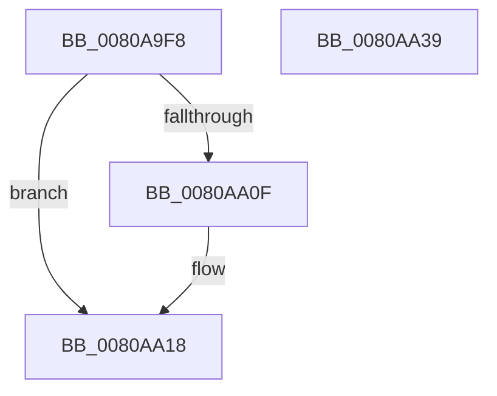

# MiDeleteAweInfo

- RVA: `0x0080A9F8`–`0x0080AA3A` (길이 `66` bytes)
- VA: `0x000000014080A9F8`
- 실행 섹션: `PAGE`
- PDB 이름 있음: `예`; PDB Function 태그: `아니요`
- unwind 정보 RVA: `0x0005CAAC`
- 디코드: `21`개 명령, `66/66` bytes 표시
- 미해석 바이트: `0` (있으면 어셈블리에 `.byte`로 보존)

> 이 문서는 커널 이미지의 기계어와 PDB 기호를 분석해 생성했습니다. 4번과 5번은 함수 원형과 자료형을 바이너리 사용 방식에서 추정한 C 해석이며 원본 소스 복구 결과는 아닙니다.

## 1. Dependencies

- 직접 호출 지점: **3**; 고유 호출 대상: **3**
- 직접 호출자로 확인된 함수: **4**
- RIP 상대 이미지 참조: **0**

### Outgoing calls
- `0x0080AA13` → [ExCleanupAutoExpandPushLock](../../text/43/ExCleanupAutoExpandPushLock_function_0043FAA0.md) (function, `0x0043FAA0`)
- `0x0080AA1F` → [MiDeleteAweBitMap](MiDeleteAweBitMap_function_0080A9A8.md) (function, `0x0080A9A8`)
- `0x0080AA29` → [ExFreePoolWithTag](../../poolcode/B8/ExFreePoolWithTag_function_00B82870.md) (function, `0x00B82870`)

### Direct callers
- [MiDeleteSectionAwe](../../text/68/MiDeleteSectionAwe_function_006887A8.md) at `0x006887BF`
- [MiAllocateAweInfo](MiAllocateAweInfo_function_00809518.md) at `0x00809624`
- [MiCreateProcessDefaultAweInfo](MiCreateProcessDefaultAweInfo_function_0080A8C0.md) at `0x0080A96E`
- [MmDeleteProcessAddressSpace](../AC/MmDeleteProcessAddressSpace_function_00AC804C.md) at `0x00AC818C`

### Static image references
- 디코드된 RIP-relative 메모리 참조가 없습니다.

## 2. Other-region calls and transfers

- 다른 실행 섹션으로 향하는 call: **2**
  - `0x0080AA13` → [ExCleanupAutoExpandPushLock](../../text/43/ExCleanupAutoExpandPushLock_function_0043FAA0.md) (`PAGE` → `.text`)
  - `0x0080AA29` → [ExFreePoolWithTag](../../poolcode/B8/ExFreePoolWithTag_function_00B82870.md) (`PAGE` → `POOLCODE`)
- 별도 외부 분기/꼬리 이동을 확인하지 못했습니다.

## 3. Assembly (complete function range)

```asm
0080A9F8  48 89 5C 24 08                  mov qword ptr [rsp + 8], rbx
0080A9FD  57                              push rdi
0080A9FE  48 83 EC 20                     sub rsp, 0x20
0080AA02  8B 42 08                        mov eax, dword ptr [rdx + 8]
0080AA05  48 8B DA                        mov rbx, rdx
0080AA08  48 8B F9                        mov rdi, rcx
0080AA0B  A8 02                           test al, 2
0080AA0D  74 09                           je 0x14080aa18
0080AA0F  48 8D 4A 40                     lea rcx, [rdx + 0x40]
0080AA13  E8 88 50 C3 FF                  call 0x14043faa0
0080AA18  48 8D 53 18                     lea rdx, [rbx + 0x18]
0080AA1C  48 8B CF                        mov rcx, rdi
0080AA1F  E8 84 FF FF FF                  call 0x14080a9a8
0080AA24  33 D2                           xor edx, edx
0080AA26  48 8B CB                        mov rcx, rbx
0080AA29  E8 42 7E 37 00                  call 0x140b82870
0080AA2E  48 8B 5C 24 30                  mov rbx, qword ptr [rsp + 0x30]
0080AA33  48 83 C4 20                     add rsp, 0x20
0080AA37  5F                              pop rdi
0080AA38  C3                              ret
0080AA39  CC                              int3
```

## 4. C-style interpretation (structured pseudocode)

```c
__int64 __fastcall MiDeleteAweInfo(__int64 a1, __int64 a2)
{
    __int64 result;
    __int64 v_rsp;
    unsigned __int64 v_stack_p8;

    v_stack_p8 = v_rbx;
    v_rsp = (v_rsp) - (32);
    result = (unsigned int)(*(unsigned int *)(a2 + 8));
    if ((((unsigned __int8)((unsigned int)(*(unsigned int *)(a2 + 8)))) & (2)) != 0) {
        a1 = a2 + 64;
        result = ExCleanupAutoExpandPushLock(a1, a2, a3, a4);
    }
    result = MiDeleteAweBitMap(a1, a2 + 24, a3, a4);
    a2 = 0;
    result = ExFreePoolWithTag(0, a2, a3, a4);
    v_rsp = (v_rsp) + (32);
    return result;
}
```

## 5. (Beta) C Style

```c
int64_t MiDeleteAweInfo(int64_t Arg1, void *Arg2)
{
    uint8_t *arg2 = (uint8_t *)Arg2;

    int64_t result;
    int64_t local_rsp;
    uint64_t v_stack_p8;

    v_stack_p8 = local_rbx;
    local_rsp = (local_rsp) - (32);
    result = (uint32_t)(*(uint32_t *)(arg2 + 0x8));
    if ((((uint8_t)((uint32_t)(*(uint32_t *)(arg2 + 0x8)))) & (2)) != 0) {
        Arg1 = Arg2 + 64;
        result = ExCleanupAutoExpandPushLock(Arg1, Arg2, a3, a4);
    }
    result = MiDeleteAweBitMap(Arg1, Arg2 + 24, a3, a4);
    Arg2 = 0;
    result = ExFreePoolWithTag(0, Arg2, a3, a4);
    local_rsp = (local_rsp) + (32);
    return result;
}
```

### 관측된 메모리 오프셋

구조체 형식이 확인되지 않은 접근은 인자 기준의 오프셋으로만 기록했습니다.

| 기준 인자 | 오프셋 표현 | 폭 (bit) | 접근 |
|---|---:|---:|---|
| `Arg2` | `+ 0x8` | `32` | `R` |
| `Arg2` | `+ 0x18` | `64` | `R` |
| `Arg2` | `+ 0x40` | `64` | `R` |

## 6. Execution-region graph

[열기: 2D/3D 그래프와 함수 탐색 컨트롤 패널](../../../control-panel.html?section=page&rva=0x0080A9F8&view=graph)

- 2D 그래프는 위에서 아래로 흐르고, 3D 그래프는 빈 공간을 드래그해 회전합니다. Shift+드래그는 이동, 휠은 확대·축소, 함수 노드 선택은 대상 보고서 이동입니다.

### Static fallback


