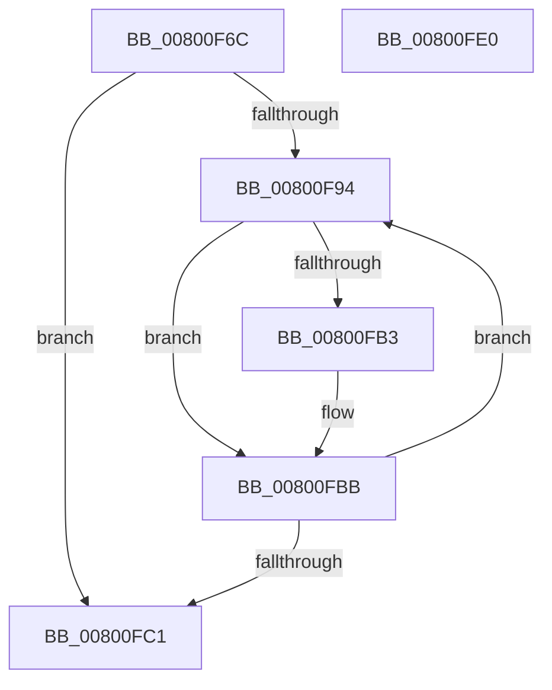

# MiDeleteFileExtentList

- RVA: `0x00800F6C`–`0x00800FE1` (길이 `117` bytes)
- VA: `0x0000000140800F6C`
- 실행 섹션: `PAGE`
- PDB 이름 있음: `예`; PDB Function 태그: `아니요`
- unwind 정보 RVA: `0x00060BC4`
- 디코드: `34`개 명령, `117/117` bytes 표시
- 미해석 바이트: `0` (있으면 어셈블리에 `.byte`로 보존)

> 이 문서는 커널 이미지의 기계어와 PDB 기호를 분석해 생성했습니다. 4번과 5번은 함수 원형과 자료형을 바이너리 사용 방식에서 추정한 C 해석이며 원본 소스 복구 결과는 아닙니다.

## 1. Dependencies

- 직접 호출 지점: **5**; 고유 호출 대상: **5**
- 직접 호출자로 확인된 함수: **5**
- RIP 상대 이미지 참조: **0**

### Outgoing calls
- `0x00800F7E` → [MiLockFileExtentsExclusive](MiLockFileExtentsExclusive_function_00801298.md) (function, `0x00801298`)
- `0x00800F86` → [MiGetExtentTable](../../text/68/MiGetExtentTable_function_00681428.md) (function, `0x00681428`)
- `0x00800FB6` → [RtlAvlRemoveNode](../../text/29/RtlAvlRemoveNode_function_00296650.md) (function, `0x00296650`)
- `0x00800FC1` → [MiUnlockFileExtentsExclusive](MiUnlockFileExtentsExclusive_function_00801318.md) (function, `0x00801318`)
- `0x00800FCB` → [ExFreePoolWithTag](../../poolcode/B8/ExFreePoolWithTag_function_00B82870.md) (function, `0x00B82870`)

### Direct callers
- [MiDeleteSegmentPages](../../text/32/MiDeleteSegmentPages_function_003261D4.md) at `0x003262FC`
- [MiEnableImageDirectMap](../../text/68/MiEnableImageDirectMap_function_00680A78.md) at `0x00680B4F`
- [MiCreateImageFileMap](../98/MiCreateImageFileMap_function_00986830.md) at `0x009870C9`
- [MiDeleteFileExtents](../A2/MiDeleteFileExtents_function_00A27004.md) at `0x00A27032`
- [MiAllocateFileExtents](../AB/MiAllocateFileExtents_function_00ABDF54.md) at `0x00ABE478`
- [MiAllocateFileExtents](../AB/MiAllocateFileExtents_function_00ABDF54.md) at `0x00ABE4C5`

### Static image references
- 디코드된 RIP-relative 메모리 참조가 없습니다.

## 2. Other-region calls and transfers

- 다른 실행 섹션으로 향하는 call: **3**
  - `0x00800F86` → [MiGetExtentTable](../../text/68/MiGetExtentTable_function_00681428.md) (`PAGE` → `.text`)
  - `0x00800FB6` → [RtlAvlRemoveNode](../../text/29/RtlAvlRemoveNode_function_00296650.md) (`PAGE` → `.text`)
  - `0x00800FCB` → [ExFreePoolWithTag](../../poolcode/B8/ExFreePoolWithTag_function_00B82870.md) (`PAGE` → `POOLCODE`)
- 별도 외부 분기/꼬리 이동을 확인하지 못했습니다.

## 3. Assembly (complete function range)

```asm
00800F6C  48 89 5C 24 08                  mov qword ptr [rsp + 8], rbx
00800F71  48 89 74 24 10                  mov qword ptr [rsp + 0x10], rsi
00800F76  57                              push rdi
00800F77  48 83 EC 20                     sub rsp, 0x20
00800F7B  48 8B F9                        mov rdi, rcx
00800F7E  E8 15 03 00 00                  call 0x140801298
00800F83  8B 4F 04                        mov ecx, dword ptr [rdi + 4]
00800F86  E8 9D 04 E8 FF                  call 0x140681428
00800F8B  33 DB                           xor ebx, ebx
00800F8D  48 8B F0                        mov rsi, rax
00800F90  39 1F                           cmp dword ptr [rdi], ebx
00800F92  76 2D                           jbe 0x140800fc1
00800F94  48 8D 14 5B                     lea rdx, [rbx + rbx*2]
00800F98  48 B8 00 00 00 00 00 00 00 80   movabs rax, 0x8000000000000000
00800FA2  48 C1 E2 04                     shl rdx, 4
00800FA6  48 83 C2 08                     add rdx, 8
00800FAA  48 03 D7                        add rdx, rdi
00800FAD  48 39 42 20                     cmp qword ptr [rdx + 0x20], rax
00800FB1  74 08                           je 0x140800fbb
00800FB3  48 8B CE                        mov rcx, rsi
00800FB6  E8 95 56 A9 FF                  call 0x140296650
00800FBB  FF C3                           inc ebx
00800FBD  3B 1F                           cmp ebx, dword ptr [rdi]
00800FBF  72 D3                           jb 0x140800f94
00800FC1  E8 52 03 00 00                  call 0x140801318
00800FC6  33 D2                           xor edx, edx
00800FC8  48 8B CF                        mov rcx, rdi
00800FCB  E8 A0 18 38 00                  call 0x140b82870
00800FD0  48 8B 5C 24 30                  mov rbx, qword ptr [rsp + 0x30]
00800FD5  48 8B 74 24 38                  mov rsi, qword ptr [rsp + 0x38]
00800FDA  48 83 C4 20                     add rsp, 0x20
00800FDE  5F                              pop rdi
00800FDF  C3                              ret
00800FE0  CC                              int3
```

## 4. C-style interpretation (structured pseudocode)

```c
__int64 __fastcall MiDeleteFileExtentList(__int64 a1)
{
    __int64 result;
    __int64 v_rbx;
    __int64 v_rsp;
    unsigned __int64 v_stack_p10;
    unsigned __int64 v_stack_p8;

    v_stack_p8 = v_rbx;
    v_stack_p10 = v_rsi;
    v_rsp = (v_rsp) - (32);
    result = MiLockFileExtentsExclusive(a1, a2, a3, a4);
    result = MiGetExtentTable((unsigned int)(*(unsigned int *)(a1 + 4)), a2, a3, a4);
    v_rbx = 0;
    if ((*(unsigned int *)(a1)) <= 0) goto loc_00800FC1;
loc_00800F94:
    a2 = (v_rbx + v_rbx * 2) << (4);
    a2 = (a2) + (8);
    a2 = (a2) + (a1);
    if ((*(unsigned __int64 *)(a2 + 32)) != result) {
        a1 = result;
        result = RtlAvlRemoveNode(a1, a2, a3, a4);
    }
    v_rbx = (unsigned int)((v_rbx) + 1);
    if (((unsigned int)(v_rbx)) < (*(unsigned int *)(a1))) goto loc_00800F94;
loc_00800FC1:
    result = MiUnlockFileExtentsExclusive(a1, a2, a3, a4);
    a2 = 0;
    result = ExFreePoolWithTag(a1, a2, a3, a4);
    v_rsp = (v_rsp) + (32);
    return result;
}
```

## 5. (Beta) C Style

```c
int64_t MiDeleteFileExtentList(void *Arg1)
{
    uint8_t *arg1 = (uint8_t *)Arg1;

    int64_t result;
    int64_t local_rbx;
    int64_t local_rsp;
    uint64_t v_stack_p10;
    uint64_t v_stack_p8;

    v_stack_p8 = local_rbx;
    v_stack_p10 = local_rsi;
    local_rsp = (local_rsp) - (32);
    result = MiLockFileExtentsExclusive(Arg1, a2, a3, a4);
    result = MiGetExtentTable((uint32_t)(*(uint32_t *)(arg1 + 0x4)), a2, a3, a4);
    local_rbx = 0;
    if ((*(uint32_t *)(arg1)) <= 0) goto loc_00800FC1;
loc_00800F94:
    a2 = (local_rbx + local_rbx * 2) << (4);
    a2 = (a2) + (8);
    a2 = (a2) + (Arg1);
    if ((*(uint64_t *)(a2 + 0x20)) != result) {
        Arg1 = result;
        result = RtlAvlRemoveNode(Arg1, a2, a3, a4);
    }
    local_rbx = (uint32_t)((local_rbx) + 1);
    if (((uint32_t)(local_rbx)) < (*(uint32_t *)(arg1))) goto loc_00800F94;
loc_00800FC1:
    result = MiUnlockFileExtentsExclusive(Arg1, a2, a3, a4);
    a2 = 0;
    result = ExFreePoolWithTag(Arg1, a2, a3, a4);
    local_rsp = (local_rsp) + (32);
    return result;
}
```

### 관측된 메모리 오프셋

구조체 형식이 확인되지 않은 접근은 인자 기준의 오프셋으로만 기록했습니다.

| 기준 인자 | 오프셋 표현 | 폭 (bit) | 접근 |
|---|---:|---:|---|
| `Arg1` | `+ 0x0` | `32` | `R` |
| `Arg1` | `+ 0x4` | `32` | `R` |

## 6. Execution-region graph

[열기: 2D/3D 그래프와 함수 탐색 컨트롤 패널](../../../control-panel.html?section=page&rva=0x00800F6C&view=graph)

- 2D 그래프는 위에서 아래로 흐르고, 3D 그래프는 빈 공간을 드래그해 회전합니다. Shift+드래그는 이동, 휠은 확대·축소, 함수 노드 선택은 대상 보고서 이동입니다.

### Static fallback


