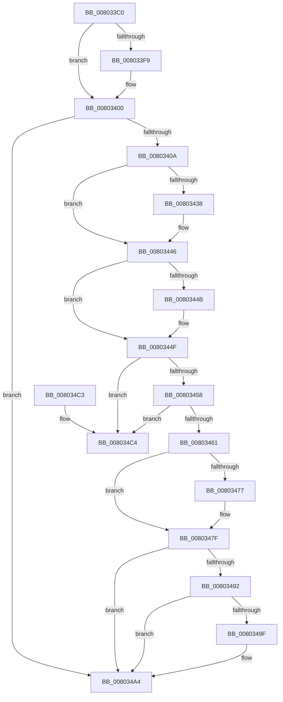

# MiDeleteHotPatchEntry

- RVA: `0x008033C0`–`0x008034CB` (길이 `267` bytes)
- VA: `0x00000001408033C0`
- 실행 섹션: `PAGE`
- PDB 이름 있음: `예`; PDB Function 태그: `아니요`
- unwind 정보 RVA: `0x00069AD0`
- 디코드: `74`개 명령, `267/267` bytes 표시
- 미해석 바이트: `0` (있으면 어셈블리에 `.byte`로 보존)

> 이 문서는 커널 이미지의 기계어와 PDB 기호를 분석해 생성했습니다. 4번과 5번은 함수 원형과 자료형을 바이너리 사용 방식에서 추정한 C 해석이며 원본 소스 복구 결과는 아닙니다.

## 1. Dependencies

- 직접 호출 지점: **9**; 고유 호출 대상: **8**
- 직접 호출자로 확인된 함수: **2**
- RIP 상대 이미지 참조: **0**

### Outgoing calls
- `0x008033EB` → [RtlFreeAnsiString](../9C/RtlFreeAnsiString_function_009C0800.md) (function, `0x009C0800`)
- `0x008033FB` → [ExFreePoolWithTag](../../poolcode/B8/ExFreePoolWithTag_function_00B82870.md) (function, `0x00B82870`)
- `0x0080340F` → [MiGetProcessHotPatchContext](MiGetProcessHotPatchContext_function_00803948.md) (function, `0x00803948`)
- `0x00803428` → [KeAbPreAcquire](../../text/21/KeAbPreAcquire_function_00210230.md) (function, `0x00210230`)
- `0x00803441` → [ExfAcquirePushLockExclusiveEx](../../text/20/ExfAcquirePushLockExclusiveEx_function_0020FC90.md) (function, `0x0020FC90`)
- `0x0080347A` → [ExfTryToWakePushLock](../../text/26/ExfTryToWakePushLock_function_00265DD0.md) (function, `0x00265DD0`)
- `0x00803482` → [KeAbPostRelease](../../text/2E/KeAbPostRelease_function_002E1600.md) (function, `0x002E1600`)
- `0x0080349F` → [KiCheckForKernelApcDelivery](../../text/2E/KiCheckForKernelApcDelivery_function_002E2C80.md) (function, `0x002E2C80`)
- `0x008034A9` → [ExFreePoolWithTag](../../poolcode/B8/ExFreePoolWithTag_function_00B82870.md) (function, `0x00B82870`)

### Direct callers
- [MiApplyImageHotPatchRequest](MiApplyImageHotPatchRequest_function_008025AC.md) at `0x00802A81`
- [MiDeleteVadHotPatchState](../AC/MiDeleteVadHotPatchState_function_00ACA608.md) at `0x00ACA66F`

### Static image references
- 디코드된 RIP-relative 메모리 참조가 없습니다.

## 2. Other-region calls and transfers

- 다른 실행 섹션으로 향하는 call: **7**
  - `0x008033FB` → [ExFreePoolWithTag](../../poolcode/B8/ExFreePoolWithTag_function_00B82870.md) (`PAGE` → `POOLCODE`)
  - `0x00803428` → [KeAbPreAcquire](../../text/21/KeAbPreAcquire_function_00210230.md) (`PAGE` → `.text`)
  - `0x00803441` → [ExfAcquirePushLockExclusiveEx](../../text/20/ExfAcquirePushLockExclusiveEx_function_0020FC90.md) (`PAGE` → `.text`)
  - `0x0080347A` → [ExfTryToWakePushLock](../../text/26/ExfTryToWakePushLock_function_00265DD0.md) (`PAGE` → `.text`)
  - `0x00803482` → [KeAbPostRelease](../../text/2E/KeAbPostRelease_function_002E1600.md) (`PAGE` → `.text`)
  - `0x0080349F` → [KiCheckForKernelApcDelivery](../../text/2E/KiCheckForKernelApcDelivery_function_002E2C80.md) (`PAGE` → `.text`)
  - `0x008034A9` → [ExFreePoolWithTag](../../poolcode/B8/ExFreePoolWithTag_function_00B82870.md) (`PAGE` → `POOLCODE`)
- 별도 외부 분기/꼬리 이동을 확인하지 못했습니다.

## 3. Assembly (complete function range)

```asm
008033C0  48 89 5C 24 08                  mov qword ptr [rsp + 8], rbx
008033C5  48 89 6C 24 10                  mov qword ptr [rsp + 0x10], rbp
008033CA  48 89 74 24 18                  mov qword ptr [rsp + 0x18], rsi
008033CF  57                              push rdi
008033D0  48 83 EC 20                     sub rsp, 0x20
008033D4  65 48 8B 34 25 88 01 00 00      mov rsi, qword ptr gs:[0x188]
008033DD  48 8B D9                        mov rbx, rcx
008033E0  48 83 C1 28                     add rcx, 0x28
008033E4  48 8B BE B8 00 00 00            mov rdi, qword ptr [rsi + 0xb8]
008033EB  E8 10 D4 1B 00                  call 0x1409c0800
008033F0  48 8B 4B 18                     mov rcx, qword ptr [rbx + 0x18]
008033F4  48 85 C9                        test rcx, rcx
008033F7  74 07                           je 0x140803400
008033F9  33 D2                           xor edx, edx
008033FB  E8 70 F4 37 00                  call 0x140b82870
00803400  48 83 3B 00                     cmp qword ptr [rbx], 0
00803404  0F 84 9A 00 00 00               je 0x1408034a4
0080340A  33 D2                           xor edx, edx
0080340C  48 8B CF                        mov rcx, rdi
0080340F  E8 34 05 00 00                  call 0x140803948
00803414  66 FF 8E E6 01 00 00            dec word ptr [rsi + 0x1e6]
0080341B  45 33 C0                        xor r8d, r8d
0080341E  33 D2                           xor edx, edx
00803420  90                              nop
00803421  48 8D 78 10                     lea rdi, [rax + 0x10]
00803425  48 8B CF                        mov rcx, rdi
00803428  E8 03 CE A0 FF                  call 0x140210230
0080342D  F0 48 0F BA 2F 00               lock bts qword ptr [rdi], 0
00803433  48 8B E8                        mov rbp, rax
00803436  73 0E                           jae 0x140803446
00803438  4C 8B C7                        mov r8, rdi
0080343B  48 8B D0                        mov rdx, rax
0080343E  48 8B CF                        mov rcx, rdi
00803441  E8 4A C8 A0 FF                  call 0x14020fc90
00803446  48 85 ED                        test rbp, rbp
00803449  74 04                           je 0x14080344f
0080344B  C6 45 0A 01                     mov byte ptr [rbp + 0xa], 1
0080344F  48 8B 0B                        mov rcx, qword ptr [rbx]
00803452  48 39 59 08                     cmp qword ptr [rcx + 8], rbx
00803456  75 6C                           jne 0x1408034c4
00803458  48 8B 43 08                     mov rax, qword ptr [rbx + 8]
0080345C  48 39 18                        cmp qword ptr [rax], rbx
0080345F  75 63                           jne 0x1408034c4
00803461  48 89 08                        mov qword ptr [rax], rcx
00803464  48 89 41 08                     mov qword ptr [rcx + 8], rax
00803468  48 83 C8 FF                     or rax, 0xffffffffffffffff
0080346C  F0 48 0F C1 07                  lock xadd qword ptr [rdi], rax
00803471  24 06                           and al, 6
00803473  3C 02                           cmp al, 2
00803475  75 08                           jne 0x14080347f
00803477  48 8B CF                        mov rcx, rdi
0080347A  E8 51 29 A6 FF                  call 0x140265dd0
0080347F  48 8B CF                        mov rcx, rdi
00803482  E8 79 E1 AD FF                  call 0x1402e1600
00803487  90                              nop
00803488  66 83 86 E6 01 00 00 01         add word ptr [rsi + 0x1e6], 1
00803490  75 12                           jne 0x1408034a4
00803492  48 8D 86 98 00 00 00            lea rax, [rsi + 0x98]
00803499  90                              nop
0080349A  48 39 00                        cmp qword ptr [rax], rax
0080349D  74 05                           je 0x1408034a4
0080349F  E8 DC F7 AD FF                  call 0x1402e2c80
008034A4  33 D2                           xor edx, edx
008034A6  48 8B CB                        mov rcx, rbx
008034A9  E8 C2 F3 37 00                  call 0x140b82870
008034AE  48 8B 5C 24 30                  mov rbx, qword ptr [rsp + 0x30]
008034B3  48 8B 6C 24 38                  mov rbp, qword ptr [rsp + 0x38]
008034B8  48 8B 74 24 40                  mov rsi, qword ptr [rsp + 0x40]
008034BD  48 83 C4 20                     add rsp, 0x20
008034C1  5F                              pop rdi
008034C2  C3                              ret
008034C3  CC                              int3
008034C4  B9 03 00 00 00                  mov ecx, 3
008034C9  CD 29                           int 0x29
```

## 4. C-style interpretation (structured pseudocode)

```c
__int64 __fastcall MiDeleteHotPatchEntry(__int64 a1, int a2, int a3)
{
    __int64 result;
    __int64 v_rsp;
    unsigned __int64 v_stack_p10;
    unsigned __int64 v_stack_p18;
    unsigned __int64 v_stack_p8;

    v_stack_p8 = v_rbx;
    v_stack_p10 = v_rbp;
    v_stack_p18 = v_rsi;
    v_rsp = (v_rsp) - (32);
    a1 = (a1) + (40);
    result = RtlFreeAnsiString(a1, a2, a3, a4);
    if (*(unsigned __int64 *)(a1 + 24) != 0) {
        a2 = 0;
        result = ExFreePoolWithTag(*(unsigned __int64 *)(a1 + 24), a2, a3, a4);
    }
    if ((*(unsigned __int64 *)(a1)) == 0) goto loc_008034A4;
    a2 = 0;
    result = MiGetProcessHotPatchContext(*(unsigned __int64 *)(*(unsigned __int64 *)(gs_base + (0 + 392)) + 184), a2, a3, a4);
    a3 = 0;
    a2 = 0;
    result = KeAbPreAcquire(result + 16, a2, a3, a4);
    if (!(condition_is_above_or_equal)) {
        a3 = result + 16;
        a2 = result;
        a1 = result + 16;
        result = ExfAcquirePushLockExclusiveEx(a1, a2, a3, a4);
    }
    if (result != 0) {
        *(unsigned __int8 *)(result + 10) = 1;
    }
    if ((*(unsigned __int64 *)(*(unsigned __int64 *)(a1) + 8)) != a1) goto loc_008034C4;
    if ((*(unsigned __int64 *)(*(unsigned __int64 *)(a1 + 8))) != a1) goto loc_008034C4;
    *(unsigned __int64 *)(*(unsigned __int64 *)(a1 + 8)) = *(unsigned __int64 *)(a1);
    *(unsigned __int64 *)(*(unsigned __int64 *)(a1) + 8) = *(unsigned __int64 *)(a1 + 8);
    result = (*(unsigned __int64 *)(a1 + 8)) | (-1);
    result = (unsigned __int8)((result) & (6));
    if (((unsigned __int8)(result)) == 2) {
        a1 = result + 16;
        result = ExfTryToWakePushLock(a1, a2, a3, a4);
    }
    result = KeAbPostRelease(result + 16, a2, a3, a4);
    if (((unsigned __int8)(result)) != 2) goto loc_008034A4;
    result = *(unsigned __int64 *)(gs_base + (0 + 392)) + 152;
    if ((*(unsigned __int64 *)(*(unsigned __int64 *)(gs_base + (0 + 392)) + 152)) != (*(unsigned __int64 *)(gs_base + (0 + 392)) + 152)) {
        result = KiCheckForKernelApcDelivery(result + 16, a2, a3, a4);
    }
    a2 = 0;
    result = ExFreePoolWithTag(a1, a2, a3, a4);
    v_rsp = (v_rsp) + (32);
    return result;
loc_008034C4:
    return result;
}
```

## 5. (Beta) C Style

```c
int64_t MiDeleteHotPatchEntry(void *Arg1, int32_t Arg2, int32_t Arg3)
{
    uint8_t *arg1 = (uint8_t *)Arg1;

    int64_t result;
    int64_t local_rsp;
    uint64_t v_stack_p10;
    uint64_t v_stack_p18;
    uint64_t v_stack_p8;

    v_stack_p8 = local_rbx;
    v_stack_p10 = local_rbp;
    v_stack_p18 = local_rsi;
    local_rsp = (local_rsp) - (32);
    Arg1 = (Arg1) + (40);
    result = RtlFreeAnsiString(Arg1, Arg2, Arg3, a4);
    if (*(uint64_t *)(arg1 + 0x18) != 0) {
        Arg2 = 0;
        result = ExFreePoolWithTag(*(uint64_t *)(arg1 + 0x18), Arg2, Arg3, a4);
    }
    if ((*(uint64_t *)(arg1)) == 0) goto loc_008034A4;
    Arg2 = 0;
    result = MiGetProcessHotPatchContext(*(uint64_t *)(*(uint64_t *)(gs_base + (0 + 0x188)) + 0xB8), Arg2, Arg3, a4);
    Arg3 = 0;
    Arg2 = 0;
    result = KeAbPreAcquire(result + 16, Arg2, Arg3, a4);
    if (!(condition_is_above_or_equal)) {
        Arg3 = result + 16;
        Arg2 = result;
        Arg1 = result + 16;
        result = ExfAcquirePushLockExclusiveEx(Arg1, Arg2, Arg3, a4);
    }
    if (result != 0) {
        *(uint8_t *)(result + 0xA) = 1;
    }
    if ((*(uint64_t *)(*(uint64_t *)(arg1) + 0x8)) != Arg1) goto loc_008034C4;
    if ((*(uint64_t *)(*(uint64_t *)(arg1 + 0x8))) != Arg1) goto loc_008034C4;
    *(uint64_t *)(*(uint64_t *)(arg1 + 0x8)) = *(uint64_t *)(arg1);
    *(uint64_t *)(*(uint64_t *)(arg1) + 0x8) = *(uint64_t *)(arg1 + 0x8);
    result = (*(uint64_t *)(arg1 + 0x8)) | (-1);
    result = (uint8_t)((result) & (6));
    if (((uint8_t)(result)) == 2) {
        Arg1 = result + 16;
        result = ExfTryToWakePushLock(Arg1, Arg2, Arg3, a4);
    }
    result = KeAbPostRelease(result + 16, Arg2, Arg3, a4);
    if (((uint8_t)(result)) != 2) goto loc_008034A4;
    result = *(uint64_t *)(gs_base + (0 + 0x188)) + 152;
    if ((*(uint64_t *)(*(uint64_t *)(gs_base + (0 + 0x188)) + 0x98)) != (*(uint64_t *)(gs_base + (0 + 0x188)) + 152)) {
        result = KiCheckForKernelApcDelivery(result + 16, Arg2, Arg3, a4);
    }
    Arg2 = 0;
    result = ExFreePoolWithTag(Arg1, Arg2, Arg3, a4);
    local_rsp = (local_rsp) + (32);
    return result;
loc_008034C4:
    return result;
}
```

### 관측된 메모리 오프셋

구조체 형식이 확인되지 않은 접근은 인자 기준의 오프셋으로만 기록했습니다.

| 기준 인자 | 오프셋 표현 | 폭 (bit) | 접근 |
|---|---:|---:|---|
| `Arg1` | `+ 0x0` | `64` | `R` |
| `Arg1` | `+ 0x8` | `64` | `R` |
| `Arg1` | `+ 0x18` | `64` | `R` |

## 6. Execution-region graph

[열기: 2D/3D 그래프와 함수 탐색 컨트롤 패널](../../../control-panel.html?section=page&rva=0x008033C0&view=graph)

- 2D 그래프는 위에서 아래로 흐르고, 3D 그래프는 빈 공간을 드래그해 회전합니다. Shift+드래그는 이동, 휠은 확대·축소, 함수 노드 선택은 대상 보고서 이동입니다.

### Static fallback


