# MiDeletePartitionResources

- RVA: `0x0080D074`–`0x0080D251` (길이 `477` bytes)
- VA: `0x000000014080D074`
- 실행 섹션: `PAGE`
- PDB 이름 있음: `예`; PDB Function 태그: `아니요`
- unwind 정보 RVA: `0x0005C954`
- 디코드: `119`개 명령, `477/477` bytes 표시
- 미해석 바이트: `0` (있으면 어셈블리에 `.byte`로 보존)

> 이 문서는 커널 이미지의 기계어와 PDB 기호를 분석해 생성했습니다. 4번과 5번은 함수 원형과 자료형을 바이너리 사용 방식에서 추정한 C 해석이며 원본 소스 복구 결과는 아닙니다.

## 1. Dependencies

- 직접 호출 지점: **24**; 고유 호출 대상: **20**
- 직접 호출자로 확인된 함수: **1**
- RIP 상대 이미지 참조: **0**

### Outgoing calls
- `0x0080D096` → [KeSetEvent](../../text/33/KeSetEvent_function_0033F310.md) (function, `0x0033F310`)
- `0x0080D0AE` → [MiUnlinkWorkingSet](../../text/2C/MiUnlinkWorkingSet_function_002C8B50.md) (function, `0x002C8B50`)
- `0x0080D0BA` → [MiReturnResident](../../text/28/MiReturnResident_function_00286890.md) (function, `0x00286890`)
- `0x0080D0DB` → [ZwWaitForSingleObject](../../text/6A/ZwWaitForSingleObject_function_006AD150.md) (function, `0x006AD150`)
- `0x0080D0E5` → [ObCloseHandle](../8A/ObCloseHandle_function_008A1870.md) (function, `0x008A1870`)
- `0x0080D100` → [MiDeleteUnmappedSystemCacheViews](../../text/67/MiDeleteUnmappedSystemCacheViews_function_0067C9A0.md) (function, `0x0067C9A0`)
- `0x0080D108` → [MiFreeClonePool](../../text/49/MiFreeClonePool_function_00492EE0.md) (function, `0x00492EE0`)
- `0x0080D115` → [MiAdjustCachedStacks](../../text/2D/MiAdjustCachedStacks_function_002D8AAC.md) (function, `0x002D8AAC`)
- `0x0080D123` → [MiCheckAndProcessCcAccessLog](../../text/45/MiCheckAndProcessCcAccessLog_function_0045D1A4.md) (function, `0x0045D1A4`)
- `0x0080D128` → [KeFlushQueuedDpcs](../../text/3C/KeFlushQueuedDpcs_function_003C0300.md) (function, `0x003C0300`)
- `0x0080D13B` → [ExFreePoolWithTag](../../poolcode/B8/ExFreePoolWithTag_function_00B82870.md) (function, `0x00B82870`)
- `0x0080D14F` → [PfDeletePartition](../75/PfDeletePartition_function_00751EB4.md) (function, `0x00751EB4`)
- `0x0080D157` → [MiDeletePagingFiles](../7F/MiDeletePagingFiles_function_007FFD34.md) (function, `0x007FFD34`)
- `0x0080D16A` → [MiDeletePartitionSlabState](MiDeletePartitionSlabState_function_0080C890.md) (function, `0x0080C890`)
- `0x0080D18A` → [MiRemoveLowestPriorityStandbyPage](../../text/33/MiRemoveLowestPriorityStandbyPage_function_00334600.md) (function, `0x00334600`)
- `0x0080D195` → [MiFreePartitionPhysicalPages](MiFreePartitionPhysicalPages_function_0080D42C.md) (function, `0x0080D42C`)
- `0x0080D1A8` → [ExFreePoolWithTag](../../poolcode/B8/ExFreePoolWithTag_function_00B82870.md) (function, `0x00B82870`)
- `0x0080D1B8` → [MiDeleteSpecialPurposeMemory](MiDeleteSpecialPurposeMemory_function_0080F52C.md) (function, `0x0080F52C`)
- `0x0080D1C0` → [MiDeletePfnBitMaps](MiDeletePfnBitMaps_function_0080C008.md) (function, `0x0080C008`)
- `0x0080D1E3` → [ObCloseHandle](../8A/ObCloseHandle_function_008A1870.md) (function, `0x008A1870`)
- `0x0080D1F5` → [ObfDereferenceObjectWithTag](../../text/2F/ObfDereferenceObjectWithTag_function_002F78E0.md) (function, `0x002F78E0`)
- `0x0080D210` → [ExFreeCacheAwareRundownProtection](../../text/48/ExFreeCacheAwareRundownProtection_function_0048FDD0.md) (function, `0x0048FDD0`)
- `0x0080D223` → [ObCloseHandle](../8A/ObCloseHandle_function_008A1870.md) (function, `0x008A1870`)
- `0x0080D236` → [ObCloseHandle](../8A/ObCloseHandle_function_008A1870.md) (function, `0x008A1870`)

### Direct callers
- [MiDeletePartition](../7F/MiDeletePartition_function_007FD2BC.md) at `0x007FD2D4`

### Static image references
- 디코드된 RIP-relative 메모리 참조가 없습니다.

## 2. Other-region calls and transfers

- 다른 실행 섹션으로 향하는 call: **14**
  - `0x0080D096` → [KeSetEvent](../../text/33/KeSetEvent_function_0033F310.md) (`PAGE` → `.text`)
  - `0x0080D0AE` → [MiUnlinkWorkingSet](../../text/2C/MiUnlinkWorkingSet_function_002C8B50.md) (`PAGE` → `.text`)
  - `0x0080D0BA` → [MiReturnResident](../../text/28/MiReturnResident_function_00286890.md) (`PAGE` → `.text`)
  - `0x0080D0DB` → [ZwWaitForSingleObject](../../text/6A/ZwWaitForSingleObject_function_006AD150.md) (`PAGE` → `.text`)
  - `0x0080D100` → [MiDeleteUnmappedSystemCacheViews](../../text/67/MiDeleteUnmappedSystemCacheViews_function_0067C9A0.md) (`PAGE` → `.text`)
  - `0x0080D108` → [MiFreeClonePool](../../text/49/MiFreeClonePool_function_00492EE0.md) (`PAGE` → `.text`)
  - `0x0080D115` → [MiAdjustCachedStacks](../../text/2D/MiAdjustCachedStacks_function_002D8AAC.md) (`PAGE` → `.text`)
  - `0x0080D123` → [MiCheckAndProcessCcAccessLog](../../text/45/MiCheckAndProcessCcAccessLog_function_0045D1A4.md) (`PAGE` → `.text`)
  - `0x0080D128` → [KeFlushQueuedDpcs](../../text/3C/KeFlushQueuedDpcs_function_003C0300.md) (`PAGE` → `.text`)
  - `0x0080D13B` → [ExFreePoolWithTag](../../poolcode/B8/ExFreePoolWithTag_function_00B82870.md) (`PAGE` → `POOLCODE`)
  - `0x0080D18A` → [MiRemoveLowestPriorityStandbyPage](../../text/33/MiRemoveLowestPriorityStandbyPage_function_00334600.md) (`PAGE` → `.text`)
  - `0x0080D1A8` → [ExFreePoolWithTag](../../poolcode/B8/ExFreePoolWithTag_function_00B82870.md) (`PAGE` → `POOLCODE`)
  - `0x0080D1F5` → [ObfDereferenceObjectWithTag](../../text/2F/ObfDereferenceObjectWithTag_function_002F78E0.md) (`PAGE` → `.text`)
  - `0x0080D210` → [ExFreeCacheAwareRundownProtection](../../text/48/ExFreeCacheAwareRundownProtection_function_0048FDD0.md) (`PAGE` → `.text`)
- 별도 외부 분기/꼬리 이동을 확인하지 못했습니다.

## 3. Assembly (complete function range)

```asm
0080D074  48 89 5C 24 08                  mov qword ptr [rsp + 8], rbx
0080D079  48 89 6C 24 10                  mov qword ptr [rsp + 0x10], rbp
0080D07E  48 89 74 24 18                  mov qword ptr [rsp + 0x18], rsi
0080D083  57                              push rdi
0080D084  48 83 EC 20                     sub rsp, 0x20
0080D088  45 33 C0                        xor r8d, r8d
0080D08B  48 8B F9                        mov rdi, rcx
0080D08E  48 83 C1 58                     add rcx, 0x58
0080D092  41 8D 50 01                     lea edx, [r8 + 1]
0080D096  E8 75 22 B3 FF                  call 0x14033f310
0080D09B  80 BF 5C 48 00 00 00            cmp byte ptr [rdi + 0x485c], 0
0080D0A2  74 1B                           je 0x14080d0bf
0080D0A4  48 8D 9F 80 49 00 00            lea rbx, [rdi + 0x4980]
0080D0AB  48 8B CB                        mov rcx, rbx
0080D0AE  E8 9D BA AB FF                  call 0x1402c8b50
0080D0B3  48 8B 53 70                     mov rdx, qword ptr [rbx + 0x70]
0080D0B7  48 8B CF                        mov rcx, rdi
0080D0BA  E8 D1 97 A7 FF                  call 0x140286890
0080D0BF  48 8D 9F 88 00 00 00            lea rbx, [rdi + 0x88]
0080D0C6  BD 06 00 00 00                  mov ebp, 6
0080D0CB  48 8B 33                        mov rsi, qword ptr [rbx]
0080D0CE  48 85 F6                        test rsi, rsi
0080D0D1  74 17                           je 0x14080d0ea
0080D0D3  45 33 C0                        xor r8d, r8d
0080D0D6  33 D2                           xor edx, edx
0080D0D8  48 8B CE                        mov rcx, rsi
0080D0DB  E8 70 00 EA FF                  call 0x1406ad150
0080D0E0  33 D2                           xor edx, edx
0080D0E2  48 8B CE                        mov rcx, rsi
0080D0E5  E8 86 47 09 00                  call 0x1408a1870
0080D0EA  48 83 C3 08                     add rbx, 8
0080D0EE  48 83 ED 01                     sub rbp, 1
0080D0F2  75 D7                           jne 0x14080d0cb
0080D0F4  40 38 AF 5C 48 00 00            cmp byte ptr [rdi + 0x485c], bpl
0080D0FB  74 08                           je 0x14080d105
0080D0FD  48 8B CF                        mov rcx, rdi
0080D100  E8 9B F8 E6 FF                  call 0x14067c9a0
0080D105  48 8B CF                        mov rcx, rdi
0080D108  E8 D3 5D C8 FF                  call 0x140492ee0
0080D10D  BA 03 00 00 00                  mov edx, 3
0080D112  48 8B CF                        mov rcx, rdi
0080D115  E8 92 B9 AC FF                  call 0x1402d8aac
0080D11A  33 D2                           xor edx, edx
0080D11C  48 8B CF                        mov rcx, rdi
0080D11F  44 8D 42 01                     lea r8d, [rdx + 1]
0080D123  E8 7C 00 C5 FF                  call 0x14045d1a4
0080D128  E8 D3 31 BB FF                  call 0x1403c0300
0080D12D  48 8B 8F 38 44 00 00            mov rcx, qword ptr [rdi + 0x4438]
0080D134  48 85 C9                        test rcx, rcx
0080D137  74 0F                           je 0x14080d148
0080D139  33 D2                           xor edx, edx
0080D13B  E8 30 57 37 00                  call 0x140b82870
0080D140  48 83 A7 38 44 00 00 00         and qword ptr [rdi + 0x4438], 0
0080D148  48 8B 8F B8 00 00 00            mov rcx, qword ptr [rdi + 0xb8]
0080D14F  E8 60 4D F4 FF                  call 0x140751eb4
0080D154  48 8B CF                        mov rcx, rdi
0080D157  E8 D8 2B FF FF                  call 0x1407ffd34
0080D15C  48 F7 D8                        neg rax
0080D15F  F0 48 01 87 98 4C 00 00         lock add qword ptr [rdi + 0x4c98], rax
0080D167  48 8B CF                        mov rcx, rdi
0080D16A  E8 21 F7 FF FF                  call 0x14080c890
0080D16F  48 8B 87 B8 00 00 00            mov rax, qword ptr [rdi + 0xb8]
0080D176  45 33 C0                        xor r8d, r8d
0080D179  48 8B 48 48                     mov rcx, qword ptr [rax + 0x48]
0080D17D  41 8D 50 08                     lea edx, [r8 + 8]
0080D181  8B 47 04                        mov eax, dword ptr [rdi + 4]
0080D184  48 8B 19                        mov rbx, qword ptr [rcx]
0080D187  48 8B CF                        mov rcx, rdi
0080D18A  E8 71 74 B2 FF                  call 0x140334600
0080D18F  48 8B D3                        mov rdx, rbx
0080D192  48 8B CF                        mov rcx, rdi
0080D195  E8 92 02 00 00                  call 0x14080d42c
0080D19A  48 8B 8F C0 44 00 00            mov rcx, qword ptr [rdi + 0x44c0]
0080D1A1  48 85 C9                        test rcx, rcx
0080D1A4  74 0F                           je 0x14080d1b5
0080D1A6  33 D2                           xor edx, edx
0080D1A8  E8 C3 56 37 00                  call 0x140b82870
0080D1AD  48 83 A7 C0 44 00 00 00         and qword ptr [rdi + 0x44c0], 0
0080D1B5  48 8B CF                        mov rcx, rdi
0080D1B8  E8 6F 23 00 00                  call 0x14080f52c
0080D1BD  48 8B CF                        mov rcx, rdi
0080D1C0  E8 43 EE FF FF                  call 0x14080c008
0080D1C5  48 8D AF D0 00 00 00            lea rbp, [rdi + 0xd0]
0080D1CC  BE 0B 00 00 00                  mov esi, 0xb
0080D1D1  48 8D 9F F8 00 00 00            lea rbx, [rdi + 0xf8]
0080D1D8  48 8B 4B 58                     mov rcx, qword ptr [rbx + 0x58]
0080D1DC  48 85 C9                        test rcx, rcx
0080D1DF  74 07                           je 0x14080d1e8
0080D1E1  33 D2                           xor edx, edx
0080D1E3  E8 88 46 09 00                  call 0x1408a1870
0080D1E8  48 8B 0B                        mov rcx, qword ptr [rbx]
0080D1EB  48 3B CD                        cmp rcx, rbp
0080D1EE  74 0A                           je 0x14080d1fa
0080D1F0  BA 4D 6D 50 6F                  mov edx, 0x6f506d4d
0080D1F5  E8 E6 A6 AE FF                  call 0x1402f78e0
0080D1FA  48 83 C3 08                     add rbx, 8
0080D1FE  48 83 EE 01                     sub rsi, 1
0080D202  75 D4                           jne 0x14080d1d8
0080D204  48 8B 8F F0 0A 00 00            mov rcx, qword ptr [rdi + 0xaf0]
0080D20B  48 85 C9                        test rcx, rcx
0080D20E  74 05                           je 0x14080d215
0080D210  E8 BB 2B C8 FF                  call 0x14048fdd0
0080D215  48 8B 8F F0 00 00 00            mov rcx, qword ptr [rdi + 0xf0]
0080D21C  48 85 C9                        test rcx, rcx
0080D21F  74 07                           je 0x14080d228
0080D221  33 D2                           xor edx, edx
0080D223  E8 48 46 09 00                  call 0x1408a1870
0080D228  48 8B 8F E8 00 00 00            mov rcx, qword ptr [rdi + 0xe8]
0080D22F  48 85 C9                        test rcx, rcx
0080D232  74 07                           je 0x14080d23b
0080D234  33 D2                           xor edx, edx
0080D236  E8 35 46 09 00                  call 0x1408a1870
0080D23B  48 8B 5C 24 30                  mov rbx, qword ptr [rsp + 0x30]
0080D240  48 8B 6C 24 38                  mov rbp, qword ptr [rsp + 0x38]
0080D245  48 8B 74 24 40                  mov rsi, qword ptr [rsp + 0x40]
0080D24A  48 83 C4 20                     add rsp, 0x20
0080D24E  5F                              pop rdi
0080D24F  C3                              ret
0080D250  CC                              int3
```

## 4. C-style interpretation (structured pseudocode)

```c
__int64 __fastcall MiDeletePartitionResources(__int64 a1, __int64 a2, int a3)
{
    __int64 result;
    __int64 v_rbp;
    __int64 v_rbx;
    __int64 v_rsi;
    __int64 v_rsp;
    unsigned __int64 v_stack_p10;
    unsigned __int64 v_stack_p18;
    unsigned __int64 v_stack_p8;

    v_stack_p8 = v_rbx;
    v_stack_p10 = v_rbp;
    v_stack_p18 = v_rsi;
    v_rsp = (v_rsp) - (32);
    a3 = 0;
    a1 = (a1) + (88);
    result = KeSetEvent(a1, a3 + 1, a3, a4);
    if ((*(unsigned __int8 *)(a1 + 18524)) != 0) {
        v_rbx = a1 + 18816;
        a1 = v_rbx;
        result = MiUnlinkWorkingSet(a1, a3 + 1, a3, a4);
        a2 = *(unsigned __int64 *)(v_rbx + 112);
        a1 = a1;
        result = MiReturnResident(a1, a2, a3, a4);
    }
loc_0080D0CB:
    if (*(unsigned __int64 *)(a1 + 136) != 0) {
        a3 = 0;
        a2 = 0;
        a1 = *(unsigned __int64 *)(a1 + 136);
        result = ZwWaitForSingleObject(a1, a2, a3, a4);
        a2 = 0;
        a1 = *(unsigned __int64 *)(a1 + 136);
        result = ObCloseHandle(a1, a2, a3, a4);
    }
    v_rbx = (a1 + 136) + (8);
    v_rbp = (6) - (1);
    if (condition_is_not_equal) goto loc_0080D0CB;
    if ((*(unsigned __int8 *)(a1 + 18524)) != ((unsigned __int8)(v_rbp))) {
        a1 = a1;
        result = MiDeleteUnmappedSystemCacheViews(a1, a2, a3, a4);
    }
    result = MiFreeClonePool(a1, a2, a3, a4);
    result = MiAdjustCachedStacks(a1, 3, a3, a4);
    a2 = 0;
    result = MiCheckAndProcessCcAccessLog(a1, a2, a2 + 1, a4);
    result = KeFlushQueuedDpcs(a1, a2, a2 + 1, a4);
    if (*(unsigned __int64 *)(a1 + 17464) != 0) {
        a2 = 0;
        result = ExFreePoolWithTag(*(unsigned __int64 *)(a1 + 17464), a2, a2 + 1, a4);
    }
    result = PfDeletePartition(*(unsigned __int64 *)(a1 + 184), a2, a2 + 1, a4);
    result = MiDeletePagingFiles(a1, a2, a2 + 1, a4);
    result = -(result);
    result = MiDeletePartitionSlabState(a1, a2, a2 + 1, a4);
    a3 = 0;
    result = MiRemoveLowestPriorityStandbyPage(a1, a3 + 8, a3, a4);
    result = MiFreePartitionPhysicalPages(a1, *(unsigned __int64 *)(*(unsigned __int64 *)(*(unsigned __int64 *)(a1 + 184) + 72)), a3, a4);
    if (*(unsigned __int64 *)(a1 + 17600) != 0) {
        a2 = 0;
        result = ExFreePoolWithTag(*(unsigned __int64 *)(a1 + 17600), a2, a3, a4);
    }
    result = MiDeleteSpecialPurposeMemory(a1, a2, a3, a4);
    result = MiDeletePfnBitMaps(a1, a2, a3, a4);
loc_0080D1D8:
    if (*(unsigned __int64 *)(a1 + 248 + 88) != 0) {
        a2 = 0;
        result = ObCloseHandle(*(unsigned __int64 *)(a1 + 248 + 88), a2, a3, a4);
    }
    if ((*(unsigned __int64 *)(a1 + 248)) != (a1 + 208)) {
        a2 = 0x6F506D4DULL;
        result = ObfDereferenceObjectWithTag(*(unsigned __int64 *)(a1 + 248), a2, a3, a4);
    }
    v_rbx = (a1 + 248) + (8);
    v_rsi = (11) - (1);
    if (condition_is_not_equal) goto loc_0080D1D8;
    if (*(unsigned __int64 *)(a1 + 2800) != 0) {
        result = ExFreeCacheAwareRundownProtection(*(unsigned __int64 *)(a1 + 2800), a2, a3, a4);
    }
    if (*(unsigned __int64 *)(a1 + 240) != 0) {
        a2 = 0;
        result = ObCloseHandle(*(unsigned __int64 *)(a1 + 240), a2, a3, a4);
    }
    if (*(unsigned __int64 *)(a1 + 232) != 0) {
        a2 = 0;
        result = ObCloseHandle(*(unsigned __int64 *)(a1 + 232), a2, a3, a4);
    }
    v_rsp = (v_rsp) + (32);
    return result;
}
```

## 5. (Beta) C Style

```c
int64_t MiDeletePartitionResources(void *Arg1, int64_t Arg2, int32_t Arg3)
{
    uint8_t *arg1 = (uint8_t *)Arg1;

    int64_t result;
    int64_t local_rbp;
    int64_t local_rbx;
    int64_t local_rsi;
    int64_t local_rsp;
    uint64_t v_stack_p10;
    uint64_t v_stack_p18;
    uint64_t v_stack_p8;

    v_stack_p8 = local_rbx;
    v_stack_p10 = local_rbp;
    v_stack_p18 = local_rsi;
    local_rsp = (local_rsp) - (32);
    Arg3 = 0;
    Arg1 = (Arg1) + (88);
    result = KeSetEvent(Arg1, Arg3 + 1, Arg3, a4);
    if ((*(uint8_t *)(arg1 + 0x485C)) != 0) {
        local_rbx = Arg1 + 18816;
        Arg1 = local_rbx;
        result = MiUnlinkWorkingSet(Arg1, Arg3 + 1, Arg3, a4);
        Arg2 = *(uint64_t *)(local_rbx + 0x70);
        Arg1 = Arg1;
        result = MiReturnResident(Arg1, Arg2, Arg3, a4);
    }
loc_0080D0CB:
    if (*(uint64_t *)(arg1 + 0x88) != 0) {
        Arg3 = 0;
        Arg2 = 0;
        Arg1 = *(uint64_t *)(arg1 + 0x88);
        result = ZwWaitForSingleObject(Arg1, Arg2, Arg3, a4);
        Arg2 = 0;
        Arg1 = *(uint64_t *)(arg1 + 0x88);
        result = ObCloseHandle(Arg1, Arg2, Arg3, a4);
    }
    local_rbx = (Arg1 + 136) + (8);
    local_rbp = (6) - (1);
    if (condition_is_not_equal) goto loc_0080D0CB;
    if ((*(uint8_t *)(arg1 + 0x485C)) != ((uint8_t)(local_rbp))) {
        Arg1 = Arg1;
        result = MiDeleteUnmappedSystemCacheViews(Arg1, Arg2, Arg3, a4);
    }
    result = MiFreeClonePool(Arg1, Arg2, Arg3, a4);
    result = MiAdjustCachedStacks(Arg1, 3, Arg3, a4);
    Arg2 = 0;
    result = MiCheckAndProcessCcAccessLog(Arg1, Arg2, Arg2 + 1, a4);
    result = KeFlushQueuedDpcs(Arg1, Arg2, Arg2 + 1, a4);
    if (*(uint64_t *)(arg1 + 0x4438) != 0) {
        Arg2 = 0;
        result = ExFreePoolWithTag(*(uint64_t *)(arg1 + 0x4438), Arg2, Arg2 + 1, a4);
    }
    result = PfDeletePartition(*(uint64_t *)(arg1 + 0xB8), Arg2, Arg2 + 1, a4);
    result = MiDeletePagingFiles(Arg1, Arg2, Arg2 + 1, a4);
    result = -(result);
    result = MiDeletePartitionSlabState(Arg1, Arg2, Arg2 + 1, a4);
    Arg3 = 0;
    result = MiRemoveLowestPriorityStandbyPage(Arg1, Arg3 + 8, Arg3, a4);
    result = MiFreePartitionPhysicalPages(Arg1, *(uint64_t *)(*(uint64_t *)(*(uint64_t *)(arg1 + 0xB8) + 0x48)), Arg3, a4);
    if (*(uint64_t *)(arg1 + 0x44C0) != 0) {
        Arg2 = 0;
        result = ExFreePoolWithTag(*(uint64_t *)(arg1 + 0x44C0), Arg2, Arg3, a4);
    }
    result = MiDeleteSpecialPurposeMemory(Arg1, Arg2, Arg3, a4);
    result = MiDeletePfnBitMaps(Arg1, Arg2, Arg3, a4);
loc_0080D1D8:
    if (*(uint64_t *)(arg1 + 0xF8 + 0x58) != 0) {
        Arg2 = 0;
        result = ObCloseHandle(*(uint64_t *)(arg1 + 0xF8 + 0x58), Arg2, Arg3, a4);
    }
    if ((*(uint64_t *)(arg1 + 0xF8)) != (Arg1 + 208)) {
        Arg2 = 0x6F506D4DULL;
        result = ObfDereferenceObjectWithTag(*(uint64_t *)(arg1 + 0xF8), Arg2, Arg3, a4);
    }
    local_rbx = (Arg1 + 248) + (8);
    local_rsi = (11) - (1);
    if (condition_is_not_equal) goto loc_0080D1D8;
    if (*(uint64_t *)(arg1 + 0xAF0) != 0) {
        result = ExFreeCacheAwareRundownProtection(*(uint64_t *)(arg1 + 0xAF0), Arg2, Arg3, a4);
    }
    if (*(uint64_t *)(arg1 + 0xF0) != 0) {
        Arg2 = 0;
        result = ObCloseHandle(*(uint64_t *)(arg1 + 0xF0), Arg2, Arg3, a4);
    }
    if (*(uint64_t *)(arg1 + 0xE8) != 0) {
        Arg2 = 0;
        result = ObCloseHandle(*(uint64_t *)(arg1 + 0xE8), Arg2, Arg3, a4);
    }
    local_rsp = (local_rsp) + (32);
    return result;
}
```

### 관측된 메모리 오프셋

구조체 형식이 확인되지 않은 접근은 인자 기준의 오프셋으로만 기록했습니다.

| 기준 인자 | 오프셋 표현 | 폭 (bit) | 접근 |
|---|---:|---:|---|
| `Arg1` | `+ 0x0` | `64` | `R` |
| `Arg1` | `+ 0x4` | `32` | `R` |
| `Arg1` | `+ 0x58` | `64` | `R` |
| `Arg1` | `+ 0x70` | `64` | `R` |
| `Arg1` | `+ 0x88` | `64` | `R` |
| `Arg1` | `+ 0xB8` | `64` | `R` |
| `Arg1` | `+ 0xD0` | `64` | `R` |
| `Arg1` | `+ 0xE8` | `64` | `R` |
| `Arg1` | `+ 0xF0` | `64` | `R` |
| `Arg1` | `+ 0xF8` | `64` | `R` |
| `Arg1` | `+ 0xAF0` | `64` | `R` |
| `Arg1` | `+ 0x4438` | `64` | `R` |
| `Arg1` | `+ 0x4438` | `64` | `R/W` |
| `Arg1` | `+ 0x44C0` | `64` | `R` |
| `Arg1` | `+ 0x44C0` | `64` | `R/W` |
| `Arg1` | `+ 0x485C` | `8` | `R` |
| `Arg1` | `+ 0x4980` | `64` | `R` |
| `Arg1` | `+ 0x4C98` | `64` | `R/W` |

## 6. Execution-region graph

[열기: 2D/3D 그래프와 함수 탐색 컨트롤 패널](../../../control-panel.html?section=page&rva=0x0080D074&view=graph)

- 2D 그래프는 위에서 아래로 흐르고, 3D 그래프는 빈 공간을 드래그해 회전합니다. Shift+드래그는 이동, 휠은 확대·축소, 함수 노드 선택은 대상 보고서 이동입니다.

### Static fallback

```mermaid
flowchart TD
  bb_0080D074[BB_0080D074]
  bb_0080D0A4[BB_0080D0A4]
  bb_0080D0BF[BB_0080D0BF]
  bb_0080D0CB[BB_0080D0CB]
  bb_0080D0D3[BB_0080D0D3]
  bb_0080D0EA[BB_0080D0EA]
  bb_0080D0F4[BB_0080D0F4]
  bb_0080D0FD[BB_0080D0FD]
  bb_0080D105[BB_0080D105]
  bb_0080D139[BB_0080D139]
  bb_0080D148[BB_0080D148]
  bb_0080D1A6[BB_0080D1A6]
  bb_0080D1B5[BB_0080D1B5]
  bb_0080D1D8[BB_0080D1D8]
  bb_0080D1E1[BB_0080D1E1]
  bb_0080D1E8[BB_0080D1E8]
  bb_0080D1F0[BB_0080D1F0]
  bb_0080D1FA[BB_0080D1FA]
  bb_0080D204[BB_0080D204]
  bb_0080D210[BB_0080D210]
  bb_0080D215[BB_0080D215]
  bb_0080D221[BB_0080D221]
  bb_0080D228[BB_0080D228]
  bb_0080D234[BB_0080D234]
  bb_0080D23B[BB_0080D23B]
  bb_0080D250[BB_0080D250]
  bb_0080D074 -->|branch| bb_0080D0BF
  bb_0080D074 -->|fallthrough| bb_0080D0A4
  bb_0080D0A4 -->|flow| bb_0080D0BF
  bb_0080D0BF -->|flow| bb_0080D0CB
  bb_0080D0CB -->|branch| bb_0080D0EA
  bb_0080D0CB -->|fallthrough| bb_0080D0D3
  bb_0080D0D3 -->|flow| bb_0080D0EA
  bb_0080D0EA -->|branch| bb_0080D0CB
  bb_0080D0EA -->|fallthrough| bb_0080D0F4
  bb_0080D0F4 -->|branch| bb_0080D105
  bb_0080D0F4 -->|fallthrough| bb_0080D0FD
  bb_0080D0FD -->|flow| bb_0080D105
  bb_0080D105 -->|branch| bb_0080D148
  bb_0080D105 -->|fallthrough| bb_0080D139
  bb_0080D139 -->|flow| bb_0080D148
  bb_0080D148 -->|branch| bb_0080D1B5
  bb_0080D148 -->|fallthrough| bb_0080D1A6
  bb_0080D1A6 -->|flow| bb_0080D1B5
  bb_0080D1B5 -->|flow| bb_0080D1D8
  bb_0080D1D8 -->|branch| bb_0080D1E8
  bb_0080D1D8 -->|fallthrough| bb_0080D1E1
  bb_0080D1E1 -->|flow| bb_0080D1E8
  bb_0080D1E8 -->|branch| bb_0080D1FA
  bb_0080D1E8 -->|fallthrough| bb_0080D1F0
  bb_0080D1F0 -->|flow| bb_0080D1FA
  bb_0080D1FA -->|branch| bb_0080D1D8
  bb_0080D1FA -->|fallthrough| bb_0080D204
  bb_0080D204 -->|branch| bb_0080D215
  bb_0080D204 -->|fallthrough| bb_0080D210
  bb_0080D210 -->|flow| bb_0080D215
  bb_0080D215 -->|branch| bb_0080D228
  bb_0080D215 -->|fallthrough| bb_0080D221
  bb_0080D221 -->|flow| bb_0080D228
  bb_0080D228 -->|branch| bb_0080D23B
  bb_0080D228 -->|fallthrough| bb_0080D234
  bb_0080D234 -->|flow| bb_0080D23B
```


