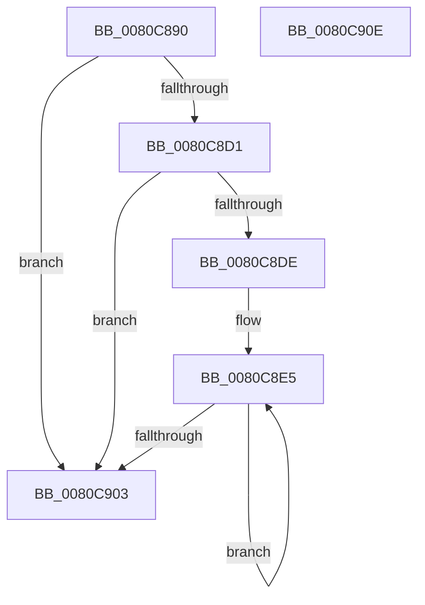

# MiDeletePartitionSlabState

- RVA: `0x0080C890`–`0x0080C90F` (길이 `127` bytes)
- VA: `0x000000014080C890`
- 실행 섹션: `PAGE`
- PDB 이름 있음: `예`; PDB Function 태그: `아니요`
- unwind 정보 RVA: `0x0006E5F8`
- 디코드: `33`개 명령, `127/127` bytes 표시
- 미해석 바이트: `0` (있으면 어셈블리에 `.byte`로 보존)

> 이 문서는 커널 이미지의 기계어와 PDB 기호를 분석해 생성했습니다. 4번과 5번은 함수 원형과 자료형을 바이너리 사용 방식에서 추정한 C 해석이며 원본 소스 복구 결과는 아닙니다.

## 1. Dependencies

- 직접 호출 지점: **3**; 고유 호출 대상: **3**
- 직접 호출자로 확인된 함수: **1**
- RIP 상대 이미지 참조: **2**

### Outgoing calls
- `0x0080C8A2` → [MiDeletePendingSlabIdentities](../../text/68/MiDeletePendingSlabIdentities_function_0068DA3C.md) (function, `0x0068DA3C`)
- `0x0080C8C0` → [MiEnumerateSlabAllocatorsEx](../../text/47/MiEnumerateSlabAllocatorsEx_function_004746F8.md) (function, `0x004746F8`)
- `0x0080C8EA` → [ExFreePoolWithTag](../../poolcode/B8/ExFreePoolWithTag_function_00B82870.md) (function, `0x00B82870`)

### Direct callers
- [MiDeletePartitionResources](MiDeletePartitionResources_function_0080D074.md) at `0x0080D16A`

### Static image references
- `0x0080C8B6` → RVA `0x0068DDC0` (`MiDeleteSlabAllocator`; read)
- `0x0080C8D1` → RVA `0x00FC5000` (`ALMOSTRO`; read)

## 2. Other-region calls and transfers

- 다른 실행 섹션으로 향하는 call: **3**
  - `0x0080C8A2` → [MiDeletePendingSlabIdentities](../../text/68/MiDeletePendingSlabIdentities_function_0068DA3C.md) (`PAGE` → `.text`)
  - `0x0080C8C0` → [MiEnumerateSlabAllocatorsEx](../../text/47/MiEnumerateSlabAllocatorsEx_function_004746F8.md) (`PAGE` → `.text`)
  - `0x0080C8EA` → [ExFreePoolWithTag](../../poolcode/B8/ExFreePoolWithTag_function_00B82870.md) (`PAGE` → `POOLCODE`)
- 별도 외부 분기/꼬리 이동을 확인하지 못했습니다.

## 3. Assembly (complete function range)

```asm
0080C890  48 89 5C 24 08                  mov qword ptr [rsp + 8], rbx
0080C895  57                              push rdi
0080C896  48 83 EC 30                     sub rsp, 0x30
0080C89A  BA 01 00 00 00                  mov edx, 1
0080C89F  48 8B F9                        mov rdi, rcx
0080C8A2  E8 95 11 E8 FF                  call 0x14068da3c
0080C8A7  41 83 C9 FF                     or r9d, 0xffffffff
0080C8AB  C7 44 24 20 09 00 00 00         mov dword ptr [rsp + 0x20], 9
0080C8B3  45 33 C0                        xor r8d, r8d
0080C8B6  48 8D 15 03 15 E8 FF            lea rdx, [rip - 0x17eafd]
0080C8BD  48 8B CF                        mov rcx, rdi
0080C8C0  E8 33 7E C6 FF                  call 0x1404746f8
0080C8C5  8B 87 70 47 00 00               mov eax, dword ptr [rdi + 0x4770]
0080C8CB  33 DB                           xor ebx, ebx
0080C8CD  85 C0                           test eax, eax
0080C8CF  74 32                           je 0x14080c903
0080C8D1  66 3B 1D 28 87 7B 00            cmp bx, word ptr [rip + 0x7b8728]
0080C8D8  48 8B 7F 10                     mov rdi, qword ptr [rdi + 0x10]
0080C8DC  73 25                           jae 0x14080c903
0080C8DE  48 81 C7 B0 DE 00 00            add rdi, 0xdeb0
0080C8E5  48 8B 0F                        mov rcx, qword ptr [rdi]
0080C8E8  33 D2                           xor edx, edx
0080C8EA  E8 81 5F 37 00                  call 0x140b82870
0080C8EF  0F B7 05 0A 87 7B 00            movzx eax, word ptr [rip + 0x7b870a]
0080C8F6  48 8D BF 80 DF 00 00            lea rdi, [rdi + 0xdf80]
0080C8FD  FF C3                           inc ebx
0080C8FF  3B D8                           cmp ebx, eax
0080C901  72 E2                           jb 0x14080c8e5
0080C903  48 8B 5C 24 40                  mov rbx, qword ptr [rsp + 0x40]
0080C908  48 83 C4 30                     add rsp, 0x30
0080C90C  5F                              pop rdi
0080C90D  C3                              ret
0080C90E  CC                              int3
```

## 4. C-style interpretation (structured pseudocode)

```c
__int64 __fastcall MiDeletePartitionSlabState(__int64 a1, __int64 a2, int a3, int a4)
{
    __int64 result;
    __int64 v_rbx;
    __int64 v_rdi;
    __int64 v_rsp;
    unsigned int v_stack_m18;
    unsigned __int64 v_stack_p8;

    v_stack_p8 = v_rbx;
    v_rsp = (v_rsp) - (48);
    result = MiDeletePendingSlabIdentities(a1, 1, a3, a4);
    a4 = (unsigned int)((a4) | (0xFFFFFFFFULL));
    v_stack_m18 = 9;
    a3 = 0;
    result = MiEnumerateSlabAllocatorsEx(a1, v_rip - 1567485, a3, a4);
    v_rbx = 0;
    if ((unsigned int)((unsigned int)(*(unsigned int *)(a1 + 18288))) == 0) goto loc_0080C903;
    if (0 >= (*(unsigned __int16 *)(v_rip + 8095528))) goto loc_0080C903;
    v_rdi = (*(unsigned __int64 *)(a1 + 16)) + (0xDEB0ULL);
loc_0080C8E5:
    a2 = 0;
    result = ExFreePoolWithTag(*(unsigned __int64 *)(v_rdi), a2, a3, a4);
    v_rbx = (unsigned int)((v_rbx) + 1);
    if (((unsigned int)(v_rbx)) < ((unsigned int)(*(unsigned __int16 *)(v_rip + 8095498)))) goto loc_0080C8E5;
loc_0080C903:
    v_rsp = (v_rsp) + (48);
    return *(unsigned __int16 *)(v_rip + 8095498);
}
```

## 5. (Beta) C Style

```c
int64_t MiDeletePartitionSlabState(void *Arg1, int64_t Arg2, int32_t Arg3, int32_t Arg4)
{
    uint8_t *arg1 = (uint8_t *)Arg1;

    int64_t result;
    int64_t local_rbx;
    int64_t local_rdi;
    int64_t local_rsp;
    uint32_t v_stack_m18;
    uint64_t v_stack_p8;

    v_stack_p8 = local_rbx;
    local_rsp = (local_rsp) - (48);
    result = MiDeletePendingSlabIdentities(Arg1, 1, Arg3, Arg4);
    Arg4 = (uint32_t)((Arg4) | (0xFFFFFFFFULL));
    v_stack_m18 = 9;
    Arg3 = 0;
    result = MiEnumerateSlabAllocatorsEx(Arg1, v_rip - 1567485, Arg3, Arg4);
    local_rbx = 0;
    if ((uint32_t)((uint32_t)(*(uint32_t *)(arg1 + 0x4770))) == 0) goto loc_0080C903;
    if (0 >= (*(uint16_t *)(v_rip + 0x7B8728))) goto loc_0080C903;
    local_rdi = (*(uint64_t *)(arg1 + 0x10)) + (0xDEB0ULL);
loc_0080C8E5:
    Arg2 = 0;
    result = ExFreePoolWithTag(*(uint64_t *)(local_rdi), Arg2, Arg3, Arg4);
    local_rbx = (uint32_t)((local_rbx) + 1);
    if (((uint32_t)(local_rbx)) < ((uint32_t)(*(uint16_t *)(v_rip + 0x7B870A)))) goto loc_0080C8E5;
loc_0080C903:
    local_rsp = (local_rsp) + (48);
    return *(uint16_t *)(v_rip + 0x7B870A);
}
```

### 관측된 메모리 오프셋

구조체 형식이 확인되지 않은 접근은 인자 기준의 오프셋으로만 기록했습니다.

| 기준 인자 | 오프셋 표현 | 폭 (bit) | 접근 |
|---|---:|---:|---|
| `Arg1` | `+ 0x10` | `64` | `R` |
| `Arg1` | `+ 0x4770` | `32` | `R` |

## 6. Execution-region graph

[열기: 2D/3D 그래프와 함수 탐색 컨트롤 패널](../../../control-panel.html?section=page&rva=0x0080C890&view=graph)

- 2D 그래프는 위에서 아래로 흐르고, 3D 그래프는 빈 공간을 드래그해 회전합니다. Shift+드래그는 이동, 휠은 확대·축소, 함수 노드 선택은 대상 보고서 이동입니다.

### Static fallback


