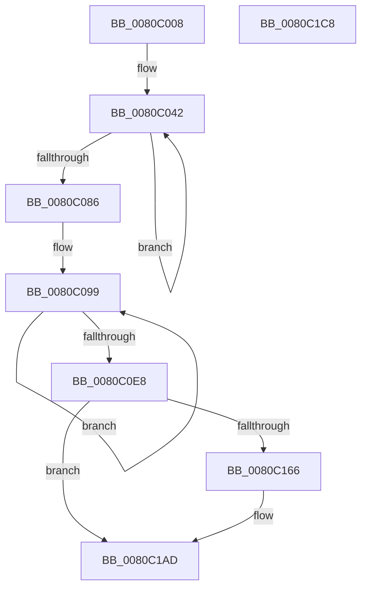

# MiDeletePfnBitMaps

- RVA: `0x0080C008`–`0x0080C1C9` (길이 `449` bytes)
- VA: `0x000000014080C008`
- 실행 섹션: `PAGE`
- PDB 이름 있음: `예`; PDB Function 태그: `아니요`
- unwind 정보 RVA: `0x0005E6B4`
- 디코드: `108`개 명령, `449/449` bytes 표시
- 미해석 바이트: `0` (있으면 어셈블리에 `.byte`로 보존)

> 이 문서는 커널 이미지의 기계어와 PDB 기호를 분석해 생성했습니다. 4번과 5번은 함수 원형과 자료형을 바이너리 사용 방식에서 추정한 C 해석이며 원본 소스 복구 결과는 아닙니다.

## 1. Dependencies

- 직접 호출 지점: **6**; 고유 호출 대상: **1**
- 직접 호출자로 확인된 함수: **2**
- RIP 상대 이미지 참조: **4**

### Outgoing calls
- `0x0080C06F` → [MiDeleteSparseRange](MiDeleteSparseRange_function_0080C1D0.md) (function, `0x0080C1D0`)
- `0x0080C0D1` → [MiDeleteSparseRange](MiDeleteSparseRange_function_0080C1D0.md) (function, `0x0080C1D0`)
- `0x0080C114` → [MiDeleteSparseRange](MiDeleteSparseRange_function_0080C1D0.md) (function, `0x0080C1D0`)
- `0x0080C14E` → [MiDeleteSparseRange](MiDeleteSparseRange_function_0080C1D0.md) (function, `0x0080C1D0`)
- `0x0080C18C` → [MiDeleteSparseRange](MiDeleteSparseRange_function_0080C1D0.md) (function, `0x0080C1D0`)
- `0x0080C1A1` → [MiDeleteSparseRange](MiDeleteSparseRange_function_0080C1D0.md) (function, `0x0080C1D0`)

### Direct callers
- [MiCreatePfnBitMaps](MiCreatePfnBitMaps_function_0080BBC8.md) at `0x0080BCCE`
- [MiDeletePartitionResources](MiDeletePartitionResources_function_0080D074.md) at `0x0080D1C0`

### Static image references
- `0x0080C021` → RVA `0x00E2DCE0` (`.data`; read)
- `0x0080C028` → RVA `0x00011C60` (`.rdata`; read)
- `0x0080C086` → RVA `0x00011128` (`.rdata`; read)
- `0x0080C15A` → RVA `0x00E38D00` (`.data`; read)

## 2. Other-region calls and transfers

- 다른 실행 섹션으로 향하는 call: **0**
- 별도 외부 분기/꼬리 이동을 확인하지 못했습니다.

## 3. Assembly (complete function range)

```asm
0080C008  48 8B C4                        mov rax, rsp
0080C00B  48 89 58 08                     mov qword ptr [rax + 8], rbx
0080C00F  48 89 68 10                     mov qword ptr [rax + 0x10], rbp
0080C013  48 89 70 18                     mov qword ptr [rax + 0x18], rsi
0080C017  48 89 78 20                     mov qword ptr [rax + 0x20], rdi
0080C01B  41 56                           push r14
0080C01D  48 83 EC 20                     sub rsp, 0x20
0080C021  48 8B 3D B8 1C 62 00            mov rdi, qword ptr [rip + 0x621cb8]
0080C028  48 8D 2D 31 5C 80 FF            lea rbp, [rip - 0x7fa3cf]
0080C02F  48 FF C7                        inc rdi
0080C032  48 8D B1 D0 3F 00 00            lea rsi, [rcx + 0x3fd0]
0080C039  48 8B D9                        mov rbx, rcx
0080C03C  41 BE 02 00 00 00               mov r14d, 2
0080C042  33 D2                           xor edx, edx
0080C044  48 8B C7                        mov rax, rdi
0080C047  48 F7 75 00                     div qword ptr [rbp]
0080C04B  48 F7 DA                        neg rdx
0080C04E  48 1B C9                        sbb rcx, rcx
0080C051  48 F7 D9                        neg rcx
0080C054  48 8D 51 07                     lea rdx, [rcx + 7]
0080C058  48 8B 0E                        mov rcx, qword ptr [rsi]
0080C05B  48 03 D0                        add rdx, rax
0080C05E  48 C1 EA 03                     shr rdx, 3
0080C062  48 81 C2 FF 0F 00 00            add rdx, 0xfff
0080C069  48 C1 EA 0C                     shr rdx, 0xc
0080C06D  8B D2                           mov edx, edx
0080C06F  E8 5C 01 00 00                  call 0x14080c1d0
0080C074  48 83 26 00                     and qword ptr [rsi], 0
0080C078  48 8D 6D 08                     lea rbp, [rbp + 8]
0080C07C  48 8D 76 10                     lea rsi, [rsi + 0x10]
0080C080  49 83 EE 01                     sub r14, 1
0080C084  75 BC                           jne 0x14080c042
0080C086  4C 8D 35 9B 50 80 FF            lea r14, [rip - 0x7faf65]
0080C08D  BD 03 00 00 00                  mov ebp, 3
0080C092  48 8D B3 10 40 00 00            lea rsi, [rbx + 0x4010]
0080C099  49 8B 0E                        mov rcx, qword ptr [r14]
0080C09C  33 D2                           xor edx, edx
0080C09E  41 B8 01 00 00 00               mov r8d, 1
0080C0A4  48 8B C7                        mov rax, rdi
0080C0A7  49 D3 E0                        shl r8, cl
0080C0AA  49 F7 F0                        div r8
0080C0AD  48 F7 DA                        neg rdx
0080C0B0  48 1B C9                        sbb rcx, rcx
0080C0B3  48 F7 D9                        neg rcx
0080C0B6  48 8D 51 07                     lea rdx, [rcx + 7]
0080C0BA  48 8B 0E                        mov rcx, qword ptr [rsi]
0080C0BD  48 03 D0                        add rdx, rax
0080C0C0  48 C1 EA 03                     shr rdx, 3
0080C0C4  48 81 C2 FF 0F 00 00            add rdx, 0xfff
0080C0CB  48 C1 EA 0C                     shr rdx, 0xc
0080C0CF  8B D2                           mov edx, edx
0080C0D1  E8 FA 00 00 00                  call 0x14080c1d0
0080C0D6  48 83 26 00                     and qword ptr [rsi], 0
0080C0DA  4D 8D 76 08                     lea r14, [r14 + 8]
0080C0DE  48 8D 76 10                     lea rsi, [rsi + 0x10]
0080C0E2  48 83 ED 01                     sub rbp, 1
0080C0E6  75 B1                           jne 0x14080c099
0080C0E8  48 8B CD                        mov rcx, rbp
0080C0EB  48 F7 C7 FF FF 03 00            test rdi, 0x3ffff
0080C0F2  48 8B C7                        mov rax, rdi
0080C0F5  0F 95 C1                        setne cl
0080C0F8  48 C1 E8 12                     shr rax, 0x12
0080C0FC  48 03 C8                        add rcx, rax
0080C0FF  48 8D 14 8D FF 0F 00 00         lea rdx, [rcx*4 + 0xfff]
0080C107  48 8B 8B 38 40 00 00            mov rcx, qword ptr [rbx + 0x4038]
0080C10E  48 C1 EA 0C                     shr rdx, 0xc
0080C112  8B D2                           mov edx, edx
0080C114  E8 B7 00 00 00                  call 0x14080c1d0
0080C119  48 21 AB 38 40 00 00            and qword ptr [rbx + 0x4038], rbp
0080C120  48 8B CD                        mov rcx, rbp
0080C123  48 F7 C7 FF 01 00 00            test rdi, 0x1ff
0080C12A  48 8B C7                        mov rax, rdi
0080C12D  0F 95 C1                        setne cl
0080C130  48 C1 E8 09                     shr rax, 9
0080C134  48 03 C8                        add rcx, rax
0080C137  48 8D 04 4D FF 0F 00 00         lea rax, [rcx*2 + 0xfff]
0080C13F  48 8B 8B 00 40 00 00            mov rcx, qword ptr [rbx + 0x4000]
0080C146  48 C1 E8 0C                     shr rax, 0xc
0080C14A  8B D0                           mov edx, eax
0080C14C  8B F0                           mov esi, eax
0080C14E  E8 7D 00 00 00                  call 0x14080c1d0
0080C153  48 21 AB 00 40 00 00            and qword ptr [rbx + 0x4000], rbp
0080C15A  48 8D 05 9F CB 62 00            lea rax, [rip + 0x62cb9f]
0080C161  48 3B D8                        cmp rbx, rax
0080C164  75 47                           jne 0x14080c1ad
0080C166  48 8B 8B F8 3F 00 00            mov rcx, qword ptr [rbx + 0x3ff8]
0080C16D  40 F6 C7 0F                     test dil, 0xf
0080C171  48 8B C5                        mov rax, rbp
0080C174  0F 95 C0                        setne al
0080C177  48 C1 EF 04                     shr rdi, 4
0080C17B  48 03 C7                        add rax, rdi
0080C17E  48 8D 14 45 FF 0F 00 00         lea rdx, [rax*2 + 0xfff]
0080C186  48 C1 EA 0C                     shr rdx, 0xc
0080C18A  8B D2                           mov edx, edx
0080C18C  E8 3F 00 00 00                  call 0x14080c1d0
0080C191  48 8B 8B 40 45 00 00            mov rcx, qword ptr [rbx + 0x4540]
0080C198  8B D6                           mov edx, esi
0080C19A  48 21 AB F8 3F 00 00            and qword ptr [rbx + 0x3ff8], rbp
0080C1A1  E8 2A 00 00 00                  call 0x14080c1d0
0080C1A6  48 21 AB 40 45 00 00            and qword ptr [rbx + 0x4540], rbp
0080C1AD  48 8B 5C 24 30                  mov rbx, qword ptr [rsp + 0x30]
0080C1B2  48 8B 6C 24 38                  mov rbp, qword ptr [rsp + 0x38]
0080C1B7  48 8B 74 24 40                  mov rsi, qword ptr [rsp + 0x40]
0080C1BC  48 8B 7C 24 48                  mov rdi, qword ptr [rsp + 0x48]
0080C1C1  48 83 C4 20                     add rsp, 0x20
0080C1C5  41 5E                           pop r14
0080C1C7  C3                              ret
0080C1C8  CC                              int3
```

## 4. C-style interpretation (structured pseudocode)

```c
__int64 __fastcall MiDeletePfnBitMaps(__int64 a1, int a2)
{
    __int64 result;
    __int64 v_r14;
    __int64 v_rbp;
    __int64 v_rdi;
    __int64 v_rsp;
    unsigned __int64 v_stack_p10;
    unsigned __int64 v_stack_p18;
    unsigned __int64 v_stack_p20;
    unsigned __int64 v_stack_p8;

    *(unsigned __int64 *)(v_rsp + 8) = v_rbx;
    *(unsigned __int64 *)(v_rsp + 16) = v_rbp;
    *(unsigned __int64 *)(v_rsp + 24) = v_rsi;
    *(unsigned __int64 *)(v_rsp + 32) = v_rdi;
    v_rsp = (v_rsp) - (32);
    v_rdi = (*(unsigned __int64 *)(v_rip + 6429880)) + 1;
loc_0080C042:
    a2 = 0;
    a2 = -(a2);
    a1 = -(a1);
    a2 = (a1 + 7) + (v_rdi);
    a2 = (a2) >> (3);
    a2 = (a2) + (0xFFFULL);
    a2 = (a2) >> (12);
    result = MiDeleteSparseRange(*(unsigned __int64 *)(a1 + 16336), (unsigned int)(a2), a3, a4);
    v_r14 = (2) - (1);
    if (condition_is_not_equal) goto loc_0080C042;
loc_0080C099:
    a2 = 0;
    a3 = (1) << ((unsigned __int8)(*(unsigned __int64 *)(v_rip - 8367973)));
    a2 = -(a2);
    a1 = -(*(unsigned __int64 *)(v_rip - 8367973));
    a2 = (a1 + 7) + (v_rdi);
    a2 = (a2) >> (3);
    a2 = (a2) + (0xFFFULL);
    a2 = (a2) >> (12);
    result = MiDeleteSparseRange(*(unsigned __int64 *)(a1 + 16400), (unsigned int)(a2), a3, a4);
    v_rbp = (3) - (1);
    if (condition_is_not_equal) goto loc_0080C099;
    a1 = (((v_rdi) & (0x3FFFFULL)) != 0) ? 1 : 0;
    result = (v_rdi) >> (18);
    a1 = (a1) + (result);
    a2 = (a1 * 4 + 4095) >> (12);
    result = MiDeleteSparseRange(*(unsigned __int64 *)(a1 + 16440), (unsigned int)(a2), a3, a4);
    a1 = (((v_rdi) & (511)) != 0) ? 1 : 0;
    result = (v_rdi) >> (9);
    a1 = (a1) + (result);
    result = (a1 * 2 + 4095) >> (12);
    result = MiDeleteSparseRange(*(unsigned __int64 *)(a1 + 16384), (unsigned int)((unsigned int)(result)), a3, a4);
    result = v_rip + 6474655;
    if (a1 == (v_rip + 6474655)) {
        a1 = *(unsigned __int64 *)(a1 + 16376);
        result = v_rbp;
        result = ((((unsigned __int8)(v_rdi)) & (15)) != 0) ? 1 : 0;
        v_rdi = (v_rdi) >> (4);
        result = (result) + (v_rdi);
        a2 = result * 2 + 4095;
        a2 = (a2) >> (12);
        a2 = a2;
        result = MiDeleteSparseRange(a1, a2, a3, a4);
        a1 = *(unsigned __int64 *)(a1 + 17728);
        a2 = (unsigned int)((unsigned int)((unsigned int)(result)));
        result = MiDeleteSparseRange(a1, a2, a3, a4);
    }
    v_rsp = (v_rsp) + (32);
    return result;
}
```

## 5. (Beta) C Style

```c
int64_t MiDeletePfnBitMaps(void *Arg1, int32_t Arg2)
{
    uint8_t *arg1 = (uint8_t *)Arg1;

    int64_t result;
    int64_t local_r14;
    int64_t local_rbp;
    int64_t local_rdi;
    int64_t local_rsp;
    uint64_t v_stack_p10;
    uint64_t v_stack_p18;
    uint64_t v_stack_p20;
    uint64_t v_stack_p8;

    *(uint64_t *)(local_rsp + 0x8) = local_rbx;
    *(uint64_t *)(local_rsp + 0x10) = local_rbp;
    *(uint64_t *)(local_rsp + 0x18) = local_rsi;
    *(uint64_t *)(local_rsp + 0x20) = local_rdi;
    local_rsp = (local_rsp) - (32);
    local_rdi = (*(uint64_t *)(v_rip + 0x621CB8)) + 1;
loc_0080C042:
    Arg2 = 0;
    Arg2 = -(Arg2);
    Arg1 = -(Arg1);
    Arg2 = (Arg1 + 7) + (local_rdi);
    Arg2 = (Arg2) >> (3);
    Arg2 = (Arg2) + (0xFFFULL);
    Arg2 = (Arg2) >> (12);
    result = MiDeleteSparseRange(*(uint64_t *)(arg1 + 0x3FD0), (uint32_t)(Arg2), a3, a4);
    local_r14 = (2) - (1);
    if (condition_is_not_equal) goto loc_0080C042;
loc_0080C099:
    Arg2 = 0;
    a3 = (1) << ((uint8_t)(*(uint64_t *)(v_rip - 0x7FAF65)));
    Arg2 = -(Arg2);
    Arg1 = -(*(uint64_t *)(v_rip - 0x7FAF65));
    Arg2 = (Arg1 + 7) + (local_rdi);
    Arg2 = (Arg2) >> (3);
    Arg2 = (Arg2) + (0xFFFULL);
    Arg2 = (Arg2) >> (12);
    result = MiDeleteSparseRange(*(uint64_t *)(arg1 + 0x4010), (uint32_t)(Arg2), a3, a4);
    local_rbp = (3) - (1);
    if (condition_is_not_equal) goto loc_0080C099;
    Arg1 = (((local_rdi) & (0x3FFFFULL)) != 0) ? 1 : 0;
    result = (local_rdi) >> (18);
    Arg1 = (Arg1) + (result);
    Arg2 = (Arg1 * 4 + 4095) >> (12);
    result = MiDeleteSparseRange(*(uint64_t *)(arg1 + 0x4038), (uint32_t)(Arg2), a3, a4);
    Arg1 = (((local_rdi) & (511)) != 0) ? 1 : 0;
    result = (local_rdi) >> (9);
    Arg1 = (Arg1) + (result);
    result = (Arg1 * 2 + 4095) >> (12);
    result = MiDeleteSparseRange(*(uint64_t *)(arg1 + 0x4000), (uint32_t)((uint32_t)(result)), a3, a4);
    result = v_rip + 6474655;
    if (Arg1 == (v_rip + 6474655)) {
        Arg1 = *(uint64_t *)(arg1 + 0x3FF8);
        result = local_rbp;
        result = ((((uint8_t)(local_rdi)) & (15)) != 0) ? 1 : 0;
        local_rdi = (local_rdi) >> (4);
        result = (result) + (local_rdi);
        Arg2 = result * 2 + 4095;
        Arg2 = (Arg2) >> (12);
        Arg2 = Arg2;
        result = MiDeleteSparseRange(Arg1, Arg2, a3, a4);
        Arg1 = *(uint64_t *)(arg1 + 0x4540);
        Arg2 = (uint32_t)((uint32_t)((uint32_t)(result)));
        result = MiDeleteSparseRange(Arg1, Arg2, a3, a4);
    }
    local_rsp = (local_rsp) + (32);
    return result;
}
```

### 관측된 메모리 오프셋

구조체 형식이 확인되지 않은 접근은 인자 기준의 오프셋으로만 기록했습니다.

| 기준 인자 | 오프셋 표현 | 폭 (bit) | 접근 |
|---|---:|---:|---|
| `Arg1` | `+ 0x0` | `64` | `R` |
| `Arg1` | `+ 0x0` | `64` | `R/W` |
| `Arg1` | `+ 0x10` | `64` | `R` |
| `Arg1` | `+ 0x3FD0` | `64` | `R` |
| `Arg1` | `+ 0x4000` | `64` | `R` |
| `Arg1` | `+ 0x4000` | `64` | `R/W` |
| `Arg1` | `+ 0x4010` | `64` | `R` |
| `Arg1` | `+ 0x4038` | `64` | `R` |
| `Arg1` | `+ 0x4038` | `64` | `R/W` |

## 6. Execution-region graph

[열기: 2D/3D 그래프와 함수 탐색 컨트롤 패널](../../../control-panel.html?section=page&rva=0x0080C008&view=graph)

- 2D 그래프는 위에서 아래로 흐르고, 3D 그래프는 빈 공간을 드래그해 회전합니다. Shift+드래그는 이동, 휠은 확대·축소, 함수 노드 선택은 대상 보고서 이동입니다.

### Static fallback


