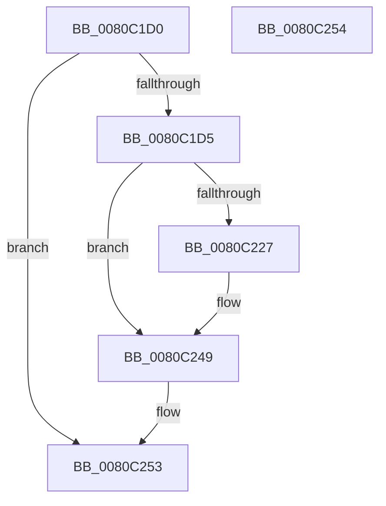

# MiDeleteSparseRange

- RVA: `0x0080C1D0`–`0x0080C255` (길이 `133` bytes)
- VA: `0x000000014080C1D0`
- 실행 섹션: `PAGE`
- PDB 이름 있음: `예`; PDB Function 태그: `아니요`
- unwind 정보 RVA: `0x000D5A80`
- 디코드: `35`개 명령, `133/133` bytes 표시
- 미해석 바이트: `0` (있으면 어셈블리에 `.byte`로 보존)

> 이 문서는 커널 이미지의 기계어와 PDB 기호를 분석해 생성했습니다. 4번과 5번은 함수 원형과 자료형을 바이너리 사용 방식에서 추정한 C 해석이며 원본 소스 복구 결과는 아닙니다.

## 1. Dependencies

- 직접 호출 지점: **6**; 고유 호출 대상: **6**
- 직접 호출자로 확인된 함수: **1**
- RIP 상대 이미지 참조: **2**

### Outgoing calls
- `0x0080C1F1` → [MiGetPteAddress](../../text/43/MiGetPteAddress_function_0043E130.md) (function, `0x0043E130`)
- `0x0080C201` → [MiCaptureSparsePages](MiCaptureSparsePages_function_0080BAF8.md) (function, `0x0080BAF8`)
- `0x0080C213` → [MiReleasePtes](../../text/24/MiReleasePtes_function_00247240.md) (function, `0x00247240`)
- `0x0080C21D` → [MiGetAwePageSize](../../text/46/MiGetAwePageSize_function_0046CFA8.md) (function, `0x0046CFA8`)
- `0x0080C22C` → [MiReturnPfnList](../../text/67/MiReturnPfnList_function_0067FBEC.md) (function, `0x0067FBEC`)
- `0x0080C244` → [MiReturnSystemCharges](../../text/36/MiReturnSystemCharges_function_00367A48.md) (function, `0x00367A48`)

### Direct callers
- [MiDeletePfnBitMaps](MiDeletePfnBitMaps_function_0080C008.md) at `0x0080C06F`
- [MiDeletePfnBitMaps](MiDeletePfnBitMaps_function_0080C008.md) at `0x0080C0D1`
- [MiDeletePfnBitMaps](MiDeletePfnBitMaps_function_0080C008.md) at `0x0080C114`
- [MiDeletePfnBitMaps](MiDeletePfnBitMaps_function_0080C008.md) at `0x0080C14E`
- [MiDeletePfnBitMaps](MiDeletePfnBitMaps_function_0080C008.md) at `0x0080C18C`
- [MiDeletePfnBitMaps](MiDeletePfnBitMaps_function_0080C008.md) at `0x0080C1A1`

### Static image references
- `0x0080C209` → RVA `0x00E37668` (`.data`; read)
- `0x0080C237` → RVA `0x00E38D00` (`.data`; read)

## 2. Other-region calls and transfers

- 다른 실행 섹션으로 향하는 call: **5**
  - `0x0080C1F1` → [MiGetPteAddress](../../text/43/MiGetPteAddress_function_0043E130.md) (`PAGE` → `.text`)
  - `0x0080C213` → [MiReleasePtes](../../text/24/MiReleasePtes_function_00247240.md) (`PAGE` → `.text`)
  - `0x0080C21D` → [MiGetAwePageSize](../../text/46/MiGetAwePageSize_function_0046CFA8.md) (`PAGE` → `.text`)
  - `0x0080C22C` → [MiReturnPfnList](../../text/67/MiReturnPfnList_function_0067FBEC.md) (`PAGE` → `.text`)
  - `0x0080C244` → [MiReturnSystemCharges](../../text/36/MiReturnSystemCharges_function_00367A48.md) (`PAGE` → `.text`)
- 별도 외부 분기/꼬리 이동을 확인하지 못했습니다.

## 3. Assembly (complete function range)

```asm
0080C1D0  48 85 C9                        test rcx, rcx
0080C1D3  74 7E                           je 0x14080c253
0080C1D5  48 89 5C 24 08                  mov qword ptr [rsp + 8], rbx
0080C1DA  57                              push rdi
0080C1DB  48 83 EC 40                     sub rsp, 0x40
0080C1DF  33 C0                           xor eax, eax
0080C1E1  0F 57 C0                        xorps xmm0, xmm0
0080C1E4  0F 11 44 24 20                  movups xmmword ptr [rsp + 0x20], xmm0
0080C1E9  48 89 44 24 30                  mov qword ptr [rsp + 0x30], rax
0080C1EE  48 8B FA                        mov rdi, rdx
0080C1F1  E8 3A 1F C3 FF                  call 0x14043e130
0080C1F6  48 8B C8                        mov rcx, rax
0080C1F9  4C 8D 44 24 20                  lea r8, [rsp + 0x20]
0080C1FE  48 8B D8                        mov rbx, rax
0080C201  E8 F2 F8 FF FF                  call 0x14080baf8
0080C206  44 8B C7                        mov r8d, edi
0080C209  48 8D 0D 58 B4 62 00            lea rcx, [rip + 0x62b458]
0080C210  48 8B D3                        mov rdx, rbx
0080C213  E8 28 B0 A3 FF                  call 0x140247240
0080C218  48 8D 4C 24 20                  lea rcx, [rsp + 0x20]
0080C21D  E8 86 0D C6 FF                  call 0x14046cfa8
0080C222  48 85 C0                        test rax, rax
0080C225  74 22                           je 0x14080c249
0080C227  48 8D 4C 24 20                  lea rcx, [rsp + 0x20]
0080C22C  E8 BB 39 E7 FF                  call 0x14067fbec
0080C231  41 B9 08 00 00 00               mov r9d, 8
0080C237  48 8D 0D C2 CA 62 00            lea rcx, [rip + 0x62cac2]
0080C23E  4C 8B C0                        mov r8, rax
0080C241  48 8B D0                        mov rdx, rax
0080C244  E8 FF B7 B5 FF                  call 0x140367a48
0080C249  48 8B 5C 24 50                  mov rbx, qword ptr [rsp + 0x50]
0080C24E  48 83 C4 40                     add rsp, 0x40
0080C252  5F                              pop rdi
0080C253  C3                              ret
0080C254  CC                              int3
```

## 4. C-style interpretation (structured pseudocode)

```c
__int64 __fastcall MiDeleteSparseRange(__int64 a1, __int64 a2)
{
    __int64 result;
    __int64 v_rsp;
    unsigned __int64 v_stack_m18;
    unsigned __int64 v_stack_m28;
    unsigned __int64 v_stack_p8;

    if (a1 == 0) goto loc_0080C253;
    v_stack_p8 = v_rbx;
    v_rsp = (v_rsp) - (64);
    result = 0;
    v_stack_m28 = v_xmm0;
    v_stack_m18 = 0;
    result = MiGetPteAddress(a1, a2, a3, a4);
    result = MiCaptureSparsePages(result, a2, v_stack_m28, a4);
    result = MiReleasePtes(v_rip + 6468696, result, (unsigned int)((unsigned int)(a2)), a4);
    result = MiGetAwePageSize(v_stack_m28, result, (unsigned int)((unsigned int)(a2)), a4);
    if (result != 0) {
        a1 = v_stack_m28;
        result = MiReturnPfnList(a1, result, (unsigned int)((unsigned int)(a2)), a4);
        a4 = 8;
        a1 = v_rip + 6474434;
        a3 = result;
        a2 = result;
        result = MiReturnSystemCharges(a1, a2, a3, a4);
    }
    v_rsp = (v_rsp) + (64);
loc_0080C253:
    return result;
}
```

## 5. (Beta) C Style

```c
int64_t MiDeleteSparseRange(int64_t Arg1, int64_t Arg2)
{
    int64_t result;
    int64_t local_rsp;
    uint64_t v_stack_m18;
    uint64_t v_stack_m28;
    uint64_t v_stack_p8;

    if (Arg1 == 0) goto loc_0080C253;
    v_stack_p8 = local_rbx;
    local_rsp = (local_rsp) - (64);
    result = 0;
    v_stack_m28 = v_xmm0;
    v_stack_m18 = 0;
    result = MiGetPteAddress(Arg1, Arg2, a3, a4);
    result = MiCaptureSparsePages(result, Arg2, v_stack_m28, a4);
    result = MiReleasePtes(v_rip + 6468696, result, (uint32_t)((uint32_t)(Arg2)), a4);
    result = MiGetAwePageSize(v_stack_m28, result, (uint32_t)((uint32_t)(Arg2)), a4);
    if (result != 0) {
        Arg1 = v_stack_m28;
        result = MiReturnPfnList(Arg1, result, (uint32_t)((uint32_t)(Arg2)), a4);
        a4 = 8;
        Arg1 = v_rip + 6474434;
        a3 = result;
        Arg2 = result;
        result = MiReturnSystemCharges(Arg1, Arg2, a3, a4);
    }
    local_rsp = (local_rsp) + (64);
loc_0080C253:
    return result;
}
```

## 6. Execution-region graph

[열기: 2D/3D 그래프와 함수 탐색 컨트롤 패널](../../../control-panel.html?section=page&rva=0x0080C1D0&view=graph)

- 2D 그래프는 위에서 아래로 흐르고, 3D 그래프는 빈 공간을 드래그해 회전합니다. Shift+드래그는 이동, 휠은 확대·축소, 함수 노드 선택은 대상 보고서 이동입니다.

### Static fallback


