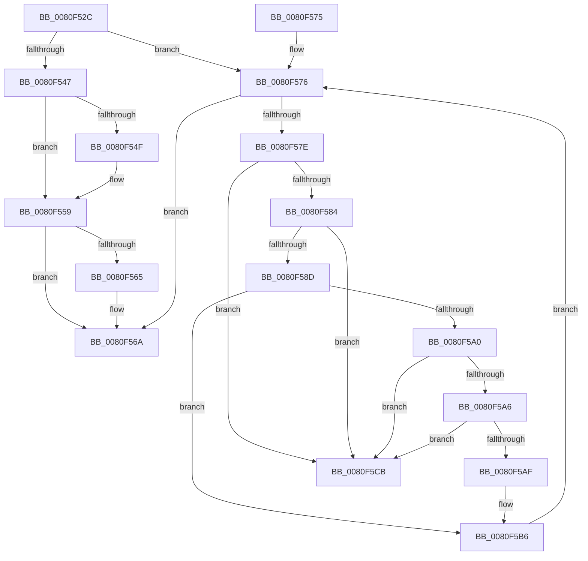

# MiDeleteSpecialPurposeMemory

- RVA: `0x0080F52C`–`0x0080F5D2` (길이 `166` bytes)
- VA: `0x000000014080F52C`
- 실행 섹션: `PAGE`
- PDB 이름 있음: `예`; PDB Function 태그: `아니요`
- unwind 정보 RVA: `0x0008DE94`
- 디코드: `51`개 명령, `166/166` bytes 표시
- 미해석 바이트: `0` (있으면 어셈블리에 `.byte`로 보존)

> 이 문서는 커널 이미지의 기계어와 PDB 기호를 분석해 생성했습니다. 4번과 5번은 함수 원형과 자료형을 바이너리 사용 방식에서 추정한 C 해석이며 원본 소스 복구 결과는 아닙니다.

## 1. Dependencies

- 직접 호출 지점: **4**; 고유 호출 대상: **3**
- 직접 호출자로 확인된 함수: **1**
- RIP 상대 이미지 참조: **0**

### Outgoing calls
- `0x0080F554` → [ObfDereferenceObjectWithTag](../../text/2F/ObfDereferenceObjectWithTag_function_002F78E0.md) (function, `0x002F78E0`)
- `0x0080F565` → [ZwClose](../../text/6A/ZwClose_function_006AD2B0.md) (function, `0x006AD2B0`)
- `0x0080F5BA` → [ZwClose](../../text/6A/ZwClose_function_006AD2B0.md) (function, `0x006AD2B0`)
- `0x0080F5C4` → [ExFreePoolWithTag](../../poolcode/B8/ExFreePoolWithTag_function_00B82870.md) (function, `0x00B82870`)

### Direct callers
- [MiDeletePartitionResources](MiDeletePartitionResources_function_0080D074.md) at `0x0080D1B8`

### Static image references
- 디코드된 RIP-relative 메모리 참조가 없습니다.

## 2. Other-region calls and transfers

- 다른 실행 섹션으로 향하는 call: **4**
  - `0x0080F554` → [ObfDereferenceObjectWithTag](../../text/2F/ObfDereferenceObjectWithTag_function_002F78E0.md) (`PAGE` → `.text`)
  - `0x0080F565` → [ZwClose](../../text/6A/ZwClose_function_006AD2B0.md) (`PAGE` → `.text`)
  - `0x0080F5BA` → [ZwClose](../../text/6A/ZwClose_function_006AD2B0.md) (`PAGE` → `.text`)
  - `0x0080F5C4` → [ExFreePoolWithTag](../../poolcode/B8/ExFreePoolWithTag_function_00B82870.md) (`PAGE` → `POOLCODE`)
- 별도 외부 분기/꼬리 이동을 확인하지 못했습니다.

## 3. Assembly (complete function range)

```asm
0080F52C  48 89 5C 24 08                  mov qword ptr [rsp + 8], rbx
0080F531  57                              push rdi
0080F532  48 83 EC 20                     sub rsp, 0x20
0080F536  8B 41 04                        mov eax, dword ptr [rcx + 4]
0080F539  48 8D B9 D8 44 00 00            lea rdi, [rcx + 0x44d8]
0080F540  48 8B D9                        mov rbx, rcx
0080F543  84 C0                           test al, al
0080F545  79 2F                           jns 0x14080f576
0080F547  48 8B 0F                        mov rcx, qword ptr [rdi]
0080F54A  48 85 C9                        test rcx, rcx
0080F54D  74 0A                           je 0x14080f559
0080F54F  BA 4D 6D 53 72                  mov edx, 0x72536d4d
0080F554  E8 87 83 AE FF                  call 0x1402f78e0
0080F559  48 8B 8B E0 44 00 00            mov rcx, qword ptr [rbx + 0x44e0]
0080F560  48 85 C9                        test rcx, rcx
0080F563  74 05                           je 0x14080f56a
0080F565  E8 46 DD E9 FF                  call 0x1406ad2b0
0080F56A  48 8B 5C 24 30                  mov rbx, qword ptr [rsp + 0x30]
0080F56F  48 83 C4 20                     add rsp, 0x20
0080F573  5F                              pop rdi
0080F574  C3                              ret
0080F575  CC                              int3
0080F576  48 8B 1F                        mov rbx, qword ptr [rdi]
0080F579  48 3B DF                        cmp rbx, rdi
0080F57C  74 EC                           je 0x14080f56a
0080F57E  48 39 7B 08                     cmp qword ptr [rbx + 8], rdi
0080F582  75 47                           jne 0x14080f5cb
0080F584  48 8B 03                        mov rax, qword ptr [rbx]
0080F587  48 39 58 08                     cmp qword ptr [rax + 8], rbx
0080F58B  75 3E                           jne 0x14080f5cb
0080F58D  48 89 07                        mov qword ptr [rdi], rax
0080F590  48 8D 53 48                     lea rdx, [rbx + 0x48]
0080F594  48 89 78 08                     mov qword ptr [rax + 8], rdi
0080F598  48 8B 0A                        mov rcx, qword ptr [rdx]
0080F59B  48 85 C9                        test rcx, rcx
0080F59E  74 16                           je 0x14080f5b6
0080F5A0  48 39 51 08                     cmp qword ptr [rcx + 8], rdx
0080F5A4  75 25                           jne 0x14080f5cb
0080F5A6  48 8B 42 08                     mov rax, qword ptr [rdx + 8]
0080F5AA  48 39 10                        cmp qword ptr [rax], rdx
0080F5AD  75 1C                           jne 0x14080f5cb
0080F5AF  48 89 08                        mov qword ptr [rax], rcx
0080F5B2  48 89 41 08                     mov qword ptr [rcx + 8], rax
0080F5B6  48 8B 4B 38                     mov rcx, qword ptr [rbx + 0x38]
0080F5BA  E8 F1 DC E9 FF                  call 0x1406ad2b0
0080F5BF  33 D2                           xor edx, edx
0080F5C1  48 8B CB                        mov rcx, rbx
0080F5C4  E8 A7 32 37 00                  call 0x140b82870
0080F5C9  EB AB                           jmp 0x14080f576
0080F5CB  B9 03 00 00 00                  mov ecx, 3
0080F5D0  CD 29                           int 0x29
```

## 4. C-style interpretation (structured pseudocode)

```c
__int64 __fastcall MiDeleteSpecialPurposeMemory(__int64 a1)
{
    __int64 result;
    __int64 v_rsp;
    unsigned __int64 v_stack_p8;

    v_stack_p8 = v_rbx;
    v_rsp = (v_rsp) - (32);
    if (!sign_flag) goto loc_0080F576;
    result = (unsigned int)(*(unsigned int *)(a1 + 4));
    if (*(unsigned __int64 *)(a1 + 17624) != 0) {
        a2 = 0x72536D4DULL;
        result = ObfDereferenceObjectWithTag(*(unsigned __int64 *)(a1 + 17624), a2, a3, a4);
    }
    if (*(unsigned __int64 *)(a1 + 17632) != 0) {
        result = ZwClose(*(unsigned __int64 *)(a1 + 17632), a2, a3, a4);
    }
    v_rsp = (v_rsp) + (32);
    return result;
loc_0080F576:
    if ((*(unsigned __int64 *)(a1 + 17624)) == (a1 + 17624)) goto loc_0080F56A;
    if ((*(unsigned __int64 *)(*(unsigned __int64 *)(a1 + 17624) + 8)) != (a1 + 17624)) goto loc_0080F5CB;
    if ((*(unsigned __int64 *)(*(unsigned __int64 *)(*(unsigned __int64 *)(a1 + 17624)) + 8)) != (*(unsigned __int64 *)(a1 + 17624))) goto loc_0080F5CB;
    *(unsigned __int64 *)(a1 + 17624) = *(unsigned __int64 *)(*(unsigned __int64 *)(a1 + 17624));
    *(unsigned __int64 *)(*(unsigned __int64 *)(*(unsigned __int64 *)(a1 + 17624)) + 8) = a1 + 17624;
    if (*(unsigned __int64 *)(*(unsigned __int64 *)(a1 + 17624) + 72) == 0) goto loc_0080F5B6;
    if ((*(unsigned __int64 *)(*(unsigned __int64 *)(*(unsigned __int64 *)(a1 + 17624) + 72) + 8)) != (*(unsigned __int64 *)(a1 + 17624) + 72)) goto loc_0080F5CB;
    if ((*(unsigned __int64 *)(*(unsigned __int64 *)(*(unsigned __int64 *)(a1 + 17624) + 72 + 8))) != (*(unsigned __int64 *)(a1 + 17624) + 72)) goto loc_0080F5CB;
    *(unsigned __int64 *)(*(unsigned __int64 *)(*(unsigned __int64 *)(a1 + 17624) + 72 + 8)) = *(unsigned __int64 *)(*(unsigned __int64 *)(a1 + 17624) + 72);
    *(unsigned __int64 *)(*(unsigned __int64 *)(*(unsigned __int64 *)(a1 + 17624) + 72) + 8) = *(unsigned __int64 *)(*(unsigned __int64 *)(a1 + 17624) + 72 + 8);
loc_0080F5B6:
    result = ZwClose(*(unsigned __int64 *)(*(unsigned __int64 *)(a1 + 17624) + 56), *(unsigned __int64 *)(a1 + 17624) + 72, a3, a4);
    a2 = 0;
    result = ExFreePoolWithTag(*(unsigned __int64 *)(a1 + 17624), a2, a3, a4);
    goto loc_0080F576;
loc_0080F5CB:
    return result;
}
```

## 5. (Beta) C Style

```c
int64_t MiDeleteSpecialPurposeMemory(void *Arg1)
{
    uint8_t *arg1 = (uint8_t *)Arg1;

    int64_t result;
    int64_t local_rsp;
    uint64_t v_stack_p8;

    v_stack_p8 = local_rbx;
    local_rsp = (local_rsp) - (32);
    if (!sign_flag) goto loc_0080F576;
    result = (uint32_t)(*(uint32_t *)(arg1 + 0x4));
    if (*(uint64_t *)(arg1 + 0x44D8) != 0) {
        a2 = 0x72536D4DULL;
        result = ObfDereferenceObjectWithTag(*(uint64_t *)(arg1 + 0x44D8), a2, a3, a4);
    }
    if (*(uint64_t *)(arg1 + 0x44E0) != 0) {
        result = ZwClose(*(uint64_t *)(arg1 + 0x44E0), a2, a3, a4);
    }
    local_rsp = (local_rsp) + (32);
    return result;
loc_0080F576:
    if ((*(uint64_t *)(arg1 + 0x44D8)) == (Arg1 + 17624)) goto loc_0080F56A;
    if ((*(uint64_t *)(*(uint64_t *)(arg1 + 0x44D8) + 0x8)) != (Arg1 + 17624)) goto loc_0080F5CB;
    if ((*(uint64_t *)(*(uint64_t *)(*(uint64_t *)(arg1 + 0x44D8)) + 0x8)) != (*(uint64_t *)(arg1 + 0x44D8))) goto loc_0080F5CB;
    *(uint64_t *)(arg1 + 0x44D8) = *(uint64_t *)(*(uint64_t *)(arg1 + 0x44D8));
    *(void **)(*(uint64_t *)(*(uint64_t *)(arg1 + 0x44D8)) + 0x8) = Arg1 + 17624;
    if (*(uint64_t *)(*(uint64_t *)(arg1 + 0x44D8) + 0x48) == 0) goto loc_0080F5B6;
    if ((*(uint64_t *)(*(uint64_t *)(*(uint64_t *)(arg1 + 0x44D8) + 0x48) + 0x8)) != (*(uint64_t *)(arg1 + 0x44D8) + 72)) goto loc_0080F5CB;
    if ((*(uint64_t *)(*(uint64_t *)(*(uint64_t *)(arg1 + 0x44D8) + 0x48 + 0x8))) != (*(uint64_t *)(arg1 + 0x44D8) + 72)) goto loc_0080F5CB;
    *(uint64_t *)(*(uint64_t *)(*(uint64_t *)(arg1 + 0x44D8) + 0x48 + 0x8)) = *(uint64_t *)(*(uint64_t *)(arg1 + 0x44D8) + 0x48);
    *(uint64_t *)(*(uint64_t *)(*(uint64_t *)(arg1 + 0x44D8) + 0x48) + 0x8) = *(uint64_t *)(*(uint64_t *)(arg1 + 0x44D8) + 0x48 + 0x8);
loc_0080F5B6:
    result = ZwClose(*(uint64_t *)(*(uint64_t *)(arg1 + 0x44D8) + 0x38), *(uint64_t *)(arg1 + 0x44D8) + 72, a3, a4);
    a2 = 0;
    result = ExFreePoolWithTag(*(uint64_t *)(arg1 + 0x44D8), a2, a3, a4);
    goto loc_0080F576;
loc_0080F5CB:
    return result;
}
```

### 관측된 메모리 오프셋

구조체 형식이 확인되지 않은 접근은 인자 기준의 오프셋으로만 기록했습니다.

| 기준 인자 | 오프셋 표현 | 폭 (bit) | 접근 |
|---|---:|---:|---|
| `Arg1` | `+ 0x0` | `64` | `R` |
| `Arg1` | `+ 0x0` | `64` | `W` |
| `Arg1` | `+ 0x4` | `32` | `R` |
| `Arg1` | `+ 0x44D8` | `64` | `R` |
| `Arg1` | `+ 0x44E0` | `64` | `R` |

## 6. Execution-region graph

[열기: 2D/3D 그래프와 함수 탐색 컨트롤 패널](../../../control-panel.html?section=page&rva=0x0080F52C&view=graph)

- 2D 그래프는 위에서 아래로 흐르고, 3D 그래프는 빈 공간을 드래그해 회전합니다. Shift+드래그는 이동, 휠은 확대·축소, 함수 노드 선택은 대상 보고서 이동입니다.

### Static fallback


