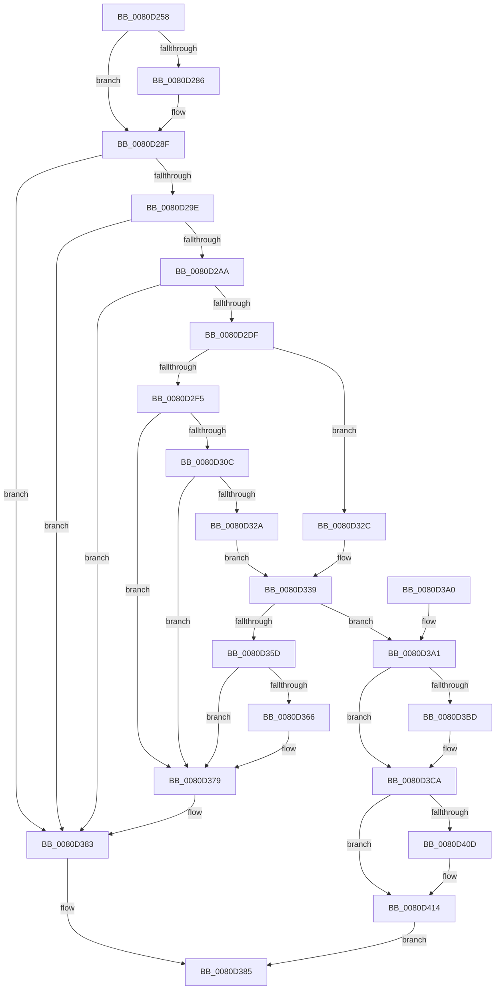

# MiExpandPartitionIds

- RVA: `0x0080D258`–`0x0080D425` (길이 `461` bytes)
- VA: `0x000000014080D258`
- 실행 섹션: `PAGE`
- PDB 이름 있음: `예`; PDB Function 태그: `아니요`
- unwind 정보 RVA: `0x0007827C`
- 디코드: `117`개 명령, `461/461` bytes 표시
- 미해석 바이트: `0` (있으면 어셈블리에 `.byte`로 보존)

> 이 문서는 커널 이미지의 기계어와 PDB 기호를 분석해 생성했습니다. 4번과 5번은 함수 원형과 자료형을 바이너리 사용 방식에서 추정한 C 해석이며 원본 소스 복구 결과는 아닙니다.

## 1. Dependencies

- 직접 호출 지점: **10**; 고유 호출 대상: **9**
- 직접 호출자로 확인된 함수: **1**
- RIP 상대 이미지 참조: **7**

### Outgoing calls
- `0x0080D2CC` → [MiAllocatePool](../../text/35/MiAllocatePool_function_0035B540.md) (function, `0x0035B540`)
- `0x0080D2FF` → [MiReservePtes](../../text/31/MiReservePtes_function_00318D20.md) (function, `0x00318D20`)
- `0x0080D33C` → [MiGetPteAddress](../../text/43/MiGetPteAddress_function_0043E130.md) (function, `0x0043E130`)
- `0x0080D354` → [MiMakeZeroedPageTables](../../text/3B/MiMakeZeroedPageTables_function_003B4F6C.md) (function, `0x003B4F6C`)
- `0x0080D374` → [MiReleasePtes](../../text/24/MiReleasePtes_function_00247240.md) (function, `0x00247240`)
- `0x0080D37E` → [ExFreePoolWithTag](../../poolcode/B8/ExFreePoolWithTag_function_00B82870.md) (function, `0x00B82870`)
- `0x0080D3AC` → [memset](../../text/6C/memset_function_006C6C40.md) (function, `0x006C6C40`)
- `0x0080D3CD` → [RtlClearAllBits](../../text/45/RtlClearAllBits_function_00450230.md) (function, `0x00450230`)
- `0x0080D3F5` → [memcpy](../../text/6C/memcpy_function_006C6840.md) (function, `0x006C6840`)
- `0x0080D40F` → [ExFreePoolWithTag](../../poolcode/B8/ExFreePoolWithTag_function_00B82870.md) (function, `0x00B82870`)

### Direct callers
- [MiAllocatePartitionId](../7F/MiAllocatePartitionId_function_007FD040.md) at `0x007FD0C4`

### Static image references
- `0x0080D271` → RVA `0x00E30080` (`.data`; read)
- `0x0080D27D` → RVA `0x00E30088` (`.data`; read)
- `0x0080D286` → RVA `0x00E30068` (`.data`; read)
- `0x0080D2F8` → RVA `0x00E37668` (`.data`; read)
- `0x0080D3C3` → RVA `0x00E30088` (`.data`; write)
- `0x0080D401` → RVA `0x00E30070` (`.data`; read)
- `0x0080D414` → RVA `0x00E30068` (`.data`; write)

## 2. Other-region calls and transfers

- 다른 실행 섹션으로 향하는 call: **10**
  - `0x0080D2CC` → [MiAllocatePool](../../text/35/MiAllocatePool_function_0035B540.md) (`PAGE` → `.text`)
  - `0x0080D2FF` → [MiReservePtes](../../text/31/MiReservePtes_function_00318D20.md) (`PAGE` → `.text`)
  - `0x0080D33C` → [MiGetPteAddress](../../text/43/MiGetPteAddress_function_0043E130.md) (`PAGE` → `.text`)
  - `0x0080D354` → [MiMakeZeroedPageTables](../../text/3B/MiMakeZeroedPageTables_function_003B4F6C.md) (`PAGE` → `.text`)
  - `0x0080D374` → [MiReleasePtes](../../text/24/MiReleasePtes_function_00247240.md) (`PAGE` → `.text`)
  - `0x0080D37E` → [ExFreePoolWithTag](../../poolcode/B8/ExFreePoolWithTag_function_00B82870.md) (`PAGE` → `POOLCODE`)
  - `0x0080D3AC` → [memset](../../text/6C/memset_function_006C6C40.md) (`PAGE` → `.text`)
  - `0x0080D3CD` → [RtlClearAllBits](../../text/45/RtlClearAllBits_function_00450230.md) (`PAGE` → `.text`)
  - `0x0080D3F5` → [memcpy](../../text/6C/memcpy_function_006C6840.md) (`PAGE` → `.text`)
  - `0x0080D40F` → [ExFreePoolWithTag](../../poolcode/B8/ExFreePoolWithTag_function_00B82870.md) (`PAGE` → `POOLCODE`)
- 별도 외부 분기/꼬리 이동을 확인하지 못했습니다.

## 3. Assembly (complete function range)

```asm
0080D258  48 8B C4                        mov rax, rsp
0080D25B  48 89 58 08                     mov qword ptr [rax + 8], rbx
0080D25F  48 89 68 10                     mov qword ptr [rax + 0x10], rbp
0080D263  48 89 70 18                     mov qword ptr [rax + 0x18], rsi
0080D267  48 89 78 20                     mov qword ptr [rax + 0x20], rdi
0080D26B  41 56                           push r14
0080D26D  48 83 EC 20                     sub rsp, 0x20
0080D271  4C 8D 35 08 2E 62 00            lea r14, [rip + 0x622e08]
0080D278  BB 00 02 00 00                  mov ebx, 0x200
0080D27D  4C 39 35 04 2E 62 00            cmp qword ptr [rip + 0x622e04], r14
0080D284  74 09                           je 0x14080d28f
0080D286  48 8B 05 DB 2D 62 00            mov rax, qword ptr [rip + 0x622ddb]
0080D28D  03 18                           add ebx, dword ptr [rax]
0080D28F  48 8B 05 D2 2D 62 00            mov rax, qword ptr [rip + 0x622dd2]
0080D296  3B 18                           cmp ebx, dword ptr [rax]
0080D298  0F 86 E5 00 00 00               jbe 0x14080d383
0080D29E  81 FB 00 04 00 00               cmp ebx, 0x400
0080D2A4  0F 87 D9 00 00 00               ja 0x14080d383
0080D2AA  8B C3                           mov eax, ebx
0080D2AC  41 B8 4D 6D 20 20               mov r8d, 0x20206d4d
0080D2B2  24 3F                           and al, 0x3f
0080D2B4  F6 D8                           neg al
0080D2B6  8B C3                           mov eax, ebx
0080D2B8  1B C9                           sbb ecx, ecx
0080D2BA  C1 E8 06                        shr eax, 6
0080D2BD  F7 D9                           neg ecx
0080D2BF  8D 51 02                        lea edx, [rcx + 2]
0080D2C2  B9 40 00 00 00                  mov ecx, 0x40
0080D2C7  03 D0                           add edx, eax
0080D2C9  C1 E2 03                        shl edx, 3
0080D2CC  E8 6F E2 B4 FF                  call 0x14035b540
0080D2D1  33 F6                           xor esi, esi
0080D2D3  48 8B F8                        mov rdi, rax
0080D2D6  48 85 C0                        test rax, rax
0080D2D9  0F 84 A4 00 00 00               je 0x14080d383
0080D2DF  48 8D 48 10                     lea rcx, [rax + 0x10]
0080D2E3  89 18                           mov dword ptr [rax], ebx
0080D2E5  48 89 48 08                     mov qword ptr [rax + 8], rcx
0080D2E9  4C 8B 05 98 2D 62 00            mov r8, qword ptr [rip + 0x622d98]
0080D2F0  4D 3B C6                        cmp r8, r14
0080D2F3  75 37                           jne 0x14080d32c
0080D2F5  8D 56 02                        lea edx, [rsi + 2]
0080D2F8  48 8D 0D 69 A3 62 00            lea rcx, [rip + 0x62a369]
0080D2FF  E8 1C BA B0 FF                  call 0x140318d20
0080D304  48 8B D8                        mov rbx, rax
0080D307  48 85 C0                        test rax, rax
0080D30A  74 6D                           je 0x14080d379
0080D30C  48 C1 E3 19                     shl rbx, 0x19
0080D310  48 B9 00 00 00 00 80 F6 FF FF   movabs rcx, 0xfffff68000000000
0080D31A  48 C1 E1 19                     shl rcx, 0x19
0080D31E  48 2B D9                        sub rbx, rcx
0080D321  48 C1 FB 10                     sar rbx, 0x10
0080D325  48 85 DB                        test rbx, rbx
0080D328  74 4F                           je 0x14080d379
0080D32A  EB 0D                           jmp 0x14080d339
0080D32C  48 8B 05 35 2D 62 00            mov rax, qword ptr [rip + 0x622d35]
0080D333  8B 08                           mov ecx, dword ptr [rax]
0080D335  49 8D 1C C8                     lea rbx, [r8 + rcx*8]
0080D339  48 8B CB                        mov rcx, rbx
0080D33C  E8 EF 0D C3 FF                  call 0x14043e130
0080D341  41 B9 08 00 00 00               mov r9d, 8
0080D347  48 8B D0                        mov rdx, rax
0080D34A  48 8B C8                        mov rcx, rax
0080D34D  48 8B E8                        mov rbp, rax
0080D350  45 8D 41 19                     lea r8d, [r9 + 0x19]
0080D354  E8 13 7C BA FF                  call 0x1403b4f6c
0080D359  85 C0                           test eax, eax
0080D35B  75 44                           jne 0x14080d3a1
0080D35D  4C 39 35 24 2D 62 00            cmp qword ptr [rip + 0x622d24], r14
0080D364  75 13                           jne 0x14080d379
0080D366  44 8D 40 01                     lea r8d, [rax + 1]
0080D36A  48 8B D5                        mov rdx, rbp
0080D36D  48 8D 0D F4 A2 62 00            lea rcx, [rip + 0x62a2f4]
0080D374  E8 C7 9E A3 FF                  call 0x140247240
0080D379  33 D2                           xor edx, edx
0080D37B  48 8B CF                        mov rcx, rdi
0080D37E  E8 ED 54 37 00                  call 0x140b82870
0080D383  33 C0                           xor eax, eax
0080D385  48 8B 5C 24 30                  mov rbx, qword ptr [rsp + 0x30]
0080D38A  48 8B 6C 24 38                  mov rbp, qword ptr [rsp + 0x38]
0080D38F  48 8B 74 24 40                  mov rsi, qword ptr [rsp + 0x40]
0080D394  48 8B 7C 24 48                  mov rdi, qword ptr [rsp + 0x48]
0080D399  48 83 C4 20                     add rsp, 0x20
0080D39D  41 5E                           pop r14
0080D39F  C3                              ret
0080D3A0  CC                              int3
0080D3A1  33 D2                           xor edx, edx
0080D3A3  41 B8 00 10 00 00               mov r8d, 0x1000
0080D3A9  48 8B CB                        mov rcx, rbx
0080D3AC  E8 8F 98 EB FF                  call 0x1406c6c40
0080D3B1  48 8B 05 D0 2C 62 00            mov rax, qword ptr [rip + 0x622cd0]
0080D3B8  49 3B C6                        cmp rax, r14
0080D3BB  75 0D                           jne 0x14080d3ca
0080D3BD  48 8B 00                        mov rax, qword ptr [rax]
0080D3C0  48 89 03                        mov qword ptr [rbx], rax
0080D3C3  48 89 1D BE 2C 62 00            mov qword ptr [rip + 0x622cbe], rbx
0080D3CA  48 8B CF                        mov rcx, rdi
0080D3CD  E8 5E 2E C4 FF                  call 0x140450230
0080D3D2  48 8B 15 8F 2C 62 00            mov rdx, qword ptr [rip + 0x622c8f]
0080D3D9  48 8B 4F 08                     mov rcx, qword ptr [rdi + 8]
0080D3DD  8B 02                           mov eax, dword ptr [rdx]
0080D3DF  48 8B 52 08                     mov rdx, qword ptr [rdx + 8]
0080D3E3  A8 3F                           test al, 0x3f
0080D3E5  40 0F 95 C6                     setne sil
0080D3E9  48 C1 E8 06                     shr rax, 6
0080D3ED  4C 8D 04 30                     lea r8, [rax + rsi]
0080D3F1  49 C1 E0 03                     shl r8, 3
0080D3F5  E8 46 94 EB FF                  call 0x1406c6840
0080D3FA  48 8B 0D 67 2C 62 00            mov rcx, qword ptr [rip + 0x622c67]
0080D401  48 8D 05 68 2C 62 00            lea rax, [rip + 0x622c68]
0080D408  48 3B C8                        cmp rcx, rax
0080D40B  74 07                           je 0x14080d414
0080D40D  33 D2                           xor edx, edx
0080D40F  E8 5C 54 37 00                  call 0x140b82870
0080D414  48 89 3D 4D 2C 62 00            mov qword ptr [rip + 0x622c4d], rdi
0080D41B  B8 01 00 00 00                  mov eax, 1
0080D420  E9 60 FF FF FF                  jmp 0x14080d385
```

## 4. C-style interpretation (structured pseudocode)

```c
__int64 __fastcall MiExpandPartitionIds(int a1)
{
    __int64 result;
    __int64 v_rbx;
    __int64 v_rsi;
    __int64 v_rsp;
    unsigned __int64 v_stack_p10;
    unsigned __int64 v_stack_p18;
    unsigned __int64 v_stack_p20;
    unsigned __int64 v_stack_p8;

    *(unsigned __int64 *)(v_rsp + 8) = v_rbx;
    *(unsigned __int64 *)(v_rsp + 16) = v_rbp;
    *(unsigned __int64 *)(v_rsp + 24) = v_rsi;
    *(unsigned __int64 *)(v_rsp + 32) = v_rdi;
    v_rsp = (v_rsp) - (32);
    result = v_rsp;
    v_rbx = 512;
    if ((*(unsigned __int64 *)(v_rip + 6434308)) != (v_rip + 6434312)) {
        result = *(unsigned __int64 *)(v_rip + 6434267);
        v_rbx = (unsigned int)((512) + (*(unsigned int *)(result)));
    }
    if (((unsigned int)(v_rbx)) <= (*(unsigned int *)(*(unsigned __int64 *)(v_rip + 6434258)))) goto loc_0080D383;
    if (((unsigned int)(v_rbx)) > 0x400ULL) goto loc_0080D383;
    result = (unsigned __int8)(((unsigned int)((unsigned int)(v_rbx))) & (63));
    result = (unsigned __int8)(-(result));
    result = (unsigned int)(((unsigned int)((unsigned int)(v_rbx))) >> (6));
    a1 = (unsigned int)(-(a1));
    a2 = (unsigned int)((a1 + 2) + ((unsigned int)(result)));
    a2 = (unsigned int)((a2) << (3));
    result = MiAllocatePool(64, a2, (unsigned int)(0x20206D4DULL), a4);
    v_rsi = 0;
    if (result == 0) goto loc_0080D383;
    *(unsigned int *)(result) = (unsigned int)(v_rbx);
    *(unsigned __int64 *)(result + 8) = result + 16;
    if ((*(unsigned __int64 *)(v_rip + 6434200)) != (v_rip + 6434312)) goto loc_0080D32C;
    result = MiReservePtes(v_rip + 6464361, v_rsi + 2, *(unsigned __int64 *)(v_rip + 6434200), a4);
    if (result == 0) goto loc_0080D379;
    v_rbx = (result) << (25);
    a1 = (v_rip + 6464361) << (25);
    v_rbx = (v_rbx) - (a1);
    v_rbx = (v_rbx) >> (16);
    if (v_rbx == 0) goto loc_0080D379;
    goto loc_0080D339;
loc_0080D32C:
loc_0080D339:
    result = MiGetPteAddress(*(unsigned __int64 *)(v_rip + 6434200) + (unsigned int)(*(unsigned int *)(*(unsigned __int64 *)(v_rip + 6434101))) * 8, v_rsi + 2, *(unsigned __int64 *)(v_rip + 6434200), a4);
    result = MiMakeZeroedPageTables(result, result, 8 + 25, 8);
    if ((unsigned int)(result) != 0) goto loc_0080D3A1;
    if ((*(unsigned __int64 *)(v_rip + 6434084)) == (v_rip + 6434312)) {
        a3 = result + 1;
        a2 = result;
        a1 = v_rip + 6464244;
        result = MiReleasePtes(a1, a2, a3, 8);
    }
    a2 = 0;
    result = ExFreePoolWithTag(result, a2, a3, 8);
loc_0080D383:
    result = 0;
loc_0080D385:
    v_rsp = (v_rsp) + (32);
    return result;
loc_0080D3A1:
    a2 = 0;
    result = memset(v_stack_p8, a2, (unsigned int)(0x1000ULL), 8);
    result = *(unsigned __int64 *)(v_rip + 6434000);
    if ((*(unsigned __int64 *)(v_rip + 6434000)) == (v_rip + 6434312)) {
        result = *(unsigned __int64 *)(*(unsigned __int64 *)(v_rip + 6434000));
        *(unsigned __int64 *)(v_stack_p8) = result;
        *(unsigned __int64 *)(v_rip + 6433982) = v_stack_p8;
    }
    result = RtlClearAllBits(v_stack_p20, a2, (unsigned int)(0x1000ULL), 8);
    v_rsi = ((((unsigned __int8)((unsigned int)(*(unsigned int *)(*(unsigned __int64 *)(v_rip + 6433935))))) & (63)) != 0) ? 1 : 0;
    result = ((unsigned int)(*(unsigned int *)(*(unsigned __int64 *)(v_rip + 6433935)))) >> (6);
    a3 = (result + v_rsi * 1) << (3);
    result = memcpy(*(unsigned __int64 *)(v_stack_p20 + 8), *(unsigned __int64 *)(*(unsigned __int64 *)(v_rip + 6433935) + 8), a3, 8);
    result = v_rip + 6433896;
    if ((*(unsigned __int64 *)(v_rip + 6433895)) != (v_rip + 6433896)) {
        a2 = 0;
        result = ExFreePoolWithTag(*(unsigned __int64 *)(v_rip + 6433895), a2, a3, 8);
    }
    *(unsigned __int64 *)(v_rip + 6433869) = v_stack_p20;
    goto loc_0080D385;
}
```

## 5. (Beta) C Style

```c
int64_t MiExpandPartitionIds(int32_t Arg1)
{
    int64_t result;
    int64_t local_rbx;
    int64_t local_rsi;
    int64_t local_rsp;
    uint64_t v_stack_p10;
    uint64_t v_stack_p18;
    uint64_t v_stack_p20;
    uint64_t v_stack_p8;

    *(uint64_t *)(local_rsp + 0x8) = local_rbx;
    *(uint64_t *)(local_rsp + 0x10) = local_rbp;
    *(uint64_t *)(local_rsp + 0x18) = local_rsi;
    *(uint64_t *)(local_rsp + 0x20) = local_rdi;
    local_rsp = (local_rsp) - (32);
    result = local_rsp;
    local_rbx = 512;
    if ((*(uint64_t *)(v_rip + 0x622E04)) != (v_rip + 6434312)) {
        result = *(uint64_t *)(v_rip + 0x622DDB);
        local_rbx = (uint32_t)((512) + (*(uint32_t *)(result)));
    }
    if (((uint32_t)(local_rbx)) <= (*(uint32_t *)(*(uint64_t *)(v_rip + 0x622DD2)))) goto loc_0080D383;
    if (((uint32_t)(local_rbx)) > 0x400ULL) goto loc_0080D383;
    result = (uint8_t)(((uint32_t)((uint32_t)(local_rbx))) & (63));
    result = (uint8_t)(-(result));
    result = (uint32_t)(((uint32_t)((uint32_t)(local_rbx))) >> (6));
    Arg1 = (uint32_t)(-(Arg1));
    a2 = (uint32_t)((Arg1 + 2) + ((uint32_t)(result)));
    a2 = (uint32_t)((a2) << (3));
    result = MiAllocatePool(64, a2, (uint32_t)(0x20206D4DULL), a4);
    local_rsi = 0;
    if (result == 0) goto loc_0080D383;
    *(uint32_t *)(result) = (uint32_t)(local_rbx);
    *(uint64_t *)(result + 0x8) = result + 16;
    if ((*(uint64_t *)(v_rip + 0x622D98)) != (v_rip + 6434312)) goto loc_0080D32C;
    result = MiReservePtes(v_rip + 6464361, local_rsi + 2, *(uint64_t *)(v_rip + 0x622D98), a4);
    if (result == 0) goto loc_0080D379;
    local_rbx = (result) << (25);
    Arg1 = (v_rip + 6464361) << (25);
    local_rbx = (local_rbx) - (Arg1);
    local_rbx = (local_rbx) >> (16);
    if (local_rbx == 0) goto loc_0080D379;
    goto loc_0080D339;
loc_0080D32C:
loc_0080D339:
    result = MiGetPteAddress(*(uint64_t *)(v_rip + 0x622D98) + (uint32_t)(*(uint32_t *)(*(uint64_t *)(v_rip + 0x622D35))) * 8, local_rsi + 2, *(uint64_t *)(v_rip + 0x622D98), a4);
    result = MiMakeZeroedPageTables(result, result, 8 + 25, 8);
    if ((uint32_t)(result) != 0) goto loc_0080D3A1;
    if ((*(uint64_t *)(v_rip + 0x622D24)) == (v_rip + 6434312)) {
        a3 = result + 1;
        a2 = result;
        Arg1 = v_rip + 6464244;
        result = MiReleasePtes(Arg1, a2, a3, 8);
    }
    a2 = 0;
    result = ExFreePoolWithTag(result, a2, a3, 8);
loc_0080D383:
    result = 0;
loc_0080D385:
    local_rsp = (local_rsp) + (32);
    return result;
loc_0080D3A1:
    a2 = 0;
    result = memset(v_stack_p8, a2, (uint32_t)(0x1000ULL), 8);
    result = *(uint64_t *)(v_rip + 0x622CD0);
    if ((*(uint64_t *)(v_rip + 0x622CD0)) == (v_rip + 6434312)) {
        result = *(uint64_t *)(*(uint64_t *)(v_rip + 0x622CD0));
        *(uint64_t *)(v_stack_p8) = result;
        *(uint64_t *)(v_rip + 0x622CBE) = v_stack_p8;
    }
    result = RtlClearAllBits(v_stack_p20, a2, (uint32_t)(0x1000ULL), 8);
    local_rsi = ((((uint8_t)((uint32_t)(*(uint32_t *)(*(uint64_t *)(v_rip + 0x622C8F))))) & (63)) != 0) ? 1 : 0;
    result = ((uint32_t)(*(uint32_t *)(*(uint64_t *)(v_rip + 0x622C8F)))) >> (6);
    a3 = (result + local_rsi * 1) << (3);
    result = memcpy(*(uint64_t *)(v_stack_p20 + 0x8), *(uint64_t *)(*(uint64_t *)(v_rip + 0x622C8F) + 0x8), a3, 8);
    result = v_rip + 6433896;
    if ((*(uint64_t *)(v_rip + 0x622C67)) != (v_rip + 6433896)) {
        a2 = 0;
        result = ExFreePoolWithTag(*(uint64_t *)(v_rip + 0x622C67), a2, a3, 8);
    }
    *(uint64_t *)(v_rip + 0x622C4D) = v_stack_p20;
    goto loc_0080D385;
}
```

## 6. Execution-region graph

[열기: 2D/3D 그래프와 함수 탐색 컨트롤 패널](../../../control-panel.html?section=page&rva=0x0080D258&view=graph)

- 2D 그래프는 위에서 아래로 흐르고, 3D 그래프는 빈 공간을 드래그해 회전합니다. Shift+드래그는 이동, 휠은 확대·축소, 함수 노드 선택은 대상 보고서 이동입니다.

### Static fallback


