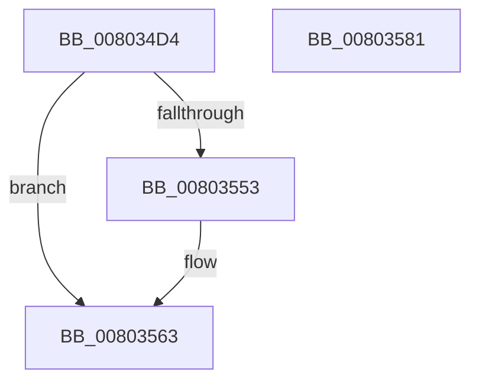

# MiFillActivePatchesQueryBuffer

- RVA: `0x008034D4`–`0x00803582` (길이 `174` bytes)
- VA: `0x00000001408034D4`
- 실행 섹션: `PAGE`
- PDB 이름 있음: `예`; PDB Function 태그: `아니요`
- unwind 정보 RVA: `0x0005E6B4`
- 디코드: `48`개 명령, `174/174` bytes 표시
- 미해석 바이트: `0` (있으면 어셈블리에 `.byte`로 보존)

> 이 문서는 커널 이미지의 기계어와 PDB 기호를 분석해 생성했습니다. 4번과 5번은 함수 원형과 자료형을 바이너리 사용 방식에서 추정한 C 해석이며 원본 소스 복구 결과는 아닙니다.

## 1. Dependencies

- 직접 호출 지점: **1**; 고유 호출 대상: **1**
- 직접 호출자로 확인된 함수: **1**
- RIP 상대 이미지 참조: **0**

### Outgoing calls
- `0x00803529` → [RtlCopyUnicodeString](../../text/3F/RtlCopyUnicodeString_function_003FEF30.md) (function, `0x003FEF30`)

### Direct callers
- [MiQueryProcessActivePatches](../AC/MiQueryProcessActivePatches_function_00AC6164.md) at `0x00AC65F3`
- [MiQueryProcessActivePatches](../AC/MiQueryProcessActivePatches_function_00AC6164.md) at `0x00AC666A`
- [MiQueryProcessActivePatches](../AC/MiQueryProcessActivePatches_function_00AC6164.md) at `0x00AC6737`
- [MiQueryProcessActivePatches](../AC/MiQueryProcessActivePatches_function_00AC6164.md) at `0x00AC679E`

### Static image references
- 디코드된 RIP-relative 메모리 참조가 없습니다.

## 2. Other-region calls and transfers

- 다른 실행 섹션으로 향하는 call: **1**
  - `0x00803529` → [RtlCopyUnicodeString](../../text/3F/RtlCopyUnicodeString_function_003FEF30.md) (`PAGE` → `.text`)
- 별도 외부 분기/꼬리 이동을 확인하지 못했습니다.

## 3. Assembly (complete function range)

```asm
008034D4  48 8B C4                        mov rax, rsp
008034D7  48 89 58 08                     mov qword ptr [rax + 8], rbx
008034DB  48 89 68 10                     mov qword ptr [rax + 0x10], rbp
008034DF  48 89 70 18                     mov qword ptr [rax + 0x18], rsi
008034E3  48 89 78 20                     mov qword ptr [rax + 0x20], rdi
008034E7  41 56                           push r14
008034E9  48 83 EC 20                     sub rsp, 0x20
008034ED  48 8B 44 24 70                  mov rax, qword ptr [rsp + 0x70]
008034F2  48 8B E9                        mov rbp, rcx
008034F5  4C 8B 74 24 50                  mov r14, qword ptr [rsp + 0x50]
008034FA  49 8B F1                        mov rsi, r9
008034FD  48 8B 7C 24 58                  mov rdi, qword ptr [rsp + 0x58]
00803502  48 8B 5C 24 60                  mov rbx, qword ptr [rsp + 0x60]
00803507  48 8B 10                        mov rdx, qword ptr [rax]
0080350A  4D 8B 06                        mov r8, qword ptr [r14]
0080350D  48 8B 0F                        mov rcx, qword ptr [rdi]
00803510  49 89 10                        mov qword ptr [r8], rdx
00803513  48 8B 54 24 78                  mov rdx, qword ptr [rsp + 0x78]
00803518  0F B7 02                        movzx eax, word ptr [rdx]
0080351B  66 89 01                        mov word ptr [rcx], ax
0080351E  66 89 41 02                     mov word ptr [rcx + 2], ax
00803522  48 8B 03                        mov rax, qword ptr [rbx]
00803525  48 89 41 08                     mov qword ptr [rcx + 8], rax
00803529  E8 02 BA BF FF                  call 0x1403fef30
0080352E  48 8B 0F                        mov rcx, qword ptr [rdi]
00803531  48 8B 54 24 68                  mov rdx, qword ptr [rsp + 0x68]
00803536  49 83 06 08                     add qword ptr [r14], 8
0080353A  48 29 71 08                     sub qword ptr [rcx + 8], rsi
0080353E  0F B7 01                        movzx eax, word ptr [rcx]
00803541  48 01 03                        add qword ptr [rbx], rax
00803544  48 8D 41 10                     lea rax, [rcx + 0x10]
00803548  48 8B 0A                        mov rcx, qword ptr [rdx]
0080354B  48 89 07                        mov qword ptr [rdi], rax
0080354E  48 85 C9                        test rcx, rcx
00803551  74 10                           je 0x140803563
00803553  8B 84 24 80 00 00 00            mov eax, dword ptr [rsp + 0x80]
0080355A  89 01                           mov dword ptr [rcx], eax
0080355C  48 8D 41 04                     lea rax, [rcx + 4]
00803560  48 89 02                        mov qword ptr [rdx], rax
00803563  FF 45 10                        inc dword ptr [rbp + 0x10]
00803566  48 8B 6C 24 38                  mov rbp, qword ptr [rsp + 0x38]
0080356B  48 8B 5C 24 30                  mov rbx, qword ptr [rsp + 0x30]
00803570  48 8B 74 24 40                  mov rsi, qword ptr [rsp + 0x40]
00803575  48 8B 7C 24 48                  mov rdi, qword ptr [rsp + 0x48]
0080357A  48 83 C4 20                     add rsp, 0x20
0080357E  41 5E                           pop r14
00803580  C3                              ret
00803581  CC                              int3
```

## 4. C-style interpretation (structured pseudocode)

```c
__int64 __fastcall MiFillActivePatchesQueryBuffer(__int64 a1, __int64 a2, __int64 a3, __int64 a4, __int64 a5, __int64 a6, __int64 a7, __int64 a8, __int64 a9, __int64 a10, unsigned int a11)
{
    __int64 result;
    __int64 v_rsp;
    unsigned __int64 v_stack_p10;
    unsigned __int64 v_stack_p18;
    unsigned __int64 v_stack_p20;
    unsigned __int64 v_stack_p8;

    *(unsigned __int64 *)(v_rsp + 8) = v_rbx;
    *(unsigned __int64 *)(v_rsp + 16) = v_rbp;
    *(unsigned __int64 *)(v_rsp + 24) = v_rsi;
    *(unsigned __int64 *)(v_rsp + 32) = v_rdi;
    v_rsp = (v_rsp) - (32);
    *(unsigned __int64 *)(*(unsigned __int64 *)(a5)) = *(unsigned __int64 *)(a9);
    *(unsigned __int16 *)(*(unsigned __int64 *)(a6)) = (unsigned __int16)(*(unsigned __int16 *)(a10));
    *(unsigned __int16 *)(*(unsigned __int64 *)(a6) + 2) = (unsigned __int16)(*(unsigned __int16 *)(a10));
    *(unsigned __int64 *)(*(unsigned __int64 *)(a6) + 8) = *(unsigned __int64 *)(a7);
    result = RtlCopyUnicodeString(*(unsigned __int64 *)(a6), a10, *(unsigned __int64 *)(a5), a4);
    *(unsigned __int64 *)(a6) = *(unsigned __int64 *)(a6) + 16;
    result = *(unsigned __int64 *)(a6) + 16;
    if (*(unsigned __int64 *)(a8) != 0) {
        result = a11;
        *(unsigned int *)(*(unsigned __int64 *)(a8)) = (unsigned int)(result);
        result = *(unsigned __int64 *)(a8) + 4;
        *(unsigned __int64 *)(a8) = result;
    }
    v_rsp = (v_rsp) + (32);
    return result;
}
```

## 5. (Beta) C Style

```c
int64_t MiFillActivePatchesQueryBuffer(void *Arg1, int64_t Arg2, int64_t Arg3, int64_t Arg4, void *Arg5, void *Arg6, void *Arg7, void *Arg8, void *Arg9, void *Arg10, uint32_t Arg11)
{
    uint8_t *arg1 = (uint8_t *)Arg1;
    uint8_t *arg5 = (uint8_t *)Arg5;
    uint8_t *arg6 = (uint8_t *)Arg6;
    uint8_t *arg7 = (uint8_t *)Arg7;
    uint8_t *arg8 = (uint8_t *)Arg8;
    uint8_t *arg9 = (uint8_t *)Arg9;
    uint8_t *arg10 = (uint8_t *)Arg10;

    int64_t result;
    int64_t local_rsp;
    uint64_t v_stack_p10;
    uint64_t v_stack_p18;
    uint64_t v_stack_p20;
    uint64_t v_stack_p8;

    *(uint64_t *)(local_rsp + 0x8) = local_rbx;
    *(uint64_t *)(local_rsp + 0x10) = local_rbp;
    *(uint64_t *)(local_rsp + 0x18) = local_rsi;
    *(uint64_t *)(local_rsp + 0x20) = local_rdi;
    local_rsp = (local_rsp) - (32);
    *(uint64_t *)(*(uint64_t *)(arg5)) = *(uint64_t *)(arg9);
    *(uint16_t *)(*(uint64_t *)(arg6)) = (uint16_t)(*(uint16_t *)(arg10));
    *(uint16_t *)(*(uint64_t *)(arg6) + 0x2) = (uint16_t)(*(uint16_t *)(arg10));
    *(uint64_t *)(*(uint64_t *)(arg6) + 0x8) = *(uint64_t *)(arg7);
    result = RtlCopyUnicodeString(*(uint64_t *)(arg6), Arg10, *(uint64_t *)(arg5), Arg4);
    *(uint64_t *)(arg6) = *(uint64_t *)(arg6) + 16;
    result = *(uint64_t *)(arg6) + 16;
    if (*(uint64_t *)(arg8) != 0) {
        result = Arg11;
        *(uint32_t *)(*(uint64_t *)(arg8)) = (uint32_t)(result);
        result = *(uint64_t *)(arg8) + 4;
        *(uint64_t *)(arg8) = result;
    }
    local_rsp = (local_rsp) + (32);
    return result;
}
```

### 관측된 메모리 오프셋

구조체 형식이 확인되지 않은 접근은 인자 기준의 오프셋으로만 기록했습니다.

| 기준 인자 | 오프셋 표현 | 폭 (bit) | 접근 |
|---|---:|---:|---|
| `Arg1` | `+ 0x10` | `32` | `R/W` |
| `Arg5` | `+ 0x0` | `64` | `R` |
| `Arg5` | `+ 0x0` | `64` | `R/W` |
| `Arg6` | `+ 0x0` | `64` | `R` |
| `Arg6` | `+ 0x0` | `64` | `W` |
| `Arg7` | `+ 0x0` | `64` | `R` |
| `Arg7` | `+ 0x0` | `64` | `R/W` |
| `Arg8` | `+ 0x0` | `64` | `R` |
| `Arg8` | `+ 0x0` | `64` | `W` |
| `Arg9` | `+ 0x0` | `64` | `R` |
| `Arg10` | `+ 0x0` | `16` | `R` |

## 6. Execution-region graph

[열기: 2D/3D 그래프와 함수 탐색 컨트롤 패널](../../../control-panel.html?section=page&rva=0x008034D4&view=graph)

- 2D 그래프는 위에서 아래로 흐르고, 3D 그래프는 빈 공간을 드래그해 회전합니다. Shift+드래그는 이동, 휠은 확대·축소, 함수 노드 선택은 대상 보고서 이동입니다.

### Static fallback


