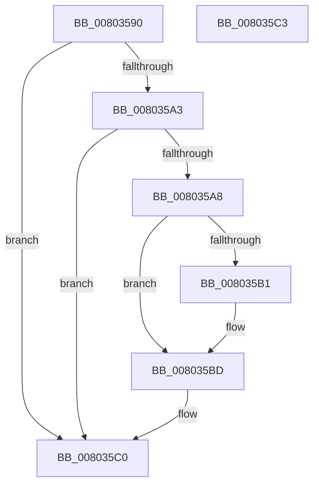

# MiFillPatchCallTargets

- RVA: `0x00803590`–`0x008035C4` (길이 `52` bytes)
- VA: `0x0000000140803590`
- 실행 섹션: `PAGE`
- PDB 이름 있음: `예`; PDB Function 태그: `아니요`
- unwind 정보 RVA: `0x000DB714`
- 디코드: `17`개 명령, `52/52` bytes 표시
- 미해석 바이트: `0` (있으면 어셈블리에 `.byte`로 보존)

> 이 문서는 커널 이미지의 기계어와 PDB 기호를 분석해 생성했습니다. 4번과 5번은 함수 원형과 자료형을 바이너리 사용 방식에서 추정한 C 해석이며 원본 소스 복구 결과는 아닙니다.

## 1. Dependencies

- 직접 호출 지점: **0**; 고유 호출 대상: **0**
- 직접 호출자로 확인된 함수: **0**
- RIP 상대 이미지 참조: **0**

### Outgoing calls
- 직접 디코드된 call 명령이 없습니다.

### Direct callers
- 이 함수 시작 RVA로 연결되는 직접 call은 확인되지 않았습니다. 간접 호출은 완전히 역산할 수 없습니다.

### Static image references
- 디코드된 RIP-relative 메모리 참조가 없습니다.

## 2. Other-region calls and transfers

- 다른 실행 섹션으로 향하는 call: **0**
- 별도 외부 분기/꼬리 이동을 확인하지 못했습니다.

## 3. Assembly (complete function range)

```asm
00803590  41 81 E0 00 C0 0F 00            and r8d, 0xfc000
00803597  4C 8B D1                        mov r10, rcx
0080359A  41 81 F8 00 40 04 00            cmp r8d, 0x44000
008035A1  75 1D                           jne 0x1408035c0
008035A3  45 84 C9                        test r9b, r9b
008035A6  74 18                           je 0x1408035c0
008035A8  4C 8B 41 08                     mov r8, qword ptr [rcx + 8]
008035AC  4D 85 C0                        test r8, r8
008035AF  74 0C                           je 0x1408035bd
008035B1  41 8B 02                        mov eax, dword ptr [r10]
008035B4  8B 0A                           mov ecx, dword ptr [rdx]
008035B6  48 03 C0                        add rax, rax
008035B9  49 89 0C C0                     mov qword ptr [r8 + rax*8], rcx
008035BD  41 FF 02                        inc dword ptr [r10]
008035C0  32 C0                           xor al, al
008035C2  C3                              ret
008035C3  CC                              int3
```

## 4. C-style interpretation (structured pseudocode)

```c
__int64 __fastcall MiFillPatchCallTargets(__int64 a1, __int64 a2, int a3, unsigned __int8 a4)
{
    __int64 result;

    a3 = (unsigned int)((a3) & (0xFC000ULL));
    if (a3 != 0x44000ULL) goto loc_008035C0;
    if (a4 == 0) goto loc_008035C0;
    if (*(unsigned __int64 *)(a1 + 8) != 0) {
        result = *(unsigned int *)(a1);
        a1 = *(unsigned int *)(a2);
        result = (result) + (result);
        *(unsigned __int64 *)(*(unsigned __int64 *)(a1 + 8) + result * 8) = a1;
    }
loc_008035C0:
    result = 0;
    return result;
}
```

## 5. (Beta) C Style

```c
int64_t MiFillPatchCallTargets(void *Arg1, void *Arg2, int32_t Arg3, uint8_t Arg4)
{
    uint8_t *arg1 = (uint8_t *)Arg1;
    uint8_t *arg2 = (uint8_t *)Arg2;

    int64_t result;

    Arg3 = (uint32_t)((Arg3) & (0xFC000ULL));
    if (Arg3 != 0x44000ULL) goto loc_008035C0;
    if (Arg4 == 0) goto loc_008035C0;
    if (*(uint64_t *)(arg1 + 0x8) != 0) {
        result = *(uint32_t *)(arg1);
        Arg1 = *(uint32_t *)(arg2);
        result = (result) + (result);
        *(void **)(*(uint64_t *)(arg1 + 0x8) + result * 8) = Arg1;
    }
loc_008035C0:
    result = 0;
    return result;
}
```

### 관측된 메모리 오프셋

구조체 형식이 확인되지 않은 접근은 인자 기준의 오프셋으로만 기록했습니다.

| 기준 인자 | 오프셋 표현 | 폭 (bit) | 접근 |
|---|---:|---:|---|
| `Arg1` | `+ 0x0` | `32` | `R` |
| `Arg1` | `+ 0x0` | `32` | `R/W` |
| `Arg1` | `+ 0x8` | `64` | `R` |
| `Arg2` | `+ 0x0` | `32` | `R` |

## 6. Execution-region graph

[열기: 2D/3D 그래프와 함수 탐색 컨트롤 패널](../../../control-panel.html?section=page&rva=0x00803590&view=graph)

- 2D 그래프는 위에서 아래로 흐르고, 3D 그래프는 빈 공간을 드래그해 회전합니다. Shift+드래그는 이동, 휠은 확대·축소, 함수 노드 선택은 대상 보고서 이동입니다.

### Static fallback


