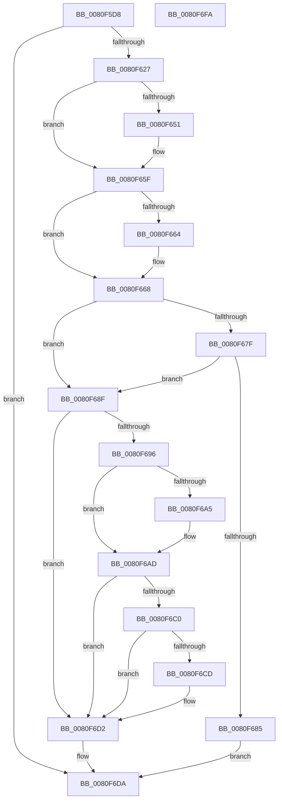

# MiFindSpecialPurposeMemoryTypeByPartition

- RVA: `0x0080F5D8`–`0x0080F6FB` (길이 `291` bytes)
- VA: `0x000000014080F5D8`
- 실행 섹션: `PAGE`
- PDB 이름 있음: `예`; PDB Function 태그: `아니요`
- unwind 정보 RVA: `0x00075C18`
- 디코드: `84`개 명령, `291/291` bytes 표시
- 미해석 바이트: `0` (있으면 어셈블리에 `.byte`로 보존)

> 이 문서는 커널 이미지의 기계어와 PDB 기호를 분석해 생성했습니다. 4번과 5번은 함수 원형과 자료형을 바이너리 사용 방식에서 추정한 C 해석이며 원본 소스 복구 결과는 아닙니다.

## 1. Dependencies

- 직접 호출 지점: **8**; 고유 호출 대상: **8**
- 직접 호출자로 확인된 함수: **3**
- RIP 상대 이미지 참조: **0**

### Outgoing calls
- `0x0080F61A` → [PsReferencePartitionSafe](../../text/3B/PsReferencePartitionSafe_function_003BA6C0.md) (function, `0x003BA6C0`)
- `0x0080F641` → [KeAbPreAcquire](../../text/21/KeAbPreAcquire_function_00210230.md) (function, `0x00210230`)
- `0x0080F65A` → [ExfAcquirePushLockExclusiveEx](../../text/20/ExfAcquirePushLockExclusiveEx_function_0020FC90.md) (function, `0x0020FC90`)
- `0x0080F672` → [MiFindSpecialPurposeMemoryType](../../text/69/MiFindSpecialPurposeMemoryType_function_0069503C.md) (function, `0x0069503C`)
- `0x0080F6A8` → [ExfTryToWakePushLock](../../text/26/ExfTryToWakePushLock_function_00265DD0.md) (function, `0x00265DD0`)
- `0x0080F6B0` → [KeAbPostRelease](../../text/2E/KeAbPostRelease_function_002E1600.md) (function, `0x002E1600`)
- `0x0080F6CD` → [KiCheckForKernelApcDelivery](../../text/2E/KiCheckForKernelApcDelivery_function_002E2C80.md) (function, `0x002E2C80`)
- `0x0080F6D5` → [PsDereferencePartition](../../text/34/PsDereferencePartition_function_00342E70.md) (function, `0x00342E70`)

### Direct callers
- [MmManagePartitionMoveMemory](MmManagePartitionMoveMemory_function_0080E1F4.md) at `0x0080E3B0`
- [MiSpecialPurposeMemoryRemoved](MiSpecialPurposeMemoryRemoved_function_0080FFD8.md) at `0x0081002F`
- [MiUpdateSpecialPurposeMemoryCacheEligibility](../81/MiUpdateSpecialPurposeMemoryCacheEligibility_function_00810270.md) at `0x008102A1`

### Static image references
- 디코드된 RIP-relative 메모리 참조가 없습니다.

## 2. Other-region calls and transfers

- 다른 실행 섹션으로 향하는 call: **8**
  - `0x0080F61A` → [PsReferencePartitionSafe](../../text/3B/PsReferencePartitionSafe_function_003BA6C0.md) (`PAGE` → `.text`)
  - `0x0080F641` → [KeAbPreAcquire](../../text/21/KeAbPreAcquire_function_00210230.md) (`PAGE` → `.text`)
  - `0x0080F65A` → [ExfAcquirePushLockExclusiveEx](../../text/20/ExfAcquirePushLockExclusiveEx_function_0020FC90.md) (`PAGE` → `.text`)
  - `0x0080F672` → [MiFindSpecialPurposeMemoryType](../../text/69/MiFindSpecialPurposeMemoryType_function_0069503C.md) (`PAGE` → `.text`)
  - `0x0080F6A8` → [ExfTryToWakePushLock](../../text/26/ExfTryToWakePushLock_function_00265DD0.md) (`PAGE` → `.text`)
  - `0x0080F6B0` → [KeAbPostRelease](../../text/2E/KeAbPostRelease_function_002E1600.md) (`PAGE` → `.text`)
  - `0x0080F6CD` → [KiCheckForKernelApcDelivery](../../text/2E/KiCheckForKernelApcDelivery_function_002E2C80.md) (`PAGE` → `.text`)
  - `0x0080F6D5` → [PsDereferencePartition](../../text/34/PsDereferencePartition_function_00342E70.md) (`PAGE` → `.text`)
- 별도 외부 분기/꼬리 이동을 확인하지 못했습니다.

## 3. Assembly (complete function range)

```asm
0080F5D8  48 89 5C 24 08                  mov qword ptr [rsp + 8], rbx
0080F5DD  48 89 6C 24 10                  mov qword ptr [rsp + 0x10], rbp
0080F5E2  48 89 74 24 18                  mov qword ptr [rsp + 0x18], rsi
0080F5E7  57                              push rdi
0080F5E8  41 54                           push r12
0080F5EA  41 55                           push r13
0080F5EC  41 56                           push r14
0080F5EE  41 57                           push r15
0080F5F0  48 83 EC 20                     sub rsp, 0x20
0080F5F4  65 48 8B 34 25 88 01 00 00      mov rsi, qword ptr gs:[0x188]
0080F5FD  48 8B E9                        mov rbp, rcx
0080F600  4C 8B B1 D8 44 00 00            mov r14, qword ptr [rcx + 0x44d8]
0080F607  4D 8B E0                        mov r12, r8
0080F60A  48 83 22 00                     and qword ptr [rdx], 0
0080F60E  49 8B CE                        mov rcx, r14
0080F611  49 83 20 00                     and qword ptr [r8], 0
0080F615  4C 8B EA                        mov r13, rdx
0080F618  33 DB                           xor ebx, ebx
0080F61A  E8 A1 B0 BA FF                  call 0x1403ba6c0
0080F61F  84 C0                           test al, al
0080F621  0F 84 B3 00 00 00               je 0x14080f6da
0080F627  4D 8B 3E                        mov r15, qword ptr [r14]
0080F62A  45 33 C0                        xor r8d, r8d
0080F62D  66 FF 8E E6 01 00 00            dec word ptr [rsi + 0x1e6]
0080F634  33 D2                           xor edx, edx
0080F636  90                              nop
0080F637  49 8D BF 08 45 00 00            lea rdi, [r15 + 0x4508]
0080F63E  48 8B CF                        mov rcx, rdi
0080F641  E8 EA 0B A0 FF                  call 0x140210230
0080F646  F0 48 0F BA 2F 00               lock bts qword ptr [rdi], 0
0080F64C  48 8B D8                        mov rbx, rax
0080F64F  73 0E                           jae 0x14080f65f
0080F651  4C 8B C7                        mov r8, rdi
0080F654  48 8B D0                        mov rdx, rax
0080F657  48 8B CF                        mov rcx, rdi
0080F65A  E8 31 06 A0 FF                  call 0x14020fc90
0080F65F  48 85 DB                        test rbx, rbx
0080F662  74 04                           je 0x14080f668
0080F664  C6 43 0A 01                     mov byte ptr [rbx + 0xa], 1
0080F668  48 8D 95 E8 44 00 00            lea rdx, [rbp + 0x44e8]
0080F66F  49 8B CF                        mov rcx, r15
0080F672  E8 C5 59 E8 FF                  call 0x14069503c
0080F677  48 8B D8                        mov rbx, rax
0080F67A  48 85 C0                        test rax, rax
0080F67D  74 10                           je 0x14080f68f
0080F67F  48 39 68 40                     cmp qword ptr [rax + 0x40], rbp
0080F683  75 0A                           jne 0x14080f68f
0080F685  4D 89 7D 00                     mov qword ptr [r13], r15
0080F689  49 89 3C 24                     mov qword ptr [r12], rdi
0080F68D  EB 4B                           jmp 0x14080f6da
0080F68F  33 DB                           xor ebx, ebx
0080F691  48 85 FF                        test rdi, rdi
0080F694  74 3C                           je 0x14080f6d2
0080F696  48 83 C8 FF                     or rax, 0xffffffffffffffff
0080F69A  F0 48 0F C1 07                  lock xadd qword ptr [rdi], rax
0080F69F  24 06                           and al, 6
0080F6A1  3C 02                           cmp al, 2
0080F6A3  75 08                           jne 0x14080f6ad
0080F6A5  48 8B CF                        mov rcx, rdi
0080F6A8  E8 23 67 A5 FF                  call 0x140265dd0
0080F6AD  48 8B CF                        mov rcx, rdi
0080F6B0  E8 4B 1F AD FF                  call 0x1402e1600
0080F6B5  90                              nop
0080F6B6  66 83 86 E6 01 00 00 01         add word ptr [rsi + 0x1e6], 1
0080F6BE  75 12                           jne 0x14080f6d2
0080F6C0  48 8D 86 98 00 00 00            lea rax, [rsi + 0x98]
0080F6C7  90                              nop
0080F6C8  48 39 00                        cmp qword ptr [rax], rax
0080F6CB  74 05                           je 0x14080f6d2
0080F6CD  E8 AE 35 AD FF                  call 0x1402e2c80
0080F6D2  49 8B CE                        mov rcx, r14
0080F6D5  E8 96 37 B3 FF                  call 0x140342e70
0080F6DA  48 8B 6C 24 58                  mov rbp, qword ptr [rsp + 0x58]
0080F6DF  48 8B C3                        mov rax, rbx
0080F6E2  48 8B 5C 24 50                  mov rbx, qword ptr [rsp + 0x50]
0080F6E7  48 8B 74 24 60                  mov rsi, qword ptr [rsp + 0x60]
0080F6EC  48 83 C4 20                     add rsp, 0x20
0080F6F0  41 5F                           pop r15
0080F6F2  41 5E                           pop r14
0080F6F4  41 5D                           pop r13
0080F6F6  41 5C                           pop r12
0080F6F8  5F                              pop rdi
0080F6F9  C3                              ret
0080F6FA  CC                              int3
```

## 4. C-style interpretation (structured pseudocode)

```c
__int64 __fastcall MiFindSpecialPurposeMemoryTypeByPartition(__int64 a1, __int64 a2, __int64 a3)
{
    __int64 result;
    __int64 v_rbx;
    __int64 v_rsp;
    unsigned __int64 v_stack_p10;
    unsigned __int64 v_stack_p18;
    unsigned __int64 v_stack_p8;

    v_stack_p8 = v_rbx;
    v_stack_p10 = v_rbp;
    v_stack_p18 = v_rsi;
    v_rsp = (v_rsp) - (32);
    v_rbx = 0;
    result = PsReferencePartitionSafe(*(unsigned __int64 *)(a1 + 17624), a2, a3, a4);
    if ((unsigned __int8)(result) == 0) goto loc_0080F6DA;
    a3 = 0;
    a2 = 0;
    result = KeAbPreAcquire(*(unsigned __int64 *)(*(unsigned __int64 *)(a1 + 17624)) + 17672, a2, a3, a4);
    if (!(condition_is_above_or_equal)) {
        a3 = *(unsigned __int64 *)(*(unsigned __int64 *)(a1 + 17624)) + 17672;
        a2 = result;
        a1 = *(unsigned __int64 *)(*(unsigned __int64 *)(a1 + 17624)) + 17672;
        result = ExfAcquirePushLockExclusiveEx(a1, a2, a3, a4);
    }
    if (result != 0) {
        *(unsigned __int8 *)(result + 10) = 1;
    }
    result = MiFindSpecialPurposeMemoryType(*(unsigned __int64 *)(*(unsigned __int64 *)(a1 + 17624)), a1 + 17640, a3, a4);
    if (result == 0) goto loc_0080F68F;
    if ((*(unsigned __int64 *)(result + 64)) != a1) goto loc_0080F68F;
    *(unsigned __int64 *)(a2) = *(unsigned __int64 *)(*(unsigned __int64 *)(a1 + 17624));
    *(unsigned __int64 *)(a3) = *(unsigned __int64 *)(*(unsigned __int64 *)(a1 + 17624)) + 17672;
    goto loc_0080F6DA;
loc_0080F68F:
    v_rbx = 0;
    if (*(unsigned __int64 *)(*(unsigned __int64 *)(a1 + 17624)) + 17672 == 0) goto loc_0080F6D2;
    result = (result) | (-1);
    result = (unsigned __int8)((result) & (6));
    if (((unsigned __int8)(result)) == 2) {
        a1 = *(unsigned __int64 *)(*(unsigned __int64 *)(a1 + 17624)) + 17672;
        result = ExfTryToWakePushLock(a1, a1 + 17640, a3, a4);
    }
    result = KeAbPostRelease(*(unsigned __int64 *)(*(unsigned __int64 *)(a1 + 17624)) + 17672, a1 + 17640, a3, a4);
    if (((unsigned __int8)(result)) != 2) goto loc_0080F6D2;
    result = *(unsigned __int64 *)(gs_base + (0 + 392)) + 152;
    if ((*(unsigned __int64 *)(*(unsigned __int64 *)(gs_base + (0 + 392)) + 152)) != (*(unsigned __int64 *)(gs_base + (0 + 392)) + 152)) {
        result = KiCheckForKernelApcDelivery(*(unsigned __int64 *)(*(unsigned __int64 *)(a1 + 17624)) + 17672, a1 + 17640, a3, a4);
    }
    result = PsDereferencePartition(*(unsigned __int64 *)(a1 + 17624), a1 + 17640, a3, a4);
loc_0080F6DA:
    v_rsp = (v_rsp) + (32);
    return 0;
}
```

## 5. (Beta) C Style

```c
int64_t MiFindSpecialPurposeMemoryTypeByPartition(void *Arg1, void *Arg2, void *Arg3)
{
    uint8_t *arg1 = (uint8_t *)Arg1;
    uint8_t *arg2 = (uint8_t *)Arg2;
    uint8_t *arg3 = (uint8_t *)Arg3;

    int64_t result;
    int64_t local_rbx;
    int64_t local_rsp;
    uint64_t v_stack_p10;
    uint64_t v_stack_p18;
    uint64_t v_stack_p8;

    v_stack_p8 = local_rbx;
    v_stack_p10 = local_rbp;
    v_stack_p18 = local_rsi;
    local_rsp = (local_rsp) - (32);
    local_rbx = 0;
    result = PsReferencePartitionSafe(*(uint64_t *)(arg1 + 0x44D8), Arg2, Arg3, a4);
    if ((uint8_t)(result) == 0) goto loc_0080F6DA;
    Arg3 = 0;
    Arg2 = 0;
    result = KeAbPreAcquire(*(uint64_t *)(*(uint64_t *)(arg1 + 0x44D8)) + 17672, Arg2, Arg3, a4);
    if (!(condition_is_above_or_equal)) {
        Arg3 = *(uint64_t *)(*(uint64_t *)(arg1 + 0x44D8)) + 17672;
        Arg2 = result;
        Arg1 = *(uint64_t *)(*(uint64_t *)(arg1 + 0x44D8)) + 17672;
        result = ExfAcquirePushLockExclusiveEx(Arg1, Arg2, Arg3, a4);
    }
    if (result != 0) {
        *(uint8_t *)(result + 0xA) = 1;
    }
    result = MiFindSpecialPurposeMemoryType(*(uint64_t *)(*(uint64_t *)(arg1 + 0x44D8)), Arg1 + 17640, Arg3, a4);
    if (result == 0) goto loc_0080F68F;
    if ((*(uint64_t *)(result + 0x40)) != Arg1) goto loc_0080F68F;
    *(uint64_t *)(arg2) = *(uint64_t *)(*(uint64_t *)(arg1 + 0x44D8));
    *(uint64_t *)(arg3) = *(uint64_t *)(*(uint64_t *)(arg1 + 0x44D8)) + 17672;
    goto loc_0080F6DA;
loc_0080F68F:
    local_rbx = 0;
    if (*(uint64_t *)(*(uint64_t *)(arg1 + 0x44D8)) + 17672 == 0) goto loc_0080F6D2;
    result = (result) | (-1);
    result = (uint8_t)((result) & (6));
    if (((uint8_t)(result)) == 2) {
        Arg1 = *(uint64_t *)(*(uint64_t *)(arg1 + 0x44D8)) + 17672;
        result = ExfTryToWakePushLock(Arg1, Arg1 + 17640, Arg3, a4);
    }
    result = KeAbPostRelease(*(uint64_t *)(*(uint64_t *)(arg1 + 0x44D8)) + 17672, Arg1 + 17640, Arg3, a4);
    if (((uint8_t)(result)) != 2) goto loc_0080F6D2;
    result = *(uint64_t *)(gs_base + (0 + 0x188)) + 152;
    if ((*(uint64_t *)(*(uint64_t *)(gs_base + (0 + 0x188)) + 0x98)) != (*(uint64_t *)(gs_base + (0 + 0x188)) + 152)) {
        result = KiCheckForKernelApcDelivery(*(uint64_t *)(*(uint64_t *)(arg1 + 0x44D8)) + 17672, Arg1 + 17640, Arg3, a4);
    }
    result = PsDereferencePartition(*(uint64_t *)(arg1 + 0x44D8), Arg1 + 17640, Arg3, a4);
loc_0080F6DA:
    local_rsp = (local_rsp) + (32);
    return 0;
}
```

### 관측된 메모리 오프셋

구조체 형식이 확인되지 않은 접근은 인자 기준의 오프셋으로만 기록했습니다.

| 기준 인자 | 오프셋 표현 | 폭 (bit) | 접근 |
|---|---:|---:|---|
| `Arg1` | `+ 0x44D8` | `64` | `R` |
| `Arg1` | `+ 0x44E8` | `64` | `R` |
| `Arg2` | `+ 0x0` | `64` | `R/W` |
| `Arg2` | `+ 0x0` | `64` | `W` |
| `Arg3` | `+ 0x0` | `64` | `R/W` |
| `Arg3` | `+ 0x0` | `64` | `W` |

## 6. Execution-region graph

[열기: 2D/3D 그래프와 함수 탐색 컨트롤 패널](../../../control-panel.html?section=page&rva=0x0080F5D8&view=graph)

- 2D 그래프는 위에서 아래로 흐르고, 3D 그래프는 빈 공간을 드래그해 회전합니다. Shift+드래그는 이동, 휠은 확대·축소, 함수 노드 선택은 대상 보고서 이동입니다.

### Static fallback


