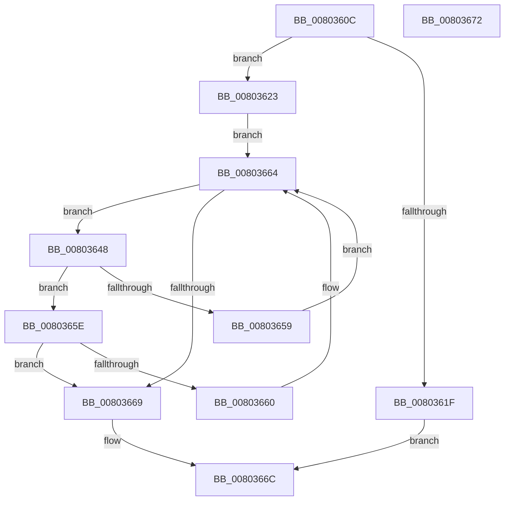

# MiFindUserSidHotPatchContext

- RVA: `0x0080360C`–`0x00803673` (길이 `103` bytes)
- VA: `0x000000014080360C`
- 실행 섹션: `PAGE`
- PDB 이름 있음: `예`; PDB Function 태그: `아니요`
- unwind 정보 RVA: `0x00064C80`
- 디코드: `32`개 명령, `103/103` bytes 표시
- 미해석 바이트: `0` (있으면 어셈블리에 `.byte`로 보존)

> 이 문서는 커널 이미지의 기계어와 PDB 기호를 분석해 생성했습니다. 4번과 5번은 함수 원형과 자료형을 바이너리 사용 방식에서 추정한 C 해석이며 원본 소스 복구 결과는 아닙니다.

## 1. Dependencies

- 직접 호출 지점: **3**; 고유 호출 대상: **3**
- 직접 호출자로 확인된 함수: **2**
- RIP 상대 이미지 참조: **1**

### Outgoing calls
- `0x00803623` → [RtlLengthSid](../../text/45/RtlLengthSid_function_0045D270.md) (function, `0x0045D270`)
- `0x00803630` → [RtlHashBytes2](../../text/43/RtlHashBytes2_function_004397C0.md) (function, `0x004397C0`)
- `0x00803650` → [MiCompareUserSidHotPatchNodes](MiCompareUserSidHotPatchNodes_function_00803144.md) (function, `0x00803144`)

### Direct callers
- [MiQueryLoadedPatches](../AB/MiQueryLoadedPatches_function_00ABE538.md) at `0x00ABE5CB`
- [sub_00B3ABCE](../B3/Unknown_function_00B3ABCE.md) at `0x00B3ABFD`

### Static image references
- `0x00803612` → RVA `0x00E37570` (`.data`; read)

## 2. Other-region calls and transfers

- 다른 실행 섹션으로 향하는 call: **2**
  - `0x00803623` → [RtlLengthSid](../../text/45/RtlLengthSid_function_0045D270.md) (`PAGE` → `.text`)
  - `0x00803630` → [RtlHashBytes2](../../text/43/RtlHashBytes2_function_004397C0.md) (`PAGE` → `.text`)
- 별도 외부 분기/꼬리 이동을 확인하지 못했습니다.

## 3. Assembly (complete function range)

```asm
0080360C  40 53                           push rbx
0080360E  48 83 EC 30                     sub rsp, 0x30
00803612  48 83 3D 56 3F 63 00 00         cmp qword ptr [rip + 0x633f56], 0
0080361A  48 8B D9                        mov rbx, rcx
0080361D  75 04                           jne 0x140803623
0080361F  33 C0                           xor eax, eax
00803621  EB 49                           jmp 0x14080366c
00803623  E8 48 9C C5 FF                  call 0x14045d270
00803628  8B D0                           mov edx, eax
0080362A  45 33 C0                        xor r8d, r8d
0080362D  48 8B CB                        mov rcx, rbx
00803630  E8 8B 61 C3 FF                  call 0x1404397c0
00803635  48 89 5C 24 28                  mov qword ptr [rsp + 0x28], rbx
0080363A  48 8B 1D 2F 3F 63 00            mov rbx, qword ptr [rip + 0x633f2f]
00803641  48 89 44 24 20                  mov qword ptr [rsp + 0x20], rax
00803646  EB 1C                           jmp 0x140803664
00803648  48 8B D3                        mov rdx, rbx
0080364B  48 8D 4C 24 20                  lea rcx, [rsp + 0x20]
00803650  E8 EF FA FF FF                  call 0x140803144
00803655  85 C0                           test eax, eax
00803657  79 05                           jns 0x14080365e
00803659  48 8B 1B                        mov rbx, qword ptr [rbx]
0080365C  EB 06                           jmp 0x140803664
0080365E  7E 09                           jle 0x140803669
00803660  48 8B 5B 08                     mov rbx, qword ptr [rbx + 8]
00803664  48 85 DB                        test rbx, rbx
00803667  75 DF                           jne 0x140803648
00803669  48 8B C3                        mov rax, rbx
0080366C  48 83 C4 30                     add rsp, 0x30
00803670  5B                              pop rbx
00803671  C3                              ret
00803672  CC                              int3
```

## 4. C-style interpretation (structured pseudocode)

```c
__int64 __fastcall MiFindUserSidHotPatchContext(__int64 a1, __int64 a2, int a3)
{
    __int64 result;
    __int64 v_rsp;
    unsigned __int64 v_stack_m10;
    unsigned __int64 v_stack_m18;

    v_rsp = (v_rsp) - (48);
    if ((*(unsigned __int64 *)(v_rip + 6504278)) != 0) goto loc_00803623;
    result = 0;
    goto loc_0080366C;
loc_00803623:
    result = RtlLengthSid(a1, a2, a3, a4);
    a3 = 0;
    result = RtlHashBytes2(a1, (unsigned int)((unsigned int)(result)), a3, a4);
    v_stack_m10 = a1;
    v_stack_m18 = result;
    goto loc_00803664;
loc_00803648:
    result = MiCompareUserSidHotPatchNodes(v_stack_m18, *(unsigned __int64 *)(v_rip + 6504239), a3, a4);
    if (!sign_flag) goto loc_0080365E;
    goto loc_00803664;
loc_0080365E:
    if (condition_is_less_or_equal) goto loc_00803669;
loc_00803664:
    if (*(unsigned __int64 *)(*(unsigned __int64 *)(*(unsigned __int64 *)(v_rip + 6504239)) + 8) != 0) goto loc_00803648;
loc_00803669:
loc_0080366C:
    v_rsp = (v_rsp) + (48);
    return *(unsigned __int64 *)(*(unsigned __int64 *)(*(unsigned __int64 *)(v_rip + 6504239)) + 8);
}
```

## 5. (Beta) C Style

```c
int64_t MiFindUserSidHotPatchContext(int64_t Arg1, int64_t Arg2, int32_t Arg3)
{
    int64_t result;
    int64_t local_rsp;
    uint64_t v_stack_m10;
    uint64_t v_stack_m18;

    local_rsp = (local_rsp) - (48);
    if ((*(uint64_t *)(v_rip + 0x633F56)) != 0) goto loc_00803623;
    result = 0;
    goto loc_0080366C;
loc_00803623:
    result = RtlLengthSid(Arg1, Arg2, Arg3, a4);
    Arg3 = 0;
    result = RtlHashBytes2(Arg1, (uint32_t)((uint32_t)(result)), Arg3, a4);
    v_stack_m10 = Arg1;
    v_stack_m18 = result;
    goto loc_00803664;
loc_00803648:
    result = MiCompareUserSidHotPatchNodes(v_stack_m18, *(uint64_t *)(v_rip + 0x633F2F), Arg3, a4);
    if (!sign_flag) goto loc_0080365E;
    goto loc_00803664;
loc_0080365E:
    if (condition_is_less_or_equal) goto loc_00803669;
loc_00803664:
    if (*(uint64_t *)(*(uint64_t *)(*(uint64_t *)(v_rip + 0x633F2F)) + 0x8) != 0) goto loc_00803648;
loc_00803669:
loc_0080366C:
    local_rsp = (local_rsp) + (48);
    return *(uint64_t *)(*(uint64_t *)(*(uint64_t *)(v_rip + 0x633F2F)) + 0x8);
}
```

## 6. Execution-region graph

[열기: 2D/3D 그래프와 함수 탐색 컨트롤 패널](../../../control-panel.html?section=page&rva=0x0080360C&view=graph)

- 2D 그래프는 위에서 아래로 흐르고, 3D 그래프는 빈 공간을 드래그해 회전합니다. Shift+드래그는 이동, 휠은 확대·축소, 함수 노드 선택은 대상 보고서 이동입니다.

### Static fallback


