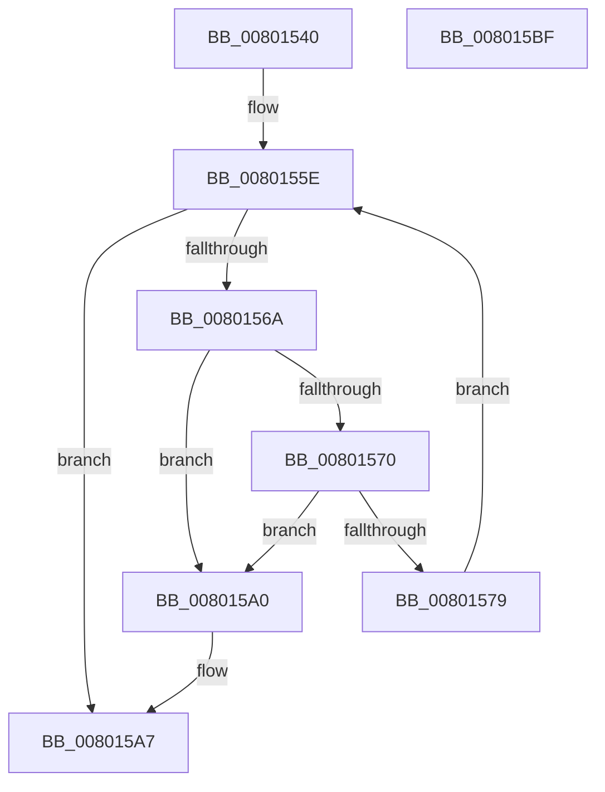

# MiFlushDeferredRetpolineImageLoadEvents

- RVA: `0x00801540`–`0x008015C0` (길이 `128` bytes)
- VA: `0x0000000140801540`
- 실행 섹션: `PAGE`
- PDB 이름 있음: `예`; PDB Function 태그: `아니요`
- unwind 정보 RVA: `0x00060BC4`
- 디코드: `35`개 명령, `128/128` bytes 표시
- 미해석 바이트: `0` (있으면 어셈블리에 `.byte`로 보존)

> 이 문서는 커널 이미지의 기계어와 PDB 기호를 분석해 생성했습니다. 4번과 5번은 함수 원형과 자료형을 바이너리 사용 방식에서 추정한 C 해석이며 원본 소스 복구 결과는 아닙니다.

## 1. Dependencies

- 직접 호출 지점: **4**; 고유 호출 대상: **4**
- 직접 호출자로 확인된 함수: **1**
- RIP 상대 이미지 참조: **2**

### Outgoing calls
- `0x0080154F` → [MmAcquireLoadLock](../../text/4D/MmAcquireLoadLock_function_004DC2A0.md) (function, `0x004DC2A0`)
- `0x0080158F` → [MiLogNonRetpolineImageLoadEvent](../A9/MiLogNonRetpolineImageLoadEvent_function_00A9975C.md) (function, `0x00A9975C`)
- `0x00801599` → [ExFreePoolWithTag](../../poolcode/B8/ExFreePoolWithTag_function_00B82870.md) (function, `0x00B82870`)
- `0x008015AA` → [MmReleaseLoadLock](../../text/4D/MmReleaseLoadLock_function_004D36D0.md) (function, `0x004D36D0`)

### Direct callers
- [MiInitSystem](../../init/C5/MiInitSystem_function_00C5E6C0.md) at `0x00C5ED3F`

### Static image references
- `0x00801557` → RVA `0x00E2D868` (`.data`; read)
- `0x00801579` → RVA `0x00E2D868` (`.data`; write)

## 2. Other-region calls and transfers

- 다른 실행 섹션으로 향하는 call: **3**
  - `0x0080154F` → [MmAcquireLoadLock](../../text/4D/MmAcquireLoadLock_function_004DC2A0.md) (`PAGE` → `.text`)
  - `0x00801599` → [ExFreePoolWithTag](../../poolcode/B8/ExFreePoolWithTag_function_00B82870.md) (`PAGE` → `POOLCODE`)
  - `0x008015AA` → [MmReleaseLoadLock](../../text/4D/MmReleaseLoadLock_function_004D36D0.md) (`PAGE` → `.text`)
- 별도 외부 분기/꼬리 이동을 확인하지 못했습니다.

## 3. Assembly (complete function range)

```asm
00801540  48 89 5C 24 08                  mov qword ptr [rsp + 8], rbx
00801545  48 89 74 24 10                  mov qword ptr [rsp + 0x10], rsi
0080154A  57                              push rdi
0080154B  48 83 EC 20                     sub rsp, 0x20
0080154F  E8 4C AD CD FF                  call 0x1404dc2a0
00801554  48 8B F8                        mov rdi, rax
00801557  48 8D 35 0A C3 62 00            lea rsi, [rip + 0x62c30a]
0080155E  48 8B 1D 03 C3 62 00            mov rbx, qword ptr [rip + 0x62c303]
00801565  48 3B DE                        cmp rbx, rsi
00801568  74 3D                           je 0x1408015a7
0080156A  48 39 73 08                     cmp qword ptr [rbx + 8], rsi
0080156E  75 30                           jne 0x1408015a0
00801570  48 8B 03                        mov rax, qword ptr [rbx]
00801573  48 39 58 08                     cmp qword ptr [rax + 8], rbx
00801577  75 27                           jne 0x1408015a0
00801579  48 89 05 E8 C2 62 00            mov qword ptr [rip + 0x62c2e8], rax
00801580  48 8D 4B 10                     lea rcx, [rbx + 0x10]
00801584  48 89 70 08                     mov qword ptr [rax + 8], rsi
00801588  44 8B 43 24                     mov r8d, dword ptr [rbx + 0x24]
0080158C  8B 53 20                        mov edx, dword ptr [rbx + 0x20]
0080158F  E8 C8 81 29 00                  call 0x140a9975c
00801594  33 D2                           xor edx, edx
00801596  48 8B CB                        mov rcx, rbx
00801599  E8 D2 12 38 00                  call 0x140b82870
0080159E  EB BE                           jmp 0x14080155e
008015A0  B9 03 00 00 00                  mov ecx, 3
008015A5  CD 29                           int 0x29
008015A7  48 8B CF                        mov rcx, rdi
008015AA  E8 21 21 CD FF                  call 0x1404d36d0
008015AF  48 8B 5C 24 30                  mov rbx, qword ptr [rsp + 0x30]
008015B4  48 8B 74 24 38                  mov rsi, qword ptr [rsp + 0x38]
008015B9  48 83 C4 20                     add rsp, 0x20
008015BD  5F                              pop rdi
008015BE  C3                              ret
008015BF  CC                              int3
```

## 4. C-style interpretation (structured pseudocode)

```c
__int64 __fastcall MiFlushDeferredRetpolineImageLoadEvents(void)
{
    __int64 result;
    __int64 v_rsp;
    unsigned __int64 v_stack_p10;
    unsigned __int64 v_stack_p8;

    v_stack_p8 = v_rbx;
    v_stack_p10 = v_rsi;
    v_rsp = (v_rsp) - (32);
    result = MmAcquireLoadLock(a1, a2, a3, a4);
loc_0080155E:
    if ((*(unsigned __int64 *)(v_rip + 6472451)) == (v_rip + 6472458)) goto loc_008015A7;
    if ((*(unsigned __int64 *)(*(unsigned __int64 *)(v_rip + 6472451) + 8)) != (v_rip + 6472458)) goto loc_008015A0;
    if ((*(unsigned __int64 *)(*(unsigned __int64 *)(*(unsigned __int64 *)(v_rip + 6472451)) + 8)) != (*(unsigned __int64 *)(v_rip + 6472451))) goto loc_008015A0;
    *(unsigned __int64 *)(v_rip + 6472424) = *(unsigned __int64 *)(*(unsigned __int64 *)(v_rip + 6472451));
    *(unsigned __int64 *)(*(unsigned __int64 *)(*(unsigned __int64 *)(v_rip + 6472451)) + 8) = v_rip + 6472458;
    result = MiLogNonRetpolineImageLoadEvent(*(unsigned __int64 *)(v_rip + 6472451) + 16, (unsigned int)(*(unsigned int *)(*(unsigned __int64 *)(v_rip + 6472451) + 32)), (unsigned int)(*(unsigned int *)(*(unsigned __int64 *)(v_rip + 6472451) + 36)), a4);
    a2 = 0;
    result = ExFreePoolWithTag(*(unsigned __int64 *)(v_rip + 6472451), a2, (unsigned int)(*(unsigned int *)(*(unsigned __int64 *)(v_rip + 6472451) + 36)), a4);
    goto loc_0080155E;
loc_008015A0:
loc_008015A7:
    result = MmReleaseLoadLock(result, a2, (unsigned int)(*(unsigned int *)(*(unsigned __int64 *)(v_rip + 6472451) + 36)), a4);
    v_rsp = (v_rsp) + (32);
    return result;
}
```

## 5. (Beta) C Style

```c
void MiFlushDeferredRetpolineImageLoadEvents(void)
{
    int64_t result;
    int64_t local_rsp;
    uint64_t v_stack_p10;
    uint64_t v_stack_p8;

    v_stack_p8 = local_rbx;
    v_stack_p10 = local_rsi;
    local_rsp = (local_rsp) - (32);
    result = MmAcquireLoadLock(a1, a2, a3, a4);
loc_0080155E:
    if ((*(uint64_t *)(v_rip + 0x62C303)) == (v_rip + 6472458)) goto loc_008015A7;
    if ((*(uint64_t *)(*(uint64_t *)(v_rip + 0x62C303) + 0x8)) != (v_rip + 6472458)) goto loc_008015A0;
    if ((*(uint64_t *)(*(uint64_t *)(*(uint64_t *)(v_rip + 0x62C303)) + 0x8)) != (*(uint64_t *)(v_rip + 0x62C303))) goto loc_008015A0;
    *(uint64_t *)(v_rip + 0x62C2E8) = *(uint64_t *)(*(uint64_t *)(v_rip + 0x62C303));
    *(uint64_t *)(*(uint64_t *)(*(uint64_t *)(v_rip + 0x62C303)) + 0x8) = v_rip + 6472458;
    result = MiLogNonRetpolineImageLoadEvent(*(uint64_t *)(v_rip + 0x62C303) + 16, (uint32_t)(*(uint32_t *)(*(uint64_t *)(v_rip + 0x62C303) + 0x20)), (uint32_t)(*(uint32_t *)(*(uint64_t *)(v_rip + 0x62C303) + 0x24)), a4);
    a2 = 0;
    result = ExFreePoolWithTag(*(uint64_t *)(v_rip + 0x62C303), a2, (uint32_t)(*(uint32_t *)(*(uint64_t *)(v_rip + 0x62C303) + 0x24)), a4);
    goto loc_0080155E;
loc_008015A0:
loc_008015A7:
    result = MmReleaseLoadLock(result, a2, (uint32_t)(*(uint32_t *)(*(uint64_t *)(v_rip + 0x62C303) + 0x24)), a4);
    local_rsp = (local_rsp) + (32);
    return result;
}
```

## 6. Execution-region graph

[열기: 2D/3D 그래프와 함수 탐색 컨트롤 패널](../../../control-panel.html?section=page&rva=0x00801540&view=graph)

- 2D 그래프는 위에서 아래로 흐르고, 3D 그래프는 빈 공간을 드래그해 회전합니다. Shift+드래그는 이동, 휠은 확대·축소, 함수 노드 선택은 대상 보고서 이동입니다.

### Static fallback


