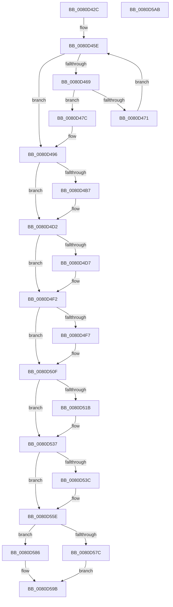

# MiFreePartitionPhysicalPages

- RVA: `0x0080D42C`–`0x0080D5AC` (길이 `384` bytes)
- VA: `0x000000014080D42C`
- 실행 섹션: `PAGE`
- PDB 이름 있음: `예`; PDB Function 태그: `아니요`
- unwind 정보 RVA: `0x000794E0`
- 디코드: `98`개 명령, `384/384` bytes 표시
- 미해석 바이트: `0` (있으면 어셈블리에 `.byte`로 보존)

> 이 문서는 커널 이미지의 기계어와 PDB 기호를 분석해 생성했습니다. 4번과 5번은 함수 원형과 자료형을 바이너리 사용 방식에서 추정한 C 해석이며 원본 소스 복구 결과는 아닙니다.

## 1. Dependencies

- 직접 호출 지점: **10**; 고유 호출 대상: **5**
- 직접 호출자로 확인된 함수: **1**
- RIP 상대 이미지 참조: **2**

### Outgoing calls
- `0x0080D448` → [MiReturnPartitionPagesToParent](../../text/69/MiReturnPartitionPagesToParent_function_00691B5C.md) (function, `0x00691B5C`)
- `0x0080D490` → [KeBugCheckEx](../../text/4F/KeBugCheckEx_function_004FD660.md) (function, `0x004FD660`)
- `0x0080D4CC` → [KeBugCheckEx](../../text/4F/KeBugCheckEx_function_004FD660.md) (function, `0x004FD660`)
- `0x0080D4EC` → [KeBugCheckEx](../../text/4F/KeBugCheckEx_function_004FD660.md) (function, `0x004FD660`)
- `0x0080D509` → [KeBugCheckEx](../../text/4F/KeBugCheckEx_function_004FD660.md) (function, `0x004FD660`)
- `0x0080D531` → [KeBugCheckEx](../../text/4F/KeBugCheckEx_function_004FD660.md) (function, `0x004FD660`)
- `0x0080D558` → [KeBugCheckEx](../../text/4F/KeBugCheckEx_function_004FD660.md) (function, `0x004FD660`)
- `0x0080D561` → [MiReturnResident](../../text/28/MiReturnResident_function_00286890.md) (function, `0x00286890`)
- `0x0080D57F` → [MiReturnCommit](../../text/24/MiReturnCommit_function_00248410.md) (function, `0x00248410`)
- `0x0080D596` → [MiIncreaseCommitLimits](../../text/68/MiIncreaseCommitLimits_function_0068CADC.md) (function, `0x0068CADC`)

### Direct callers
- [MiDeletePartitionResources](MiDeletePartitionResources_function_0080D074.md) at `0x0080D195`

### Static image references
- `0x0080D45E` → RVA `0x00FC5000` (`ALMOSTRO`; read)
- `0x0080D56D` → RVA `0x00E38D00` (`.data`; read)

## 2. Other-region calls and transfers

- 다른 실행 섹션으로 향하는 call: **10**
  - `0x0080D448` → [MiReturnPartitionPagesToParent](../../text/69/MiReturnPartitionPagesToParent_function_00691B5C.md) (`PAGE` → `.text`)
  - `0x0080D490` → [KeBugCheckEx](../../text/4F/KeBugCheckEx_function_004FD660.md) (`PAGE` → `.text`)
  - `0x0080D4CC` → [KeBugCheckEx](../../text/4F/KeBugCheckEx_function_004FD660.md) (`PAGE` → `.text`)
  - `0x0080D4EC` → [KeBugCheckEx](../../text/4F/KeBugCheckEx_function_004FD660.md) (`PAGE` → `.text`)
  - `0x0080D509` → [KeBugCheckEx](../../text/4F/KeBugCheckEx_function_004FD660.md) (`PAGE` → `.text`)
  - `0x0080D531` → [KeBugCheckEx](../../text/4F/KeBugCheckEx_function_004FD660.md) (`PAGE` → `.text`)
  - `0x0080D558` → [KeBugCheckEx](../../text/4F/KeBugCheckEx_function_004FD660.md) (`PAGE` → `.text`)
  - `0x0080D561` → [MiReturnResident](../../text/28/MiReturnResident_function_00286890.md) (`PAGE` → `.text`)
  - `0x0080D57F` → [MiReturnCommit](../../text/24/MiReturnCommit_function_00248410.md) (`PAGE` → `.text`)
  - `0x0080D596` → [MiIncreaseCommitLimits](../../text/68/MiIncreaseCommitLimits_function_0068CADC.md) (`PAGE` → `.text`)
- 별도 외부 분기/꼬리 이동을 확인하지 못했습니다.

## 3. Assembly (complete function range)

```asm
0080D42C  48 89 5C 24 08                  mov qword ptr [rsp + 8], rbx
0080D431  48 89 74 24 10                  mov qword ptr [rsp + 0x10], rsi
0080D436  57                              push rdi
0080D437  48 83 EC 30                     sub rsp, 0x30
0080D43B  48 8B B9 50 48 00 00            mov rdi, qword ptr [rcx + 0x4850]
0080D442  48 8B F2                        mov rsi, rdx
0080D445  48 8B D9                        mov rbx, rcx
0080D448  E8 0F 47 E8 FF                  call 0x140691b5c
0080D44D  4C 8B 43 10                     mov r8, qword ptr [rbx + 0x10]
0080D451  45 33 DB                        xor r11d, r11d
0080D454  41 8B C3                        mov eax, r11d
0080D457  49 81 C0 98 3B 00 00            add r8, 0x3b98
0080D45E  0F B7 15 9B 7B 7B 00            movzx edx, word ptr [rip + 0x7b7b9b]
0080D465  3B C2                           cmp eax, edx
0080D467  73 2D                           jae 0x14080d496
0080D469  49 8B 08                        mov rcx, qword ptr [r8]
0080D46C  48 85 C9                        test rcx, rcx
0080D46F  75 0B                           jne 0x14080d47c
0080D471  49 81 C0 80 DF 00 00            add r8, 0xdf80
0080D478  FF C0                           inc eax
0080D47A  EB E2                           jmp 0x14080d45e
0080D47C  45 33 C9                        xor r9d, r9d
0080D47F  4C 89 5C 24 20                  mov qword ptr [rsp + 0x20], r11
0080D484  4C 8B C1                        mov r8, rcx
0080D487  BA 08 10 04 00                  mov edx, 0x41008
0080D48C  41 8D 49 1A                     lea ecx, [r9 + 0x1a]
0080D490  E8 CB 01 CF FF                  call 0x1404fd660
0080D495  CC                              int3
0080D496  4C 8B 8B 00 49 00 00            mov r9, qword ptr [rbx + 0x4900]
0080D49D  48 8B 93 40 49 00 00            mov rdx, qword ptr [rbx + 0x4940]
0080D4A4  48 8B 83 80 1B 00 00            mov rax, qword ptr [rbx + 0x1b80]
0080D4AB  48 8B 8B 50 48 00 00            mov rcx, qword ptr [rbx + 0x4850]
0080D4B2  48 85 C0                        test rax, rax
0080D4B5  74 1B                           je 0x14080d4d2
0080D4B7  4C 89 4C 24 20                  mov qword ptr [rsp + 0x20], r9
0080D4BC  4C 8B C7                        mov r8, rdi
0080D4BF  4C 8B C9                        mov r9, rcx
0080D4C2  BA 06 10 04 00                  mov edx, 0x41006
0080D4C7  B9 1A 00 00 00                  mov ecx, 0x1a
0080D4CC  E8 8F 01 CF FF                  call 0x1404fd660
0080D4D1  CC                              int3
0080D4D2  48 85 C9                        test rcx, rcx
0080D4D5  74 1B                           je 0x14080d4f2
0080D4D7  4C 89 4C 24 20                  mov qword ptr [rsp + 0x20], r9
0080D4DC  4C 8B C7                        mov r8, rdi
0080D4DF  4C 8B C9                        mov r9, rcx
0080D4E2  BA 05 10 04 00                  mov edx, 0x41005
0080D4E7  B9 1A 00 00 00                  mov ecx, 0x1a
0080D4EC  E8 6F 01 CF FF                  call 0x1404fd660
0080D4F1  CC                              int3
0080D4F2  4D 85 C9                        test r9, r9
0080D4F5  74 18                           je 0x14080d50f
0080D4F7  4C 8B C7                        mov r8, rdi
0080D4FA  4C 89 5C 24 20                  mov qword ptr [rsp + 0x20], r11
0080D4FF  BA 04 10 04 00                  mov edx, 0x41004
0080D504  B9 1A 00 00 00                  mov ecx, 0x1a
0080D509  E8 52 01 CF FF                  call 0x1404fd660
0080D50E  CC                              int3
0080D50F  4C 8B 83 40 4B 00 00            mov r8, qword ptr [rbx + 0x4b40]
0080D516  4D 85 C0                        test r8, r8
0080D519  74 1C                           je 0x14080d537
0080D51B  4C 8B 8B 98 4C 00 00            mov r9, qword ptr [rbx + 0x4c98]
0080D522  BA 09 10 04 00                  mov edx, 0x41009
0080D527  B9 1A 00 00 00                  mov ecx, 0x1a
0080D52C  48 89 7C 24 20                  mov qword ptr [rsp + 0x20], rdi
0080D531  E8 2A 01 CF FF                  call 0x1404fd660
0080D536  CC                              int3
0080D537  48 3B D7                        cmp rdx, rdi
0080D53A  74 22                           je 0x14080d55e
0080D53C  48 8B 83 98 4C 00 00            mov rax, qword ptr [rbx + 0x4c98]
0080D543  4C 8B CA                        mov r9, rdx
0080D546  BA 03 10 04 00                  mov edx, 0x41003
0080D54B  48 89 44 24 20                  mov qword ptr [rsp + 0x20], rax
0080D550  4C 8B C7                        mov r8, rdi
0080D553  B9 1A 00 00 00                  mov ecx, 0x1a
0080D558  E8 03 01 CF FF                  call 0x1404fd660
0080D55D  CC                              int3
0080D55E  48 8B CE                        mov rcx, rsi
0080D561  E8 2A 93 A7 FF                  call 0x140286890
0080D566  48 8B 93 98 4C 00 00            mov rdx, qword ptr [rbx + 0x4c98]
0080D56D  48 8D 05 8C B7 62 00            lea rax, [rip + 0x62b78c]
0080D574  48 8B CE                        mov rcx, rsi
0080D577  48 3B F0                        cmp rsi, rax
0080D57A  75 0A                           jne 0x14080d586
0080D57C  45 33 C0                        xor r8d, r8d
0080D57F  E8 8C AE A3 FF                  call 0x140248410
0080D584  EB 15                           jmp 0x14080d59b
0080D586  4C 89 5C 24 28                  mov qword ptr [rsp + 0x28], r11
0080D58B  45 33 C9                        xor r9d, r9d
0080D58E  4C 8B C2                        mov r8, rdx
0080D591  44 89 5C 24 20                  mov dword ptr [rsp + 0x20], r11d
0080D596  E8 41 F5 E7 FF                  call 0x14068cadc
0080D59B  48 8B 5C 24 40                  mov rbx, qword ptr [rsp + 0x40]
0080D5A0  48 8B 74 24 48                  mov rsi, qword ptr [rsp + 0x48]
0080D5A5  48 83 C4 30                     add rsp, 0x30
0080D5A9  5F                              pop rdi
0080D5AA  C3                              ret
0080D5AB  CC                              int3
```

## 4. C-style interpretation (structured pseudocode)

```c
__int64 __fastcall MiFreePartitionPhysicalPages(__int64 a1, __int64 a2, __int64 a3, int a4)
{
    __int64 result;
    __int64 v_r11;
    __int64 v_rsp;
    unsigned __int64 v_stack_m10;
    unsigned __int64 v_stack_m18;
    unsigned __int64 v_stack_p10;
    unsigned __int64 v_stack_p8;

    v_stack_p8 = v_rbx;
    v_stack_p10 = v_rsi;
    v_rsp = (v_rsp) - (48);
    result = MiReturnPartitionPagesToParent(a1, a2, a3, a4);
    v_r11 = 0;
    a3 = (*(unsigned __int64 *)(a1 + 16)) + (0x3B98ULL);
loc_0080D45E:
    if (0 >= ((unsigned int)(*(unsigned __int16 *)(v_rip + 8092571)))) goto loc_0080D496;
    if (*(unsigned __int64 *)(a3) != 0) goto loc_0080D47C;
    a3 = (a3) + (0xDF80ULL);
    result = (unsigned int)((0) + 1);
    goto loc_0080D45E;
loc_0080D47C:
    a4 = 0;
    v_stack_m18 = 0;
    result = KeBugCheckEx(a4 + 26, (unsigned int)(0x41008ULL), *(unsigned __int64 *)(a3), a4);
loc_0080D496:
    result = *(unsigned __int64 *)(a1 + 7040);
    if (*(unsigned __int64 *)(a1 + 7040) != 0) {
        v_stack_m18 = *(unsigned __int64 *)(a1 + 18688);
        a3 = *(unsigned __int64 *)(a1 + 18512);
        a4 = *(unsigned __int64 *)(a1 + 18512);
        a2 = 0x41006ULL;
        a1 = 26;
        result = KeBugCheckEx(a1, a2, a3, a4);
    }
    if (a1 != 0) {
        v_stack_m18 = a4;
        a3 = *(unsigned __int64 *)(a1 + 18512);
        a4 = a1;
        a2 = 0x41005ULL;
        a1 = 26;
        result = KeBugCheckEx(a1, a2, a3, a4);
    }
    if (a4 != 0) {
        a3 = *(unsigned __int64 *)(a1 + 18512);
        v_stack_m18 = 0;
        a2 = 0x41004ULL;
        a1 = 26;
        result = KeBugCheckEx(a1, a2, a3, a4);
    }
    if (*(unsigned __int64 *)(a1 + 19264) != 0) {
        a4 = *(unsigned __int64 *)(a1 + 19608);
        a2 = 0x41009ULL;
        a1 = 26;
        v_stack_m18 = *(unsigned __int64 *)(a1 + 18512);
        result = KeBugCheckEx(a1, a2, *(unsigned __int64 *)(a1 + 19264), a4);
    }
    if (a2 != (*(unsigned __int64 *)(a1 + 18512))) {
        result = *(unsigned __int64 *)(a1 + 19608);
        a4 = a2;
        a2 = 0x41003ULL;
        v_stack_m18 = result;
        a3 = *(unsigned __int64 *)(a1 + 18512);
        a1 = 26;
        result = KeBugCheckEx(a1, a2, a3, a4);
    }
    result = MiReturnResident(a2, a2, a3, a4);
    if (a2 != (v_rip + 6469516)) goto loc_0080D586;
    a3 = 0;
    result = MiReturnCommit(a2, *(unsigned __int64 *)(a1 + 19608), a3, a4);
    goto loc_0080D59B;
loc_0080D586:
    v_stack_m10 = 0;
    a4 = 0;
    v_stack_m18 = 0;
    result = MiIncreaseCommitLimits(a2, *(unsigned __int64 *)(a1 + 19608), *(unsigned __int64 *)(a1 + 19608), a4);
loc_0080D59B:
    v_rsp = (v_rsp) + (48);
    return result;
}
```

## 5. (Beta) C Style

```c
int64_t MiFreePartitionPhysicalPages(void *Arg1, int64_t Arg2, int64_t Arg3, int32_t Arg4)
{
    uint8_t *arg1 = (uint8_t *)Arg1;

    int64_t result;
    int64_t local_r11;
    int64_t local_rsp;
    uint64_t v_stack_m10;
    uint64_t v_stack_m18;
    uint64_t v_stack_p10;
    uint64_t v_stack_p8;

    v_stack_p8 = local_rbx;
    v_stack_p10 = local_rsi;
    local_rsp = (local_rsp) - (48);
    result = MiReturnPartitionPagesToParent(Arg1, Arg2, Arg3, Arg4);
    local_r11 = 0;
    Arg3 = (*(uint64_t *)(arg1 + 0x10)) + (0x3B98ULL);
loc_0080D45E:
    if (0 >= ((uint32_t)(*(uint16_t *)(v_rip + 0x7B7B9B)))) goto loc_0080D496;
    if (*(uint64_t *)(Arg3) != 0) goto loc_0080D47C;
    Arg3 = (Arg3) + (0xDF80ULL);
    result = (uint32_t)((0) + 1);
    goto loc_0080D45E;
loc_0080D47C:
    Arg4 = 0;
    v_stack_m18 = 0;
    result = KeBugCheckEx(Arg4 + 26, (uint32_t)(0x41008ULL), *(uint64_t *)(Arg3), Arg4);
loc_0080D496:
    result = *(uint64_t *)(arg1 + 0x1B80);
    if (*(uint64_t *)(arg1 + 0x1B80) != 0) {
        v_stack_m18 = *(uint64_t *)(arg1 + 0x4900);
        Arg3 = *(uint64_t *)(arg1 + 0x4850);
        Arg4 = *(uint64_t *)(arg1 + 0x4850);
        Arg2 = 0x41006ULL;
        Arg1 = 26;
        result = KeBugCheckEx(Arg1, Arg2, Arg3, Arg4);
    }
    if (Arg1 != NULL) {
        v_stack_m18 = Arg4;
        Arg3 = *(uint64_t *)(arg1 + 0x4850);
        Arg4 = Arg1;
        Arg2 = 0x41005ULL;
        Arg1 = 26;
        result = KeBugCheckEx(Arg1, Arg2, Arg3, Arg4);
    }
    if (Arg4 != 0) {
        Arg3 = *(uint64_t *)(arg1 + 0x4850);
        v_stack_m18 = 0;
        Arg2 = 0x41004ULL;
        Arg1 = 26;
        result = KeBugCheckEx(Arg1, Arg2, Arg3, Arg4);
    }
    if (*(uint64_t *)(arg1 + 0x4B40) != 0) {
        Arg4 = *(uint64_t *)(arg1 + 0x4C98);
        Arg2 = 0x41009ULL;
        Arg1 = 26;
        v_stack_m18 = *(uint64_t *)(arg1 + 0x4850);
        result = KeBugCheckEx(Arg1, Arg2, *(uint64_t *)(arg1 + 0x4B40), Arg4);
    }
    if (Arg2 != (*(uint64_t *)(arg1 + 0x4850))) {
        result = *(uint64_t *)(arg1 + 0x4C98);
        Arg4 = Arg2;
        Arg2 = 0x41003ULL;
        v_stack_m18 = result;
        Arg3 = *(uint64_t *)(arg1 + 0x4850);
        Arg1 = 26;
        result = KeBugCheckEx(Arg1, Arg2, Arg3, Arg4);
    }
    result = MiReturnResident(Arg2, Arg2, Arg3, Arg4);
    if (Arg2 != (v_rip + 6469516)) goto loc_0080D586;
    Arg3 = 0;
    result = MiReturnCommit(Arg2, *(uint64_t *)(arg1 + 0x4C98), Arg3, Arg4);
    goto loc_0080D59B;
loc_0080D586:
    v_stack_m10 = 0;
    Arg4 = 0;
    v_stack_m18 = 0;
    result = MiIncreaseCommitLimits(Arg2, *(uint64_t *)(arg1 + 0x4C98), *(uint64_t *)(arg1 + 0x4C98), Arg4);
loc_0080D59B:
    local_rsp = (local_rsp) + (48);
    return result;
}
```

### 관측된 메모리 오프셋

구조체 형식이 확인되지 않은 접근은 인자 기준의 오프셋으로만 기록했습니다.

| 기준 인자 | 오프셋 표현 | 폭 (bit) | 접근 |
|---|---:|---:|---|
| `Arg1` | `+ 0x10` | `64` | `R` |
| `Arg1` | `+ 0x1B80` | `64` | `R` |
| `Arg1` | `+ 0x4850` | `64` | `R` |
| `Arg1` | `+ 0x4900` | `64` | `R` |
| `Arg1` | `+ 0x4940` | `64` | `R` |
| `Arg1` | `+ 0x4B40` | `64` | `R` |
| `Arg1` | `+ 0x4C98` | `64` | `R` |

## 6. Execution-region graph

[열기: 2D/3D 그래프와 함수 탐색 컨트롤 패널](../../../control-panel.html?section=page&rva=0x0080D42C&view=graph)

- 2D 그래프는 위에서 아래로 흐르고, 3D 그래프는 빈 공간을 드래그해 회전합니다. Shift+드래그는 이동, 휠은 확대·축소, 함수 노드 선택은 대상 보고서 이동입니다.

### Static fallback


