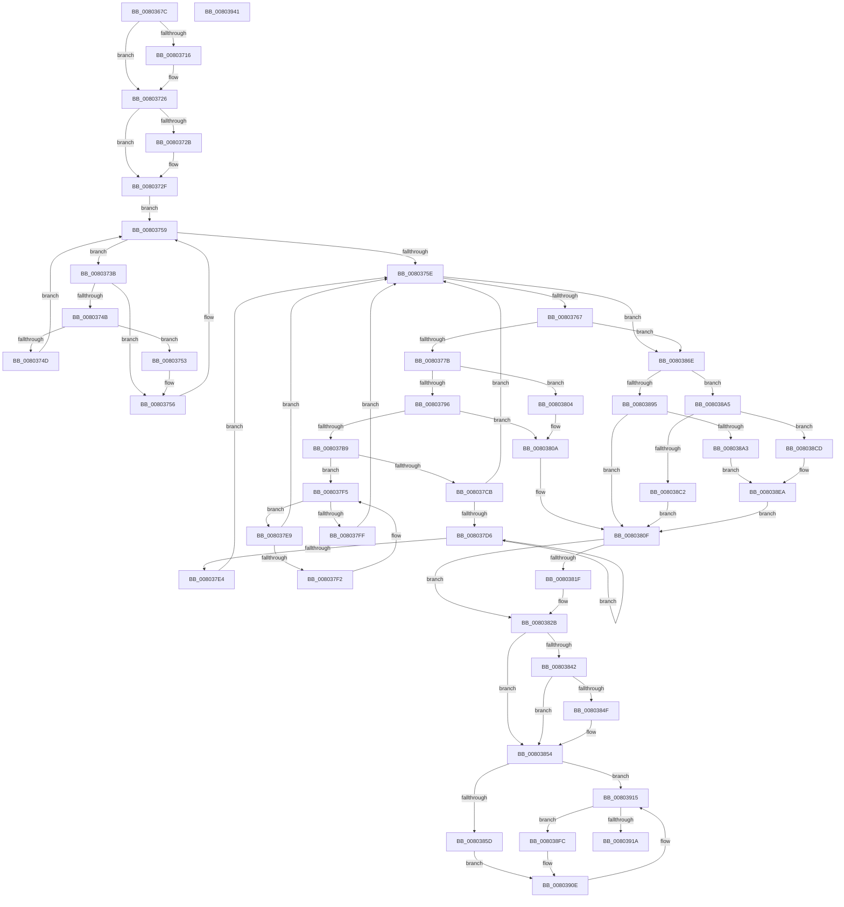

# MiGetAllRegisteredPatches

- RVA: `0x0080367C`–`0x00803942` (길이 `710` bytes)
- VA: `0x000000014080367C`
- 실행 섹션: `PAGE`
- PDB 이름 있음: `예`; PDB Function 태그: `아니요`
- unwind 정보 RVA: `0x000D8654`
- 디코드: `198`개 명령, `710/710` bytes 표시
- 미해석 바이트: `0` (있으면 어셈블리에 `.byte`로 보존)

> 이 문서는 커널 이미지의 기계어와 PDB 기호를 분석해 생성했습니다. 4번과 5번은 함수 원형과 자료형을 바이너리 사용 방식에서 추정한 C 해석이며 원본 소스 복구 결과는 아닙니다.

## 1. Dependencies

- 직접 호출 지점: **18**; 고유 호출 대상: **12**
- 직접 호출자로 확인된 함수: **1**
- RIP 상대 이미지 참조: **2**

### Outgoing calls
- `0x008036CD` → [RtlInitUnicodeString](../../text/42/RtlInitUnicodeString_function_0042A780.md) (function, `0x0042A780`)
- `0x008036FE` → [KeAbPreAcquire](../../text/21/KeAbPreAcquire_function_00210230.md) (function, `0x00210230`)
- `0x00803721` → [ExfAcquirePushLockSharedEx](../../text/21/ExfAcquirePushLockSharedEx_function_0021044C.md) (function, `0x0021044C`)
- `0x00803742` → [MiCompareHotPatchNodes](MiCompareHotPatchNodes_function_00803114.md) (function, `0x00803114`)
- `0x0080376E` → [MiCompareHotPatchNodes](MiCompareHotPatchNodes_function_00803114.md) (function, `0x00803114`)
- `0x00803789` → [MiAllocatePool](../../text/35/MiAllocatePool_function_0035B540.md) (function, `0x0035B540`)
- `0x0080379C` → [RtlInitUnicodeString](../../text/42/RtlInitUnicodeString_function_0042A780.md) (function, `0x0042A780`)
- `0x008037AB` → [RtlDuplicateUnicodeString](../93/RtlDuplicateUnicodeString_function_009321F0.md) (function, `0x009321F0`)
- `0x00803826` → [ExfReleasePushLockShared](../../text/26/ExfReleasePushLockShared_function_00263440.md) (function, `0x00263440`)
- `0x00803832` → [KeAbPostRelease](../../text/2E/KeAbPostRelease_function_002E1600.md) (function, `0x002E1600`)
- `0x0080384F` → [KiCheckForKernelApcDelivery](../../text/2E/KiCheckForKernelApcDelivery_function_002E2C80.md) (function, `0x002E2C80`)
- `0x00803861` → [RtlFreeAnsiString](../9C/RtlFreeAnsiString_function_009C0800.md) (function, `0x009C0800`)
- `0x00803889` → [MiFindProcessImageHotPatchRecord](../A4/MiFindProcessImageHotPatchRecord_function_00A4206C.md) (function, `0x00A4206C`)
- `0x008038B5` → [MiAllocatePool](../../text/35/MiAllocatePool_function_0035B540.md) (function, `0x0035B540`)
- `0x008038DC` → [RtlInitUnicodeString](../../text/42/RtlInitUnicodeString_function_0042A780.md) (function, `0x0042A780`)
- `0x00803906` → [RtlFreeAnsiString](../9C/RtlFreeAnsiString_function_009C0800.md) (function, `0x009C0800`)
- `0x00803910` → [ExFreePoolWithTag](../../poolcode/B8/ExFreePoolWithTag_function_00B82870.md) (function, `0x00B82870`)
- `0x0080391E` → [RtlFreeAnsiString](../9C/RtlFreeAnsiString_function_009C0800.md) (function, `0x009C0800`)

### Direct callers
- [MiApplyImageHotPatchRequest](MiApplyImageHotPatchRequest_function_008025AC.md) at `0x00802912`

### Static image references
- `0x008036E5` → RVA `0x00E37590` (`.data`; read)
- `0x0080372F` → RVA `0x00E37580` (`.data`; read)

## 2. Other-region calls and transfers

- 다른 실행 섹션으로 향하는 call: **11**
  - `0x008036CD` → [RtlInitUnicodeString](../../text/42/RtlInitUnicodeString_function_0042A780.md) (`PAGE` → `.text`)
  - `0x008036FE` → [KeAbPreAcquire](../../text/21/KeAbPreAcquire_function_00210230.md) (`PAGE` → `.text`)
  - `0x00803721` → [ExfAcquirePushLockSharedEx](../../text/21/ExfAcquirePushLockSharedEx_function_0021044C.md) (`PAGE` → `.text`)
  - `0x00803789` → [MiAllocatePool](../../text/35/MiAllocatePool_function_0035B540.md) (`PAGE` → `.text`)
  - `0x0080379C` → [RtlInitUnicodeString](../../text/42/RtlInitUnicodeString_function_0042A780.md) (`PAGE` → `.text`)
  - `0x00803826` → [ExfReleasePushLockShared](../../text/26/ExfReleasePushLockShared_function_00263440.md) (`PAGE` → `.text`)
  - `0x00803832` → [KeAbPostRelease](../../text/2E/KeAbPostRelease_function_002E1600.md) (`PAGE` → `.text`)
  - `0x0080384F` → [KiCheckForKernelApcDelivery](../../text/2E/KiCheckForKernelApcDelivery_function_002E2C80.md) (`PAGE` → `.text`)
  - `0x008038B5` → [MiAllocatePool](../../text/35/MiAllocatePool_function_0035B540.md) (`PAGE` → `.text`)
  - `0x008038DC` → [RtlInitUnicodeString](../../text/42/RtlInitUnicodeString_function_0042A780.md) (`PAGE` → `.text`)
  - `0x00803910` → [ExFreePoolWithTag](../../poolcode/B8/ExFreePoolWithTag_function_00B82870.md) (`PAGE` → `POOLCODE`)
- 별도 외부 분기/꼬리 이동을 확인하지 못했습니다.

## 3. Assembly (complete function range)

```asm
0080367C  48 8B C4                        mov rax, rsp
0080367F  48 89 58 18                     mov qword ptr [rax + 0x18], rbx
00803683  4C 89 48 20                     mov qword ptr [rax + 0x20], r9
00803687  89 50 10                        mov dword ptr [rax + 0x10], edx
0080368A  48 89 48 08                     mov qword ptr [rax + 8], rcx
0080368E  55                              push rbp
0080368F  56                              push rsi
00803690  57                              push rdi
00803691  41 54                           push r12
00803693  41 55                           push r13
00803695  41 56                           push r14
00803697  41 57                           push r15
00803699  48 8B EC                        mov rbp, rsp
0080369C  48 81 EC 80 00 00 00            sub rsp, 0x80
008036A3  0F 57 C0                        xorps xmm0, xmm0
008036A6  48 8D 4D B8                     lea rcx, [rbp - 0x48]
008036AA  8B FA                           mov edi, edx
008036AC  33 C0                           xor eax, eax
008036AE  45 33 F6                        xor r14d, r14d
008036B1  48 89 45 F8                     mov qword ptr [rbp - 8], rax
008036B5  33 D2                           xor edx, edx
008036B7  45 8B FE                        mov r15d, r14d
008036BA  0F 11 45 C8                     movups xmmword ptr [rbp - 0x38], xmm0
008036BE  45 8B E0                        mov r12d, r8d
008036C1  0F 11 45 D8                     movups xmmword ptr [rbp - 0x28], xmm0
008036C5  0F 11 45 E8                     movups xmmword ptr [rbp - 0x18], xmm0
008036C9  0F 11 45 B8                     movups xmmword ptr [rbp - 0x48], xmm0
008036CD  E8 AE 70 C2 FF                  call 0x14042a780
008036D2  65 4C 8B 2C 25 88 01 00 00      mov r13, qword ptr gs:[0x188]
008036DB  41 8D 76 01                     lea esi, [r14 + 1]
008036DF  89 7D E0                        mov dword ptr [rbp - 0x20], edi
008036E2  45 33 C0                        xor r8d, r8d
008036E5  48 8D 3D A4 3E 63 00            lea rdi, [rip + 0x633ea4]
008036EC  44 89 65 E4                     mov dword ptr [rbp - 0x1c], r12d
008036F0  33 D2                           xor edx, edx
008036F2  48 8B CF                        mov rcx, rdi
008036F5  66 41 29 B5 E6 01 00 00         sub word ptr [r13 + 0x1e6], si
008036FD  90                              nop
008036FE  E8 2D CB A0 FF                  call 0x140210230
00803703  48 8B D8                        mov rbx, rax
00803706  8D 4E 10                        lea ecx, [rsi + 0x10]
00803709  33 C0                           xor eax, eax
0080370B  F0 48 0F B1 0D 7C 3E 63 00      lock cmpxchg qword ptr [rip + 0x633e7c], rcx
00803714  74 10                           je 0x140803726
00803716  4C 8B CF                        mov r9, rdi
00803719  4C 8B C3                        mov r8, rbx
0080371C  33 D2                           xor edx, edx
0080371E  48 8B CF                        mov rcx, rdi
00803721  E8 26 CD A0 FF                  call 0x14021044c
00803726  48 85 DB                        test rbx, rbx
00803729  74 04                           je 0x14080372f
0080372B  40 88 73 0A                     mov byte ptr [rbx + 0xa], sil
0080372F  48 8B 1D 4A 3E 63 00            mov rbx, qword ptr [rip + 0x633e4a]
00803736  49 8B F6                        mov rsi, r14
00803739  EB 1E                           jmp 0x140803759
0080373B  48 8B D3                        mov rdx, rbx
0080373E  48 8D 4D C8                     lea rcx, [rbp - 0x38]
00803742  E8 CD F9 FF FF                  call 0x140803114
00803747  85 C0                           test eax, eax
00803749  78 0B                           js 0x140803756
0080374B  7E 06                           jle 0x140803753
0080374D  48 8B 5B 08                     mov rbx, qword ptr [rbx + 8]
00803751  EB 06                           jmp 0x140803759
00803753  48 8B F3                        mov rsi, rbx
00803756  48 8B 1B                        mov rbx, qword ptr [rbx]
00803759  48 85 DB                        test rbx, rbx
0080375C  75 DD                           jne 0x14080373b
0080375E  48 85 F6                        test rsi, rsi
00803761  0F 84 07 01 00 00               je 0x14080386e
00803767  48 8B D6                        mov rdx, rsi
0080376A  48 8D 4D C8                     lea rcx, [rbp - 0x38]
0080376E  E8 A1 F9 FF FF                  call 0x140803114
00803773  85 C0                           test eax, eax
00803775  0F 85 F3 00 00 00               jne 0x14080386e
0080377B  8D 50 38                        lea edx, [rax + 0x38]
0080377E  B9 00 01 00 00                  mov ecx, 0x100
00803783  41 B8 4D 6D 48 72               mov r8d, 0x72486d4d
00803789  E8 B2 7D B5 FF                  call 0x14035b540
0080378E  48 8B F8                        mov rdi, rax
00803791  48 85 C0                        test rax, rax
00803794  74 6E                           je 0x140803804
00803796  33 D2                           xor edx, edx
00803798  48 8D 48 28                     lea rcx, [rax + 0x28]
0080379C  E8 DF 6F C2 FF                  call 0x14042a780
008037A1  48 8D 56 28                     lea rdx, [rsi + 0x28]
008037A5  33 C9                           xor ecx, ecx
008037A7  4C 8D 47 28                     lea r8, [rdi + 0x28]
008037AB  E8 40 EA 12 00                  call 0x1409321f0
008037B0  33 DB                           xor ebx, ebx
008037B2  44 8B F0                        mov r14d, eax
008037B5  85 C0                           test eax, eax
008037B7  78 51                           js 0x14080380a
008037B9  4C 89 3F                        mov qword ptr [rdi], r15
008037BC  48 8B CE                        mov rcx, rsi
008037BF  48 8B 46 08                     mov rax, qword ptr [rsi + 8]
008037C3  4C 8B FF                        mov r15, rdi
008037C6  48 85 C0                        test rax, rax
008037C9  74 2A                           je 0x1408037f5
008037CB  48 8B 08                        mov rcx, qword ptr [rax]
008037CE  48 8B F0                        mov rsi, rax
008037D1  48 85 C9                        test rcx, rcx
008037D4  74 88                           je 0x14080375e
008037D6  48 8B 01                        mov rax, qword ptr [rcx]
008037D9  48 8B F1                        mov rsi, rcx
008037DC  48 8B C8                        mov rcx, rax
008037DF  48 85 C0                        test rax, rax
008037E2  75 F2                           jne 0x1408037d6
008037E4  E9 75 FF FF FF                  jmp 0x14080375e
008037E9  48 39 0E                        cmp qword ptr [rsi], rcx
008037EC  0F 84 6C FF FF FF               je 0x14080375e
008037F2  48 8B CE                        mov rcx, rsi
008037F5  48 8B 76 10                     mov rsi, qword ptr [rsi + 0x10]
008037F9  48 83 E6 FC                     and rsi, 0xfffffffffffffffc
008037FD  75 EA                           jne 0x1408037e9
008037FF  E9 5A FF FF FF                  jmp 0x14080375e
00803804  41 BE 9A 00 00 C0               mov r14d, 0xc000009a
0080380A  BE 01 00 00 00                  mov esi, 1
0080380F  B8 11 00 00 00                  mov eax, 0x11
00803814  F0 48 0F B1 1D 73 3D 63 00      lock cmpxchg qword ptr [rip + 0x633d73], rbx
0080381D  74 0C                           je 0x14080382b
0080381F  48 8D 0D 6A 3D 63 00            lea rcx, [rip + 0x633d6a]
00803826  E8 15 FC A5 FF                  call 0x140263440
0080382B  48 8D 0D 5E 3D 63 00            lea rcx, [rip + 0x633d5e]
00803832  E8 C9 DD AD FF                  call 0x1402e1600
00803837  90                              nop
00803838  66 41 01 B5 E6 01 00 00         add word ptr [r13 + 0x1e6], si
00803840  75 12                           jne 0x140803854
00803842  49 8D 85 98 00 00 00            lea rax, [r13 + 0x98]
00803849  90                              nop
0080384A  48 39 00                        cmp qword ptr [rax], rax
0080384D  74 05                           je 0x140803854
0080384F  E8 2C F4 AD FF                  call 0x1402e2c80
00803854  48 85 FF                        test rdi, rdi
00803857  0F 84 B8 00 00 00               je 0x140803915
0080385D  48 8D 4F 28                     lea rcx, [rdi + 0x28]
00803861  E8 9A CF 1B 00                  call 0x1409c0800
00803866  48 8B CF                        mov rcx, rdi
00803869  E9 A0 00 00 00                  jmp 0x14080390e
0080386E  8B 55 48                        mov edx, dword ptr [rbp + 0x48]
00803871  48 8D 45 B8                     lea rax, [rbp - 0x48]
00803875  48 8B 4D 40                     mov rcx, qword ptr [rbp + 0x40]
00803879  BE 01 00 00 00                  mov esi, 1
0080387E  44 8B CE                        mov r9d, esi
00803881  48 89 44 24 20                  mov qword ptr [rsp + 0x20], rax
00803886  45 8B C4                        mov r8d, r12d
00803889  E8 DE E7 23 00                  call 0x140a4206c
0080388E  44 8B F0                        mov r14d, eax
00803891  85 C0                           test eax, eax
00803893  79 10                           jns 0x1408038a5
00803895  48 8B FB                        mov rdi, rbx
00803898  3D 25 02 00 C0                  cmp eax, 0xc0000225
0080389D  0F 85 6C FF FF FF               jne 0x14080380f
008038A3  EB 45                           jmp 0x1408038ea
008038A5  BA 38 00 00 00                  mov edx, 0x38
008038AA  B9 00 01 00 00                  mov ecx, 0x100
008038AF  41 B8 4D 6D 48 72               mov r8d, 0x72486d4d
008038B5  E8 86 7C B5 FF                  call 0x14035b540
008038BA  48 8B F8                        mov rdi, rax
008038BD  48 85 C0                        test rax, rax
008038C0  75 0B                           jne 0x1408038cd
008038C2  41 BE 9A 00 00 C0               mov r14d, 0xc000009a
008038C8  E9 42 FF FF FF                  jmp 0x14080380f
008038CD  0F 10 45 B8                     movups xmm0, xmmword ptr [rbp - 0x48]
008038D1  33 D2                           xor edx, edx
008038D3  48 8D 4D B8                     lea rcx, [rbp - 0x48]
008038D7  F3 0F 7F 40 28                  movdqu xmmword ptr [rax + 0x28], xmm0
008038DC  E8 9F 6E C2 FF                  call 0x14042a780
008038E1  4C 89 3F                        mov qword ptr [rdi], r15
008038E4  4C 8B FF                        mov r15, rdi
008038E7  48 8B FB                        mov rdi, rbx
008038EA  48 8B 4D 58                     mov rcx, qword ptr [rbp + 0x58]
008038EE  44 8B F3                        mov r14d, ebx
008038F1  4C 89 39                        mov qword ptr [rcx], r15
008038F4  4C 8B FB                        mov r15, rbx
008038F7  E9 13 FF FF FF                  jmp 0x14080380f
008038FC  49 8B DF                        mov rbx, r15
008038FF  4D 8B 3F                        mov r15, qword ptr [r15]
00803902  48 8D 4B 28                     lea rcx, [rbx + 0x28]
00803906  E8 F5 CE 1B 00                  call 0x1409c0800
0080390B  48 8B CB                        mov rcx, rbx
0080390E  33 D2                           xor edx, edx
00803910  E8 5B EF 37 00                  call 0x140b82870
00803915  4D 85 FF                        test r15, r15
00803918  75 E2                           jne 0x1408038fc
0080391A  48 8D 4D B8                     lea rcx, [rbp - 0x48]
0080391E  E8 DD CE 1B 00                  call 0x1409c0800
00803923  48 8B 9C 24 D0 00 00 00         mov rbx, qword ptr [rsp + 0xd0]
0080392B  41 8B C6                        mov eax, r14d
0080392E  48 81 C4 80 00 00 00            add rsp, 0x80
00803935  41 5F                           pop r15
00803937  41 5E                           pop r14
00803939  41 5D                           pop r13
0080393B  41 5C                           pop r12
0080393D  5F                              pop rdi
0080393E  5E                              pop rsi
0080393F  5D                              pop rbp
00803940  C3                              ret
00803941  CC                              int3
```

## 4. C-style interpretation (structured pseudocode)

```c
__int64 __fastcall MiGetAllRegisteredPatches(__int64 a1, int a2, int a3, __int64 a4)
{
    __int64 result;
    __int64 v_r14;
    __int64 v_rbx;
    __int64 v_rsi;
    __int64 v_rsp;
    unsigned __int64 v_stack_m40;
    unsigned __int64 v_stack_m50;
    unsigned int v_stack_m54;
    unsigned int v_stack_m58;
    unsigned __int64 v_stack_m60;
    unsigned __int64 v_stack_m70;
    unsigned __int64 v_stack_m80;
    unsigned __int64 v_stack_m98;
    unsigned int v_stack_p10;
    unsigned __int64 v_stack_p18;
    unsigned __int64 v_stack_p20;
    unsigned __int64 v_stack_p8;

    *(unsigned __int64 *)(v_rsp + 24) = v_rbx;
    *(unsigned __int64 *)(v_rsp + 32) = a4;
    *(unsigned int *)(v_rsp + 16) = a2;
    *(unsigned __int64 *)(v_rsp + 8) = a1;
    v_rsp = (v_rsp) - (128);
    result = 0;
    v_r14 = 0;
    v_stack_m40 = 0;
    a2 = 0;
    v_stack_m70 = v_xmm0;
    v_stack_m60 = v_xmm0;
    v_stack_m50 = v_xmm0;
    v_stack_m80 = v_xmm0;
    result = RtlInitUnicodeString(v_stack_m80, a2, a3, a4);
    v_stack_m58 = (unsigned int)((unsigned int)(a2));
    a3 = 0;
    v_stack_m54 = (unsigned int)((unsigned int)(a3));
    a2 = 0;
    result = KeAbPreAcquire(v_rip + 6504100, a2, a3, a4);
    result = 0;
    if (!(condition_is_equal)) {
        a4 = v_rip + 6504100;
        a3 = 0;
        a2 = 0;
        a1 = v_rip + 6504100;
        result = ExfAcquirePushLockSharedEx(a1, a2, a3, a4);
    }
    if (result != 0) {
        *(unsigned __int8 *)(result + 10) = (unsigned __int8)(v_r14 + 1);
    }
    goto loc_00803759;
loc_0080373B:
    result = MiCompareHotPatchNodes(v_stack_m70, *(unsigned __int64 *)(v_rip + 6504010), a3, a4);
    if (sign_flag) goto loc_00803756;
    if (condition_is_less_or_equal) goto loc_00803753;
    goto loc_00803759;
loc_00803753:
loc_00803756:
loc_00803759:
    if (*(unsigned __int64 *)(*(unsigned __int64 *)(*(unsigned __int64 *)(v_rip + 6504010) + 8)) != 0) goto loc_0080373B;
loc_0080375E:
    if (*(unsigned __int64 *)(*(unsigned __int64 *)(v_rip + 6504010) + 8) == 0) goto loc_0080386E;
    result = MiCompareHotPatchNodes(v_stack_m70, *(unsigned __int64 *)(*(unsigned __int64 *)(v_rip + 6504010) + 8), a3, a4);
    if ((unsigned int)(result) != 0) goto loc_0080386E;
    result = MiAllocatePool(256, result + 56, (unsigned int)(0x72486D4DULL), a4);
    if (result == 0) goto loc_00803804;
    a2 = 0;
    result = RtlInitUnicodeString(result + 40, a2, (unsigned int)(0x72486D4DULL), a4);
    a1 = 0;
    result = RtlDuplicateUnicodeString(a1, *(unsigned __int64 *)(*(unsigned __int64 *)(v_rip + 6504010) + 8) + 40, result + 40, a4);
    v_rbx = 0;
    if (sign_flag) goto loc_0080380A;
    *(unsigned __int64 *)(result) = 0;
    if (*(unsigned __int64 *)(*(unsigned __int64 *)(*(unsigned __int64 *)(v_rip + 6504010) + 8) + 8) == 0) goto loc_008037F5;
    if (*(unsigned __int64 *)(*(unsigned __int64 *)(*(unsigned __int64 *)(*(unsigned __int64 *)(v_rip + 6504010) + 8) + 8)) == 0) goto loc_0080375E;
loc_008037D6:
    if (*(unsigned __int64 *)(*(unsigned __int64 *)(*(unsigned __int64 *)(*(unsigned __int64 *)(*(unsigned __int64 *)(v_rip + 6504010) + 8) + 8))) != 0) goto loc_008037D6;
    goto loc_0080375E;
loc_008037E9:
    if ((*(unsigned __int64 *)(*(unsigned __int64 *)(*(unsigned __int64 *)(*(unsigned __int64 *)(*(unsigned __int64 *)(v_rip + 6504010) + 8) + 8)))) == (*(unsigned __int64 *)(*(unsigned __int64 *)(*(unsigned __int64 *)(*(unsigned __int64 *)(*(unsigned __int64 *)(v_rip + 6504010) + 8) + 8))))) goto loc_0080375E;
loc_008037F5:
    v_rsi = (*(unsigned __int64 *)(*(unsigned __int64 *)(*(unsigned __int64 *)(*(unsigned __int64 *)(*(unsigned __int64 *)(v_rip + 6504010) + 8) + 8)) + 16)) & (-4);
    if (condition_is_not_equal) goto loc_008037E9;
    goto loc_0080375E;
loc_00803804:
loc_0080380A:
loc_0080380F:
    result = 17;
    if (!(condition_is_equal)) {
        a1 = v_rip + 6503786;
        result = ExfReleasePushLockShared(a1, *(unsigned __int64 *)(*(unsigned __int64 *)(v_rip + 6504010) + 8) + 40, result + 40, a4);
    }
    result = KeAbPostRelease(v_rip + 6503774, *(unsigned __int64 *)(*(unsigned __int64 *)(v_rip + 6504010) + 8) + 40, result + 40, a4);
    if (condition_is_not_equal) goto loc_00803854;
    result = *(unsigned __int64 *)(gs_base + (0 + 392)) + 152;
    if ((*(unsigned __int64 *)(*(unsigned __int64 *)(gs_base + (0 + 392)) + 152)) != (*(unsigned __int64 *)(gs_base + (0 + 392)) + 152)) {
        result = KiCheckForKernelApcDelivery(v_rip + 6503774, *(unsigned __int64 *)(*(unsigned __int64 *)(v_rip + 6504010) + 8) + 40, result + 40, a4);
    }
    if (result == 0) goto loc_00803915;
    result = RtlFreeAnsiString(result + 40, *(unsigned __int64 *)(*(unsigned __int64 *)(v_rip + 6504010) + 8) + 40, result + 40, a4);
    goto loc_0080390E;
loc_0080386E:
    v_stack_m98 = v_stack_m80;
    result = MiFindProcessImageHotPatchRecord(v_stack_p8, (unsigned int)(v_stack_p10), (unsigned int)((unsigned int)((unsigned int)(a3))), 1);
    if (!sign_flag) goto loc_008038A5;
    if (((unsigned int)(result)) != 0xC0000225ULL) goto loc_0080380F;
    goto loc_008038EA;
loc_008038A5:
    result = MiAllocatePool(256, 56, (unsigned int)(0x72486D4DULL), 1);
    if (result != 0) goto loc_008038CD;
    goto loc_0080380F;
loc_008038CD:
    a2 = 0;
    *(unsigned __int64 *)(result + 40) = v_xmm0;
    result = RtlInitUnicodeString(v_stack_m80, a2, (unsigned int)(0x72486D4DULL), 1);
    *(unsigned __int64 *)(result) = result;
loc_008038EA:
    *(unsigned __int64 *)(v_stack_p20) = result;
    goto loc_0080380F;
loc_008038FC:
    result = RtlFreeAnsiString(0 + 40, a2, (unsigned int)(0x72486D4DULL), 1);
loc_0080390E:
    a2 = 0;
    result = ExFreePoolWithTag(0, a2, (unsigned int)(0x72486D4DULL), 1);
loc_00803915:
    if (*(unsigned __int64 *)(0) != 0) goto loc_008038FC;
    result = RtlFreeAnsiString(v_stack_m80, a2, (unsigned int)(0x72486D4DULL), 1);
    v_rsp = (v_rsp) + (128);
    return 0;
}
```

## 5. (Beta) C Style

```c
int64_t MiGetAllRegisteredPatches(int64_t Arg1, int32_t Arg2, int32_t Arg3, int64_t Arg4)
{
    int64_t result;
    int64_t local_r14;
    int64_t local_rbx;
    int64_t local_rsi;
    int64_t local_rsp;
    uint64_t v_stack_m40;
    uint64_t v_stack_m50;
    uint32_t v_stack_m54;
    uint32_t v_stack_m58;
    uint64_t v_stack_m60;
    uint64_t v_stack_m70;
    uint64_t v_stack_m80;
    uint64_t v_stack_m98;
    uint32_t v_stack_p10;
    uint64_t v_stack_p18;
    uint64_t v_stack_p20;
    uint64_t v_stack_p8;

    *(uint64_t *)(local_rsp + 0x18) = local_rbx;
    *(uint64_t *)(local_rsp + 0x20) = Arg4;
    *(uint32_t *)(local_rsp + 0x10) = Arg2;
    *(uint64_t *)(local_rsp + 0x8) = Arg1;
    local_rsp = (local_rsp) - (128);
    result = 0;
    local_r14 = 0;
    v_stack_m40 = 0;
    Arg2 = 0;
    v_stack_m70 = v_xmm0;
    v_stack_m60 = v_xmm0;
    v_stack_m50 = v_xmm0;
    v_stack_m80 = v_xmm0;
    result = RtlInitUnicodeString(v_stack_m80, Arg2, Arg3, Arg4);
    v_stack_m58 = (uint32_t)((uint32_t)(Arg2));
    Arg3 = 0;
    v_stack_m54 = (uint32_t)((uint32_t)(Arg3));
    Arg2 = 0;
    result = KeAbPreAcquire(v_rip + 6504100, Arg2, Arg3, Arg4);
    result = 0;
    if (!(condition_is_equal)) {
        Arg4 = v_rip + 6504100;
        Arg3 = 0;
        Arg2 = 0;
        Arg1 = v_rip + 6504100;
        result = ExfAcquirePushLockSharedEx(Arg1, Arg2, Arg3, Arg4);
    }
    if (result != 0) {
        *(uint8_t *)(result + 0xA) = (uint8_t)(local_r14 + 1);
    }
    goto loc_00803759;
loc_0080373B:
    result = MiCompareHotPatchNodes(v_stack_m70, *(uint64_t *)(v_rip + 0x633E4A), Arg3, Arg4);
    if (sign_flag) goto loc_00803756;
    if (condition_is_less_or_equal) goto loc_00803753;
    goto loc_00803759;
loc_00803753:
loc_00803756:
loc_00803759:
    if (*(uint64_t *)(*(uint64_t *)(*(uint64_t *)(v_rip + 0x633E4A) + 0x8)) != 0) goto loc_0080373B;
loc_0080375E:
    if (*(uint64_t *)(*(uint64_t *)(v_rip + 0x633E4A) + 0x8) == 0) goto loc_0080386E;
    result = MiCompareHotPatchNodes(v_stack_m70, *(uint64_t *)(*(uint64_t *)(v_rip + 0x633E4A) + 0x8), Arg3, Arg4);
    if ((uint32_t)(result) != 0) goto loc_0080386E;
    result = MiAllocatePool(256, result + 56, (uint32_t)(0x72486D4DULL), Arg4);
    if (result == 0) goto loc_00803804;
    Arg2 = 0;
    result = RtlInitUnicodeString(result + 40, Arg2, (uint32_t)(0x72486D4DULL), Arg4);
    Arg1 = 0;
    result = RtlDuplicateUnicodeString(Arg1, *(uint64_t *)(*(uint64_t *)(v_rip + 0x633E4A) + 0x8) + 40, result + 40, Arg4);
    local_rbx = 0;
    if (sign_flag) goto loc_0080380A;
    *(uint64_t *)(result) = 0;
    if (*(uint64_t *)(*(uint64_t *)(*(uint64_t *)(v_rip + 0x633E4A) + 0x8) + 0x8) == 0) goto loc_008037F5;
    if (*(uint64_t *)(*(uint64_t *)(*(uint64_t *)(*(uint64_t *)(v_rip + 0x633E4A) + 0x8) + 0x8)) == 0) goto loc_0080375E;
loc_008037D6:
    if (*(uint64_t *)(*(uint64_t *)(*(uint64_t *)(*(uint64_t *)(*(uint64_t *)(v_rip + 0x633E4A) + 0x8) + 0x8))) != 0) goto loc_008037D6;
    goto loc_0080375E;
loc_008037E9:
    if ((*(uint64_t *)(*(uint64_t *)(*(uint64_t *)(*(uint64_t *)(*(uint64_t *)(v_rip + 0x633E4A) + 0x8) + 0x8)))) == (*(uint64_t *)(*(uint64_t *)(*(uint64_t *)(*(uint64_t *)(*(uint64_t *)(v_rip + 0x633E4A) + 0x8) + 0x8))))) goto loc_0080375E;
loc_008037F5:
    local_rsi = (*(uint64_t *)(*(uint64_t *)(*(uint64_t *)(*(uint64_t *)(*(uint64_t *)(v_rip + 0x633E4A) + 0x8) + 0x8)) + 0x10)) & (-4);
    if (condition_is_not_equal) goto loc_008037E9;
    goto loc_0080375E;
loc_00803804:
loc_0080380A:
loc_0080380F:
    result = 17;
    if (!(condition_is_equal)) {
        Arg1 = v_rip + 6503786;
        result = ExfReleasePushLockShared(Arg1, *(uint64_t *)(*(uint64_t *)(v_rip + 0x633E4A) + 0x8) + 40, result + 40, Arg4);
    }
    result = KeAbPostRelease(v_rip + 6503774, *(uint64_t *)(*(uint64_t *)(v_rip + 0x633E4A) + 0x8) + 40, result + 40, Arg4);
    if (condition_is_not_equal) goto loc_00803854;
    result = *(uint64_t *)(gs_base + (0 + 0x188)) + 152;
    if ((*(uint64_t *)(*(uint64_t *)(gs_base + (0 + 0x188)) + 0x98)) != (*(uint64_t *)(gs_base + (0 + 0x188)) + 152)) {
        result = KiCheckForKernelApcDelivery(v_rip + 6503774, *(uint64_t *)(*(uint64_t *)(v_rip + 0x633E4A) + 0x8) + 40, result + 40, Arg4);
    }
    if (result == 0) goto loc_00803915;
    result = RtlFreeAnsiString(result + 40, *(uint64_t *)(*(uint64_t *)(v_rip + 0x633E4A) + 0x8) + 40, result + 40, Arg4);
    goto loc_0080390E;
loc_0080386E:
    v_stack_m98 = v_stack_m80;
    result = MiFindProcessImageHotPatchRecord(v_stack_p8, (uint32_t)(v_stack_p10), (uint32_t)((uint32_t)((uint32_t)(Arg3))), 1);
    if (!sign_flag) goto loc_008038A5;
    if (((uint32_t)(result)) != 0xC0000225ULL) goto loc_0080380F;
    goto loc_008038EA;
loc_008038A5:
    result = MiAllocatePool(256, 56, (uint32_t)(0x72486D4DULL), 1);
    if (result != 0) goto loc_008038CD;
    goto loc_0080380F;
loc_008038CD:
    Arg2 = 0;
    *(uint64_t *)(result + 0x28) = v_xmm0;
    result = RtlInitUnicodeString(v_stack_m80, Arg2, (uint32_t)(0x72486D4DULL), 1);
    *(uint64_t *)(result) = result;
loc_008038EA:
    *(uint64_t *)(v_stack_p20) = result;
    goto loc_0080380F;
loc_008038FC:
    result = RtlFreeAnsiString(0 + 40, Arg2, (uint32_t)(0x72486D4DULL), 1);
loc_0080390E:
    Arg2 = 0;
    result = ExFreePoolWithTag(0, Arg2, (uint32_t)(0x72486D4DULL), 1);
loc_00803915:
    if (*(uint64_t *)(0) != 0) goto loc_008038FC;
    result = RtlFreeAnsiString(v_stack_m80, Arg2, (uint32_t)(0x72486D4DULL), 1);
    local_rsp = (local_rsp) + (128);
    return 0;
}
```

## 6. Execution-region graph

[열기: 2D/3D 그래프와 함수 탐색 컨트롤 패널](../../../control-panel.html?section=page&rva=0x0080367C&view=graph)

- 2D 그래프는 위에서 아래로 흐르고, 3D 그래프는 빈 공간을 드래그해 회전합니다. Shift+드래그는 이동, 휠은 확대·축소, 함수 노드 선택은 대상 보고서 이동입니다.

### Static fallback


