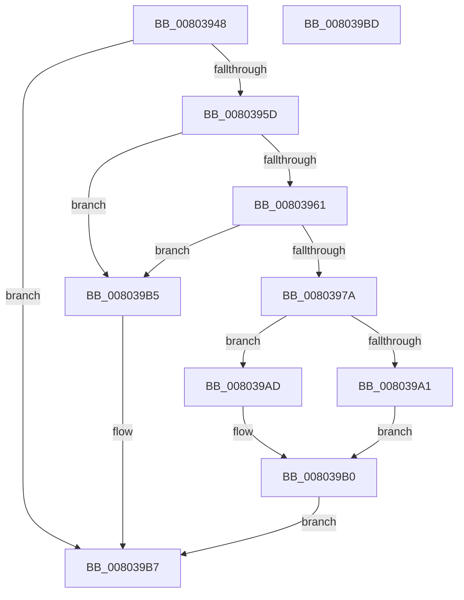

# MiGetProcessHotPatchContext

- RVA: `0x00803948`–`0x008039BE` (길이 `118` bytes)
- VA: `0x0000000140803948`
- 실행 섹션: `PAGE`
- PDB 이름 있음: `예`; PDB Function 태그: `아니요`
- unwind 정보 RVA: `0x0005CF00`
- 디코드: `37`개 명령, `118/118` bytes 표시
- 미해석 바이트: `0` (있으면 어셈블리에 `.byte`로 보존)

> 이 문서는 커널 이미지의 기계어와 PDB 기호를 분석해 생성했습니다. 4번과 5번은 함수 원형과 자료형을 바이너리 사용 방식에서 추정한 C 해석이며 원본 소스 복구 결과는 아닙니다.

## 1. Dependencies

- 직접 호출 지점: **2**; 고유 호출 대상: **2**
- 직접 호출자로 확인된 함수: **4**
- RIP 상대 이미지 참조: **0**

### Outgoing calls
- `0x0080396D` → [MiAllocatePool](../../text/35/MiAllocatePool_function_0035B540.md) (function, `0x0035B540`)
- `0x008039A6` → [ExFreePoolWithTag](../../poolcode/B8/ExFreePoolWithTag_function_00B82870.md) (function, `0x00B82870`)

### Direct callers
- [MiApplyImageHotPatchRequest](MiApplyImageHotPatchRequest_function_008025AC.md) at `0x00802C91`
- [MiDeleteHotPatchEntry](MiDeleteHotPatchEntry_function_008033C0.md) at `0x0080340F`
- [MiLogHotPatchRundown](MiLogHotPatchRundown_function_008057A4.md) at `0x00806057`
- [MiQueryProcessActivePatches](../AC/MiQueryProcessActivePatches_function_00AC6164.md) at `0x00AC63E3`

### Static image references
- 디코드된 RIP-relative 메모리 참조가 없습니다.

## 2. Other-region calls and transfers

- 다른 실행 섹션으로 향하는 call: **2**
  - `0x0080396D` → [MiAllocatePool](../../text/35/MiAllocatePool_function_0035B540.md) (`PAGE` → `.text`)
  - `0x008039A6` → [ExFreePoolWithTag](../../poolcode/B8/ExFreePoolWithTag_function_00B82870.md) (`PAGE` → `POOLCODE`)
- 별도 외부 분기/꼬리 이동을 확인하지 못했습니다.

## 3. Assembly (complete function range)

```asm
00803948  40 53                           push rbx
0080394A  48 83 EC 20                     sub rsp, 0x20
0080394E  48 8B 81 78 07 00 00            mov rax, qword ptr [rcx + 0x778]
00803955  48 8B D9                        mov rbx, rcx
00803958  48 85 C0                        test rax, rax
0080395B  75 5A                           jne 0x1408039b7
0080395D  85 D2                           test edx, edx
0080395F  74 54                           je 0x1408039b5
00803961  8D 50 28                        lea edx, [rax + 0x28]
00803964  41 B8 48 50 50 43               mov r8d, 0x43505048
0080396A  8D 48 40                        lea ecx, [rax + 0x40]
0080396D  E8 CE 7B B5 FF                  call 0x14035b540
00803972  4C 8B C0                        mov r8, rax
00803975  48 85 C0                        test rax, rax
00803978  74 3B                           je 0x1408039b5
0080397A  48 89 40 08                     mov qword ptr [rax + 8], rax
0080397E  48 8D 48 18                     lea rcx, [rax + 0x18]
00803982  48 89 00                        mov qword ptr [rax], rax
00803985  48 89 49 08                     mov qword ptr [rcx + 8], rcx
00803989  48 89 09                        mov qword ptr [rcx], rcx
0080398C  48 83 60 10 00                  and qword ptr [rax + 0x10], 0
00803991  33 C0                           xor eax, eax
00803993  F0 4C 0F B1 83 78 07 00 00      lock cmpxchg qword ptr [rbx + 0x778], r8
0080399C  48 8B D8                        mov rbx, rax
0080399F  74 0C                           je 0x1408039ad
008039A1  33 D2                           xor edx, edx
008039A3  49 8B C8                        mov rcx, r8
008039A6  E8 C5 EE 37 00                  call 0x140b82870
008039AB  EB 03                           jmp 0x1408039b0
008039AD  49 8B D8                        mov rbx, r8
008039B0  48 8B C3                        mov rax, rbx
008039B3  EB 02                           jmp 0x1408039b7
008039B5  33 C0                           xor eax, eax
008039B7  48 83 C4 20                     add rsp, 0x20
008039BB  5B                              pop rbx
008039BC  C3                              ret
008039BD  CC                              int3
```

## 4. C-style interpretation (structured pseudocode)

```c
__int64 __fastcall MiGetProcessHotPatchContext(__int64 a1, int a2)
{
    __int64 result;
    __int64 v_rsp;

    v_rsp = (v_rsp) - (32);
    if (*(unsigned __int64 *)(a1 + 1912) != 0) goto loc_008039B7;
    if (a2 == 0) goto loc_008039B5;
    result = MiAllocatePool(*(unsigned __int64 *)(a1 + 1912) + 64, *(unsigned __int64 *)(a1 + 1912) + 40, (unsigned int)(0x43505048ULL), a4);
    if (result == 0) goto loc_008039B5;
    *(unsigned __int64 *)(result + 8) = result;
    *(unsigned __int64 *)(result) = result;
    *(unsigned __int64 *)(result + 24 + 8) = result + 24;
    *(unsigned __int64 *)(result + 24) = result + 24;
    result = 0;
    if (condition_is_equal) goto loc_008039AD;
    a2 = 0;
    result = ExFreePoolWithTag(0, a2, result, a4);
    goto loc_008039B0;
loc_008039AD:
loc_008039B0:
    goto loc_008039B7;
loc_008039B5:
    result = 0;
loc_008039B7:
    v_rsp = (v_rsp) + (32);
    return result;
}
```

## 5. (Beta) C Style

```c
int64_t MiGetProcessHotPatchContext(void *Arg1, int32_t Arg2)
{
    uint8_t *arg1 = (uint8_t *)Arg1;

    int64_t result;
    int64_t local_rsp;

    local_rsp = (local_rsp) - (32);
    if (*(uint64_t *)(arg1 + 0x778) != 0) goto loc_008039B7;
    if (Arg2 == 0) goto loc_008039B5;
    result = MiAllocatePool(*(uint64_t *)(arg1 + 0x778) + 64, *(uint64_t *)(arg1 + 0x778) + 40, (uint32_t)(0x43505048ULL), a4);
    if (result == 0) goto loc_008039B5;
    *(uint64_t *)(result + 0x8) = result;
    *(uint64_t *)(result) = result;
    *(uint64_t *)(result + 0x18 + 0x8) = result + 24;
    *(uint64_t *)(result + 0x18) = result + 24;
    result = 0;
    if (condition_is_equal) goto loc_008039AD;
    Arg2 = 0;
    result = ExFreePoolWithTag(0, Arg2, result, a4);
    goto loc_008039B0;
loc_008039AD:
loc_008039B0:
    goto loc_008039B7;
loc_008039B5:
    result = 0;
loc_008039B7:
    local_rsp = (local_rsp) + (32);
    return result;
}
```

### 관측된 메모리 오프셋

구조체 형식이 확인되지 않은 접근은 인자 기준의 오프셋으로만 기록했습니다.

| 기준 인자 | 오프셋 표현 | 폭 (bit) | 접근 |
|---|---:|---:|---|
| `Arg1` | `+ 0x778` | `64` | `R` |

## 6. Execution-region graph

[열기: 2D/3D 그래프와 함수 탐색 컨트롤 패널](../../../control-panel.html?section=page&rva=0x00803948&view=graph)

- 2D 그래프는 위에서 아래로 흐르고, 3D 그래프는 빈 공간을 드래그해 회전합니다. Shift+드래그는 이동, 휠은 확대·축소, 함수 노드 선택은 대상 보고서 이동입니다.

### Static fallback


