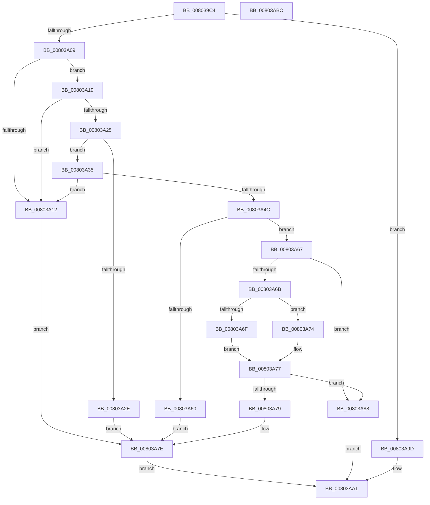

# MiGetVadForHotPatchInProgress

- RVA: `0x008039C4`–`0x00803ABD` (길이 `249` bytes)
- VA: `0x00000001408039C4`
- 실행 섹션: `PAGE`
- PDB 이름 있음: `예`; PDB Function 태그: `아니요`
- unwind 정보 RVA: `0x000BEF48`
- 디코드: `81`개 명령, `249/249` bytes 표시
- 미해석 바이트: `0` (있으면 어셈블리에 `.byte`로 보존)

> 이 문서는 커널 이미지의 기계어와 PDB 기호를 분석해 생성했습니다. 4번과 5번은 함수 원형과 자료형을 바이너리 사용 방식에서 추정한 C 해석이며 원본 소스 복구 결과는 아닙니다.

## 1. Dependencies

- 직접 호출 지점: **5**; 고유 호출 대상: **5**
- 직접 호출자로 확인된 함수: **2**
- RIP 상대 이미지 참조: **0**

### Outgoing calls
- `0x008039F8` → [MiObtainReferencedVadEx](../../text/31/MiObtainReferencedVadEx_function_00316690.md) (function, `0x00316690`)
- `0x00803A1C` → [MiVadDeleted](../../text/43/MiVadDeleted_function_00431350.md) (function, `0x00431350`)
- `0x00803A25` → [MiImageVadHotPatchEligible](MiImageVadHotPatchEligible_function_00803FB8.md) (function, `0x00803FB8`)
- `0x00803A81` → [MiUnlockAndDereferenceVad](../../text/31/MiUnlockAndDereferenceVad_function_00316E60.md) (function, `0x00316E60`)
- `0x00803A90` → [MiSetVadFlags](../../text/43/MiSetVadFlags_function_004311FC.md) (function, `0x004311FC`)

### Direct callers
- [MiApplyImageHotPatchRequest](MiApplyImageHotPatchRequest_function_008025AC.md) at `0x00802718`
- [MiApplyImageHotPatchRequest](MiApplyImageHotPatchRequest_function_008025AC.md) at `0x00802859`
- [MiCreatePatchSectionRequest](MiCreatePatchSectionRequest_function_008031E0.md) at `0x008032B9`

### Static image references
- 디코드된 RIP-relative 메모리 참조가 없습니다.

## 2. Other-region calls and transfers

- 다른 실행 섹션으로 향하는 call: **4**
  - `0x008039F8` → [MiObtainReferencedVadEx](../../text/31/MiObtainReferencedVadEx_function_00316690.md) (`PAGE` → `.text`)
  - `0x00803A1C` → [MiVadDeleted](../../text/43/MiVadDeleted_function_00431350.md) (`PAGE` → `.text`)
  - `0x00803A81` → [MiUnlockAndDereferenceVad](../../text/31/MiUnlockAndDereferenceVad_function_00316E60.md) (`PAGE` → `.text`)
  - `0x00803A90` → [MiSetVadFlags](../../text/43/MiSetVadFlags_function_004311FC.md) (`PAGE` → `.text`)
- 별도 외부 분기/꼬리 이동을 확인하지 못했습니다.

## 3. Assembly (complete function range)

```asm
008039C4  48 8B C4                        mov rax, rsp
008039C7  48 89 58 08                     mov qword ptr [rax + 8], rbx
008039CB  48 89 68 10                     mov qword ptr [rax + 0x10], rbp
008039CF  48 89 70 20                     mov qword ptr [rax + 0x20], rsi
008039D3  57                              push rdi
008039D4  41 56                           push r14
008039D6  41 57                           push r15
008039D8  48 83 EC 20                     sub rsp, 0x20
008039DC  33 DB                           xor ebx, ebx
008039DE  4D 8B F8                        mov r15, r8
008039E1  49 89 18                        mov qword ptr [r8], rbx
008039E4  8B EA                           mov ebp, edx
008039E6  4C 8D 40 18                     lea r8, [rax + 0x18]
008039EA  89 58 18                        mov dword ptr [rax + 0x18], ebx
008039ED  33 D2                           xor edx, edx
008039EF  41 89 19                        mov dword ptr [r9], ebx
008039F2  4D 8B F1                        mov r14, r9
008039F5  48 8B F1                        mov rsi, rcx
008039F8  E8 93 2C B1 FF                  call 0x140316690
008039FD  48 8B F8                        mov rdi, rax
00803A00  48 85 C0                        test rax, rax
00803A03  0F 84 94 00 00 00               je 0x140803a9d
00803A09  8B 40 30                        mov eax, dword ptr [rax + 0x30]
00803A0C  24 70                           and al, 0x70
00803A0E  3C 20                           cmp al, 0x20
00803A10  74 07                           je 0x140803a19
00803A12  BB 18 00 00 C0                  mov ebx, 0xc0000018
00803A17  EB 65                           jmp 0x140803a7e
00803A19  48 8B CF                        mov rcx, rdi
00803A1C  E8 2F D9 C2 FF                  call 0x140431350
00803A21  85 C0                           test eax, eax
00803A23  75 ED                           jne 0x140803a12
00803A25  E8 8E 05 00 00                  call 0x140803fb8
00803A2A  85 C0                           test eax, eax
00803A2C  75 07                           jne 0x140803a35
00803A2E  BB BB 00 00 C0                  mov ebx, 0xc00000bb
00803A33  EB 49                           jmp 0x140803a7e
00803A35  0F B6 4F 20                     movzx ecx, byte ptr [rdi + 0x20]
00803A39  8B 47 18                        mov eax, dword ptr [rdi + 0x18]
00803A3C  48 C1 E1 20                     shl rcx, 0x20
00803A40  48 0B C8                        or rcx, rax
00803A43  48 C1 E1 0C                     shl rcx, 0xc
00803A47  48 3B F1                        cmp rsi, rcx
00803A4A  75 C6                           jne 0x140803a12
00803A4C  8B 77 30                        mov esi, dword ptr [rdi + 0x30]
00803A4F  41 B8 01 00 00 00               mov r8d, 1
00803A55  C1 EE 17                        shr esi, 0x17
00803A58  83 E6 03                        and esi, 3
00803A5B  41 3B F0                        cmp esi, r8d
00803A5E  75 07                           jne 0x140803a67
00803A60  BB 76 04 00 C0                  mov ebx, 0xc0000476
00803A65  EB 17                           jmp 0x140803a7e
00803A67  85 F6                           test esi, esi
00803A69  74 1D                           je 0x140803a88
00803A6B  85 ED                           test ebp, ebp
00803A6D  75 05                           jne 0x140803a74
00803A6F  83 FE 02                        cmp esi, 2
00803A72  EB 03                           jmp 0x140803a77
00803A74  83 FE 03                        cmp esi, 3
00803A77  74 0F                           je 0x140803a88
00803A79  BB 03 A0 00 C0                  mov ebx, 0xc000a003
00803A7E  48 8B CF                        mov rcx, rdi
00803A81  E8 DA 33 B1 FF                  call 0x140316e60
00803A86  EB 19                           jmp 0x140803aa1
00803A88  BA 04 00 00 00                  mov edx, 4
00803A8D  48 8B CF                        mov rcx, rdi
00803A90  E8 67 D7 C2 FF                  call 0x1404311fc
00803A95  41 89 36                        mov dword ptr [r14], esi
00803A98  49 89 3F                        mov qword ptr [r15], rdi
00803A9B  EB 04                           jmp 0x140803aa1
00803A9D  8B 5C 24 50                     mov ebx, dword ptr [rsp + 0x50]
00803AA1  48 8B 6C 24 48                  mov rbp, qword ptr [rsp + 0x48]
00803AA6  8B C3                           mov eax, ebx
00803AA8  48 8B 5C 24 40                  mov rbx, qword ptr [rsp + 0x40]
00803AAD  48 8B 74 24 58                  mov rsi, qword ptr [rsp + 0x58]
00803AB2  48 83 C4 20                     add rsp, 0x20
00803AB6  41 5F                           pop r15
00803AB8  41 5E                           pop r14
00803ABA  5F                              pop rdi
00803ABB  C3                              ret
00803ABC  CC                              int3
```

## 4. C-style interpretation (structured pseudocode)

```c
__int64 __fastcall MiGetVadForHotPatchInProgress(__int64 a1, int a2, __int64 a3, __int64 a4)
{
    __int64 result;
    __int64 v_rbx;
    __int64 v_rsi;
    __int64 v_rsp;
    unsigned __int64 v_stack_p10;
    unsigned int v_stack_p18;
    unsigned __int64 v_stack_p20;
    unsigned __int64 v_stack_p8;

    *(unsigned __int64 *)(v_rsp + 8) = v_rbx;
    *(unsigned __int64 *)(v_rsp + 16) = v_rbp;
    *(unsigned __int64 *)(v_rsp + 32) = v_rsi;
    v_rsp = (v_rsp) - (32);
    v_rbx = 0;
    *(unsigned __int64 *)(a3) = 0;
    *(unsigned int *)(v_rsp + 24) = 0;
    a2 = 0;
    *(unsigned int *)(a4) = 0;
    result = MiObtainReferencedVadEx(a1, a2, v_rsp + 24, a4);
    if (result == 0) goto loc_00803A9D;
    result = (unsigned __int8)(((unsigned int)(*(unsigned int *)(result + 48))) & (112));
    if (((unsigned __int8)(result)) == 32) goto loc_00803A19;
loc_00803A12:
    goto loc_00803A7E;
loc_00803A19:
    result = MiVadDeleted(result, a2, v_rsp + 24, a4);
    if ((unsigned int)(result) != 0) goto loc_00803A12;
    result = MiImageVadHotPatchEligible(result, a2, v_rsp + 24, a4);
    if ((unsigned int)(result) != 0) goto loc_00803A35;
    goto loc_00803A7E;
loc_00803A35:
    a1 = (*(unsigned __int8 *)(result + 32)) << (32);
    a1 = (a1) | ((unsigned int)(*(unsigned int *)(result + 24)));
    a1 = (a1) << (12);
    if (a1 != a1) goto loc_00803A12;
    v_rsi = (unsigned int)(((unsigned int)(*(unsigned int *)(result + 48))) >> (23));
    v_rsi = (unsigned int)((v_rsi) & (3));
    if (((unsigned int)(v_rsi)) != 1) goto loc_00803A67;
    goto loc_00803A7E;
loc_00803A67:
    if ((unsigned int)(v_rsi) == 0) goto loc_00803A88;
    if ((unsigned int)((unsigned int)(a2)) != 0) goto loc_00803A74;
    goto loc_00803A77;
loc_00803A74:
loc_00803A77:
    if (((unsigned int)(v_rsi)) == 3) goto loc_00803A88;
loc_00803A7E:
    result = MiUnlockAndDereferenceVad(result, a2, 1, a4);
    goto loc_00803AA1;
loc_00803A88:
    result = MiSetVadFlags(result, 4, 1, a4);
    *(unsigned int *)(a4) = (unsigned int)(v_rsi);
    *(unsigned __int64 *)(a3) = result;
    goto loc_00803AA1;
loc_00803A9D:
loc_00803AA1:
    v_rsp = (v_rsp) + (32);
    return (unsigned int)((unsigned int)((unsigned int)(v_stack_p18)));
}
```

## 5. (Beta) C Style

```c
int64_t MiGetVadForHotPatchInProgress(int64_t Arg1, int32_t Arg2, void *Arg3, void *Arg4)
{
    uint8_t *arg3 = (uint8_t *)Arg3;
    uint8_t *arg4 = (uint8_t *)Arg4;

    int64_t result;
    int64_t local_rbx;
    int64_t local_rsi;
    int64_t local_rsp;
    uint64_t v_stack_p10;
    uint32_t v_stack_p18;
    uint64_t v_stack_p20;
    uint64_t v_stack_p8;

    *(uint64_t *)(local_rsp + 0x8) = local_rbx;
    *(uint64_t *)(local_rsp + 0x10) = local_rbp;
    *(uint64_t *)(local_rsp + 0x20) = local_rsi;
    local_rsp = (local_rsp) - (32);
    local_rbx = 0;
    *(uint64_t *)(arg3) = 0;
    *(uint32_t *)(local_rsp + 0x18) = 0;
    Arg2 = 0;
    *(uint32_t *)(arg4) = 0;
    result = MiObtainReferencedVadEx(Arg1, Arg2, local_rsp + 24, Arg4);
    if (result == 0) goto loc_00803A9D;
    result = (uint8_t)(((uint32_t)(*(uint32_t *)(result + 0x30))) & (112));
    if (((uint8_t)(result)) == 32) goto loc_00803A19;
loc_00803A12:
    goto loc_00803A7E;
loc_00803A19:
    result = MiVadDeleted(result, Arg2, local_rsp + 24, Arg4);
    if ((uint32_t)(result) != 0) goto loc_00803A12;
    result = MiImageVadHotPatchEligible(result, Arg2, local_rsp + 24, Arg4);
    if ((uint32_t)(result) != 0) goto loc_00803A35;
    goto loc_00803A7E;
loc_00803A35:
    Arg1 = (*(uint8_t *)(result + 0x20)) << (32);
    Arg1 = (Arg1) | ((uint32_t)(*(uint32_t *)(result + 0x18)));
    Arg1 = (Arg1) << (12);
    if (Arg1 != Arg1) goto loc_00803A12;
    local_rsi = (uint32_t)(((uint32_t)(*(uint32_t *)(result + 0x30))) >> (23));
    local_rsi = (uint32_t)((local_rsi) & (3));
    if (((uint32_t)(local_rsi)) != 1) goto loc_00803A67;
    goto loc_00803A7E;
loc_00803A67:
    if ((uint32_t)(local_rsi) == 0) goto loc_00803A88;
    if ((uint32_t)((uint32_t)(Arg2)) != 0) goto loc_00803A74;
    goto loc_00803A77;
loc_00803A74:
loc_00803A77:
    if (((uint32_t)(local_rsi)) == 3) goto loc_00803A88;
loc_00803A7E:
    result = MiUnlockAndDereferenceVad(result, Arg2, 1, Arg4);
    goto loc_00803AA1;
loc_00803A88:
    result = MiSetVadFlags(result, 4, 1, Arg4);
    *(uint32_t *)(arg4) = (uint32_t)(local_rsi);
    *(uint64_t *)(arg3) = result;
    goto loc_00803AA1;
loc_00803A9D:
loc_00803AA1:
    local_rsp = (local_rsp) + (32);
    return (uint32_t)((uint32_t)((uint32_t)(v_stack_p18)));
}
```

### 관측된 메모리 오프셋

구조체 형식이 확인되지 않은 접근은 인자 기준의 오프셋으로만 기록했습니다.

| 기준 인자 | 오프셋 표현 | 폭 (bit) | 접근 |
|---|---:|---:|---|
| `Arg3` | `+ 0x0` | `64` | `W` |
| `Arg4` | `+ 0x0` | `32` | `W` |

## 6. Execution-region graph

[열기: 2D/3D 그래프와 함수 탐색 컨트롤 패널](../../../control-panel.html?section=page&rva=0x008039C4&view=graph)

- 2D 그래프는 위에서 아래로 흐르고, 3D 그래프는 빈 공간을 드래그해 회전합니다. Shift+드래그는 이동, 휠은 확대·축소, 함수 노드 선택은 대상 보고서 이동입니다.

### Static fallback


