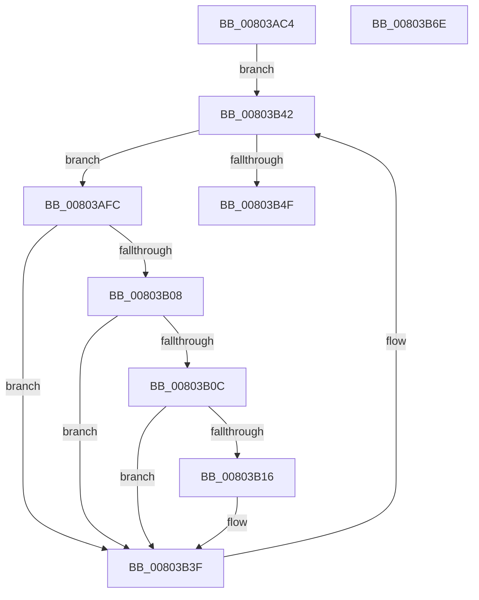

# MiHotPatchAllProcesses

- RVA: `0x00803AC4`–`0x00803B6F` (길이 `171` bytes)
- VA: `0x0000000140803AC4`
- 실행 섹션: `PAGE`
- PDB 이름 있음: `예`; PDB Function 태그: `아니요`
- unwind 정보 RVA: `0x000CCD10`
- 디코드: `51`개 명령, `171/171` bytes 표시
- 미해석 바이트: `0` (있으면 어셈블리에 `.byte`로 보존)

> 이 문서는 커널 이미지의 기계어와 PDB 기호를 분석해 생성했습니다. 4번과 5번은 함수 원형과 자료형을 바이너리 사용 방식에서 추정한 C 해석이며 원본 소스 복구 결과는 아닙니다.

## 1. Dependencies

- 직접 호출 지점: **5**; 고유 호출 대상: **5**
- 직접 호출자로 확인된 함수: **2**
- RIP 상대 이미지 참조: **1**

### Outgoing calls
- `0x00803B1E` → [KeStackAttachProcess](../../text/21/KeStackAttachProcess_function_00216800.md) (function, `0x00216800`)
- `0x00803B2E` → [MiHotPatchProcess](MiHotPatchProcess_function_00803B78.md) (function, `0x00803B78`)
- `0x00803B3A` → [KiUnstackDetachProcess](../../text/21/KiUnstackDetachProcess_function_00217D30.md) (function, `0x00217D30`)
- `0x00803B42` → [PsGetNextProcess](../91/PsGetNextProcess_function_0091C900.md) (function, `0x0091C900`)
- `0x00803B59` → [_security_check_cookie](../../text/6A/_security_check_cookie_function_006AC640.md) (function, `0x006AC640`)

### Direct callers
- [MiLoadHotPatchForUserSid](../AB/MiLoadHotPatchForUserSid_function_00AB4F08.md) at `0x00AB51A5`
- [MiLoadHotPatch](../AB/MiLoadHotPatch_function_00AB521C.md) at `0x00AB55A7`

### Static image references
- `0x00803AD0` → RVA `0x00E0A740` (`.data`; read)

## 2. Other-region calls and transfers

- 다른 실행 섹션으로 향하는 call: **3**
  - `0x00803B1E` → [KeStackAttachProcess](../../text/21/KeStackAttachProcess_function_00216800.md) (`PAGE` → `.text`)
  - `0x00803B3A` → [KiUnstackDetachProcess](../../text/21/KiUnstackDetachProcess_function_00217D30.md) (`PAGE` → `.text`)
  - `0x00803B59` → [_security_check_cookie](../../text/6A/_security_check_cookie_function_006AC640.md) (`PAGE` → `.text`)
- 별도 외부 분기/꼬리 이동을 확인하지 못했습니다.

## 3. Assembly (complete function range)

```asm
00803AC4  48 89 5C 24 20                  mov qword ptr [rsp + 0x20], rbx
00803AC9  55                              push rbp
00803ACA  56                              push rsi
00803ACB  57                              push rdi
00803ACC  48 83 EC 60                     sub rsp, 0x60
00803AD0  48 8B 05 69 6C 60 00            mov rax, qword ptr [rip + 0x606c69]
00803AD7  48 33 C4                        xor rax, rsp
00803ADA  48 89 44 24 50                  mov qword ptr [rsp + 0x50], rax
00803ADF  0F 57 C0                        xorps xmm0, xmm0
00803AE2  8B F1                           mov esi, ecx
00803AE4  0F 11 44 24 20                  movups xmmword ptr [rsp + 0x20], xmm0
00803AE9  41 8B D8                        mov ebx, r8d
00803AEC  8B EA                           mov ebp, edx
00803AEE  0F 11 44 24 30                  movups xmmword ptr [rsp + 0x30], xmm0
00803AF3  33 C9                           xor ecx, ecx
00803AF5  0F 11 44 24 40                  movups xmmword ptr [rsp + 0x40], xmm0
00803AFA  EB 46                           jmp 0x140803b42
00803AFC  8B 87 FC 05 00 00               mov eax, dword ptr [rdi + 0x5fc]
00803B02  0F BA E0 0C                     bt eax, 0xc
00803B06  72 37                           jb 0x140803b3f
00803B08  A8 01                           test al, 1
00803B0A  75 33                           jne 0x140803b3f
00803B0C  48 83 BF 40 06 00 00 00         cmp qword ptr [rdi + 0x640], 0
00803B14  75 29                           jne 0x140803b3f
00803B16  48 8D 54 24 20                  lea rdx, [rsp + 0x20]
00803B1B  48 8B CF                        mov rcx, rdi
00803B1E  E8 DD 2C A1 FF                  call 0x140216800
00803B23  44 8B CB                        mov r9d, ebx
00803B26  44 8B C5                        mov r8d, ebp
00803B29  8B D6                           mov edx, esi
00803B2B  48 8B CF                        mov rcx, rdi
00803B2E  E8 45 00 00 00                  call 0x140803b78
00803B33  33 D2                           xor edx, edx
00803B35  48 8D 4C 24 20                  lea rcx, [rsp + 0x20]
00803B3A  E8 F1 41 A1 FF                  call 0x140217d30
00803B3F  48 8B CF                        mov rcx, rdi
00803B42  E8 B9 8D 11 00                  call 0x14091c900
00803B47  48 8B F8                        mov rdi, rax
00803B4A  48 85 C0                        test rax, rax
00803B4D  75 AD                           jne 0x140803afc
00803B4F  33 C0                           xor eax, eax
00803B51  48 8B 4C 24 50                  mov rcx, qword ptr [rsp + 0x50]
00803B56  48 33 CC                        xor rcx, rsp
00803B59  E8 E2 8A EA FF                  call 0x1406ac640
00803B5E  48 8B 9C 24 98 00 00 00         mov rbx, qword ptr [rsp + 0x98]
00803B66  48 83 C4 60                     add rsp, 0x60
00803B6A  5F                              pop rdi
00803B6B  5E                              pop rsi
00803B6C  5D                              pop rbp
00803B6D  C3                              ret
00803B6E  CC                              int3
```

## 4. C-style interpretation (structured pseudocode)

```c
__int64 __fastcall MiHotPatchAllProcesses(int a1, int a2, int a3)
{
    __int64 result;
    __int64 v_rsp;
    unsigned __int64 v_stack_m28;
    unsigned __int64 v_stack_m38;
    unsigned __int64 v_stack_m48;
    unsigned __int64 v_stack_m58;
    unsigned __int64 v_stack_p20;

    v_stack_p20 = v_rbx;
    v_rsp = (v_rsp) - (96);
    result = (*(unsigned __int64 *)(v_rip + 6319209)) ^ (v_rsp);
    v_stack_m28 = result;
    v_stack_m58 = v_xmm0;
    v_stack_m48 = v_xmm0;
    a1 = 0;
    v_stack_m38 = v_xmm0;
    goto loc_00803B42;
loc_00803AFC:
    if (condition_is_below) goto loc_00803B3F;
    if ((((unsigned __int8)((unsigned int)(*(unsigned int *)(v_rdi + 1532)))) & (1)) != 0) goto loc_00803B3F;
    result = (unsigned int)(*(unsigned int *)(v_rdi + 1532));
    if ((*(unsigned __int64 *)(v_rdi + 1600)) == 0) {
        a2 = v_stack_m58;
        a1 = v_rdi;
        result = KeStackAttachProcess(a1, a2, a3, a4);
        a4 = (unsigned int)((unsigned int)(a3));
        a3 = (unsigned int)((unsigned int)(a2));
        a2 = (unsigned int)((unsigned int)(a1));
        a1 = v_rdi;
        result = MiHotPatchProcess(a1, a2, a3, a4);
        a2 = 0;
        a1 = v_stack_m58;
        result = KiUnstackDetachProcess(a1, a2, a3, a4);
    }
loc_00803B42:
    result = PsGetNextProcess(v_rdi, a2, a3, a4);
    if (result != 0) goto loc_00803AFC;
    result = 0;
    a1 = (v_stack_m28) ^ (v_rsp);
    result = _security_check_cookie(a1, a2, a3, a4);
    v_rsp = (v_rsp) + (96);
    return result;
}
```

## 5. (Beta) C Style

```c
int64_t MiHotPatchAllProcesses(int32_t Arg1, int32_t Arg2, int32_t Arg3)
{
    int64_t result;
    int64_t local_rsp;
    uint64_t v_stack_m28;
    uint64_t v_stack_m38;
    uint64_t v_stack_m48;
    uint64_t v_stack_m58;
    uint64_t v_stack_p20;

    v_stack_p20 = local_rbx;
    local_rsp = (local_rsp) - (96);
    result = (*(uint64_t *)(v_rip + 0x606C69)) ^ (local_rsp);
    v_stack_m28 = result;
    v_stack_m58 = v_xmm0;
    v_stack_m48 = v_xmm0;
    Arg1 = 0;
    v_stack_m38 = v_xmm0;
    goto loc_00803B42;
loc_00803AFC:
    if (condition_is_below) goto loc_00803B3F;
    if ((((uint8_t)((uint32_t)(*(uint32_t *)(local_rdi + 0x5FC)))) & (1)) != 0) goto loc_00803B3F;
    result = (uint32_t)(*(uint32_t *)(local_rdi + 0x5FC));
    if ((*(uint64_t *)(local_rdi + 0x640)) == 0) {
        Arg2 = v_stack_m58;
        Arg1 = local_rdi;
        result = KeStackAttachProcess(Arg1, Arg2, Arg3, a4);
        a4 = (uint32_t)((uint32_t)(Arg3));
        Arg3 = (uint32_t)((uint32_t)(Arg2));
        Arg2 = (uint32_t)((uint32_t)(Arg1));
        Arg1 = local_rdi;
        result = MiHotPatchProcess(Arg1, Arg2, Arg3, a4);
        Arg2 = 0;
        Arg1 = v_stack_m58;
        result = KiUnstackDetachProcess(Arg1, Arg2, Arg3, a4);
    }
loc_00803B42:
    result = PsGetNextProcess(local_rdi, Arg2, Arg3, a4);
    if (result != 0) goto loc_00803AFC;
    result = 0;
    Arg1 = (v_stack_m28) ^ (local_rsp);
    result = _security_check_cookie(Arg1, Arg2, Arg3, a4);
    local_rsp = (local_rsp) + (96);
    return result;
}
```

## 6. Execution-region graph

[열기: 2D/3D 그래프와 함수 탐색 컨트롤 패널](../../../control-panel.html?section=page&rva=0x00803AC4&view=graph)

- 2D 그래프는 위에서 아래로 흐르고, 3D 그래프는 빈 공간을 드래그해 회전합니다. Shift+드래그는 이동, 휠은 확대·축소, 함수 노드 선택은 대상 보고서 이동입니다.

### Static fallback


