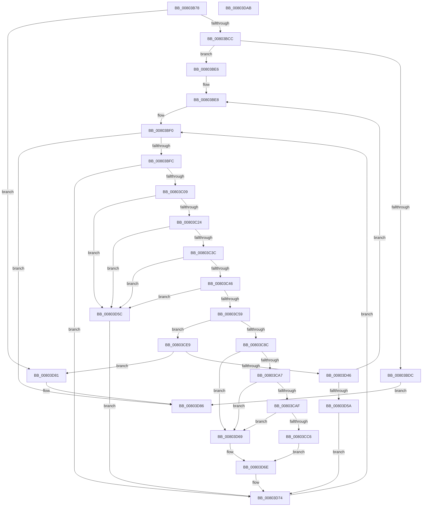

# MiHotPatchProcess

- RVA: `0x00803B78`–`0x00803DAC` (길이 `564` bytes)
- VA: `0x0000000140803B78`
- 실행 섹션: `PAGE`
- PDB 이름 있음: `예`; PDB Function 태그: `아니요`
- unwind 정보 RVA: `0x00099E84`
- 디코드: `147`개 명령, `564/564` bytes 표시
- 미해석 바이트: `0` (있으면 어셈블리에 `.byte`로 보존)

> 이 문서는 커널 이미지의 기계어와 PDB 기호를 분석해 생성했습니다. 4번과 5번은 함수 원형과 자료형을 바이너리 사용 방식에서 추정한 C 해석이며 원본 소스 복구 결과는 아닙니다.

## 1. Dependencies

- 직접 호출 지점: **20**; 고유 호출 대상: **14**
- 직접 호출자로 확인된 함수: **1**
- RIP 상대 이미지 참조: **1**

### Outgoing calls
- `0x00803BB9` → [LOCK_ADDRESS_SPACE_SHARED](../../text/2A/LOCK_ADDRESS_SPACE_SHARED_function_002A8B3C.md) (function, `0x002A8B3C`)
- `0x00803BEB` → [MiGetFirstVad](../../text/2A/MiGetFirstVad_function_002A8BBC.md) (function, `0x002A8BBC`)
- `0x00803C0F` → [MiLockVadShared](../../text/31/MiLockVadShared_function_00316DE0.md) (function, `0x00316DE0`)
- `0x00803C17` → [MiVadDeleted](../../text/43/MiVadDeleted_function_00431350.md) (function, `0x00431350`)
- `0x00803C4C` → [RtlIsPatchMachineApplicable](../84/RtlIsPatchMachineApplicable_function_00841194.md) (function, `0x00841194`)
- `0x00803C80` → [MiImageVadHotPatchEligibleEx](../../text/68/MiImageVadHotPatchEligibleEx_function_006836BC.md) (function, `0x006836BC`)
- `0x00803C92` → [MiUnlockVadShared](../../text/2E/MiUnlockVadShared_function_002E2420.md) (function, `0x002E2420`)
- `0x00803CB9` → [tlgKeywordOn](../../text/42/tlgKeywordOn_function_0042EAA0.md) (function, `0x0042EAA0`)
- `0x00803CDF` → [MiLogHotPatchOperationStatus](MiLogHotPatchOperationStatus_function_00804E84.md) (function, `0x00804E84`)
- `0x00803CEC` → [MiReferenceVad](../../text/29/MiReferenceVad_function_00295890.md) (function, `0x00295890`)
- `0x00803CF7` → [MiUnlockVadShared](../../text/2E/MiUnlockVadShared_function_002E2420.md) (function, `0x002E2420`)
- `0x00803D02` → [UNLOCK_ADDRESS_SPACE_SHARED](../../text/2A/UNLOCK_ADDRESS_SPACE_SHARED_function_002A8ACC.md) (function, `0x002A8ACC`)
- `0x00803D11` → [MiInjectThreadForHotPatch](MiInjectThreadForHotPatch_function_00803FD8.md) (function, `0x00803FD8`)
- `0x00803D1C` → [LOCK_ADDRESS_SPACE_SHARED](../../text/2A/LOCK_ADDRESS_SPACE_SHARED_function_002A8B3C.md) (function, `0x002A8B3C`)
- `0x00803D27` → [MiLockVadShared](../../text/31/MiLockVadShared_function_00316DE0.md) (function, `0x00316DE0`)
- `0x00803D2F` → [MiVadDeleted](../../text/43/MiVadDeleted_function_00431350.md) (function, `0x00431350`)
- `0x00803D37` → [MiUnlockAndDereferenceVadShared](../../text/2A/MiUnlockAndDereferenceVadShared_function_002AEF10.md) (function, `0x002AEF10`)
- `0x00803D62` → [MiUnlockVadShared](../../text/2E/MiUnlockVadShared_function_002E2420.md) (function, `0x002E2420`)
- `0x00803D77` → [MiGetNextVad](../../text/29/MiGetNextVad_function_00297224.md) (function, `0x00297224`)
- `0x00803D8C` → [UNLOCK_ADDRESS_SPACE_SHARED](../../text/2A/UNLOCK_ADDRESS_SPACE_SHARED_function_002A8ACC.md) (function, `0x002A8ACC`)

### Direct callers
- [MiHotPatchAllProcesses](MiHotPatchAllProcesses_function_00803AC4.md) at `0x00803B2E`

### Static image references
- `0x00803C97` → RVA `0x00E37618` (`.data`; read)

## 2. Other-region calls and transfers

- 다른 실행 섹션으로 향하는 call: **17**
  - `0x00803BB9` → [LOCK_ADDRESS_SPACE_SHARED](../../text/2A/LOCK_ADDRESS_SPACE_SHARED_function_002A8B3C.md) (`PAGE` → `.text`)
  - `0x00803BEB` → [MiGetFirstVad](../../text/2A/MiGetFirstVad_function_002A8BBC.md) (`PAGE` → `.text`)
  - `0x00803C0F` → [MiLockVadShared](../../text/31/MiLockVadShared_function_00316DE0.md) (`PAGE` → `.text`)
  - `0x00803C17` → [MiVadDeleted](../../text/43/MiVadDeleted_function_00431350.md) (`PAGE` → `.text`)
  - `0x00803C80` → [MiImageVadHotPatchEligibleEx](../../text/68/MiImageVadHotPatchEligibleEx_function_006836BC.md) (`PAGE` → `.text`)
  - `0x00803C92` → [MiUnlockVadShared](../../text/2E/MiUnlockVadShared_function_002E2420.md) (`PAGE` → `.text`)
  - `0x00803CB9` → [tlgKeywordOn](../../text/42/tlgKeywordOn_function_0042EAA0.md) (`PAGE` → `.text`)
  - `0x00803CEC` → [MiReferenceVad](../../text/29/MiReferenceVad_function_00295890.md) (`PAGE` → `.text`)
  - `0x00803CF7` → [MiUnlockVadShared](../../text/2E/MiUnlockVadShared_function_002E2420.md) (`PAGE` → `.text`)
  - `0x00803D02` → [UNLOCK_ADDRESS_SPACE_SHARED](../../text/2A/UNLOCK_ADDRESS_SPACE_SHARED_function_002A8ACC.md) (`PAGE` → `.text`)
  - `0x00803D1C` → [LOCK_ADDRESS_SPACE_SHARED](../../text/2A/LOCK_ADDRESS_SPACE_SHARED_function_002A8B3C.md) (`PAGE` → `.text`)
  - `0x00803D27` → [MiLockVadShared](../../text/31/MiLockVadShared_function_00316DE0.md) (`PAGE` → `.text`)
  - `0x00803D2F` → [MiVadDeleted](../../text/43/MiVadDeleted_function_00431350.md) (`PAGE` → `.text`)
  - `0x00803D37` → [MiUnlockAndDereferenceVadShared](../../text/2A/MiUnlockAndDereferenceVadShared_function_002AEF10.md) (`PAGE` → `.text`)
  - `0x00803D62` → [MiUnlockVadShared](../../text/2E/MiUnlockVadShared_function_002E2420.md) (`PAGE` → `.text`)
  - `0x00803D77` → [MiGetNextVad](../../text/29/MiGetNextVad_function_00297224.md) (`PAGE` → `.text`)
  - `0x00803D8C` → [UNLOCK_ADDRESS_SPACE_SHARED](../../text/2A/UNLOCK_ADDRESS_SPACE_SHARED_function_002A8ACC.md) (`PAGE` → `.text`)
- 별도 외부 분기/꼬리 이동을 확인하지 못했습니다.

## 3. Assembly (complete function range)

```asm
00803B78  48 89 5C 24 18                  mov qword ptr [rsp + 0x18], rbx
00803B7D  89 54 24 10                     mov dword ptr [rsp + 0x10], edx
00803B81  55                              push rbp
00803B82  56                              push rsi
00803B83  57                              push rdi
00803B84  41 54                           push r12
00803B86  41 55                           push r13
00803B88  41 56                           push r14
00803B8A  41 57                           push r15
00803B8C  48 83 EC 30                     sub rsp, 0x30
00803B90  65 4C 8B 34 25 88 01 00 00      mov r14, qword ptr gs:[0x188]
00803B99  44 8B FA                        mov r15d, edx
00803B9C  44 0F B7 A9 EC 06 00 00         movzx r13d, word ptr [rcx + 0x6ec]
00803BA4  48 8B D1                        mov rdx, rcx
00803BA7  48 8B E9                        mov rbp, rcx
00803BAA  66 44 89 6C 24 70               mov word ptr [rsp + 0x70], r13w
00803BB0  49 8B CE                        mov rcx, r14
00803BB3  41 8B D9                        mov ebx, r9d
00803BB6  45 8B E0                        mov r12d, r8d
00803BB9  E8 7E 4F AA FF                  call 0x1402a8b3c
00803BBE  8B 85 F4 01 00 00               mov eax, dword ptr [rbp + 0x1f4]
00803BC4  A8 20                           test al, 0x20
00803BC6  0F 85 B5 01 00 00               jne 0x140803d81
00803BCC  48 8B 85 10 04 00 00            mov rax, qword ptr [rbp + 0x410]
00803BD3  F6 80 25 04 00 00 02            test byte ptr [rax + 0x425], 2
00803BDA  74 0A                           je 0x140803be6
00803BDC  BF BB 00 00 C0                  mov edi, 0xc00000bb
00803BE1  E9 A0 01 00 00                  jmp 0x140803d86
00803BE6  33 FF                           xor edi, edi
00803BE8  48 8B CD                        mov rcx, rbp
00803BEB  E8 CC 4F AA FF                  call 0x1402a8bbc
00803BF0  48 8B F0                        mov rsi, rax
00803BF3  48 85 C0                        test rax, rax
00803BF6  0F 84 8A 01 00 00               je 0x140803d86
00803BFC  8B 40 30                        mov eax, dword ptr [rax + 0x30]
00803BFF  24 70                           and al, 0x70
00803C01  3C 20                           cmp al, 0x20
00803C03  0F 85 6B 01 00 00               jne 0x140803d74
00803C09  48 8B D6                        mov rdx, rsi
00803C0C  49 8B CE                        mov rcx, r14
00803C0F  E8 CC 31 B1 FF                  call 0x140316de0
00803C14  48 8B CE                        mov rcx, rsi
00803C17  E8 34 D7 C2 FF                  call 0x140431350
00803C1C  85 C0                           test eax, eax
00803C1E  0F 85 38 01 00 00               jne 0x140803d5c
00803C24  48 8B 46 48                     mov rax, qword ptr [rsi + 0x48]
00803C28  48 8B 08                        mov rcx, qword ptr [rax]
00803C2B  4C 8B 01                        mov r8, qword ptr [rcx]
00803C2E  49 8B 40 38                     mov rax, qword ptr [r8 + 0x38]
00803C32  44 39 78 3C                     cmp dword ptr [rax + 0x3c], r15d
00803C36  0F 85 20 01 00 00               jne 0x140803d5c
00803C3C  44 39 60 48                     cmp dword ptr [rax + 0x48], r12d
00803C40  0F 85 16 01 00 00               jne 0x140803d5c
00803C46  41 0F B7 CD                     movzx ecx, r13w
00803C4A  8B D3                           mov edx, ebx
00803C4C  E8 43 D5 03 00                  call 0x140841194
00803C51  84 C0                           test al, al
00803C53  0F 84 03 01 00 00               je 0x140803d5c
00803C59  8B 46 18                        mov eax, dword ptr [rsi + 0x18]
00803C5C  44 0F B6 7E 20                  movzx r15d, byte ptr [rsi + 0x20]
00803C61  49 C1 E7 20                     shl r15, 0x20
00803C65  4C 0B F8                        or r15, rax
00803C68  49 C1 E7 0C                     shl r15, 0xc
00803C6C  48 83 C9 FF                     or rcx, 0xffffffffffffffff
00803C70  48 8B C1                        mov rax, rcx
00803C73  F0 49 0F B1 48 18               lock cmpxchg qword ptr [r8 + 0x18], rcx
00803C79  41 8A 40 0F                     mov al, byte ptr [r8 + 0xf]
00803C7D  48 8B CE                        mov rcx, rsi
00803C80  E8 37 FA E7 FF                  call 0x1406836bc
00803C85  44 8B E8                        mov r13d, eax
00803C88  85 C0                           test eax, eax
00803C8A  74 5D                           je 0x140803ce9
00803C8C  48 8B D6                        mov rdx, rsi
00803C8F  49 8B CE                        mov rcx, r14
00803C92  E8 89 E7 AD FF                  call 0x1402e2420
00803C97  48 8B 0D 7A 39 63 00            mov rcx, qword ptr [rip + 0x63397a]
00803C9E  48 85 C9                        test rcx, rcx
00803CA1  0F 84 C2 00 00 00               je 0x140803d69
00803CA7  39 39                           cmp dword ptr [rcx], edi
00803CA9  0F 86 BA 00 00 00               jbe 0x140803d69
00803CAF  48 BA 20 00 00 00 00 40 00 00   movabs rdx, 0x400000000020
00803CB9  E8 E2 AD C2 FF                  call 0x14042eaa0
00803CBE  84 C0                           test al, al
00803CC0  0F 84 A3 00 00 00               je 0x140803d69
00803CC6  4D 8B C7                        mov r8, r15
00803CC9  C7 44 24 20 08 00 00 00         mov dword ptr [rsp + 0x20], 8
00803CD1  44 8B 7C 24 78                  mov r15d, dword ptr [rsp + 0x78]
00803CD6  45 8B CD                        mov r9d, r13d
00803CD9  41 8B CF                        mov ecx, r15d
00803CDC  41 8B D4                        mov edx, r12d
00803CDF  E8 A0 11 00 00                  call 0x140804e84
00803CE4  E9 85 00 00 00                  jmp 0x140803d6e
00803CE9  48 8B CE                        mov rcx, rsi
00803CEC  E8 9F 1B A9 FF                  call 0x140295890
00803CF1  49 8B CE                        mov rcx, r14
00803CF4  48 8B D6                        mov rdx, rsi
00803CF7  E8 24 E7 AD FF                  call 0x1402e2420
00803CFC  48 8B D5                        mov rdx, rbp
00803CFF  49 8B CE                        mov rcx, r14
00803D02  E8 C5 4D AA FF                  call 0x1402a8acc
00803D07  8B 54 24 78                     mov edx, dword ptr [rsp + 0x78]
00803D0B  45 8B C4                        mov r8d, r12d
00803D0E  49 8B CF                        mov rcx, r15
00803D11  E8 C2 02 00 00                  call 0x140803fd8
00803D16  48 8B D5                        mov rdx, rbp
00803D19  49 8B CE                        mov rcx, r14
00803D1C  E8 1B 4E AA FF                  call 0x1402a8b3c
00803D21  48 8B D6                        mov rdx, rsi
00803D24  49 8B CE                        mov rcx, r14
00803D27  E8 B4 30 B1 FF                  call 0x140316de0
00803D2C  48 8B CE                        mov rcx, rsi
00803D2F  E8 1C D6 C2 FF                  call 0x140431350
00803D34  44 8B F8                        mov r15d, eax
00803D37  E8 D4 B1 AA FF                  call 0x1402aef10
00803D3C  8B 85 F4 01 00 00               mov eax, dword ptr [rbp + 0x1f4]
00803D42  A8 20                           test al, 0x20
00803D44  75 3B                           jne 0x140803d81
00803D46  44 0F B7 6C 24 70               movzx r13d, word ptr [rsp + 0x70]
00803D4C  45 85 FF                        test r15d, r15d
00803D4F  44 8B 7C 24 78                  mov r15d, dword ptr [rsp + 0x78]
00803D54  0F 85 8E FE FF FF               jne 0x140803be8
00803D5A  EB 18                           jmp 0x140803d74
00803D5C  48 8B D6                        mov rdx, rsi
00803D5F  49 8B CE                        mov rcx, r14
00803D62  E8 B9 E6 AD FF                  call 0x1402e2420
00803D67  EB 0B                           jmp 0x140803d74
00803D69  44 8B 7C 24 78                  mov r15d, dword ptr [rsp + 0x78]
00803D6E  44 0F B7 6C 24 70               movzx r13d, word ptr [rsp + 0x70]
00803D74  48 8B CE                        mov rcx, rsi
00803D77  E8 A8 34 A9 FF                  call 0x140297224
00803D7C  E9 6F FE FF FF                  jmp 0x140803bf0
00803D81  BF 0A 01 00 C0                  mov edi, 0xc000010a
00803D86  48 8B D5                        mov rdx, rbp
00803D89  49 8B CE                        mov rcx, r14
00803D8C  E8 3B 4D AA FF                  call 0x1402a8acc
00803D91  48 8B 9C 24 80 00 00 00         mov rbx, qword ptr [rsp + 0x80]
00803D99  8B C7                           mov eax, edi
00803D9B  48 83 C4 30                     add rsp, 0x30
00803D9F  41 5F                           pop r15
00803DA1  41 5E                           pop r14
00803DA3  41 5D                           pop r13
00803DA5  41 5C                           pop r12
00803DA7  5F                              pop rdi
00803DA8  5E                              pop rsi
00803DA9  5D                              pop rbp
00803DAA  C3                              ret
00803DAB  CC                              int3
```

## 4. C-style interpretation (structured pseudocode)

```c
__int64 __fastcall MiHotPatchProcess(__int64 a1, int a2, int a3, int a4)
{
    __int64 result;
    __int64 v_r15;
    __int64 v_rdi;
    __int64 v_rsp;
    unsigned int v_stack_m48;
    unsigned int v_stack_p10;
    unsigned __int64 v_stack_p18;
    unsigned __int16 v_stack_p8;

    v_stack_p18 = v_rbx;
    v_stack_p10 = a2;
    v_rsp = (v_rsp) - (48);
    v_stack_p8 = (unsigned __int16)(*(unsigned __int16 *)(a1 + 1772));
    result = LOCK_ADDRESS_SPACE_SHARED(*(unsigned __int64 *)(gs_base + (0 + 392)), a1, a3, a4);
    if ((((unsigned __int8)((unsigned int)(*(unsigned int *)(a1 + 500)))) & (32)) != 0) goto loc_00803D81;
    if (((*(unsigned __int8 *)(*(unsigned __int64 *)(a1 + 1040) + 1061)) & (2)) == 0) goto loc_00803BE6;
    goto loc_00803D86;
loc_00803BE6:
    v_rdi = 0;
loc_00803BE8:
    result = MiGetFirstVad(a1, a1, a3, a4);
loc_00803BF0:
    if (result == 0) goto loc_00803D86;
    result = (unsigned __int8)(((unsigned int)(*(unsigned int *)(result + 48))) & (112));
    if (((unsigned __int8)(result)) != 32) goto loc_00803D74;
    result = MiLockVadShared(*(unsigned __int64 *)(gs_base + (0 + 392)), result, a3, a4);
    result = MiVadDeleted(result, result, a3, a4);
    if ((unsigned int)(result) != 0) goto loc_00803D5C;
    if ((*(unsigned int *)(*(unsigned __int64 *)(*(unsigned __int64 *)(*(unsigned __int64 *)(*(unsigned __int64 *)(result + 72))) + 56) + 60)) != ((unsigned int)((unsigned int)(a2)))) goto loc_00803D5C;
    if ((*(unsigned int *)(*(unsigned __int64 *)(*(unsigned __int64 *)(*(unsigned __int64 *)(*(unsigned __int64 *)(result + 72))) + 56) + 72)) != ((unsigned int)((unsigned int)(a3)))) goto loc_00803D5C;
    result = RtlIsPatchMachineApplicable((unsigned __int16)(*(unsigned __int16 *)(a1 + 1772)), (unsigned int)((unsigned int)((unsigned int)(a4))), *(unsigned __int64 *)(*(unsigned __int64 *)(*(unsigned __int64 *)(result + 72))), a4);
    if ((unsigned __int8)(result) == 0) goto loc_00803D5C;
    v_r15 = (*(unsigned __int8 *)(result + 32)) << (32);
    v_r15 = (v_r15) | ((unsigned int)(*(unsigned int *)(result + 24)));
    v_r15 = (v_r15) << (12);
    a1 = ((unsigned __int16)(*(unsigned __int16 *)(a1 + 1772))) | (-1);
    result = MiImageVadHotPatchEligibleEx(result, (unsigned int)((unsigned int)((unsigned int)(a4))), *(unsigned __int64 *)(*(unsigned __int64 *)(*(unsigned __int64 *)(result + 72))), a4);
    if ((unsigned int)(result) == 0) goto loc_00803CE9;
    result = MiUnlockVadShared(*(unsigned __int64 *)(gs_base + (0 + 392)), result, *(unsigned __int64 *)(*(unsigned __int64 *)(*(unsigned __int64 *)(result + 72))), a4);
    if (*(unsigned __int64 *)(v_rip + 6502778) == 0) goto loc_00803D69;
    if ((*(unsigned int *)(*(unsigned __int64 *)(v_rip + 6502778))) <= 0) goto loc_00803D69;
    result = tlgKeywordOn(*(unsigned __int64 *)(v_rip + 6502778), result, *(unsigned __int64 *)(*(unsigned __int64 *)(*(unsigned __int64 *)(result + 72))), a4);
    if ((unsigned __int8)(result) == 0) goto loc_00803D69;
    v_stack_m48 = 8;
    result = MiLogHotPatchOperationStatus((unsigned int)((unsigned int)((unsigned int)(v_stack_p10))), (unsigned int)((unsigned int)((unsigned int)(a3))), v_r15, (unsigned int)((unsigned int)((unsigned int)((unsigned int)(result)))));
    goto loc_00803D6E;
loc_00803CE9:
    result = MiReferenceVad(result, (unsigned int)((unsigned int)((unsigned int)(a3))), v_r15, (unsigned int)((unsigned int)((unsigned int)((unsigned int)(result)))));
    result = MiUnlockVadShared(*(unsigned __int64 *)(gs_base + (0 + 392)), result, v_r15, (unsigned int)((unsigned int)((unsigned int)((unsigned int)(result)))));
    result = UNLOCK_ADDRESS_SPACE_SHARED(*(unsigned __int64 *)(gs_base + (0 + 392)), a1, v_r15, (unsigned int)((unsigned int)((unsigned int)((unsigned int)(result)))));
    result = MiInjectThreadForHotPatch((unsigned int)(v_stack_p10), (unsigned int)(v_stack_p10), (unsigned int)((unsigned int)((unsigned int)(a3))), (unsigned int)((unsigned int)((unsigned int)((unsigned int)(result)))));
    result = LOCK_ADDRESS_SPACE_SHARED(*(unsigned __int64 *)(gs_base + (0 + 392)), a1, (unsigned int)((unsigned int)((unsigned int)(a3))), (unsigned int)((unsigned int)((unsigned int)((unsigned int)(result)))));
    result = MiLockVadShared(*(unsigned __int64 *)(gs_base + (0 + 392)), result, (unsigned int)((unsigned int)((unsigned int)(a3))), (unsigned int)((unsigned int)((unsigned int)((unsigned int)(result)))));
    result = MiVadDeleted(result, result, (unsigned int)((unsigned int)((unsigned int)(a3))), (unsigned int)((unsigned int)((unsigned int)((unsigned int)(result)))));
    result = MiUnlockAndDereferenceVadShared(result, result, (unsigned int)((unsigned int)((unsigned int)(a3))), (unsigned int)((unsigned int)((unsigned int)((unsigned int)(result)))));
    if ((((unsigned __int8)((unsigned int)(*(unsigned int *)(a1 + 500)))) & (32)) != 0) goto loc_00803D81;
    if ((unsigned int)((unsigned int)((unsigned int)(result))) != 0) goto loc_00803BE8;
    goto loc_00803D74;
loc_00803D5C:
    result = MiUnlockVadShared(*(unsigned __int64 *)(gs_base + (0 + 392)), result, (unsigned int)((unsigned int)((unsigned int)(a3))), (unsigned int)((unsigned int)((unsigned int)((unsigned int)(result)))));
    goto loc_00803D74;
loc_00803D69:
loc_00803D6E:
loc_00803D74:
    result = MiGetNextVad(result, result, (unsigned int)((unsigned int)((unsigned int)(a3))), (unsigned int)((unsigned int)((unsigned int)((unsigned int)(result)))));
    goto loc_00803BF0;
loc_00803D81:
loc_00803D86:
    result = UNLOCK_ADDRESS_SPACE_SHARED(*(unsigned __int64 *)(gs_base + (0 + 392)), a1, (unsigned int)((unsigned int)((unsigned int)(a3))), (unsigned int)((unsigned int)((unsigned int)((unsigned int)(result)))));
    v_rsp = (v_rsp) + (48);
    return (unsigned int)((unsigned int)((unsigned int)(0xC000010AULL)));
}
```

## 5. (Beta) C Style

```c
int64_t MiHotPatchProcess(void *Arg1, int32_t Arg2, int32_t Arg3, int32_t Arg4)
{
    uint8_t *arg1 = (uint8_t *)Arg1;

    int64_t result;
    int64_t local_r15;
    int64_t local_rdi;
    int64_t local_rsp;
    uint32_t v_stack_m48;
    uint32_t v_stack_p10;
    uint64_t v_stack_p18;
    uint16_t v_stack_p8;

    v_stack_p18 = local_rbx;
    v_stack_p10 = Arg2;
    local_rsp = (local_rsp) - (48);
    v_stack_p8 = (uint16_t)(*(uint16_t *)(arg1 + 0x6EC));
    result = LOCK_ADDRESS_SPACE_SHARED(*(uint64_t *)(gs_base + (0 + 0x188)), Arg1, Arg3, Arg4);
    if ((((uint8_t)((uint32_t)(*(uint32_t *)(arg1 + 0x1F4)))) & (32)) != 0) goto loc_00803D81;
    if (((*(uint8_t *)(*(uint64_t *)(arg1 + 0x410) + 0x425)) & (2)) == 0) goto loc_00803BE6;
    goto loc_00803D86;
loc_00803BE6:
    local_rdi = 0;
loc_00803BE8:
    result = MiGetFirstVad(Arg1, Arg1, Arg3, Arg4);
loc_00803BF0:
    if (result == 0) goto loc_00803D86;
    result = (uint8_t)(((uint32_t)(*(uint32_t *)(result + 0x30))) & (112));
    if (((uint8_t)(result)) != 32) goto loc_00803D74;
    result = MiLockVadShared(*(uint64_t *)(gs_base + (0 + 0x188)), result, Arg3, Arg4);
    result = MiVadDeleted(result, result, Arg3, Arg4);
    if ((uint32_t)(result) != 0) goto loc_00803D5C;
    if ((*(uint32_t *)(*(uint64_t *)(*(uint64_t *)(*(uint64_t *)(*(uint64_t *)(result + 0x48))) + 0x38) + 0x3C)) != ((uint32_t)((uint32_t)(Arg2)))) goto loc_00803D5C;
    if ((*(uint32_t *)(*(uint64_t *)(*(uint64_t *)(*(uint64_t *)(*(uint64_t *)(result + 0x48))) + 0x38) + 0x48)) != ((uint32_t)((uint32_t)(Arg3)))) goto loc_00803D5C;
    result = RtlIsPatchMachineApplicable((uint16_t)(*(uint16_t *)(arg1 + 0x6EC)), (uint32_t)((uint32_t)((uint32_t)(Arg4))), *(uint64_t *)(*(uint64_t *)(*(uint64_t *)(result + 0x48))), Arg4);
    if ((uint8_t)(result) == 0) goto loc_00803D5C;
    local_r15 = (*(uint8_t *)(result + 0x20)) << (32);
    local_r15 = (local_r15) | ((uint32_t)(*(uint32_t *)(result + 0x18)));
    local_r15 = (local_r15) << (12);
    Arg1 = ((uint16_t)(*(uint16_t *)(arg1 + 0x6EC))) | (-1);
    result = MiImageVadHotPatchEligibleEx(result, (uint32_t)((uint32_t)((uint32_t)(Arg4))), *(uint64_t *)(*(uint64_t *)(*(uint64_t *)(result + 0x48))), Arg4);
    if ((uint32_t)(result) == 0) goto loc_00803CE9;
    result = MiUnlockVadShared(*(uint64_t *)(gs_base + (0 + 0x188)), result, *(uint64_t *)(*(uint64_t *)(*(uint64_t *)(result + 0x48))), Arg4);
    if (*(uint64_t *)(v_rip + 0x63397A) == 0) goto loc_00803D69;
    if ((*(uint32_t *)(*(uint64_t *)(v_rip + 0x63397A))) <= 0) goto loc_00803D69;
    result = tlgKeywordOn(*(uint64_t *)(v_rip + 0x63397A), result, *(uint64_t *)(*(uint64_t *)(*(uint64_t *)(result + 0x48))), Arg4);
    if ((uint8_t)(result) == 0) goto loc_00803D69;
    v_stack_m48 = 8;
    result = MiLogHotPatchOperationStatus((uint32_t)((uint32_t)((uint32_t)(v_stack_p10))), (uint32_t)((uint32_t)((uint32_t)(Arg3))), local_r15, (uint32_t)((uint32_t)((uint32_t)((uint32_t)(result)))));
    goto loc_00803D6E;
loc_00803CE9:
    result = MiReferenceVad(result, (uint32_t)((uint32_t)((uint32_t)(Arg3))), local_r15, (uint32_t)((uint32_t)((uint32_t)((uint32_t)(result)))));
    result = MiUnlockVadShared(*(uint64_t *)(gs_base + (0 + 0x188)), result, local_r15, (uint32_t)((uint32_t)((uint32_t)((uint32_t)(result)))));
    result = UNLOCK_ADDRESS_SPACE_SHARED(*(uint64_t *)(gs_base + (0 + 0x188)), Arg1, local_r15, (uint32_t)((uint32_t)((uint32_t)((uint32_t)(result)))));
    result = MiInjectThreadForHotPatch((uint32_t)(v_stack_p10), (uint32_t)(v_stack_p10), (uint32_t)((uint32_t)((uint32_t)(Arg3))), (uint32_t)((uint32_t)((uint32_t)((uint32_t)(result)))));
    result = LOCK_ADDRESS_SPACE_SHARED(*(uint64_t *)(gs_base + (0 + 0x188)), Arg1, (uint32_t)((uint32_t)((uint32_t)(Arg3))), (uint32_t)((uint32_t)((uint32_t)((uint32_t)(result)))));
    result = MiLockVadShared(*(uint64_t *)(gs_base + (0 + 0x188)), result, (uint32_t)((uint32_t)((uint32_t)(Arg3))), (uint32_t)((uint32_t)((uint32_t)((uint32_t)(result)))));
    result = MiVadDeleted(result, result, (uint32_t)((uint32_t)((uint32_t)(Arg3))), (uint32_t)((uint32_t)((uint32_t)((uint32_t)(result)))));
    result = MiUnlockAndDereferenceVadShared(result, result, (uint32_t)((uint32_t)((uint32_t)(Arg3))), (uint32_t)((uint32_t)((uint32_t)((uint32_t)(result)))));
    if ((((uint8_t)((uint32_t)(*(uint32_t *)(arg1 + 0x1F4)))) & (32)) != 0) goto loc_00803D81;
    if ((uint32_t)((uint32_t)((uint32_t)(result))) != 0) goto loc_00803BE8;
    goto loc_00803D74;
loc_00803D5C:
    result = MiUnlockVadShared(*(uint64_t *)(gs_base + (0 + 0x188)), result, (uint32_t)((uint32_t)((uint32_t)(Arg3))), (uint32_t)((uint32_t)((uint32_t)((uint32_t)(result)))));
    goto loc_00803D74;
loc_00803D69:
loc_00803D6E:
loc_00803D74:
    result = MiGetNextVad(result, result, (uint32_t)((uint32_t)((uint32_t)(Arg3))), (uint32_t)((uint32_t)((uint32_t)((uint32_t)(result)))));
    goto loc_00803BF0;
loc_00803D81:
loc_00803D86:
    result = UNLOCK_ADDRESS_SPACE_SHARED(*(uint64_t *)(gs_base + (0 + 0x188)), Arg1, (uint32_t)((uint32_t)((uint32_t)(Arg3))), (uint32_t)((uint32_t)((uint32_t)((uint32_t)(result)))));
    local_rsp = (local_rsp) + (48);
    return (uint32_t)((uint32_t)((uint32_t)(0xC000010AULL)));
}
```

### 관측된 메모리 오프셋

구조체 형식이 확인되지 않은 접근은 인자 기준의 오프셋으로만 기록했습니다.

| 기준 인자 | 오프셋 표현 | 폭 (bit) | 접근 |
|---|---:|---:|---|
| `Arg1` | `+ 0x1F4` | `32` | `R` |
| `Arg1` | `+ 0x410` | `64` | `R` |
| `Arg1` | `+ 0x6EC` | `16` | `R` |

## 6. Execution-region graph

[열기: 2D/3D 그래프와 함수 탐색 컨트롤 패널](../../../control-panel.html?section=page&rva=0x00803B78&view=graph)

- 2D 그래프는 위에서 아래로 흐르고, 3D 그래프는 빈 공간을 드래그해 회전합니다. Shift+드래그는 이동, 휠은 확대·축소, 함수 노드 선택은 대상 보고서 이동입니다.

### Static fallback


